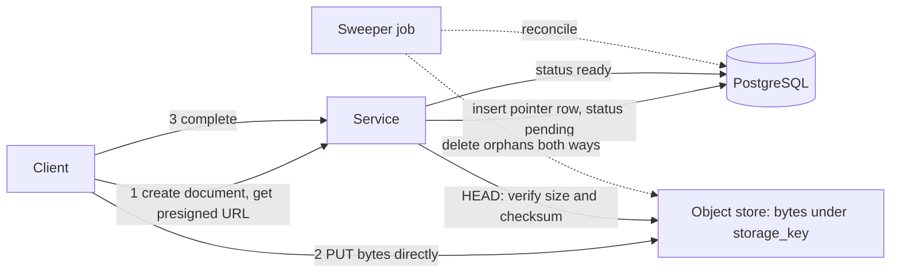

# Blob Storage

> [!abstract] In one sentence
> "Blob storage" names both a data shape (Binary Large OBject: bytes the database does not interpret) and a product category (Azure Blob Storage, which is an [[Object Storage|object store]]), and the design decision behind it is whether blob bytes belong inside your transactional database, on a shared file system or in an object store — with the answer almost always "a pointer in the database, the bytes elsewhere".

> [!tip] Deeper treatment in your system-design vault
> `system-design/07 NoSQL and Storage Engines/How S3 Works.md` — read it *after* you have written your own explanation below.

**Map:** [[Storage & Search MOC]] → [[HLD MOC]]

## Definition

A **blob** is a variable-length binary value that the storage system treats as opaque: it is neither indexed nor interpreted, only stored and returned whole (or by byte range). Relational databases expose blob columns (`BYTEA` and large objects in PostgreSQL, `BLOB`/`LONGBLOB` in MySQL, `VARBINARY(MAX)` in SQL Server); document stores have equivalents (MongoDB's 16 MB document limit and GridFS for larger). **Blob storage** as a product — Azure Blob Storage, and loosely S3 and GCS — is object storage: a flat namespace of immutable blobs behind HTTP, covered in detail in [[Object Storage]]. This note is about the decision: where should large binary data live relative to the structured data that references it?

## Problem solved

Applications accumulate binary payloads — uploaded documents, images, generated reports, signed contracts, archives — that are large, written once, rarely updated and read by identity. Storing them in the transactional database is the path of least resistance (one store, one backup, one transaction) and it works until it does not: table and backup sizes balloon far beyond the structured data, replication streams carry megabytes per row change, the buffer cache fills with bytes nobody queries, `VACUUM` and index maintenance slow, and every full backup copies gigabytes of static PDFs again. Storing them on a local disk works until the second application instance needs them. The pattern that resolves this — a small **pointer** (key, size, content type, checksum) in the database and the bytes in an object store — keeps the database small and fast, lets the bytes get cheap durability and CDN delivery, and makes the choice of where bytes live independent of the schema ([[Data Modeling]]).

## How it works

1. **Classify by size and access.** Below roughly a few hundred kilobytes, a database column is often fine and simpler: the blob is read with the row, participates in the transaction, and is backed up with everything else. Above that — and certainly for megabytes — the costs in the "problem solved" section dominate. The threshold is workload-dependent; the mechanism costs (buffer cache, WAL volume, backup size) are what you measure.
2. **Pointer row.** A table such as `documents(id, owner_id, storage_key, content_type, size_bytes, sha256, created_at, status)` holds everything you query on. `storage_key` is the object key; `sha256` lets you verify integrity and deduplicate identical uploads; `status` tracks the two-phase upload.
3. **Two-phase write.** Because the database and the object store cannot share a [[Transactions|transaction]], the write is ordered: (a) insert the pointer row with `status = 'pending'` (or generate a key and presigned URL), (b) the client uploads bytes directly to the object store, (c) the client or a completion callback marks the row `'ready'` after verifying the checksum and size with a `HEAD`. A sweeper deletes objects whose row never became ready and rows whose object never arrived. Delete runs in the opposite order: mark deleted, remove the object, then remove the row (or keep it as a tombstone for audit).
4. **Read path.** The API returns the pointer's metadata plus a short-lived presigned or CDN-signed URL; the client fetches bytes without the application proxying them. For private documents behind strict [[Authorization]], the service can stream the object through itself at the cost of bandwidth and latency on your pods.
5. **Database-side blobs when you must.** PostgreSQL `BYTEA` is TOASTed out of line and compressed automatically above ~2 KB; large objects (`lo_*`) support streaming and seeking but need separate permission and vacuuming handling. MySQL `LONGBLOB` rows up to 4 GB are possible but tune `max_allowed_packet`. In all cases exclude blob columns from `SELECT *`, keep them in their own table so hot rows stay small, and watch the replication stream.
6. **Immutability and versioning.** Treat blobs as immutable: a new version is a new key (`doc_42/v3.pdf`); the pointer row moves to it. This makes caching and CDN delivery trivial and avoids partial-overwrite corruption.

```sql
-- Pointer table: small, indexed, transactional; bytes live in the object store
CREATE TABLE documents (
  id            uuid PRIMARY KEY,
  owner_id      bigint NOT NULL,
  storage_key   text   NOT NULL UNIQUE,       -- e.g. 'docs/2026/10/9f1c.pdf'
  content_type  text   NOT NULL,
  size_bytes    bigint,
  sha256        bytea,
  status        text   NOT NULL DEFAULT 'pending',  -- pending | ready | deleted
  created_at    timestamptz NOT NULL DEFAULT now()
);
CREATE INDEX ON documents (owner_id, created_at DESC) WHERE status = 'ready';
```

## Architecture



> [!example]- Excalidraw version — the same diagram as an editable canvas
> ![[Blob Storage.excalidraw]]
> [[Blob Storage.excalidraw|Open in Excalidraw]] — needs the Excalidraw plugin (see [[Plugins to Install]]).


## Use cases

- "Users upload documents, images or attachments" — pointer in the database, bytes in object storage, by default.
- "Generated reports, statements, exports" — write once, read by key, archive by lifecycle ([[Data Retention and Archival]]).
- "Small binary values read with every row" (a thumbnail, a serialised setting, a short signature) — a database column is reasonable below the size threshold.
- "Replication, backups or `VACUUM` are slow because of a few huge tables" — a symptom that blobs are in the wrong place.
- "The message payload is too large for the queue" — store the blob, send the key (claim-check pattern).

## Limitations

- The pointer pattern gives up transactional atomicity between metadata and bytes; you must implement the two-phase flow and a sweeper.
- Two systems to secure, back up and restore in a consistent state: a database restore to Tuesday with objects from Thursday has dangling pointers.
- Database blobs are simplest but scale worst; GridFS-style chunking inside a document store recreates the object store badly.
- Streaming blobs through application pods consumes bandwidth and memory on the critical path; presigned delivery is better but harder to audit per access.
- Deduplication by content hash can leak the existence of a document across tenants if not scoped carefully.

## Trade-offs

| You gain | You sacrifice |
|---|---|
| A small, fast transactional database and cheap, durable bytes | Atomicity between the row and the bytes |
| Direct client upload and CDN delivery without proxying | A second system in every backup, restore and security review |
| Freedom to change where bytes live without touching the schema | Simplicity of one store for small blobs |
| Content hashes that enable integrity checks and dedup | Per-access audit granularity unless you proxy |

## Failure modes

- **Orphans**: pending rows whose upload never completed, or objects whose completing commit failed. Noticed as storage growth and `404`s on download; a sweeper and the `status` column are the fix.
- **Backup skew**: database restored to an earlier point than the object store (or vice versa). Noticed after a [[Disaster Recovery]] drill as missing or dangling documents; align retention and restore points, and keep objects versioned.
- **Database bloat from blob columns**: WAL volume, replication lag and backup time grow with uploads rather than with business data. Noticed as replicas lagging after bulk uploads; move the bytes out.
- **Overwrite in place**: a new version written under the old key while a CDN or client holds the old bytes; noticed as mixed or corrupted downloads. Use new keys per version.
- **Unbounded `SELECT *` on a table with blobs**: an ORM loads megabytes per row into memory; noticed as heap pressure on list endpoints. Separate the blob column into its own table.

## Performance

Reading a blob from object storage adds an HTTP round trip (tens of milliseconds first byte) versus reading a column with the row (microseconds once cached), which is exactly why small, always-needed blobs can stay in the database and large, sometimes-needed ones should not. In the database, blobs compete for buffer cache with your hot rows and inflate WAL; a 5 MB upload is 5 MB of WAL shipped to every replica. Direct-to-object-store uploads remove the bytes from your pods entirely, so API throughput is unaffected by upload volume; checksums computed client-side and verified by the store catch corruption without extra passes.

## Scalability

The pointer pattern scales independently on each axis: the row table grows with document count (cheap), the object store grows with bytes (cheap, elastic), and delivery scales through a [[CDNs|CDN]]. Blob columns scale with neither: the table, its indexes, backups and replicas all carry the bytes. At 10x upload volume, the only changes in the pointer design are sweeper throughput and lifecycle rules; with database blobs you are re-architecting.

## Operational impact

Moderate: two systems with coordinated retention, backups and access control; a sweeper job to monitor; integrity metrics (checksum mismatches, orphan counts). Restores must be rehearsed across both stores. Access auditing for sensitive documents needs either proxied downloads or object-store access logs joined to your user context ([[Audit Logs]]). Local development needs a MinIO or LocalStack container alongside the database.

## Alternatives

- **[[Object Storage]] directly, no pointer table** — only when metadata needs are trivial and the key encodes everything; you lose the ability to query.
- **Database blob columns** — wins below the size threshold and when transactional atomicity is non-negotiable.
- **Shared [[File Systems]] (EFS/NFS)** — wins when legacy software needs file paths; worse durability economics and scaling than object storage.
- **Chunked, content-addressed storage** — wins for sync and dedup across versions (Dropbox-style), built on top of object storage ([[Design File Storage]]).

## Real-world examples

- Azure Blob Storage is Microsoft's object store, with block blobs (uploaded in blocks, like multipart), append blobs (for logs) and page blobs (random-access, backing VM disks) — three blob types for three access patterns.
- MongoDB's GridFS splits files above the 16 MB document limit into 255 KB chunks across two collections; its own documentation recommends it mainly when you need the file inside the database's replication and sharding.
- Instagram's early architecture stored photos on S3 with metadata in PostgreSQL — the pointer pattern at its simplest.
- In a stack like yours: KYC documents and statements uploaded via presigned URLs to S3, pointer rows in PostgreSQL with status and checksum, a sweeper on a schedule, and small items such as profile thumbnails that genuinely are read with every row kept as `BYTEA` only if they stay tiny.

## Practical exercise

1. Create two variants of a `documents` service in Spring Boot or NestJS: variant A stores a 2 MB PDF in a `BYTEA` column; variant B stores the pointer and uploads to MinIO via presigned URL.
2. Upload 2,000 documents to each; compare database size, WAL generated (`pg_current_wal_lsn()` before and after), backup time with `pg_dump`, and p99 of a list endpoint that selects rows.
3. Add a read replica (or `pg_basebackup` streaming) and measure replication lag during the bulk upload for each variant.
4. In variant B, kill the client between upload and completion; run the sweeper and confirm the orphan is removed on both sides.
5. Restore the database from a backup taken before the last 100 uploads and count dangling pointers; then design the retention rule that prevents it.

## Related concepts

### Prerequisites
- [[Object Storage]] — where the bytes go in the recommended design
- [[Relational Database Internals]] — why blobs hurt buffer cache, WAL and vacuum
- [[Transactions]] — what you lose when metadata and bytes live apart

### Related
- [[File Systems]] — the legacy alternative for shared mutable files
- [[Data Modeling]] — pointer tables and separating hot from cold columns
- [[Backups and Restoration]] — coordinating restores across two stores
- [[Data Retention and Archival]] — lifecycle for the bytes, retention for the rows

### Builds on this
- [[CDNs]] — immutable keyed blobs are what edges cache best
- [[Search Indexing Pipelines]] — extracting text from stored documents for search
- [[Outbox Pattern]] — the same "two systems, no shared transaction" reasoning

### Design problems where it applies
- [[Design File Storage]]
- [[Design a Video Streaming Service]]
- [[Design a RAG Knowledge Assistant]]

### Projects where it can be implemented
- [[Vault RAG Assistant]]

### Resources
- [[Designing Data-Intensive Applications]] — storage engines and encoding, chapters 3 and 4
- [[Database Internals]] — on-disk structures and why large values are costly

## Personal understanding

> [!question] Explain it without the source
> Write your own explanation here, from memory. Then compare it with the sections above and note what you missed.

### Mastery checklist
- [ ] I can explain it without the original resource
- [ ] I can describe the problem it solves
- [ ] I can compare it with its alternatives
- [ ] I can name its limitations and failure modes
- [ ] I can recognise when it is appropriate in a real system
- [ ] I have applied it in a system design
- [ ] I have validated my assumptions with an experiment or implementation

## Open questions

- [ ] At what blob size does PostgreSQL TOAST storage stop being "fine" for our read patterns, measured by buffer-cache hit ratio rather than folklore?
- [ ] Should document access for regulated files be proxied through the service for per-access audit, or is S3 access logging joined to presign records sufficient?
- [ ] How should the sweeper distinguish a slow multipart upload from an abandoned one?
