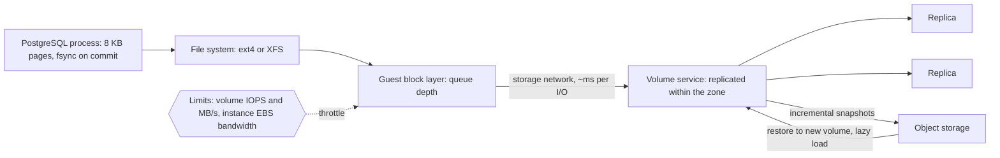

# Block Storage

> [!abstract] In one sentence
> A block volume is a virtual disk — numbered blocks you read and write at any offset, attached to one host — with cloud versions replicated behind the scenes and metered in IOPS and MB/s, which makes it the right substrate for databases and file systems and the wrong one for anything that must be shared across machines.

> [!tip] Deeper treatment in your system-design vault
> `system-design/18 AWS Services/EC2.md` — read it *after* you have written your own explanation below.

**Map:** [[Storage & Search MOC]] → [[HLD MOC]]

## Definition

Block storage exposes storage as a linear array of fixed-size **blocks** (typically 4 KB sectors, grouped into larger I/O units) addressed by number, with no notion of files, names or structure — that is the [[File Systems|file system]]'s job, layered on top. A **volume** is one such device: a local NVMe or SATA disk, a SAN LUN over iSCSI or Fibre Channel, or a cloud **network-attached volume** such as AWS EBS, GCP Persistent Disk or Azure Managed Disk, which is a replicated virtual disk served over the network to one instance at a time. Cloud volumes have a type (SSD general purpose, provisioned IOPS, throughput-optimised HDD), a size, and limits on **IOPS** (I/O operations per second) and **throughput** (MB/s), and support point-in-time **snapshots** that are stored in [[Object Storage]].

## Problem solved

Databases, file systems, and anything with random reads and writes at small granularity need a disk: a device that answers "read 8 KB at offset X" in well under a millisecond and makes a write durable on `fsync`. Instance-local disks do this fastest but die with the instance and cannot be moved; physical SANs solved durability and mobility at great cost and operational weight. Cloud block storage made the SAN a service: a volume that outlives the instance, replicates within its availability zone, can be detached and attached elsewhere in seconds, resized online, snapshotted incrementally, and sized for performance by the number rather than by buying hardware. For a database on Kubernetes or EC2 it is the difference between "the node died and so did the data" and "the pod rescheduled and reattached its volume".

## How it works

1. **Attachment.** A volume is attached to one instance (EBS multi-attach exists for a narrow set of cluster-aware file systems and is the exception). The guest kernel sees a device (`/dev/nvme1n1`); you create a file system on it or hand it raw to a database that manages its own layout. In Kubernetes a `PersistentVolumeClaim` with `ReadWriteOnce` is this attachment, handled by the CSI driver; a pod moving nodes forces a detach and reattach, which takes seconds and is the reason StatefulSets reschedule slowly.
2. **I/O path.** Reads and writes go from the guest's block layer, over the hypervisor's storage network, to the volume service, which replicates each write to multiple servers within the zone before acknowledging. Per-I/O latency is therefore sub-millisecond to low single-digit milliseconds (versus tens of microseconds for local NVMe) — a crucial number for `fsync`-bound workloads such as a database's commit path ([[Latency]]).
3. **Performance model.** Each volume type has a baseline IOPS and throughput that scales with size (gp3 on AWS: 3,000 IOPS and 125 MB/s included, provisionable up to 16,000 IOPS and 1,000 MB/s independently of size; io2 for higher and more consistent IOPS), and the *instance* has its own EBS bandwidth cap that can be lower than the sum of its volumes. I/O size matters: the quoted IOPS figures assume 16 KiB operations, and larger I/Os (up to 256 KiB per operation on SSD volumes) hit the MB/s ceiling long before the IOPS ceiling. Queue depth governs how many I/Os are in flight; too shallow and you cannot reach the limit, too deep and latency climbs.
4. **Durability.** A cloud volume is replicated within one availability zone; the published annual failure rate for gp3/io2-class volumes is in the range of 0.1–0.2% (io2 is designed for 0.001%). That is far below "eleven nines" object storage, which is why **snapshots** — incremental, block-level, stored in object storage — and database-level [[Replication]] across zones are not optional.
5. **Snapshots.** The first snapshot copies all used blocks; later ones copy only changed blocks. Restoring creates a new volume that lazily loads blocks from the snapshot (first reads are slow until warmed, or use fast snapshot restore). Application-consistent snapshots need the file system or database quiesced (or rely on the database's crash recovery, as a crash-consistent snapshot is equivalent to a power cut) ([[Backups and Restoration]]).
6. **Local instance storage.** NVMe disks physically in the host: much lower latency and higher IOPS, no extra cost, but **ephemeral** — data is gone on stop or hardware failure. Used for caches, temporary analytics, and databases that replicate at the application level (Cassandra, Kafka brokers with replication) where losing one node's disk is survivable by design.

```bash
# What a volume looks like from the inside, and how to see whether it is the bottleneck
lsblk -o NAME,SIZE,TYPE,MOUNTPOINT                 # /dev/nvme1n1  500G  disk  /var/lib/postgresql
iostat -xz 1                                       # watch r/s, w/s, await (ms), %util
# await climbing with %util near 100 while IOPS sit at the volume's limit means you are throttled
fio --name=rand --rw=randwrite --bs=8k --iodepth=32 --size=4G --direct=1 --filename=/mnt/data/fio.test
```

## Architecture



> [!example]- Excalidraw version — the same diagram as an editable canvas
> ![[Block Storage.excalidraw]]
> [[Block Storage.excalidraw|Open in Excalidraw]] — needs the Excalidraw plugin (see [[Plugins to Install]]).


## Use cases

- "Run a database on this node" (PostgreSQL, MySQL, MongoDB, Elasticsearch, Kafka brokers) — random small I/O with durability requirements; block storage is the only fit.
- "A stateful pod that must keep its data across restarts and reschedules" — `ReadWriteOnce` persistent volume.
- "Need predictable IOPS or throughput" — provisioned-performance volume types; the knob exists only here.
- "Point-in-time copies for backup, cloning environments or testing migrations" — snapshots.
- "Fast scratch for a single job" — local instance NVMe, accepting ephemerality.

## Limitations

- One host at a time: sharing requires a file system or database layer on top, never the volume itself.
- Network-attached latency per I/O is an order of magnitude above local NVMe, which caps `fsync`-heavy commit rates.
- Durability within a single zone only; a zonal outage takes the volume with it until the zone returns, and loss rates are far above object storage.
- Performance is a purchased ceiling; exceeding it means throttling, not graceful slowdown, and the instance-level cap can surprise you.
- Capacity is provisioned, not elastic; you pay for the allocated size whether used or not, and shrinking is not supported in place.

## Trade-offs

| You gain | You sacrifice |
|---|---|
| A durable, movable disk with sub-millisecond-to-millisecond I/O for databases and file systems | Shareability across hosts |
| Provisioned, predictable IOPS and throughput | The raw speed of local NVMe |
| Incremental snapshots and easy cloning | Cross-zone durability; replication is your job |
| Online resize and detach/attach mobility | Elastic, pay-for-what-you-use capacity |

## Failure modes

- **IOPS or throughput throttling**: a batch job or a `VACUUM` pushes the volume to its limit, `await` spikes, every query slows, and the database looks CPU-idle but slow. Noticed via `%util` at 100% and the cloud's volume-queue-length and throttled-ops metrics; blast radius is every tenant of that database. Provision more IOPS or spread hot files across volumes.
- **Instance EBS bandwidth cap**: several volumes on one instance together exceed the instance's limit; noticed when a larger volume does not help. Resize the instance or move volumes.
- **Volume stuck attaching after a node failure**: the old node has not released it, the pod stays `ContainerCreating` for minutes; noticed as StatefulSet pods not rescheduling. Understand the CSI detach timeouts before relying on reschedule for [[Availability]].
- **Disk full**: WAL or logs fill the volume, the database halts writes or crashes; noticed too late unless free space is alerted on. Resize online and set alerts at 80%.
- **Crash-inconsistent snapshot restored** for an application without crash recovery (or with `fsync` disabled): corrupted data after restore; noticed only when restoring. Quiesce or rely on a database that handles it, and test restores.

## Performance

Local NVMe: tens of microseconds per I/O, hundreds of thousands of IOPS. Network-attached volumes: roughly sub-millisecond to a few milliseconds per I/O depending on type and load, with IOPS and MB/s bounded by the purchased tier — order-of-magnitude figures that you should verify against your provider's current documentation. For a database, the commit path is bounded by `fsync` latency: at ~1 ms per flush, a single connection commits at most ~1,000 times per second, which is why group commit, larger WAL buffers and batching matter. Read-heavy workloads depend on the buffer cache far more than on the disk; if the working set fits in memory the volume barely matters, and if it does not, IOPS are the bottleneck ([[Bottleneck Analysis]]).

## Scalability

Vertical only, within one volume and one host: bigger and faster volume types, striping several volumes in RAID 0 for more IOPS (at the cost of multiplied failure probability), bigger instances for bandwidth. Beyond that, scaling is the database's job — [[Read Replicas]], [[Sharding]], or moving cold data to object storage — not the volume's. At 10x data, the questions become snapshot time and cost (incremental, so manageable), restore warm-up time, and whether a single volume's maximum size and IOPS still suffice.

## Operational impact

Moderate: sizing IOPS and capacity ([[Capacity Planning]]), alerting on free space and throttling, scheduling snapshots with retention, and periodically testing restores including warm-up behaviour. In Kubernetes, storage classes, CSI driver versions and volume expansion settings are platform concerns; a database operator or managed service (RDS, which is EBS underneath) removes most of the day-to-day work. Cost is per provisioned GB and per provisioned IOPS, so over-provisioning "to be safe" is a visible line item.

## Alternatives

- **Local instance storage** — wins for latency and cost when the application replicates data itself or the data is disposable.
- **Managed databases** (RDS, Aurora with its distributed storage layer, DynamoDB) — wins when you want the disk decisions made for you; Aurora in particular replaces the single-zone volume with a six-way, three-zone storage service.
- **[[Object Storage]]** — wins for anything that does not need random in-place writes.
- **Network [[File Systems]]** — wins when files must be shared across hosts and POSIX is required.

## Real-world examples

- AWS RDS and self-managed PostgreSQL on EC2 both run on EBS; Aurora's distinguishing design is replacing EBS with a purpose-built, multi-AZ log-structured storage service.
- Kafka and Cassandra are commonly deployed on local NVMe or throughput-optimised volumes because application-level replication makes a single disk loss survivable, and their sequential I/O patterns suit cheaper tiers.
- Netflix's and others' early cloud write-ups describe moving Cassandra from EBS to ephemeral SSDs for latency, then revisiting the choice as EBS performance improved — a reminder that the trade-off shifts with the hardware generation.
- In a stack like yours: RDS or Aurora for PostgreSQL (block storage you never see but whose IOPS tier you still choose), self-managed MSK brokers on EBS or local disks with replication factor 3, and any StatefulSet on EKS (Redis with persistence, Elasticsearch) on `gp3` persistent volumes with snapshot schedules and free-space alerts.

## Practical exercise

1. On a cloud instance (or a VM with a rate-limited virtual disk via `cgroup` I/O limits in Docker), attach a volume and run `fio` random 8 KB writes with `--direct=1` at queue depths 1, 8 and 32; record IOPS and latency and find the point where latency rises without more IOPS.
2. Run PostgreSQL on that volume with `pg_test_fsync` and compare the commits-per-second figure to the `fio` latency; then run a `pgbench` write workload and watch `iostat` `await` when it hits the IOPS limit.
3. Take a snapshot while `pgbench` runs, restore it to a new volume, start PostgreSQL and read the crash-recovery log; measure the first-read latency on the lazily loaded volume versus the original.
4. Fill the volume to 95% with WAL by holding a replication slot; observe the database's behaviour and resize online.
5. Compare the same `fio` run on local instance storage, then terminate the instance and confirm the data is gone.

## Related concepts

### Prerequisites
- [[Relational Database Internals]] — pages, WAL and `fsync` are what block storage serves
- [[Latency]] and [[Throughput]] — IOPS and MB/s are those two measured at the disk

### Related
- [[File Systems]] — the layer on top of the block device
- [[Object Storage]] — where snapshots live and where non-disk data should go
- [[Backups and Restoration]] — snapshot consistency and restore testing
- [[Capacity Planning]] — sizing IOPS, throughput and space
- [[Replication]] — the answer to single-zone volume durability

### Builds on this
- [[Database Scaling]] — vertical disk scaling is the first lever, then replicas and shards
- [[Disaster Recovery]] — cross-zone and cross-region copies of snapshots
- [[Recovery Point Objective]] — snapshot frequency sets the floor

### Design problems where it applies
- [[Design a Message Queue]]
- [[Design a Metrics and Monitoring System]]
- [[Design a Distributed Key-Value Store]]

### Projects where it can be implemented
- [[Mini-KV Store]]
- [[Load Test and Latency Lab]]

### Resources
- [[Database Internals]] — storage engines and their interaction with disks
- [[Latency Numbers Every Programmer Should Know]] — disk seek and SSD figures for estimation
- [[Designing Data-Intensive Applications]] — chapter 3 on storage engines

## Personal understanding

> [!question] Explain it without the source
> Write your own explanation here, from memory. Then compare it with the sections above and note what you missed.

### Mastery checklist
- [ ] I can explain it without the original resource
- [ ] I can describe the problem it solves
- [ ] I can compare it with its alternatives
- [ ] I can name its limitations and failure modes
- [ ] I can recognise when it is appropriate in a real system
- [ ] I have applied it in a system design
- [ ] I have validated my assumptions with an experiment or implementation

## Open questions

- [ ] What IOPS tier are our RDS instances on, and how close to the limit do they run during end-of-day batch jobs?
- [ ] How does Aurora's storage layer change the `fsync` latency equation compared with PostgreSQL on gp3, and does it show up in our commit latency?
- [ ] For a Kafka broker, when does local NVMe beat EBS once replication, rebalancing time after a node loss and cost are all counted?
