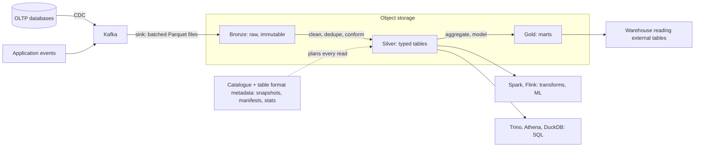

# Data Lakes

> [!abstract] In one sentence
> A data lake is cheap, open, append-friendly storage for *everything* — events, logs, database snapshots, files — in formats like Parquet on [[Object Storage]], queried by whichever engine fits, which buys flexibility and cost at the price of governance; a lakehouse table format (Iceberg, Delta, Hudi) adds the transactions, schema and time travel that stop it becoming a swamp.

> [!tip] Deeper treatment in your system-design vault
> `system-design/07 NoSQL and Storage Engines/Time Series and Analytics Stores.md` — read it *after* you have written your own explanation below.

**Map:** [[Storage & Search MOC]] → [[HLD MOC]]

## Definition

A **data lake** is a repository of data in its raw or lightly processed form — structured tables, semi-structured JSON events, logs, files — stored as objects in open formats (Parquet, ORC, Avro, JSON, CSV) on object storage, with a catalogue that records what exists. The defining property is **schema on read**: data is written without being forced into a predefined model, and structure is applied by whichever engine reads it (Spark, Trino, Athena, DuckDB, Flink). A **lakehouse** layers an **open table format** — Apache Iceberg, Delta Lake or Apache Hudi — over the files to provide ACID commits, schema enforcement and evolution, partition management, time travel and efficient updates, so that the lake can serve warehouse-style workloads directly. A [[Data Warehouses|data warehouse]], by contrast, applies schema on write into a proprietary or engine-specific store.

## Problem solved

Warehouses are excellent at answering known questions over modelled data, but they are poor landing zones: every source must be modelled before it is loaded, semi-structured and binary data fit badly, storage is priced at warehouse rates, and the data is locked to one engine. Teams that wanted to keep *all* raw events ("we might need them for a model next year"), store clickstreams and logs at petabyte scale, or run Spark and SQL and Python over the same bytes needed something cheaper and more open. The first-generation lake (HDFS, then S3 with Hive tables) delivered that but became the "data swamp": no transactions (readers saw half-written partitions), no schema enforcement (a producer's change broke every consumer), slow directory listings for planning, and no way to delete a user's rows for privacy without rewriting everything. Table formats were created to fix exactly those four problems while keeping the open substrate.

## How it works

1. **Landing.** Producers write files to object storage under a layout: `s3://lake/raw/payments/transactions/dt=2026-10-19/part-0001.parquet`. Sources are [[Change Data Capture]] streams from databases, application events from [[Kafka]] (sink connectors batch them into files), API extracts, and bulk snapshots. Raw data is kept immutable ("bronze"); cleaned and conformed layers ("silver", "gold") are derived from it and can always be rebuilt.
2. **Columnar files.** Parquet stores row groups with per-column chunks, dictionary and run-length encoding, and per-chunk statistics (min/max, null counts), which is what makes scans skip data; file size matters — tens to hundreds of MB per file, because thousands of tiny files make planning and reads slow (the "small files problem") and compaction jobs exist to merge them.
3. **Catalogue.** A metastore (Hive Metastore, AWS Glue, Unity, Nessie, an Iceberg REST catalogue) maps table names to locations and schemas so engines can find and plan over the data; without it the lake is just a bucket.
4. **Table format.** Iceberg (and Delta, Hudi) keeps a **metadata tree**: a table pointer → snapshot → manifest lists → manifests → data files, with statistics per file. A write produces new data files and a new metadata snapshot, committed by an atomic swap of the table pointer (optimistic concurrency, [[Optimistic and Pessimistic Locking]]): readers see either the old or the new snapshot, never a partial one. This gives ACID at the table level, **time travel** (query the snapshot as of a timestamp), schema evolution by column id (rename or reorder without rewriting), **hidden partitioning** (partition by `day(ts)` without users writing the column), and row-level deletes via delete files that are merged on read and compacted later — the mechanism that makes privacy deletions feasible.
5. **Engines.** Any engine that understands the format queries the same tables: Spark for heavy transforms and ML, Trino/Athena/Presto for interactive SQL, Flink for streaming writes, DuckDB for local analysis, and cloud warehouses themselves reading external Iceberg tables. Compute is chosen per job; storage is shared and paid once.
6. **Governance.** Schema registries for events ([[Event Schemas]]), data contracts between producers and the lake, column-level access control and masking, lineage, and retention rules by layer ([[Data Retention and Archival]]) are what separate a lake from a swamp.

```sql
-- Iceberg table via Spark SQL or Trino: hidden partitioning, ACID merge, time travel
CREATE TABLE lake.payments.transactions (
  txn_id string, account_id bigint, amount_minor bigint, currency string,
  status string, event_ts timestamp)
USING iceberg
PARTITIONED BY (days(event_ts));

MERGE INTO lake.payments.transactions t
USING updates u ON t.txn_id = u.txn_id
WHEN MATCHED THEN UPDATE SET status = u.status
WHEN NOT MATCHED THEN INSERT *;

SELECT count(*) FROM lake.payments.transactions
  FOR SYSTEM_TIME AS OF TIMESTAMP '2026-10-18 00:00:00';
```

## Architecture



## Use cases

- "Keep all raw events indefinitely, cheaply" — logs, clickstreams, audit trails, model training data.
- "Several engines and teams need the same data" (SQL analysts, Spark pipelines, Python notebooks, ML training) — open formats on shared storage avoid copies per engine.
- "Semi-structured or evolving data" — JSON events whose shape changes; schema on read plus evolution in the table format.
- "Petabyte scale at object-storage prices" — the cost structure of the lake is its strongest argument.
- "Right-to-erasure over historical data" — row-level deletes in a table format, impossible in a pile of immutable files.

## Limitations

- Query latency and concurrency are worse than a tuned warehouse for interactive BI unless gold tables are carefully compacted and clustered.
- Governance is not built in; without contracts, a catalogue and ownership the lake degrades into unusable files.
- Small-file accumulation, metadata growth and compaction are ongoing maintenance jobs that someone must run.
- Streaming writes with low latency are hard: commits every few seconds produce many files and snapshots; most pipelines settle on minute-level micro-batches.
- The ecosystem is moving fast; format features, engine support and catalogue standards still vary.

## Trade-offs

| You gain | You sacrifice |
|---|---|
| Cheapest storage per byte, any format, any engine | Interactive query speed without extra tuning and compaction |
| Raw history that can be re-processed as understanding changes | Schema enforcement at write time unless a table format is used |
| ACID, time travel and row-level deletes with a table format | Operational simplicity: catalogues, compaction and metadata are yours |
| Decoupling of compute from data, no vendor lock on bytes | A single polished SQL experience out of the box |

## Failure modes

- **Swamp**: hundreds of undocumented paths, no owners, three versions of "transactions"; noticed when nobody trusts any number. Blast radius is every decision made from the lake. Prevent with a catalogue, data contracts and layer discipline.
- **Readers see half-written partitions** (pre-table-format lakes): a dashboard double-counts during the hourly load; noticed as numbers that flicker. Table formats' atomic commits fix it.
- **Small files**: a streaming sink writes one file per second; a year later a query plans over millions of objects and times out. Noticed as planning time dwarfing execution; compaction and larger batches fix it.
- **Schema break from a producer**: a renamed field nulls out a column for all downstream tables; noticed days later. Enforce schemas at the boundary ([[Event Schema Evolution]]).
- **Deletion that did not delete**: a privacy erasure removed rows from silver but raw files still hold them; noticed in an audit. Define retention per layer and delete at the source layer too.

## Performance

Scan performance comes from Parquet's columnar encoding and statistics: a well-partitioned, well-sorted table lets the planner skip most files and most row groups, and engines read object storage in parallel at aggregate bandwidth of many GB/s. Metadata-driven planning (Iceberg's manifests with per-file statistics) replaces slow directory listings. Latency floors are seconds — engine start-up, planning, object-storage first-byte — so the lake serves analysts and pipelines, not user requests. Write performance favours large batches; file size (hundreds of MB), partition granularity (daily, not hourly, unless volume justifies it) and periodic compaction are the knobs.

## Scalability

Storage scales with object storage; compute scales per engine and per job, independently, which is the architectural win over coupled systems. At 10x data, the stress points are metadata (snapshot and manifest growth needs expiry and rewrite jobs), the catalogue's request rate, and partition design that still prunes effectively. At 10x producers, contracts and schema governance scale worse than bytes do — the organisational layer is where lakes fail ([[Data Ownership and Lifecycle]]).

## Operational impact

High for a platform team, low for consumers: someone owns ingestion connectors, compaction and snapshot-expiry schedules, catalogue availability, access policies and cost monitoring per layer, while analysts get SQL. Monitor freshness per table, file counts and sizes per partition, failed commits (optimistic concurrency conflicts between concurrent writers) and query cost by user. Managed offerings (Databricks, AWS Lake Formation plus Athena, Snowflake's Iceberg support) reduce the platform work at a price.

## Alternatives

- **[[Data Warehouses]]** — wins for curated, interactive BI on modelled data with strong governance built in; costs more per byte and locks data to the engine.
- **A lakehouse** — the converged default for new platforms: lake economics with warehouse semantics; most warehouses now read Iceberg tables directly.
- **[[Object Storage]] archive only** — wins when the data is kept for compliance and almost never queried; skip the table format and catalogue.
- **Operational stores plus [[Change Data Capture]] into a warehouse** — wins for small organisations with few sources and no ML or semi-structured needs.

## Real-world examples

- Netflix created Apache Iceberg to fix the correctness and performance problems of Hive tables on S3 at petabyte scale; Apple, LinkedIn and others adopted it, and it has become the de facto open table standard.
- Databricks' Delta Lake and the "lakehouse" term came from the same pressures on Spark-on-S3 workloads; Uber's Hudi addressed incremental upserts for its trips data.
- AWS's reference "modern data architecture" is S3 plus Glue catalogue plus Athena/EMR, with Redshift reading the lake for curated marts.
- In a stack like yours: raw payment, ledger and risk events landing from MSK into S3 as Parquet via a sink connector, Iceberg tables with daily partitions, Athena or Trino for ad-hoc SQL and Spark for model features, gold marts promoted into the warehouse, and privacy deletions executed as Iceberg row deletes with raw-layer retention short enough to stay compliant.

## Practical exercise

1. In Docker Compose, run MinIO plus a Spark or Trino container with Iceberg and a REST or JDBC catalogue (or use DuckDB's Iceberg extension locally for reads).
2. Write 20 million synthetic transaction rows as Parquet into an Iceberg table partitioned by `days(event_ts)`; query a one-day window and compare files scanned (`EXPLAIN`) with and without partitioning.
3. Run a `MERGE` to update 1% of rows, then query the table `AS OF` the previous snapshot; inspect the metadata directory to see manifests and delete files.
4. Simulate a streaming sink writing one 1 KB file per second for ten minutes; measure query planning time, then run compaction (`rewrite_data_files`) and re-measure.
5. Break the schema (rename a column in the producer) and observe the difference between a raw JSON landing and an Iceberg table with schema evolution by column id.

## Related concepts

### Prerequisites
- [[Object Storage]] — the substrate: immutable objects, prefix listing, no atomic rename
- [[Data Warehouses]] — the contrast that defines what a lake is for
- [[Event Schemas]] — what producers must respect for a lake to stay usable

### Related
- [[Change Data Capture]] — the main ingestion path from databases
- [[Event Schema Evolution]] — the lake inherits every upstream change
- [[Optimistic and Pessimistic Locking]] — table commits are optimistic pointer swaps
- [[Data Retention and Archival]] — retention per layer and privacy deletes
- [[Data Ownership and Lifecycle]] — who owns each table and its contract

### Builds on this
- [[Data Retention and Archival]] — the lake's bronze layer is the archive for many systems
- [[Search Indexing Pipelines]] — backfills often read from the lake
- [[Design a RAG Knowledge Assistant]] — document corpora and embeddings are lake-shaped

### Design problems where it applies
- [[Design a Logging System]]
- [[Design a Real-Time Fraud Detection Pipeline]]
- [[Design a Metrics and Monitoring System]]

### Projects where it can be implemented
- [[Streaming Fraud Rules Engine]]
- [[Vault RAG Assistant]]

### Resources
- [[Designing Data-Intensive Applications]] — chapters 10 and 11 on batch and stream processing of derived data
- [[Turning the Database Inside Out]] — the log-centric view that lakes implement at rest
- [[Kafka Design Documentation]] — the log that usually feeds the lake

## Personal understanding

> [!question] Explain it without the source
> Write your own explanation here, from memory. Then compare it with the sections above and note what you missed.

### Mastery checklist
- [ ] I can explain it without the original resource
- [ ] I can describe the problem it solves
- [ ] I can compare it with its alternatives
- [ ] I can name its limitations and failure modes
- [ ] I can recognise when it is appropriate in a real system
- [ ] I have applied it in a system design
- [ ] I have validated my assumptions with an experiment or implementation

## Open questions

- [ ] How does Iceberg guarantee an atomic commit on an object store with no atomic rename — what exactly does the catalogue do?
- [ ] What is the right raw-layer retention for payment events given both audit requirements and erasure requests?
- [ ] At what point would a lakehouse replace a separate warehouse for our reporting, and what would the BI latency look like?
