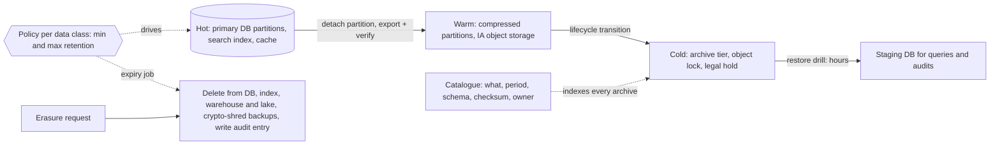

# Data Retention and Archival

> [!abstract] In one sentence
> Every byte you store should have an owner, a reason, a tier and an expiry: retention policy says how long and why, archival moves data from expensive hot storage to cheap cold storage without losing the ability to restore it, and deletion — including under privacy law — is engineered and tested rather than hoped for.

**Map:** [[Storage & Search MOC]] → [[HLD MOC]]

## Definition

**Data retention** is the policy that defines, per data class, the minimum period data must be kept (legal, regulatory, audit, product needs) and the maximum period it may be kept (privacy law, data minimisation, cost). **Archival** is the mechanism that moves data no longer needed for live operation into cheaper, slower storage — from a hot database or index to warm replicas or compressed partitions, then to cold [[Object Storage]] archive tiers — in a format and with metadata that allow it to be found and restored. **Deletion** is the terminal step: physical removal, including from backups and derived stores, within a defined time after retention ends or after an erasure request. Together they form the **lifecycle** of a record, the storage counterpart of [[Data Ownership and Lifecycle]].

## Problem solved

Without explicit policy, data accumulates by default: tables grow until every query slows and every backup takes all night, search indexes hold years of logs nobody reads, object storage fills with exports, and the bill rises linearly while value does not. The opposite failure is worse: a cleanup job deletes transaction records a regulator later asks for, or a company keeps personal data it was obliged to erase and cannot prove what it holds about whom. Fintech sits on both horns — payment records, KYC documents and audit trails must be retained for years (periods of five to ten years are common across jurisdictions; the exact rule depends on regulator and data class), while privacy regimes grant erasure rights and require minimisation — and the only way out is a policy per data class, enforced by machinery, with restore and deletion both tested. Tiering also solves a performance problem: a hot table of 200 million rows, of which 5 million are active, is slow for everyone because of the 195 million it drags along ([[Partitioning]]).

## How it works

1. **Classify.** Inventory data by class — transactions, ledger entries, KYC documents, session logs, application logs, metrics, analytics events, backups — and for each record the owner, the legal basis and minimum retention, the maximum retention, whether it contains personal data, and which derived copies exist (replicas, indexes, warehouse, caches, backups). This inventory is the policy's source of truth ([[Data Ownership and Lifecycle]]).
2. **Tier.** Define storage tiers by access pattern and cost: **hot** (primary database, search index, cache: milliseconds, most expensive per GB), **warm** (compressed partitions, read replicas, infrequent-access object storage: seconds, cheaper), **cold** (archive object storage such as S3 Glacier tiers: minutes to hours to restore, an order of magnitude or more cheaper per GB, with minimum storage durations and per-retrieval charges). Rough orders of magnitude for cloud object storage: standard class is a few cents per GB-month, infrequent access roughly half, deep archive around a tenth or less — verify current pricing, the ratios are what matter.
3. **Move.** Mechanisms per store: database **table partitioning by time** so that archiving a month is detaching one partition, exporting it (Parquet or CSV plus schema) to object storage, verifying the export, then dropping the partition — a metadata operation instead of a `DELETE` of millions of rows that bloats WAL and indexes. Search indexes use time-based rollover and index lifecycle management (hot → warm → cold nodes → searchable snapshot → delete). Object storage uses **lifecycle rules** (transition after N days, expire after M). TSDBs downsample and expire by age ([[Time-Series Databases]]). Logs tier from the index to compressed objects ([[Design a Logging System]]).
4. **Preserve restorability.** An archive is only valuable if it can be read: store in open, self-describing formats (Parquet with schema, or JSON Lines plus a schema file), keep a catalogue (what, from where, which period, checksum, schema version), keep the decryption keys for as long as the data ([[Encryption at Rest and in Transit]], [[Secrets Management]]), and run **restore drills** on a schedule — restore a 3-year-old month into a staging database and run a known query ([[Backups and Restoration]]).
5. **Protect against deletion.** For data with a legal minimum, use WORM controls: object lock in compliance mode (nobody, including root, can delete before the retention date), immutable backups, and a **legal hold** flag that suspends expiry for records under investigation.
6. **Delete properly.** Expiry deletes from the primary *and* every derived copy: replicas follow automatically, but search indexes, caches, the warehouse, data lake layers and analytics exports need their own jobs. Backups are the hard case: you cannot edit a backup, so either keep backup retention short enough that expired data ages out within the policy window, or use **crypto-shredding** — encrypt each subject's data under a per-subject key and delete the key, rendering every copy unreadable ([[Design a Digital Wallet and Ledger]] has similar key-per-tenant reasoning). Record deletions in an [[Audit Logs|audit log]] as evidence.
7. **Erasure requests versus retention obligations.** When a user requests deletion but a transaction record must be kept, the answer is usually **pseudonymisation**: keep the financial record, replace identifying fields with a token, delete the mapping — with the policy stating exactly which fields are retained and why.

```sql
-- PostgreSQL: monthly partitions make archival a metadata operation
CREATE TABLE transactions (
  id uuid, account_id bigint, amount_minor bigint, created_at timestamptz NOT NULL, ...
) PARTITION BY RANGE (created_at);
CREATE TABLE transactions_2024_01 PARTITION OF transactions
  FOR VALUES FROM ('2024-01-01') TO ('2024-02-01');

-- Archive job (monthly): export, verify, detach, drop
COPY (SELECT * FROM transactions_2024_01)
  TO PROGRAM 'gzip | aws s3 cp - s3://archive/transactions/2024-01.csv.gz';
-- verify row count and checksum against the catalogue entry, then:
ALTER TABLE transactions DETACH PARTITION transactions_2024_01;
DROP TABLE transactions_2024_01;
```

```json
// S3 lifecycle rule: warm after 90 days, cold after 1 year, expire after 7 years, with object lock on the bucket
{ "Rules": [{ "ID": "transactions-archive", "Filter": { "Prefix": "transactions/" }, "Status": "Enabled",
  "Transitions": [{ "Days": 90, "StorageClass": "STANDARD_IA" }, { "Days": 365, "StorageClass": "DEEP_ARCHIVE" }],
  "Expiration": { "Days": 2555 } }] }
```

## Architecture



## Use cases

- "Regulated records (payments, KYC, ledger) must be kept N years and be producible on request" — minimum retention, WORM, restore drills.
- "Users can request deletion of their data" — maximum retention, erasure pipelines across every copy, pseudonymisation where records must persist.
- "The main table or index is slow and most rows are old" — time partitioning with archival to warm and cold tiers.
- "Storage and backup costs are growing faster than the business" — lifecycle rules and tiering ([[Performance vs Cost Trade-offs]]).
- "Logs, metrics and events pile up with no owner" — per-class retention in the logging and metrics stacks.

## Limitations

- Policy is a legal and product decision before it is an engineering one; engineering can only enforce what has been decided per class and jurisdiction.
- Cold tiers have minimum storage durations, retrieval fees and hours of latency; archiving data you will need next week costs more than keeping it.
- Deleting from every derived copy is hard to prove complete; backups and third-party processors are the usual gaps.
- Schema drift over years makes old archives hard to read unless formats are self-describing and schema versions are catalogued.
- Partition-based archival requires the schema to be designed for it up front; retrofitting partitioning onto a huge live table is a migration project ([[Schema Evolution]]).

## Trade-offs

| You gain | You sacrifice |
|---|---|
| Hot stores that stay small and fast as history grows | Immediate access to old data; restores take minutes to hours |
| Storage cost that tracks value rather than age | Operational machinery: jobs, catalogues, drills, legal holds |
| Provable compliance for both retention and erasure | Simplicity of "keep everything forever" |
| Reduced blast radius of breaches through minimisation | Potential future analytical uses of data you deleted |

## Failure modes

- **Archive that cannot be restored**: encrypted with a rotated-away key, written in a format nobody can parse, or never verified; noticed during an audit or dispute, years later. Blast radius is legal exposure. Catalogue, checksum, keep keys, and drill restores.
- **Expiry deleting the wrong data**: a lifecycle prefix too broad, a partition drop one month off; noticed when a customer or regulator asks. Dry-run expiry jobs, require object lock on regulated buckets, keep soft-delete windows.
- **Erasure that misses copies**: user deleted from the database but present in the search index, the warehouse and a 6-month backup; noticed in a privacy audit or a second request. Maintain the copy inventory and automate per-copy deletion with evidence.
- **Hot table never partitioned**: the retention policy exists on paper, but a `DELETE WHERE created_at < …` of 100 million rows locks, bloats and times out; noticed as a failed cleanup job that has been failing for a year. Partition, or delete in small batches off-peak.
- **Cost surprise from cold retrieval**: an analytics team restores a year of deep archive for one query; noticed on the bill. Keep a warm aggregate layer for the questions people actually ask ([[Data Warehouses]]).

## Performance

Partition detach and drop are metadata operations measured in milliseconds, versus hours of `DELETE` with WAL and index bloat for the same rows; exports run at sequential-scan speed. Hot-store performance improves directly with retention: smaller indexes fit in memory, vacuum and backups shorten, and query plans over recent data stop touching old partitions ([[Query Execution and Optimization]]). Cold retrieval latency ranges from minutes (expedited) to about half a day (bulk) depending on tier — order-of-magnitude figures to verify — so archived data is for audits and investigations, not for product features. Crypto-shredding makes erasure O(1) per subject regardless of copies, which is why it is favoured where backups are long-lived.

## Scalability

Policy-driven lifecycle scales because it is proportional to time, not to total data: each month archives one partition and one set of objects, and the hot footprint stays roughly constant. The scaling risk is in the *number of classes and copies* — more services, more derived stores, more jurisdictions — which multiplies the inventory and the deletion fan-out; a central catalogue and a per-service "delete subject" API ([[Design an IAM Service]] often owns the subject identity) are how large organisations keep it tractable. Object-storage lifecycle rules scale to any volume without application involvement.

## Operational impact

High in setup, moderate ongoing: the inventory and policy need legal, product and engineering sign-off; partitioning and lifecycle rules need building per store; archive, expiry and erasure jobs need monitoring (did this month's archive run, verify and drop?), alerting on failures, and evidence logs; restore drills need scheduling and a staging environment; legal holds need a process that suspends automation. The on-call view is quiet until a job fails silently for months — so freshness of the last successful archive per class is the metric to watch.

## Alternatives

- **Keep everything hot** — wins for small data or where every record is queried; costs grow linearly and privacy obligations go unmet.
- **Backups as the archive** — wins only for disaster recovery; backups are not queryable, not catalogued per record, and expire on their own schedule ([[Backups and Restoration]]).
- **Data lake as the archive** ([[Data Lakes]]) — wins when archived data must remain queryable for analytics; costs a catalogue and table-format maintenance, and privacy deletes need row-level delete support.
- **Downsampling and aggregation instead of archival** — wins for metrics and events where the aggregate answers every future question ([[Time-Series Databases]]).

## Real-world examples

- AWS S3 lifecycle configuration, storage classes (Standard, IA, Glacier Instant/Flexible/Deep Archive) and Object Lock in compliance mode are the reference building blocks; most regulated archives on AWS are built from them.
- Elasticsearch and OpenSearch index lifecycle management (hot, warm, cold, frozen, delete phases) is the same model applied to search and log indexes.
- Payment companies' privacy documentation typically states that transaction records are retained for legally required periods while other personal data is deleted or de-identified on request — the two-obligation pattern described above, visible in public policies rather than in engineering write-ups.
- In a stack like yours: transactions and ledger entries in monthly partitions with a verified export to S3 and partition drops after the hot window, KYC documents under object lock for the regulated period with lifecycle transitions to archive tiers, OpenSearch logs with 30-day retention and metrics downsampled after 15 days, and an erasure workflow that pseudonymises financial records, deletes profile data across database, index and warehouse, and relies on short backup retention or per-subject keys for backups.

## Practical exercise

1. Create a partitioned `transactions` table in PostgreSQL with 24 monthly partitions and 50 million rows; compare `DELETE` of one month against `DETACH` plus `DROP` on time, WAL generated and index bloat.
2. Export a detached partition to MinIO as Parquet (via DuckDB) with a catalogue entry (period, row count, checksum, schema version); drop it; restore it into a staging database and run a reconciliation query against the catalogue count.
3. Configure a MinIO lifecycle rule (transition and expiry) and object lock on a bucket; attempt a delete inside the retention window and observe the refusal.
4. Implement an erasure job for one subject that deletes from the database, an OpenSearch index and a Parquet "warehouse" file (Iceberg row delete or rewrite), writing an audit entry; then implement crypto-shredding for the same subject and compare the work.
5. Schedule the archive job, break it silently (wrong prefix), and design the freshness alert that would have caught it.

## Related concepts

### Prerequisites
- [[Object Storage]] — tiers, lifecycle rules and object lock
- [[Partitioning]] — time partitions make archival cheap
- [[Data Ownership and Lifecycle]] — who decides and who owns each class

### Related
- [[Backups and Restoration]] — backups versus archives, and the deletion gap
- [[Audit Logs]] — evidence of retention and deletion actions
- [[Encryption at Rest and in Transit]] — keys must outlive the data; crypto-shredding
- [[Time-Series Databases]] and [[Logging]] — retention in the observability stack
- [[Performance vs Cost Trade-offs]] — tiering is this trade-off made explicit

### Builds on this
- [[Disaster Recovery]] — archives and backups both feed recovery plans
- [[Data Lakes]] — the queryable archive
- [[Recovery Point Objective]] — retention windows bound what can be recovered

### Design problems where it applies
- [[Design a Payment System]]
- [[Design a Logging System]]
- [[Design a Digital Wallet and Ledger]]
- [[Design a Metrics and Monitoring System]]

### Projects where it can be implemented
- [[Double-Entry Ledger Service]]
- [[Durable Job Scheduler]]

### Resources
- [[Designing Data-Intensive Applications]] — derived data and the ethics chapter's data minimisation argument
- [[Site Reliability Engineering (Google)]] — the data integrity chapter: restores, not backups, are the goal

## Personal understanding

> [!question] Explain it without the source
> Write your own explanation here, from memory. Then compare it with the sections above and note what you missed.

### Mastery checklist
- [ ] I can explain it without the original resource
- [ ] I can describe the problem it solves
- [ ] I can compare it with its alternatives
- [ ] I can name its limitations and failure modes
- [ ] I can recognise when it is appropriate in a real system
- [ ] I have applied it in a system design
- [ ] I have validated my assumptions with an experiment or implementation

## Open questions

- [ ] What are the exact minimum retention periods for our transaction, KYC and audit data by regulator and jurisdiction, and where is that inventory kept?
- [ ] How long are our database backups retained, and does that window conflict with any erasure obligation — would per-subject keys be cheaper than shortening it?
- [ ] Which of our large tables are not time-partitioned today, and what would it take to migrate the biggest one online?
