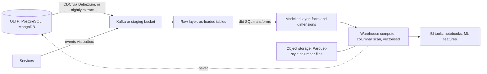

# Data Warehouses

> [!abstract] In one sentence
> A data warehouse stores copies of your operational data in a column-oriented, compressed, massively parallel engine built for scanning and aggregating billions of rows — the opposite of an OLTP database's row-at-a-time, index-driven design — so that reporting, analytics and machine-learning features never compete with customer transactions for the primary's CPU, locks and buffer cache.

> [!tip] Deeper treatment in your system-design vault
> `system-design/07 NoSQL and Storage Engines/Time Series and Analytics Stores.md` — read it *after* you have written your own explanation below.

**Map:** [[Storage & Search MOC]] → [[HLD MOC]]

## Definition

A **data warehouse** is a database optimised for **OLAP** (online analytical processing): few concurrent users running queries that touch a few columns of very many rows — sums, counts, group-bys, joins over time ranges — as opposed to **OLTP** (online transaction processing), where many concurrent users touch few rows each by key. Warehouses are **columnar** (each column stored contiguously), compressed, append-oriented, and typically distributed across many nodes with a query planner that parallelises scans. Snowflake, BigQuery, Redshift, ClickHouse and Databricks SQL are current examples; Teradata and Vertica are the earlier generation. Data arrives by batch loads or streaming pipelines from the operational systems, usually transformed into a modelled schema (star schema of facts and dimensions, or wide denormalised tables).

## Problem solved

Analytical queries and transactional queries want opposite physical layouts. A `SELECT SUM(amount) FROM transactions WHERE created_at > now() - interval '90 days' GROUP BY merchant_id` on a row-store OLTP database reads every byte of every row in range — including the twenty columns it does not need — through the buffer cache, evicting the hot rows customers are using, holding snapshots that block [[Relational Database Internals|vacuum]], and competing for the same CPU as checkout. Running it on a [[Read Replicas|read replica]] protects the primary's CPU but not the replica's cache, replication lag or the fundamental inefficiency: row stores are built for point reads, not scans. Warehouses solve this by moving the data to an engine where the same query reads only `amount`, `created_at` and `merchant_id`, each compressed tens of times, scanned in parallel across nodes — and by physically separating analytical load from the system that moves money.

## How it works

1. **Columnar layout.** A table is stored as column chunks (Parquet row groups, Redshift blocks, ClickHouse parts): all values of `amount` together, then all of `merchant_id`. A query touching 3 of 40 columns reads ~7% of the bytes. Within a column, values are similar, so **compression** is dramatic: run-length encoding for sorted or repetitive columns, dictionary encoding for low-cardinality strings, delta and bit-packing for integers and timestamps — compression ratios of several-fold to tens-of-fold are typical and are what make scanning billions of rows feasible.
2. **Vectorised execution.** Operators process batches of column values with tight loops and SIMD rather than one row at a time through a tuple interface; aggregations and filters run at memory bandwidth. Predicate pushdown uses per-chunk min/max statistics (zone maps) to skip chunks entirely, which is the columnar substitute for B-tree [[Indexing|indexes]] — sort keys and clustering keys control how well this works.
3. **Distribution.** Tables are partitioned (by date, most commonly) and distributed across nodes by a key; large fact tables are scanned in parallel, small dimension tables are broadcast for joins. Modern cloud warehouses **separate storage from compute**: data sits in [[Object Storage]] in a columnar format, and stateless compute clusters are spun up per workload and billed by the second (Snowflake virtual warehouses, BigQuery slots), so an analyst's heavy query does not slow the nightly ETL.
4. **Loading: ELT and CDC.** Data arrives from OLTP systems in one of three ways: periodic batch extracts (nightly dumps), [[Change Data Capture]] streams (Debezium to Kafka to a sink connector, giving minutes of lag), or event streams from the application's own [[Outbox Pattern|outbox]]. Modern practice is **ELT**: load raw data as-is into a staging area, then transform *inside* the warehouse with SQL (dbt is the standard tool), keeping transformations versioned and re-runnable.
5. **Modelling.** A **star schema** keeps a wide fact table (`fact_transactions`: one row per event with foreign keys and measures) surrounded by dimension tables (`dim_merchant`, `dim_date`, `dim_customer`). Slowly changing dimensions record history (type 2: a new row per change with validity dates) so last year's report still shows last year's merchant category. Wide, denormalised tables are often faster in columnar engines and simpler for analysts; the choice is governance versus convenience.
6. **Writes and mutability.** Warehouses prefer appends and bulk loads; single-row updates and deletes are expensive (rewriting immutable chunks) and are batched or handled by merge-on-read. This is why they are not transactional stores and why deletions for privacy need their own pipeline ([[Data Retention and Archival]]).

```sql
-- Same question, warehouse style: a few columns, a date partition, a group-by over 1e9 rows
SELECT d.calendar_month, m.category, SUM(t.amount_minor) / 100.0 AS volume, COUNT(*) AS txns
FROM fact_transactions t
JOIN dim_merchant m ON m.merchant_key = t.merchant_key
JOIN dim_date     d ON d.date_key     = t.date_key
WHERE t.date_key BETWEEN 20260101 AND 20260930          -- partition pruning
  AND t.status = 'SETTLED'                               -- zone-map skipping
GROUP BY 1, 2
ORDER BY 1, 3 DESC;
```

## Architecture



## Use cases

- "Reports and dashboards over months or years of data", "finance wants daily settlement and reconciliation views" — scanning history by aggregate is the warehouse's native query.
- "Analysts write ad-hoc SQL" — isolating them from production is as much about blast radius as performance.
- "Join data from several systems" (payments, ledger, CRM, support) — the warehouse is the integration point where cross-system questions get answered.
- "Features for a model trained on historical behaviour" — batch feature computation over large windows ([[Design a Real-Time Fraud Detection Pipeline]] trains here, scores elsewhere).
- "Regulatory and audit reporting that must be reproducible" — modelled, versioned, historical data with slowly changing dimensions.

## Limitations

- Not for serving user-facing requests: query latency is seconds, concurrency is limited, and per-query cost can be significant.
- Freshness is bounded by the pipeline: minutes with CDC, hours with batch; "real-time dashboards" need a stream processor or a [[Time-Series Databases|time-series store]].
- Point lookups and single-row updates are slow and expensive; it is not a transactional store and must not be treated as the source of truth.
- Modelling and pipeline maintenance are real work: schema changes upstream break loads ([[Schema Evolution]]), and semantic drift ("what counts as a transaction?") is a governance problem.
- Cost scales with bytes scanned or compute-seconds; an unbounded `SELECT *` by a BI tool can be an expensive mistake.

## Trade-offs

| You gain | You sacrifice |
|---|---|
| Scans and aggregates over billions of rows in seconds, with heavy compression | Low-latency point reads and row-level updates |
| Complete isolation of analytics from the transactional systems | Freshness: data is minutes to hours behind |
| One modelled, historical, cross-system view of the business | A pipeline and a data model to build, version and own |
| Elastic, per-workload compute in cloud warehouses | Predictable cost without query governance |

## Failure modes

- **Someone runs analytics on the primary anyway** (an ORM report endpoint, a BI tool pointed at a replica with lag alarms off): p99 of checkout rises every morning at 9; noticed by correlating slow queries with report schedules. Blast radius is production. Move the query, and restrict analytical roles on OLTP databases.
- **Pipeline silently stops** (connector failure, schema change rejected): dashboards show flat lines that look like "no activity"; noticed days later by a confused analyst. Alert on load freshness per table, not just on job success ([[Monitoring]]).
- **Duplicates or gaps from at-least-once loading**: totals drift from the ledger; noticed in reconciliation. Load idempotently (merge on key, or dedupe on event id) ([[Duplicate Message Processing]]).
- **Runaway cost**: a dashboard refreshing a full-table scan every minute, or a cartesian join; noticed on the bill. Enforce partition filters, result caching and per-user quotas.
- **Semantic mismatch**: the warehouse's `revenue` differs from finance's; noticed in a board meeting. A single metrics layer with owned definitions is the fix, not more tables.

## Performance

Columnar scans run near memory or storage bandwidth: a node scanning a compressed column at hundreds of MB/s of compressed data can process billions of values per second, so a query over a year of transactions typically returns in seconds when partition pruning and zone maps cut the data touched. Latency is dominated by the amount of data scanned, the number of joins that require shuffles across nodes, and cold-start time of compute. Sort/cluster keys matching the common filters (date, tenant) are the biggest lever; materialised views and result caches handle repeated dashboard queries. Loads are efficient in bulk (files of tens to hundreds of MB) and inefficient as trickles of single rows.

## Scalability

Storage scales in object storage at object-storage prices; compute scales by adding nodes or clusters, with near-linear speed-up for scan-heavy queries and worse for shuffle-heavy joins. At 10x data, partitioning discipline and retention policies (archive cold partitions, [[Data Retention and Archival]]) matter more than raw hardware; at 10x users, workload isolation (separate compute for ETL, BI and ad-hoc) prevents one group from starving another. The pipeline scales with the OLTP write rate: CDC keeps up with hundreds of thousands of changes per second where nightly extracts would never finish.

## Operational impact

Significant and mostly organisational: ownership of pipelines and models, freshness and quality monitoring, schema-change coordination with upstream teams, access control on sensitive columns (PII masking, row-level policies), and cost governance. Managed cloud warehouses remove hardware operations but add cost and quota management. On-call for the data platform looks different from service on-call: the failure is usually "a number is wrong" rather than "the site is down", and the fix is a backfill ([[Search Indexing Pipelines]] shares the shape).

## Alternatives

- **[[Read Replicas]] of the OLTP database** — wins for small data and simple reports with the same schema; loses once scans compete with cache or lag matters.
- **[[Data Lakes]] with a query engine** (Parquet/Iceberg on object storage, queried by Trino or Spark) — wins for raw, semi-structured and very large data and for ML; the lakehouse blurs this line.
- **[[Time-Series Databases]] or stream processors** — wins for operational metrics and real-time aggregates with sub-second freshness.
- **ClickHouse-style real-time OLAP serving** — wins when you need columnar speed behind a user-facing dashboard with second-level freshness and high concurrency.

## Real-world examples

- Snowflake's architecture — separated storage and compute on cloud object storage with per-workload virtual warehouses — reset the market and is now the shape Redshift (RA3), BigQuery and Databricks share.
- Netflix runs its warehouse and lake on S3 with Iceberg tables, with Spark and Trino as engines, serving thousands of analysts and pipelines.
- Uber's and Lyft's write-ups describe moving from nightly dumps to CDC-fed, incrementally updated tables to bring freshness from a day to minutes.
- In a stack like yours: payments, ledger and KYC tables in PostgreSQL streamed through Debezium on MSK into a warehouse, modelled with dbt into facts and dimensions for settlement, reconciliation and risk reporting, with the primary database locked down so no BI tool can connect to it.

## Practical exercise

1. Generate 50 million synthetic transactions into PostgreSQL (`generate_series`) with 30 columns; run the month-by-merchant aggregate above and record time and buffer reads (`EXPLAIN (ANALYZE, BUFFERS)`).
2. Export the table to Parquet (DuckDB `COPY ... TO 'tx.parquet'`), then run the same query in DuckDB or ClickHouse in Docker; compare time, bytes read and file size versus the PostgreSQL table.
3. Add a sort by `created_at` before writing Parquet and observe row-group pruning with a date filter.
4. Stream changes with Debezium into Kafka and sink them into ClickHouse (or a Parquet append job); measure end-to-end freshness and verify counts match the source after a burst of updates.
5. Point a `pgbench` OLTP workload at PostgreSQL while running the aggregate on it, then while running it in the columnar engine; compare OLTP p99 in both cases.

## Related concepts

### Prerequisites
- [[Relational Database Internals]] — row stores, buffer cache and why scans hurt OLTP
- [[Indexing]] — what zone maps and sort keys replace
- [[Change Data Capture]] — the usual feed from OLTP to the warehouse

### Related
- [[Data Lakes]] — the raw, open-format sibling and the lakehouse convergence
- [[Read Replicas]] — the first, insufficient attempt at isolating analytics
- [[Object Storage]] — where modern warehouse data physically lives
- [[Schema Evolution]] — upstream changes are the pipeline's main hazard
- [[Data Retention and Archival]] — partition lifecycle and legal retention

### Builds on this
- [[Time-Series Databases]] — a specialised columnar store for metrics
- [[Data Ownership and Lifecycle]] — the warehouse is where ownership questions surface
- [[Search Indexing Pipelines]] — the same source-to-derived-store pipeline pattern

### Design problems where it applies
- [[Design a Payment System]]
- [[Design a Real-Time Fraud Detection Pipeline]]
- [[Design a Metrics and Monitoring System]]
- [[Design a Digital Wallet and Ledger]]

### Projects where it can be implemented
- [[Streaming Fraud Rules Engine]]
- [[Double-Entry Ledger Service]]

### Resources
- [[Designing Data-Intensive Applications]] — chapter 3 on column-oriented storage and chapter 10 on batch processing
- [[Debezium]] — the CDC connector that feeds most warehouse pipelines
- [[Turning the Database Inside Out]] — derived data stores fed by logs

## Personal understanding

> [!question] Explain it without the source
> Write your own explanation here, from memory. Then compare it with the sections above and note what you missed.

### Mastery checklist
- [ ] I can explain it without the original resource
- [ ] I can describe the problem it solves
- [ ] I can compare it with its alternatives
- [ ] I can name its limitations and failure modes
- [ ] I can recognise when it is appropriate in a real system
- [ ] I have applied it in a system design
- [ ] I have validated my assumptions with an experiment or implementation

## Open questions

- [ ] How do columnar engines handle a late-arriving correction to a settled transaction without rewriting a whole partition?
- [ ] For a ledger, should the warehouse be fed from the outbox events or from CDC on the ledger tables, and what does each do to reconciliation?
- [ ] At what data volume does a PostgreSQL read replica with a few covering indexes stop being enough for our daily reports?
