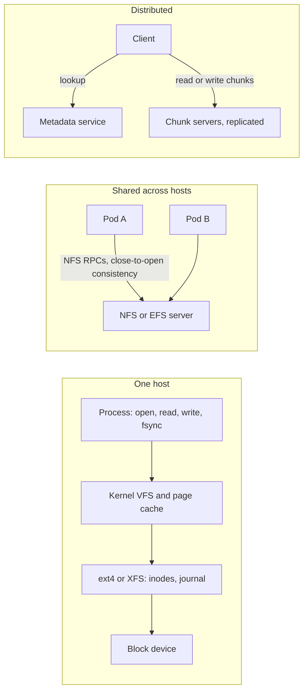

# File Systems

> [!abstract] In one sentence
> A file system turns raw blocks into named, hierarchical, mutable files with POSIX semantics — open, read at an offset, write in place, rename atomically, lock — which is what most software expects, and which is exactly the set of guarantees that becomes slow, inconsistent or impossible once many hosts share the same tree.

> [!tip] Deeper treatment in your system-design vault
> `system-design/15 Interview Playbook/Design Distributed File Storage.md` — read it *after* you have written your own explanation below.

**Map:** [[Storage & Search MOC]] → [[HLD MOC]]

## Definition

A **file system** organises storage into a tree of directories and files, each file a mutable byte array addressed by path and offset, with metadata (size, timestamps, permissions) kept in inodes. A **local file system** (ext4, XFS, NTFS, APFS) lives on one host's [[Block Storage|block device]] and gives the full POSIX contract: byte-range reads and writes, appends, atomic rename, advisory locks, and strong consistency within the host. A **network file system** (NFS, SMB, AWS EFS, Azure Files) exports that tree over the network so several hosts mount it, with weaker and more expensive consistency. A **distributed file system** (HDFS, Ceph FS, GlusterFS, Google's Colossus) spreads file data in chunks across many servers under a metadata service, usually trading parts of POSIX (random writes, locking) for scale.

## Problem solved

Software needs files: configuration, logs, uploaded documents, database data directories, build artefacts, machine learning datasets. The local file system solves the single-host case nearly perfectly — fast, consistent, familiar. The problems begin when more than one host needs the same files: two application pods that must both see an uploaded document, a batch job that writes results a web server reads, a fleet that shares a model directory. Copying files around is error-prone; shipping them through a database is slow. Network file systems answered by making one tree visible everywhere, and distributed file systems answered the next question — what if the tree is bigger than one server — by chunking files across machines. Both exist because POSIX-expecting software is everywhere and rewriting it against an [[Object Storage|object API]] is not always possible.

## How it works

1. **Local layout.** The file system maps paths to inodes and inodes to block extents on the device; a journal (ext4, XFS) or copy-on-write tree (ZFS, Btrfs, APFS) makes metadata updates crash-safe. The page cache in the kernel absorbs reads and buffers writes; `fsync()` is what forces data to the device, and it is the primitive every database's durability rests on ([[Relational Database Internals]]).
2. **POSIX contract.** `open/read/write/lseek` give random access, `rename` is atomic within a file system (the basis of "write temp, fsync, rename" for safe updates), `flock`/`fcntl` give advisory locking, and directory listing is cheap. Within a host, a write is visible to the next read immediately.
3. **Network file systems.** NFS clients send RPCs for each operation to a server that owns the disk. To make this bearable, clients cache attributes and data; NFS's **close-to-open consistency** promises only that a file closed on one client is fully visible to another client that opens it afterwards — concurrent writers on two hosts can interleave or lose updates, and locks are a separate, fragile protocol. EFS is NFSv4 as a managed, multi-AZ service with elastic capacity; its throughput and IOPS are provisioned or burst-based, and per-operation latency is milliseconds, not microseconds.
4. **Distributed file systems.** HDFS splits each file into large blocks (128 MB by default), replicates them three times across DataNodes, and keeps the namespace in a NameNode; it supports write-once/append-only files, which is what made it simple and scalable for batch analytics. Ceph FS stores data as objects in RADOS with a metadata server cluster and offers near-POSIX semantics; Colossus (Google) and Tectonic (Meta) are the same shape at larger scale. The common pattern: **separate metadata from data**, make data chunks immutable or append-only, and let clients talk to chunk servers directly after consulting metadata.
5. **Why shared mutable state scales poorly.** Every POSIX guarantee that is trivial on one host — atomic rename, visible-immediately writes, locks — requires coordination across hosts: a metadata service that becomes the bottleneck or single point of failure, cache invalidation chatter, and lock managers that must handle client crashes. Systems that scale do so by giving up the guarantees (HDFS: no random writes) or by sharding the namespace (Colossus, Tectonic).
6. **In Kubernetes.** A pod gets an ephemeral local file system; a `PersistentVolume` backed by block storage (`ReadWriteOnce`) attaches to one node; a `ReadWriteMany` volume needs a network file system (EFS CSI driver, NFS) and inherits its semantics and latency.

```bash
# Safe in-place update on a POSIX file system: temp file, fsync, atomic rename
tmp=$(mktemp config.yaml.XXXX)
cat new-config.yaml > "$tmp" && sync -f "$tmp"       # or fsync from code
mv "$tmp" config.yaml                                   # atomic within one file system
# On NFS: rename is atomic on the server, but other clients may cache the old file until reopen
```

## Architecture



> [!example]- Excalidraw version — the same diagram as an editable canvas
> ![[File Systems.excalidraw]]
> [[File Systems.excalidraw|Open in Excalidraw]] — needs the Excalidraw plugin (see [[Plugins to Install]]).


## Use cases

- "This software expects a directory" (databases, legacy apps, build tools, ML frameworks loading datasets by path) — local or block-backed file system on one host.
- "Several pods must read and occasionally write the same files" with modest throughput — a managed NFS such as EFS, accepting its latency and consistency.
- "Batch analytics over huge files written once" — HDFS-style or, today, [[Object Storage]] with [[Data Lakes|lake table formats]].
- "Lift-and-shift of an application that writes uploads to disk" — a shared file system as a bridge before moving to object storage ([[Strangler Pattern]]).
- "Scratch space for a single job" — ephemeral local disk, the fastest option.

## Limitations

- Network file systems give weaker consistency than local ones and cannot safely host databases or anything that relies on locks across hosts.
- Per-operation latency over the network (milliseconds) makes metadata-heavy workloads — millions of small files, `ls` on huge directories — painfully slow.
- Capacity, throughput and IOPS of a shared file system are provisioned or burst-limited; they do not scale with clients the way object storage does.
- Distributed file systems with full POSIX are complex to operate; the ones that are simple give up random writes.
- Hierarchies invite deep trees and renames that are cheap locally but expensive or non-atomic across a cluster.

## Trade-offs

| You gain | You sacrifice |
|---|---|
| POSIX semantics every program understands: paths, offsets, in-place writes, rename, locks | Scalability of shared mutable state across many hosts |
| Microsecond local access through the page cache | That speed the moment the file system is network-mounted |
| A single shared tree visible to all hosts (network file systems) | Strong consistency and safe concurrent writes |
| Elastic capacity and chunk-level replication (distributed file systems) | Parts of POSIX, operational simplicity, and per-operation latency |

## Failure modes

- **Two writers on NFS corrupt a file** (log files appended from several pods, a SQLite database on a shared mount): interleaved or lost writes; noticed as truncated or garbled content; blast radius is that file and whatever reads it. Give each writer its own file or move to a service that serialises writes.
- **Stale cache after close-to-open**: pod B reads an old version seconds after pod A wrote; noticed as "the config change did not apply on some pods". Reopen the file, or push changes through a store with explicit versioning.
- **Metadata bottleneck**: a directory with millions of small files makes listing and creation crawl; noticed as rising latency on upload paths. Shard directories by hash prefix or stop using a file system for it.
- **Burst credits exhausted on a managed file system** (EFS bursting mode): throughput falls to the baseline after a sustained load and everything mounted slows at once. Noticed via the burst-credit metric; switch to provisioned or elastic throughput.
- **Hung mount**: an NFS server outage leaves client processes blocked in uninterruptible I/O; pods cannot even be killed cleanly. Mount with timeouts and treat the server as a hard dependency in your [[Availability]] model.

## Performance

Local file systems through the page cache deliver reads in microseconds and sequential throughput at the device's limit; `fsync` latency (hundreds of microseconds on NVMe, milliseconds on networked block storage) bounds write-durable throughput. Network file systems add a round trip per uncached operation — typically single-digit milliseconds — so small-file and metadata-heavy workloads degrade by orders of magnitude while large sequential reads can still approach provisioned bandwidth. Distributed file systems optimise for large sequential chunks: HDFS throughput scales with DataNodes, while small files are its documented weakness.

## Scalability

Local: bounded by one host's disks and CPU — scale vertically or shard the data across hosts yourself. Network: capacity is elastic (EFS) but throughput and metadata operations are shared and provisioned, so the file system becomes the fleet's common bottleneck. Distributed: data scales linearly with chunk servers, metadata is the hard part — a single NameNode holds the namespace in memory, and federation or sharded metadata (Colossus, Tectonic) is how exabyte systems are built. The architectural lesson for application design: shared mutable files do not scale horizontally, so push shared state into a database, a queue or an object store and keep file systems local ([[Horizontal vs Vertical Scaling]]).

## Operational impact

Local file systems are nearly free to operate but must be sized and monitored for disk-full (the most common silent outage cause: logs filling a node). Network file systems add a shared dependency with its own availability, performance credits, backup story and security (mount permissions, encryption in transit). Distributed file systems are a platform in themselves — HDFS or Ceph clusters need dedicated operators — which is why managed object storage has replaced them for most new analytics workloads. In Kubernetes, `ReadWriteMany` requests should prompt the question "does this really need a file system?"

## Alternatives

- **[[Object Storage]]** — wins for write-once data, sharing across hosts and scale; loses POSIX semantics and latency.
- **[[Block Storage]]** — wins when one host needs a fast disk (databases); not shareable.
- **A database or [[Redis]]** — wins for small, structured, concurrently updated state that was living in files for convenience.
- **Content-addressed chunk stores** on top of object storage — wins for sync and dedup of versioned files ([[Design File Storage]]).

## Real-world examples

- Google's GFS paper (2003) and its successor Colossus established the chunk-server-plus-metadata design; HDFS was the open-source reimplementation that powered the Hadoop era.
- Meta's Tectonic consolidated separate HDFS-style and blob clusters into one exabyte-scale file system with sharded metadata.
- AWS EFS is NFSv4 as a service, commonly used for shared content in lift-and-shift web applications and for ML training data across many instances.
- In a stack like yours: pods on EKS use ephemeral local disk for scratch and logs shipped by an agent, PostgreSQL runs on block-backed volumes (or RDS), uploaded documents go to S3 with pointers in the database ([[Blob Storage]]), and an EFS `ReadWriteMany` volume would be reserved for legacy components that cannot be changed to read from S3.

## Practical exercise

1. In Docker Compose, run an NFS server container and mount its export into two application containers; from each, append lines to the same file concurrently for a minute and inspect the result for interleaving and loss.
2. Write a config file from container A and read it from container B in a loop, with and without reopening the file; measure how long B sees stale content.
3. Benchmark 10,000 small-file creates and one 1 GB sequential write on the local file system versus the NFS mount with `fio` or a small Java/TypeScript loop; compare operations per second and throughput.
4. Run a PostgreSQL data directory on the NFS mount (deliberately) and read its documentation on why that is discouraged; observe `fsync` latency with `pg_test_fsync`.
5. Re-implement the "shared uploads directory" as pointers plus MinIO and compare the code and failure modes.

## Related concepts

### Prerequisites
- [[Block Storage]] — the device a local file system sits on
- [[Consistency Models]] — close-to-open consistency is a weak model with a name

### Related
- [[Object Storage]] — the flat, immutable alternative that scales
- [[Blob Storage]] — where application files should usually live
- [[Relational Database Internals]] — `fsync`, journals and why databases want local disks
- [[Horizontal vs Vertical Scaling]] — shared mutable state as the enemy of horizontal scale
- [[Availability]] — a shared mount is a shared dependency

### Builds on this
- [[Data Lakes]] — the successor to HDFS-style analytics storage
- [[Backups and Restoration]] — snapshots of file systems versus object versioning
- [[Design File Storage]] — building Dropbox-like semantics on object storage

### Design problems where it applies
- [[Design File Storage]]
- [[Design a Logging System]]
- [[Design a Video Streaming Service]]

### Projects where it can be implemented
- [[Chaos Lab]]

### Resources
- [[Designing Data-Intensive Applications]] — storage engines and the role of the file system beneath them
- [[Database Internals]] — file formats, journaling and durability primitives

## Personal understanding

> [!question] Explain it without the source
> Write your own explanation here, from memory. Then compare it with the sections above and note what you missed.

### Mastery checklist
- [ ] I can explain it without the original resource
- [ ] I can describe the problem it solves
- [ ] I can compare it with its alternatives
- [ ] I can name its limitations and failure modes
- [ ] I can recognise when it is appropriate in a real system
- [ ] I have applied it in a system design
- [ ] I have validated my assumptions with an experiment or implementation

## Open questions

- [ ] What exactly does NFSv4 guarantee for `rename` visibility across clients, and how does EFS document its consistency?
- [ ] Which of our workloads request `ReadWriteMany` volumes today, and could each be replaced by object storage plus a pointer table?
- [ ] How do Colossus-style systems shard metadata without breaking atomic rename across shards?
