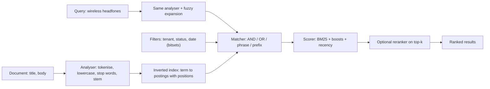

# Full-Text Search

> [!abstract] In one sentence
> Full-text search makes "find documents *about* X" tractable by analysing text into tokens (tokenise, lowercase, strip stop words, stem), looking those tokens up in an [[Inverted Indexes|inverted index]], and scoring matches with TF-IDF or BM25 so that the best documents rise to the top — a different problem from the exact-match filtering a B-tree [[Indexing|index]] handles, and one you can get from PostgreSQL for modest needs or from a [[Search Engines|search engine]] for serious ones.

**Map:** [[Storage & Search MOC]] → [[HLD MOC]]

## Definition

Full-text search is the retrieval of documents from a collection by the *content* of their text rather than by exact field values. It has three parts. **Analysis** converts raw text into a normalised token stream (`"Running Payments, Ltd."` → `run`, `payment`, `ltd`) identically for indexed documents and incoming queries. **Matching** finds documents containing the query tokens — any of them (OR), all of them (AND), in sequence (phrase), within an edit distance (fuzzy), or by prefix — using an inverted index. **Ranking** orders matches by a relevance score, classically **TF-IDF** and today **BM25**, optionally combined with business signals (recency, popularity, boosts). Implementations range from PostgreSQL's `tsvector`/`tsquery` and MySQL's `FULLTEXT` to Lucene-based engines (Elasticsearch, OpenSearch, Solr) and purpose-built libraries (Tantivy, Bleve).

## Problem solved

`WHERE title LIKE '%payment%'` has four defects: it scans every row (no B-tree can serve a leading wildcard), it matches substrings rather than words (`repayment`, `payments`), it ignores case, inflection and typos unless you hand-roll them, and it returns rows in no useful order — ten thousand matches with no sense of which are *about* payments. Users, meanwhile, type two or three words with a typo and expect the right answer first. Full-text search exists to make that expectation cheap: analysis normalises language variation once at index time, the inverted index makes lookups independent of corpus size, and relevance scoring turns a set of matches into a ranked list. The second, quieter problem it solves is separating **filtering** (which documents qualify: tenant, status, date) from **ranking** (which qualifying documents are best), two operations with different index structures and costs.

## How it works

1. **Tokenisation.** A tokeniser splits text into terms: the standard tokeniser on Unicode word boundaries; whitespace or pattern tokenisers for codes and ids; n-gram tokenisers for partial matching; language-specific ones for CJK scripts where words are not space-delimited.
2. **Token filters.** Lowercasing; **stop-word** removal (`the`, `of` — cheap to drop, but they matter in phrases like "to be or not to be"); **stemming** (Porter/Snowball: `payments` → `payment`, `running` → `run`) or **lemmatisation** (dictionary-based, more accurate, slower); synonym expansion (`tv` ↔ `television`); ASCII folding (`café` → `cafe`); **edge n-grams** for prefix/autocomplete (`pay`, `paym`, `payme`…). The same chain must run on queries, otherwise `Payments` never matches `payment`.
3. **Indexing.** Each term maps to a posting list of document ids with per-document term frequency and positions ([[Inverted Indexes]]); positions enable phrase and proximity queries. Fields are analysed independently so `title` and `body` can have different chains and boosts.
4. **Query types.** *Term/match* (analysed, OR or AND); *phrase* (`"card declined"` using positions, with optional slop); *prefix* (`pay*`, expensive on large term dictionaries unless edge n-grams are indexed); *fuzzy* (Levenshtein distance ≤ 1–2 via automaton over the term dictionary — `headfones` → `headphones`); *boolean* combinations; *filters* on `keyword`, numeric and date fields that do not affect the score.
5. **Scoring.** TF-IDF: a term counts more the more often it appears in the document (TF) and the rarer it is across the corpus (IDF). **BM25** refines it with two parameters: `k1` (≈1.2) saturates TF so the tenth occurrence adds little, and `b` (≈0.75) normalises by document length so long documents do not win by volume. The score for a query is the sum over its terms; field boosts weight `title` above `body`; function scores add recency decay or popularity; a second-stage reranker (learning-to-rank or a cross-encoder model) can reorder the top-k.
6. **Filtering versus ranking.** Filters narrow the candidate set with cheap, cacheable bitsets; scoring runs only over candidates. A design that puts tenant, status and date into *filters* and text into *must* clauses is both faster and more correct than scoring everything.
7. **In the database.** PostgreSQL stores an analysed `tsvector` (`to_tsvector('english', title || ' ' || body)`), indexes it with GIN, matches with `@@` against a `tsquery`, ranks with `ts_rank`/`ts_rank_cd` (TF-based, no IDF), and offers `pg_trgm` trigram indexes for fuzzy and `LIKE '%x%'` matching. It is good for tens of millions of rows and one language; it lacks BM25 (extensions add it), facet aggregations and horizontal query scaling.

```sql
-- PostgreSQL: analysed column, GIN index, ranked phrase-aware search with a filter
ALTER TABLE merchants ADD COLUMN search tsvector
  GENERATED ALWAYS AS (
    setweight(to_tsvector('english', coalesce(name, '')), 'A') ||
    setweight(to_tsvector('english', coalesce(description, '')), 'B')) STORED;
CREATE INDEX merchants_search_idx ON merchants USING gin (search);

SELECT id, name, ts_rank_cd(search, q) AS score
FROM merchants, websearch_to_tsquery('english', 'wireless "head phones"') q
WHERE search @@ q AND status = 'ACTIVE'              -- filter, then rank
ORDER BY score DESC LIMIT 20;
```

## Architecture



> [!example]- Excalidraw version — the same diagram as an editable canvas
> ![[Full-Text Search.excalidraw]]
> [[Full-Text Search.excalidraw|Open in Excalidraw]] — needs the Excalidraw plugin (see [[Plugins to Install]]).


## Use cases

- "Users search by words, phrases or partial names and expect relevance and typo tolerance" — product, merchant, document, help-centre and customer search.
- "Find transactions or tickets by free-text notes and descriptions" — operations and support tooling where exact ids are unknown.
- "Autocomplete as the user types" — edge n-grams or completion structures ([[Design Search Autocomplete]]).
- "Multi-language content" — per-language analysers, which databases handle only partially.
- "Search inside uploaded documents" — extract text (PDF, DOCX) into an indexed field ([[Blob Storage]] pointers plus an index).

## Limitations

- Lexical matching misses meaning: `cheap flights` does not match `inexpensive airfare`; synonyms help, embeddings (vector search) address it differently, and hybrid retrieval combines both.
- Analysis is lossy and language-specific; stemming errors (`universal` → `univers`) and stop-word removal change results in ways users notice.
- Relevance has no ground truth; tuning is empirical and needs judgement lists or click data, and every change can regress a query you did not test.
- Prefix, wildcard and fuzzy queries on large term dictionaries are expensive; they need index-time preparation (n-grams) to be fast.
- Database full-text search scales reads with the database and lacks facets and BM25; moving to an engine later means building a sync pipeline ([[Search Indexing Pipelines]]).

## Trade-offs

| You gain | You sacrifice |
|---|---|
| Word-level, language-aware matching with typo tolerance | Exactness: analysis normalises away distinctions users sometimes want |
| Relevance ranking instead of arbitrary order | Determinism and simple explainability of results |
| Queries whose cost is independent of corpus size | Write-time cost: analysis and index maintenance per document |
| Database-native search without a second system (PostgreSQL) | BM25, facets and read scale-out that a dedicated engine provides |

## Failure modes

- **Query and index analysed differently** (different analyser, language or version): matches silently vanish for a subset of terms; noticed via user complaints that "search stopped finding X". Pin analysers per field and test with a golden query set.
- **Stop words break exact phrases**: searching a product code or a title like "The The" returns nothing or everything; noticed in support tickets. Keep a non-stop-word `keyword` or exact subfield.
- **Leading-wildcard or fuzzy query storm**: a UI sends `*term*` with fuzziness on every keystroke; CPU on the search tier spikes and p99 climbs for all users. Rate-limit and debounce the client, use edge n-grams, and cap fuzziness.
- **Scoring dominated by length or duplicates**: a document with the term repeated fifty times (spam, boilerplate) tops every result; BM25's saturation helps, but noticed as junk at rank 1. Clean inputs and boost by trusted fields.
- **GIN index bloat and slow updates** in PostgreSQL: high write rates against a GIN index with `fastupdate` pending lists cause latency spikes at cleanup; noticed as periodic write stalls. Tune `gin_pending_list_limit` or move search out of the primary.

## Performance

A term lookup is a dictionary probe plus a posting-list scan; conjunctions intersect sorted lists with skip pointers, so a query over tens of millions of documents answers in milliseconds when the index is in memory. Phrase queries cost more (positions must be compared), fuzzy queries expand to many terms, and prefix queries over huge dictionaries can be the slowest operation in the system. Scoring cost is proportional to candidate documents, which is why filters first and top-k heaps matter. Write cost is per-document analysis (microseconds to milliseconds) plus index maintenance; in PostgreSQL a GIN index roughly doubles the write cost of the row and must be vacuumed. Measure relevance separately from [[Latency]]: a fast wrong answer is still wrong.

## Scalability

In the database, full-text search scales with the primary or [[Read Replicas|read replicas]] and shares their buffer cache; tens of millions of documents with moderate query rates are fine, beyond which the engine path — sharded indexes, replicas for query throughput — takes over ([[Search Engines]]). The corpus side scales through segment merges and sharding; the query side through replicas and caching of filter bitsets. At 10x corpus size, IDF statistics, term dictionary size and prefix-query cost change behaviour; at 10x query rate, the question is replicas and whether the hot queries are cacheable.

## Operational impact

Moderate: analysers, synonym lists and boosts are configuration that changes product behaviour and must be versioned, reviewed and regression-tested with a query set; index rebuilds are required for analyser changes; relevance needs an owner and a feedback loop (click-through, zero-result rate, abandoned searches as [[Metrics]]). In PostgreSQL the operational cost is GIN maintenance and write amplification; in an engine it is the cluster ([[Search Engines]]). Document extraction for binaries (PDFs) adds a processing pipeline.

## Alternatives

- **B-tree and trigram [[Indexing|indexes]]** (`pg_trgm`) — wins for substring and fuzzy matching on short fields (names, codes) without tokenisation semantics.
- **Vector (semantic) search** ([[pgvector]], engine kNN) — wins when meaning matters more than words; loses precision on exact terms, ids and names; hybrid is the common answer.
- **A dedicated [[Search Engines|search engine]]** — wins for BM25, facets, multi-language and read scale-out at the cost of a sync pipeline.
- **Hosted search** (Algolia, Typesense) — wins for product search with prebuilt typo tolerance and ranking rules when time-to-market dominates.

## Real-world examples

- Lucene's BM25 default (since version 6) replaced TF-IDF across Elasticsearch and Solr; the function's parameters and the Okapi research behind it are documented in Elastic's "Practical BM25" series.
- PostgreSQL's full-text search (`tsvector`, GIN, `websearch_to_tsquery`) powers search in many mid-sized products; GitLab, for instance, has used both PostgreSQL search and Elasticsearch "advanced search" depending on tier and scale.
- Wikipedia's CirrusSearch layers language analysers and learning-to-rank over Elasticsearch for hundreds of languages.
- In a stack like yours: merchant and customer lookup in support tooling starting with a generated `tsvector` column and GIN index in PostgreSQL (plus `pg_trgm` for partial account names), with a defined threshold — corpus size, facet needs, query p99 on the replica — at which the index moves to OpenSearch fed by the outbox ([[Search Indexing Pipelines]]).

## Practical exercise

1. Load 2 million synthetic merchant records (name, description, category, status) into PostgreSQL.
2. Compare `ILIKE '%term%'`, a `pg_trgm` GIN index, and the `tsvector` GIN approach above for ten queries including a typo and a phrase; record p50/p99 and judge the top five results by hand.
3. Change the analyser from `english` to `simple` (no stemming) and rerun; note which queries break.
4. Measure insert throughput with and without the GIN index, and observe `fastupdate` cleanup stalls under a sustained write load.
5. Load the same data into OpenSearch, run `multi_match` with `fuzziness: AUTO` and a `terms` aggregation on category; compare relevance and latency, and write down the point at which you would switch.

## Related concepts

### Prerequisites
- [[Inverted Indexes]] — the structure that makes matching fast
- [[Indexing]] — B-trees, GIN and why `LIKE '%x%'` cannot use them

### Related
- [[Search Engines]] — where full-text search lives at scale
- [[Query Execution and Optimization]] — how the planner uses a GIN index and when it does not
- [[Search Indexing Pipelines]] — keeping an external index in sync
- [[Read Replicas]] — isolating search load inside the database
- [[Latency]] — the budget for interactive search

### Builds on this
- [[Design Search Autocomplete]] — prefix structures on top of analysis
- [[Design a RAG Knowledge Assistant]] — hybrid lexical plus vector retrieval
- [[Design a Logging System]] — tokenised log search

### Design problems where it applies
- [[Design Search Autocomplete]]
- [[Design a RAG Knowledge Assistant]]
- [[Design a Logging System]]

### Projects where it can be implemented
- [[Vault RAG Assistant]]
- [[Personal Notification Hub]]

### Resources
- [[PostgreSQL Indexes Docs]] — GIN, GiST and trigram indexes behind in-database search
- [[pgvector]] — the semantic complement to lexical search
- [[Designing Data-Intensive Applications]] — indexes and derived data

## Personal understanding

> [!question] Explain it without the source
> Write your own explanation here, from memory. Then compare it with the sections above and note what you missed.

### Mastery checklist
- [ ] I can explain it without the original resource
- [ ] I can describe the problem it solves
- [ ] I can compare it with its alternatives
- [ ] I can name its limitations and failure modes
- [ ] I can recognise when it is appropriate in a real system
- [ ] I have applied it in a system design
- [ ] I have validated my assumptions with an experiment or implementation

## Open questions

- [ ] How much does the lack of IDF in PostgreSQL's `ts_rank` hurt ranking on our corpora compared with BM25, measured on a judgement set?
- [ ] What is the right analyser chain for Indian merchant names that mix scripts, transliterations and abbreviations?
- [ ] At what query rate and corpus size does GIN maintenance on the primary become the reason to move search out, rather than relevance?
