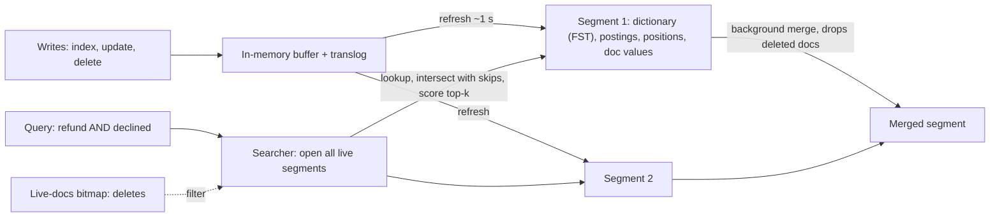

# Inverted Indexes

> [!abstract] In one sentence
> An inverted index flips the document → words relation into words → documents, storing for every term a compressed, sorted list of the documents (and positions) that contain it, which makes "which documents mention *refund* and *declined*" a matter of intersecting two lists — the structure beneath every [[Search Engines|search engine]], PostgreSQL's GIN index and even a [[Time-Series Databases|TSDB]]'s label index.

**Map:** [[Storage & Search MOC]] → [[HLD MOC]]

## Definition

An inverted index consists of a **term dictionary** — every distinct token in the corpus, sorted — and, for each term, a **posting list**: the ids of documents containing that term in ascending order, usually with per-document **term frequency** and, in a positional index, the **positions** at which the term occurs. A **forward index** (document → terms, or stored fields and doc values) often sits beside it for retrieving and scoring the matched documents. In Lucene, the index is a set of immutable **segments**, each a complete mini-index built from a batch of documents; new documents go into new segments, deletions are recorded in a bitmap, and segments are periodically **merged**. The same structure under another name appears as PostgreSQL's GIN (Generalized Inverted Index) and as the label index of Prometheus.

## Problem solved

To answer "which of these ten million documents contain the word *refund*", the naive approach reads every document — cost proportional to the corpus, every query. A B-tree on a text column does not help: it orders whole values, not the words inside them, so only prefix matches on the entire field use it ([[Indexing]]). The inverted index pre-computes the answer at write time: the list of documents for *refund* is already sitting in the index, so the query cost is proportional to the *size of the result*, not the corpus. Combined with analysis ([[Full-Text Search]]) it also solves variation — one posting list for `refund` covers *refunds*, *Refunded* and *refunding* — and with positions it answers phrase and proximity queries that no other structure handles. The engineering problem then becomes keeping such an index *updatable* and *compact*, since a naive mutable index would fragment under writes and a naive representation would be larger than the text itself.

## How it works

1. **Build.** For a batch of documents, run analysis to get `(term, docId, position)` triples, sort by term then docId, and write: the term dictionary (an FST — finite state transducer — in Lucene, which compresses shared prefixes and maps term → pointer), the postings (docIds as deltas, variable-byte or bit-packed — `[3, 7, 8, 20]` becomes `[3, 4, 1, 12]`, small integers that pack into few bits), frequencies, and positions. A **skip list** over each posting list lets intersections jump ahead instead of walking every entry.
2. **Query.** For `refund AND declined`: look up both terms, open both posting lists, and intersect by advancing the smaller list and skipping in the larger (`advance(docId)`); for OR, merge; for a phrase, intersect then check that positions differ by one. Each matched document gets a score from its frequencies and the term's IDF, maintained in a top-k heap.
3. **Segments and refresh.** Writes are buffered in memory and periodically **flushed** as a new immutable segment (Elasticsearch's refresh, 1 s by default). A query opens all live segments and merges their results. Nothing is ever modified in place: an update is a delete (a bit flipped in the segment's live-docs bitmap) plus an insert into a new segment — the same append-and-merge discipline as LSM-tree storage engines ([[Relational Database Internals]]).
4. **Merge.** Small segments are merged into larger ones in the background (tiered merge policy): the merged segment drops deleted documents physically, rebuilds the dictionary and postings, and the old segments are removed once no reader uses them. Merging costs CPU and I/O proportional to the data rewritten — the **write amplification** of search — and is throttled so it does not starve queries.
5. **Compression trade-offs.** Smaller postings mean more of the index fits in the page cache, but decoding costs CPU; modern codecs (Lucene's PFOR-delta variants, Roaring bitmaps for dense sets, Elias–Fano) balance the two. Positions roughly double index size; omit them for fields that never need phrase queries. Index size on disk is typically a fraction of the raw text — commonly 20–50% depending on positions and stored fields, workload-dependent.
6. **Doc values and columnar companions.** Sorting, aggregations and function scores need document → value access, the forward direction. Engines store a **columnar** copy per field (doc values) alongside the inverted index; conflating the two (using inverted-index field data for aggregations) is the classic way to run out of heap.
7. **Numeric and geo.** Ranges over numbers are not term lookups; Lucene uses BKD trees (k-d trees over blocks) for numeric and geo fields, while GIN in PostgreSQL also indexes arrays and JSONB keys as "terms" — the inverted index generalises to any multi-valued attribute.

```text
Corpus
  d1: "refund declined by issuer"
  d2: "refund processed"
  d3: "card declined, refund requested"

Dictionary -> postings (docId: positions)
  card      -> d3:0
  declin    -> d1:1, d3:1
  issuer    -> d1:3
  process   -> d2:1
  refund    -> d1:0, d2:0, d3:2
  request   -> d3:3

Query "refund AND declin": intersect [d1,d2,d3] with [d1,d3] = [d1,d3]
Phrase "refund declin": d1 has refund@0, declin@1 -> match; d3 has refund@2, declin@1 -> no
```

## Architecture



> [!example]- Excalidraw version — the same diagram as an editable canvas
> ![[Inverted Indexes.excalidraw]]
> [[Inverted Indexes.excalidraw|Open in Excalidraw]] — needs the Excalidraw plugin (see [[Plugins to Install]]).


## Use cases

- "Search by words inside text fields" — the base case; any [[Full-Text Search]] need.
- "Filter by any of many tags, labels or JSON keys" — PostgreSQL GIN on arrays and JSONB, label matchers in a TSDB.
- "Find all events with these attributes, fast, in a write-heavy stream" — log and event search where append-and-merge fits the arrival pattern ([[Design a Logging System]]).
- "Phrase and proximity queries" — positional postings are the only structure that answers them.
- "Faceted browsing" — posting-list intersections for filters plus doc values for counts ([[Search Engines]]).

## Limitations

- Write cost: every document is analysed, buffered, flushed and later rewritten by merges; high update rates on large documents generate heavy I/O.
- Near-real-time, not real-time: a document is searchable only after the next refresh, so read-your-writes needs a forward lookup or a forced refresh.
- Updates are delete-plus-insert; a corpus with frequent in-place edits accumulates deleted documents until merges catch up, inflating size and slowing queries.
- Term dictionary size grows with vocabulary; high-cardinality tokens (ids, hashes, n-grams of everything) bloat it and slow prefix and fuzzy queries.
- It answers "which documents" well and "sort/aggregate by value" poorly without a companion columnar structure.

## Trade-offs

| You gain | You sacrifice |
|---|---|
| Query cost proportional to results, not corpus size | Write amplification from analysis, flush and merge |
| Phrase, proximity and multi-valued attribute queries | Immediate visibility of writes |
| Compact, cache-friendly immutable segments | In-place updates; deletes are tombstones until merged |
| A general structure for text, tags, labels and JSON keys | Native range and sort operations, which need other structures |

## Failure modes

- **Merge storms**: a bulk reindex or a burst of updates creates many segments; merges saturate disk I/O and queries slow for everyone. Noticed via merge-thread metrics and rising search latency during loads; throttle merges, increase refresh interval during bulk loads, and size bulk requests.
- **Deleted-document bloat**: a table-like workload updating every document daily leaves 30–50% deleted docs in large segments that rarely merge; noticed as index size and latency drifting up. Force-merge during quiet hours or redesign updates to touch fewer documents.
- **Dictionary explosion**: indexing unique ids, UUIDs or full URLs as analysed text; the FST and postings balloon, and prefix queries crawl. Noticed as memory growth per shard; index such fields as `keyword` (exact) or not at all.
- **Fielddata on text fields**: aggregating on an analysed field loads the entire inverted index into heap; noticed as circuit-breaker trips. Use doc values on `keyword` fields.
- **Refresh set too low**: 100 ms refreshes for "real-time" create tiny segments and constant merging; noticed as high CPU with modest traffic. Accept near-real-time or use a forward index for the few cases that need immediacy.

## Performance

Lookups are a dictionary probe (memory-resident FST) plus sequential, compressed posting-list reads; an AND of two common terms over tens of millions of documents completes in milliseconds when postings are in the page cache. Skip lists make conjunctions cost roughly proportional to the *smaller* list. Positional queries read more data and cost several times a plain match. Write throughput is bounded by analysis CPU and merge I/O; raising the refresh interval and using large bulk batches commonly multiplies indexing throughput. Memory: keep the term dictionary and hot postings in the OS page cache; heap holds only transient structures and doc-value caches — the reason the "half RAM to heap, half to the page cache" rule exists.

## Scalability

Within one index, the structure scales until segments outgrow cache and merges dominate; beyond that, split into shards, each its own set of segments, and fan queries out ([[Sharding]], [[Search Engines]]). Immutable segments make [[Replication]] simple — copy files — and make snapshots cheap. At 10x corpus, merge policy, positional data and stored fields decide disk and I/O; at 10x write rate, the refresh interval and the number of replicas (each re-indexing every document) decide CPU. Time-based rollover indexes keep old segments static and fully merged, which is why logs and metrics map so well onto this structure.

## Operational impact

Mostly indirect: you do not operate an inverted index, you operate the engine or database that contains it, but the index's behaviour explains the metrics you watch — segment counts, merge activity, deleted-document ratio, refresh latency, page-cache hit rate — and the tuning you perform (refresh interval, merge throttling, force-merge after bulk loads, mapping choices such as positions and doc values). In PostgreSQL the equivalent chores are GIN's pending list and vacuum. Understanding the structure is what turns "search is slow" from a mystery into a diagnosis.

## Alternatives

- **B-tree [[Indexing|indexes]]** — wins for exact and range predicates on scalar values and prefix matches on whole fields; cannot index words within text.
- **Trigram (n-gram) indexes** (`pg_trgm`) — an inverted index over character trigrams; wins for substring and fuzzy matching on short strings, costs size.
- **Suffix arrays and tries** — win for arbitrary substring search and autocomplete over a fixed corpus; updates are expensive ([[Design Search Autocomplete]]).
- **Bitmap indexes** — win for low-cardinality attributes in analytical stores; Roaring bitmaps blur the line, as modern posting codecs use them.

## Real-world examples

- Apache Lucene (1999, Doug Cutting) is the reference implementation whose FST dictionary, block-packed postings and tiered merge policy are described in its codec documentation; Elasticsearch, OpenSearch and Solr are its servers.
- PostgreSQL's GIN index implements the same idea for `tsvector`, arrays and JSONB, with a pending-list optimisation for write bursts documented in the manual.
- Prometheus's TSDB index is an inverted index from label pairs to series ids, with posting-list intersection for selectors — the Gorilla-descended design applied to metrics ([[Time-Series Databases]]).
- In a stack like yours: OpenSearch shards holding merchant and transaction-note indexes with positions enabled only on free-text fields, account ids as `keyword`, refresh at 5–30 s for operational search, and PostgreSQL GIN on JSONB metadata columns for tag-style filtering inside the primary.

## Practical exercise

1. Write a 150-line Java or TypeScript program that builds an in-memory inverted index (dictionary → sorted postings with positions) over 100,000 generated documents, with AND, OR and phrase queries; measure query time versus a linear scan as the corpus grows from 10k to 1M.
2. Add delta encoding and variable-byte compression to the postings; compare memory use and decode time.
3. In OpenSearch, bulk-load 5 million documents with refresh interval 1 s and then 30 s; compare indexing throughput and segment counts (`_cat/segments`), then force-merge and compare query p99.
4. Update every document once; observe `docs.deleted` growth and query latency; force-merge and remeasure.
5. In PostgreSQL, create a GIN index on a JSONB column, insert at high rate with `fastupdate` on and off, and watch latency spikes around pending-list cleanup.

## Related concepts

### Prerequisites
- [[Indexing]] — B-trees and why they cannot index words
- [[Relational Database Internals]] — LSM-style append-and-merge, which segments mirror

### Related
- [[Time-Series Databases]] — label indexes are inverted indexes
- [[Search Indexing Pipelines]] — bulk loads, refresh and merges under load
- [[Query Execution and Optimization]] — how planners decide to use a GIN index
- [[Sharding]] — each shard is its own set of segments
- [[Replication]] — immutable segments make copying shards simple

### Builds on this
- [[Full-Text Search]] — analysis and scoring on top of the postings
- [[Search Engines]] — sharded, replicated segments behind a query API
- [[Logging]] — log search is inverted indexes over tokenised lines

### Design problems where it applies
- [[Design Search Autocomplete]]
- [[Design a Logging System]]
- [[Design a Metrics and Monitoring System]]

### Projects where it can be implemented
- [[Vault RAG Assistant]]
- [[Live Ops Dashboard]]

### Resources
- [[PostgreSQL Indexes Docs]] — GIN internals and the pending list
- [[Designing Data-Intensive Applications]] — chapter 3 on indexes, LSM trees and full-text structures
- [[Database Internals]] — on-disk index structures and merge-based storage

## Personal understanding

> [!question] Explain it without the source
> Write your own explanation here, from memory. Then compare it with the sections above and note what you missed.

### Mastery checklist
- [ ] I can explain it without the original resource
- [ ] I can describe the problem it solves
- [ ] I can compare it with its alternatives
- [ ] I can name its limitations and failure modes
- [ ] I can recognise when it is appropriate in a real system
- [ ] I have applied it in a system design
- [ ] I have validated my assumptions with an experiment or implementation

## Open questions

- [ ] How does Lucene's tiered merge policy decide which segments to merge, and what does that imply for a workload that updates the same documents daily?
- [ ] What is the actual size ratio of positions versus plain postings on our merchant descriptions, and which fields truly need phrase queries?
- [ ] How do Roaring bitmaps compare with delta-packed postings for the dense filter sets (status, tenant) in our indexes?
