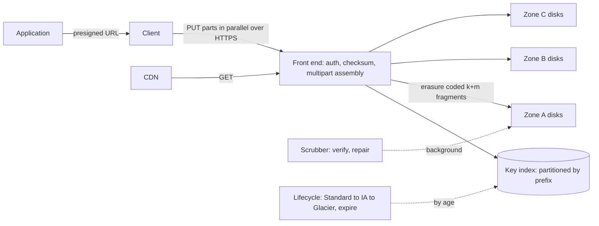

# Object Storage

> [!abstract] In one sentence
> An object store trades the file system's hierarchy, mutability and POSIX semantics for a flat key–value namespace of immutable objects over HTTP, which is exactly the simplification that lets a provider spread your bytes across many disks and data centres, promise extreme durability, and charge only for what you store and request.

> [!tip] Deeper treatment in your system-design vault
> `system-design/07 NoSQL and Storage Engines/How S3 Works.md` — read it *after* you have written your own explanation below.

**Map:** [[Storage & Search MOC]] → [[HLD MOC]]

## Definition

Object storage is a service that stores **objects** — an opaque byte sequence (bytes to terabytes), a **key** (a string such as `invoices/2026/10/inv_8841.pdf`; the slashes are convention, not directories), and **metadata** (content type, user tags, checksums) — inside **buckets**, accessed through an HTTP API: `PUT`, `GET`, `HEAD`, `DELETE`, `LIST` by prefix, and multipart upload for large objects. Objects are immutable: you replace one by writing a new object under the same key (optionally keeping versions), never by editing bytes in place. Amazon S3 defined the model and its API, which Google Cloud Storage, Azure Blob Storage, MinIO, Ceph RGW and others implement or mirror; see [[Blob Storage]] for the vocabulary overlap.

## Problem solved

Before object stores, large binary data lived on file servers or in database BLOB columns, and both broke at scale: a file server is one machine with finite disks and a single point of failure, NFS-style sharing scales poorly ([[File Systems]]), and database blobs bloat backups, replication streams and buffer caches ([[Blob Storage]]). Every team re-solved durability (RAID, backups, off-site copies), capacity planning and access control, and still lost data to correlated failures. Object storage moved the problem to a service: unlimited capacity that grows per byte, durability engineered across disks, racks and availability zones so that losing a data centre loses nothing, built-in access control and encryption, and an HTTP interface any language, [[CDNs|CDN]] or analytics engine can use. For the application, "store this file" became one network call with no capacity or durability decisions attached.

## How it works

1. **Namespace.** Keys live in a flat index partitioned by key prefix; `LIST` with a prefix and delimiter *simulates* directories by scanning the index. Renames are copies plus deletes, and listing a prefix with millions of keys is a paged scan, not a directory read — which is why key design (prefix spread, date components) matters for both performance and lifecycle rules.
2. **Write path.** A `PUT` streams bytes to a front-end that computes checksums (MD5 or SHA-256 supplied by the client is verified), then writes to the durability layer before acknowledging. For objects above a threshold (S3 recommends multipart above 100 MB; the limit per part is 5 GB, up to 10,000 parts), **multipart upload** splits the object into parts uploaded in parallel and completed with one call, giving resumability and bandwidth aggregation.
3. **Durability engineering.** Either **replication** (three full copies across zones) or **erasure coding** (split an object into *k* data fragments plus *m* parity fragments — e.g. 10+4 — spread across failure domains, so any *k* survive and storage overhead is 1.4× instead of 3×). Background scrubbers continually re-read and checksum fragments and re-replicate anything lost. The "eleven nines" (99.999999999%) annual durability figure S3 publishes is the design target of this machinery: expected loss of one object in ten billion per year — a design target under stated assumptions, not a guarantee against a bucket-wide accidental delete.
4. **Consistency.** S3 has offered **strong read-after-write consistency** for all operations since December 2020: a `GET` or `LIST` after a successful `PUT` or `DELETE` sees the new state. Earlier it was eventually consistent for overwrites and listings, which shaped a generation of pipelines; other providers and on-prem systems vary, so check ([[Consistency Models]]). There are no multi-object transactions and no atomic rename; conditional writes (`If-None-Match: *` on S3, generation preconditions on GCS) give compare-and-swap on a single key.
5. **Versioning and protection.** Bucket versioning keeps every overwrite and delete as a version; object lock (WORM) prevents deletion for a retention period, which is what compliance and ransomware defence rely on ([[Data Retention and Archival]]).
6. **Lifecycle.** Rules transition objects by age between storage classes — frequent (Standard) → infrequent (IA) → archive (Glacier tiers, with retrieval delays from minutes to hours) — and expire them; intelligent tiering automates the moves by access pattern.
7. **Access.** IAM policies and bucket policies for principals; **presigned URLs** let an untrusted client upload or download one key for a limited time without credentials passing through your servers, which is how most apps accept uploads ([[Authorization]]).
8. **Cost shape.** Three meters: storage per GB-month (varies by class), requests (per 1,000 `PUT`/`LIST`, cheaper per 1,000 `GET`), and data transfer out to the internet (significant) — transfer within a region to compute is typically free. Small objects are dominated by request cost; large cold objects by storage class; public downloads by egress, which is why a CDN sits in front.

```java
// Presigned upload: the browser PUTs straight to S3, the server never touches the bytes
S3Presigner presigner = S3Presigner.create();
PutObjectRequest put = PutObjectRequest.builder()
    .bucket("kyc-docs").key("user_42/passport.pdf")
    .contentType("application/pdf").build();
PresignedPutObjectRequest signed = presigner.presignPutObject(b -> b
    .signatureDuration(Duration.ofMinutes(10)).putObjectRequest(put));
return signed.url();   // hand to the client; store the key in your database
```

## Architecture



> [!example]- Excalidraw version — the same diagram as an editable canvas
> ![[Object Storage.excalidraw]]
> [[Object Storage.excalidraw|Open in Excalidraw]] — needs the Excalidraw plugin (see [[Plugins to Install]]).


## Use cases

- "Users upload files, images, documents, videos" — the canonical case: bytes in the store, a key and metadata in your database ([[Design File Storage]]).
- "Backups, snapshots, exports, logs and audit trails that must survive anything" — durability and WORM lock ([[Backups and Restoration]], [[Audit Logs]]).
- "Data for analytics in open formats" — Parquet on object storage is the substrate of [[Data Lakes]] and modern [[Data Warehouses]].
- "Static assets and media served to the public" — origin for a [[CDNs|CDN]].
- "Large payloads that do not belong in a queue or database" — store the object, pass the key through [[Kafka]] or SQS (the claim-check pattern).

## Limitations

- No in-place edits, appends, or atomic multi-object operations; a mutable document or a log file is the wrong fit.
- Latency per request is tens to a few hundred milliseconds with HTTP overhead; it is not a database and not a file system for small, chatty reads.
- `LIST` is a scan and renames are copies; tree-shaped workloads (move a directory of a million files) are slow and expensive.
- Request pricing punishes millions of tiny objects; egress pricing punishes public downloads without a CDN.
- POSIX-expecting software (databases, build tools) cannot run on it directly; gateways and FUSE mounts are leaky.

## Trade-offs

| You gain | You sacrifice |
|---|---|
| Durability and capacity you could not engineer yourself, per byte | POSIX semantics: mutability, appends, directories, atomic rename |
| A universal HTTP interface usable from any client, CDN or query engine | Low-latency, small-granularity access |
| Pay-per-use with tiering for cold data | Predictable cost under chatty access patterns or heavy egress |
| Built-in versioning, locking, encryption and access policies | Transactions across objects; you must design around single-key atomicity |

## Failure modes

- **Public bucket or over-broad presigned policy**: private documents exposed to the internet; noticed via an audit, a scanner, or a breach disclosure. Blast radius is every object under the policy. Block public access at the account level and scope presigns to one key and a short expiry ([[Least Privilege]]).
- **Accidental mass delete or overwrite** (a bad lifecycle rule, a script with the wrong prefix): "eleven nines" does not protect against this. Noticed when something is missing; recover from versioning or object lock — if you turned them on.
- **Hot prefix or request-rate throttling**: a burst of thousands of requests per second on one prefix returns `503 SlowDown`; noticed as throttling errors in a batch job. S3 scales per prefix (thousands of requests per second per prefix), so spread keys and retry with backoff ([[Timeouts and Retries]]).
- **Orphaned or dangling references**: the database row exists but the object was never written (crash between upload and commit) or the object exists with no row (commit failed after upload). Noticed as broken downloads or unexplained storage growth; fix with a two-phase flow (upload, then commit row, with a sweeper for orphans) ([[Outbox Pattern]] thinking applies).
- **Egress bill shock**: a popular public object served directly from the bucket; noticed on the invoice. Put a CDN in front and set bucket policies that only allow CDN origin access.

## Performance

First-byte latency for a `GET` is typically tens of milliseconds within a region (order of magnitude: comparable to a cross-datacentre round trip plus service overhead), and throughput per connection is bounded by TCP; large transfers reach multi-gigabit rates by parallelising ranged `GET`s and multipart `PUT`s. Small-object workloads are request-bound: 10,000 one-kilobyte objects cost 10,000 requests and 10,000 round trips, so batch or pack them. Listing is paged at 1,000 keys per call; building an index in your own database beats repeated `LIST`s. Data transfer in-region to compute is free and fast; cross-region and internet egress is the expensive direction.

## Scalability

Capacity and throughput scale with the provider; the parts you own are key layout (spread prefixes to avoid per-prefix throttling), request patterns (ranged parallel reads for large objects, packing for small ones) and metadata (keep the catalogue of objects in a database you can query, since the store's index only answers prefix scans). At 10x objects, lifecycle rules and storage classes dominate cost; at 10x reads, the CDN and the hot-prefix rules dominate; at 10x writes, multipart parallelism and request-rate limits do. Multi-region replication is a bucket-level setting, which makes it the easiest part of a [[Disaster Recovery]] plan.

## Operational impact

Low for the service itself — no disks, no capacity planning — and moderate for policy: bucket policies and public-access blocks, encryption keys ([[Encryption at Rest and in Transit]], [[Secrets Management]]), versioning and lock settings, lifecycle rules, access logging, and cost monitoring per bucket. The recurring work is governance: who may presign, how orphans are swept, which buckets hold regulated data and for how long, and periodic restore drills from archive tiers whose retrieval takes hours. Local development uses MinIO or LocalStack with the same API.

## Alternatives

- **[[Block Storage]]** — wins when software needs a disk: databases, file systems, anything POSIX; single-host and no HTTP interface.
- **[[File Systems]] (NFS, EFS)** — wins when many hosts must share a mutable hierarchy with POSIX semantics; costs more and scales worse than object storage.
- **Database BLOB columns** — wins for small blobs that must be transactional with the row; see [[Blob Storage]] for the threshold.
- **Content-addressed or chunked storage on top of object storage** — wins for dedup and sync workloads (Dropbox-style), built as a layer, not a replacement ([[Design File Storage]]).

## Real-world examples

- Amazon S3 launched in 2006 and stores hundreds of trillions of objects; its API became the de facto standard that MinIO, Ceph and Cloudflare R2 implement.
- Netflix stores its content masters and encoded assets in S3 and pushes them to Open Connect edge appliances; the warehouse and data lake also sit on S3 ([[Data Lakes]]).
- Dropbox famously moved from S3 to its own "Magic Pocket" object store at exabyte scale, then kept S3 for some workloads — a rare, well-documented [[Build vs Buy Decisions|build-versus-buy]] reversal.
- In a stack like yours: KYC documents, statements and exports written via presigned URLs to S3 with object lock for regulated retention, keys and metadata in PostgreSQL, CloudFront in front of public assets, Parquet exports for the warehouse, and Kafka or SQS messages carrying object keys rather than payloads.

## Practical exercise

1. Run MinIO in Docker Compose; create a bucket with versioning enabled.
2. From a Spring Boot or NestJS service, implement presigned `PUT` and `GET` with 10-minute expiry; upload from a browser and confirm the server never proxies bytes.
3. Upload a 1 GB file with a single `PUT` and with multipart (8 parts in parallel); compare wall-clock time and observe resumability by killing the upload midway.
4. Write 10,000 one-kilobyte objects and one 10 MB object; time both and compute the request-count difference you would pay for.
5. Delete a key, then restore it from its previous version; enable object lock on a second bucket and try to delete within the retention window.
6. Simulate the orphan problem: crash the service between upload and database commit; write a sweeper that lists the prefix and reconciles against the table.

## Related concepts

### Prerequisites
- [[HTTP and HTTPS]] — the entire interface is HTTP verbs and headers
- [[Availability]] and [[Fault Tolerance]] — replication across failure domains is the mechanism behind durability
- [[Consistency Models]] — read-after-write versus eventual listing semantics

### Related
- [[Blob Storage]] — vocabulary and where bytes belong
- [[File Systems]] and [[Block Storage]] — the alternatives with different semantics
- [[CDNs]] — the layer in front of public objects
- [[Data Retention and Archival]] — lifecycle, tiers and lock
- [[Encryption at Rest and in Transit]] — server-side and client-side encryption options

### Builds on this
- [[Data Lakes]] — open-format tables on object storage
- [[Data Warehouses]] — modern warehouses separate compute from object-stored data
- [[Backups and Restoration]] — the destination for most backup pipelines
- [[Search Indexing Pipelines]] — snapshots and bulk reindex sources

### Design problems where it applies
- [[Design File Storage]]
- [[Design a Video Streaming Service]]
- [[Design a Logging System]]
- [[Design a RAG Knowledge Assistant]]

### Projects where it can be implemented
- [[Vault RAG Assistant]]
- [[Double-Entry Ledger Service]]

### Resources
- [[Designing Data-Intensive Applications]] — storage and encoding foundations, chapters 3 and 4
- [[System Design Primer (GitHub)]] — storage options overview

## Personal understanding

> [!question] Explain it without the source
> Write your own explanation here, from memory. Then compare it with the sections above and note what you missed.

### Mastery checklist
- [ ] I can explain it without the original resource
- [ ] I can describe the problem it solves
- [ ] I can compare it with its alternatives
- [ ] I can name its limitations and failure modes
- [ ] I can recognise when it is appropriate in a real system
- [ ] I have applied it in a system design
- [ ] I have validated my assumptions with an experiment or implementation

## Open questions

- [ ] How exactly does erasure coding with k+m fragments change the rebuild time and network cost after a disk loss compared with three-way replication?
- [ ] For regulated documents, what combination of versioning, object lock mode and lifecycle expiry satisfies both "retain for seven years" and "delete on request" ([[Data Retention and Archival]])?
- [ ] What does the per-prefix request-rate limit mean for a key scheme that starts every key with a date?
