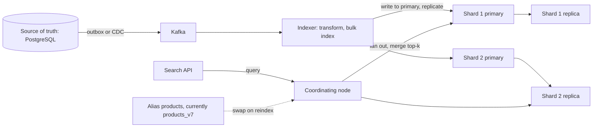

# Search Engines

> [!abstract] In one sentence
> A search engine is a purpose-built distributed store for *finding* things — tokenised text, filters, facets, relevance scoring and aggregations over sharded [[Inverted Indexes|inverted indexes]] — that you run *beside* your database and feed from it, trading a sync pipeline and eventual consistency for query capabilities a relational index cannot provide.

**Map:** [[Storage & Search MOC]] → [[HLD MOC]]

## Definition

A search engine is a system that indexes documents (JSON objects with typed fields) through **analysers** (tokenisation, lowercasing, stemming) into inverted indexes, and executes queries that combine **full-text relevance** (BM25 scoring), **structured filters** (terms, ranges, geo), **aggregations** (facets, histograms, cardinalities) and **ranking**, returning top-k hits in milliseconds. Elasticsearch and OpenSearch (its Apache-licensed fork) are the dominant implementations, built on Apache Lucene; Solr is the older Lucene server; Typesense, Meilisearch and Vespa are alternatives; managed services include Elastic Cloud, Amazon OpenSearch Service and Algolia. The engine is a **derived store**: it holds a transformed copy of data whose source of truth lives elsewhere ([[Search Indexing Pipelines]]).

## Problem solved

Relational databases answer exact and range predicates over indexed columns superbly and answer "find products matching *wireless headfones* sorted by relevance, filtered by brand and price, with counts per category" badly: `LIKE '%head%'` cannot use a B-tree, there is no notion of relevance, typos are unhandled, and facet counts need one aggregate query per facet. PostgreSQL's built-in [[Full-Text Search|full-text search]] closes part of the gap for modest data, but ranking quality, analysers for many languages, fuzzy matching, faceting at scale and horizontal scaling of query load are where a dedicated engine wins. The engine also offloads the read load: search queries, autocomplete and log analytics are expensive and bursty, and running them on the transactional database puts product discovery and checkout on the same CPU ([[Bottleneck Analysis]]).

## How it works

1. **Mapping and analysis.** Each index has a mapping: `text` fields are analysed (standard tokeniser → lowercase → stop words → stemmer; language-specific or custom chains with synonyms and n-grams) and stored in the inverted index; `keyword` fields are indexed verbatim for exact filters, sorting and aggregations; numbers, dates and geo points get their own structures (BKD trees). Getting the mapping right up front matters because changing an analysed field means reindexing.
2. **Indexing.** A document write goes to the primary shard chosen by `hash(_id) % number_of_primary_shards`, is appended to a translog for durability, and buffered in memory. Every **refresh interval** (1 s by default) the buffer becomes a new, searchable, immutable Lucene **segment** — this is "near real time": a write is durable immediately and searchable within about a second. Segments are periodically **merged** in the background, which is where deletes are physically removed and where much of the I/O goes ([[Inverted Indexes]]).
3. **Sharding and replication.** An index is split into N **primary shards** (fixed at creation) each with R **replica shards** on other nodes. Writes go to the primary then replicas; reads are served by any copy. A query fans out to one copy of every shard, each returns its top-k with scores, and the coordinating node merges them ([[Sharding]], [[Replication]], [[Fan-Out]]). Shard count is a sizing decision: too few limits parallelism and growth; too many (thousands of tiny shards) wastes heap and makes cluster state huge — a shard of tens of GB is a common target.
4. **Querying and scoring.** A `bool` query combines `must` (scored), `filter` (unscored, cacheable), `should` and `must_not` clauses. Text clauses score with **BM25**, which rewards term frequency with saturation, penalises common terms and normalises for document length ([[Full-Text Search]]). Scores can be boosted per field, decayed by recency or distance, or reranked by a function or model. Pagination uses `from/size` for shallow pages and `search_after` for deep ones (deep `from` is expensive because every shard must return `from + size` hits).
5. **Aggregations.** Terms, ranges, histograms, percentiles and cardinality (HyperLogLog) run alongside the query over the matched set, using **doc values** (a columnar on-disk layout per field) rather than the inverted index — this is what makes faceted navigation and log analytics one request.
6. **Cluster roles and consistency.** Master-eligible nodes hold cluster state and elect a master ([[Leader Election]], with quorum rules to avoid [[Split-Brain|split-brain]]); data nodes hold shards; coordinating nodes route. A document is readable by id immediately (realtime `GET` reads from the translog) but visible to *search* only after refresh, so the engine is **eventually consistent** relative to the source database and even relative to its own writes ([[Eventual Consistency]]).
7. **Keeping in sync.** The source system publishes changes — through an [[Outbox Pattern|outbox]], [[Change Data Capture]] or dual writes (fragile) — and an indexer transforms and bulk-indexes them; the lag between database commit and search visibility is a design parameter users will notice ("I just saved it, why can't I find it?"). Reindexing into a new index and switching an **alias** is how mappings change without downtime ([[Search Indexing Pipelines]]).

```json
POST /products/_search
{
  "query": {
    "bool": {
      "must":   [{ "multi_match": { "query": "wireless headfones", "fields": ["title^3", "description"], "fuzziness": "AUTO" } }],
      "filter": [{ "term": { "brand": "sony" } }, { "range": { "price": { "lte": 20000 } } }]
    }
  },
  "aggs": { "by_category": { "terms": { "field": "category" } } },
  "size": 20, "sort": ["_score"]
}
```

## Architecture



## Use cases

- "Users search by free text with typos across several fields and expect relevant results" — product, document, customer or merchant search ([[Full-Text Search]]).
- "Filter by many attributes and show counts per facet" — e-commerce navigation, admin consoles, support tooling.
- "Autocomplete or type-ahead at scale" — completion suggesters and edge n-grams ([[Design Search Autocomplete]]).
- "Search and aggregate logs, events or audit trails" — the ELK/OpenSearch stack for [[Logging]] ([[Design a Logging System]]).
- "Vector or hybrid search over embeddings" — kNN fields alongside BM25 ([[Design a RAG Knowledge Assistant]]).

## Limitations

- Not a source of truth: no transactions, no joins beyond `nested`/`parent-child` with costs, and data can be rebuilt but must never be the only copy.
- Eventual consistency with the source: lag from the pipeline plus the refresh interval; read-your-writes needs special handling.
- Mapping changes require reindexing; denormalisation means a change to a shared attribute (a brand's name) touches every document that embeds it.
- Operationally heavy: JVM heap sizing, shard allocation, merges, hot/warm tiers, snapshots, version upgrades with breaking changes.
- Deep pagination, high-cardinality aggregations and leading-wildcard queries are expensive; relevance tuning is an ongoing product task, not a configuration.

## Trade-offs

| You gain | You sacrifice |
|---|---|
| Relevance-ranked, fuzzy, multi-field text search in milliseconds | A second copy of data and a pipeline to keep it in sync |
| Facets, aggregations and filters in one request over large corpora | Transactions and strong consistency with the source |
| Horizontal scaling of read load independent of the database | Operational simplicity: a stateful JVM cluster with many knobs |
| Analysers, synonyms and ranking features for many languages | Cheap schema changes; mappings are mostly fixed once indexed |

## Failure modes

- **Index drift**: the pipeline drops or reorders updates and the search shows deleted or stale products; noticed by customers before dashboards. Blast radius is trust in search. Fix with idempotent, versioned upserts (external version = source row version) and periodic reconciliation ([[Search Indexing Pipelines]]).
- **Cluster red/yellow after node loss**: primaries unassigned, writes rejected; noticed via cluster health alerts. Replicas across zones and shard allocation awareness are the prevention.
- **Heap pressure and circuit breakers**: a huge aggregation or fielddata on a text field trips the parent circuit breaker, rejecting queries fleet-wide. Noticed as `429`/`circuit_breaking_exception`; enforce query limits and use `keyword` for aggregations.
- **Mapping explosion**: dynamic mapping creates a field per arbitrary JSON key (user-defined attributes, log fields), bloating cluster state until updates stall. Set `dynamic: strict` or `false` and model attributes as key–value arrays.
- **Split-brain on misconfigured master quorum** (older versions): two masters, divergent indexes; noticed as inconsistent search results by node. Modern versions use a proper voting configuration; still run three dedicated masters.

## Performance

Query latency for a filtered, scored search over tens of millions of documents is typically tens of milliseconds when shards fit in the OS page cache and filters are cached; aggregations add cost proportional to matched documents and bucket count. Indexing throughput is governed by bulk sizing (a few to tens of MB per bulk request), refresh interval (raise to 30 s or disable during bulk loads), replica count (each replica re-indexes the document) and merge I/O. Memory is split between JVM heap (bounded at ~30 GB for compressed pointers) and the page cache that Lucene relies on; "half the RAM to heap, half to the OS" is the standard rule. Tail latency is driven by the slowest shard in the fan-out ([[The Tail at Scale]]), so shard count and per-shard size directly shape p99.

## Scalability

Data scales by shards across nodes; query throughput scales by replicas; both must be planned because primary shard count is fixed per index — time-based or size-based index rollover (one index per month, or per 50 GB) is how logs and events keep growing. At 10x documents, shard size and merge I/O dominate; at 10x queries, replicas and the coordinating-node merge dominate; at 10x tenants, index-per-tenant versus shared-index-with-routing is the decision ([[Hot Keys]] and noisy neighbours apply). Hot/warm/cold node tiers move old indexes to cheaper hardware and finally to searchable snapshots on [[Object Storage]].

## Operational impact

High: a search cluster is a stateful distributed system with its own [[Leader Election|master election]], shard rebalancing, snapshot lifecycle, upgrade path and tuning. Monitor cluster health, unassigned shards, indexing and search latency per index, rejected threads, JVM GC pauses, merge activity and disk watermarks. Managed services remove hardware and some upgrades but not mapping design, relevance work or capacity decisions. Relevance quality needs its own feedback loop — click-through or judgement lists — because "search is broken" rarely shows up as an error.

## Alternatives

- **[[Full-Text Search]] in PostgreSQL** (`tsvector`, GIN, `pg_trgm`) — wins for modest corpora, single-language text and simple ranking when you want no second system; loses on facets at scale, fuzzy quality and read scale-out.
- **Hosted search APIs** (Algolia, Typesense Cloud) — wins for product search with fast time-to-market and built-in typo tolerance and ranking; costs per record and per search, with less control.
- **Vector databases or [[pgvector]]** — wins for semantic similarity; most teams end up with hybrid (BM25 plus vectors), which the engines now support natively.
- **[[Data Warehouses]] / ClickHouse** — wins for analytical aggregation over logs and events where text relevance is not needed.

## Real-world examples

- Elasticsearch began as a Lucene wrapper (2010) and became the default for both product search and log analytics; AWS forked it as OpenSearch in 2021 after the licence change, so both now coexist widely.
- GitHub's code search moved from Elasticsearch to a purpose-built engine (Blackbird) at the scale of tens of billions of documents — a reminder that general engines have limits at the very top end.
- Wikipedia runs its search on Elasticsearch (CirrusSearch); Uber and Netflix use it for internal and operational search and logs.
- In a stack like yours: merchant, transaction and customer search for operations and support tooling fed from PostgreSQL through an outbox-to-Kafka indexer into Amazon OpenSearch, with aliases for zero-downtime reindexes, `keyword` fields for account ids, and logs in a separate OpenSearch domain with index rollover and retention.

## Practical exercise

1. Run OpenSearch (single node) and PostgreSQL in Docker Compose; load 1 million synthetic products into both.
2. Implement search three ways: `LIKE`, PostgreSQL `tsvector` with a GIN index, and OpenSearch `multi_match` with fuzziness; measure p50/p99 with k6 and judge relevance on ten queries including typos.
3. Add brand and price filters with a `terms` aggregation on category; compare with the equivalent SQL `GROUP BY` for facet counts.
4. Build an outbox-driven indexer; update 10,000 rows and measure database-commit-to-search-visibility lag with the default refresh interval and with 30 s.
5. Change the title analyser (add a stemmer), reindex into `products_v2`, and swap the alias under load; verify no failed queries. Then kill the node mid-bulk and observe translog recovery.

## Related concepts

### Prerequisites
- [[Inverted Indexes]] — the data structure every query runs on
- [[Full-Text Search]] — analysis and relevance, the reason the engine exists
- [[Sharding]] and [[Replication]] — how the index is distributed

### Related
- [[Search Indexing Pipelines]] — feeding and reindexing the engine
- [[Eventual Consistency]] — the contract between source and index
- [[Fan-Out]] — scatter-gather across shards
- [[Leader Election]] — master nodes and cluster state
- [[Logging]] — the other big workload for these engines

### Builds on this
- [[Design Search Autocomplete]] — suggesters and prefix indexes
- [[Design a Logging System]] — index rollover, tiers and retention
- [[Design a RAG Knowledge Assistant]] — hybrid lexical and vector retrieval

### Design problems where it applies
- [[Design Search Autocomplete]]
- [[Design a Logging System]]
- [[Design a RAG Knowledge Assistant]]
- [[Design a Social Feed]]

### Projects where it can be implemented
- [[Vault RAG Assistant]]
- [[Personal Notification Hub]]

### Resources
- [[Designing Data-Intensive Applications]] — derived data, indexes and the log-based sync model in chapters 3 and 11
- [[pgvector]] — the in-database alternative for vector search
- [[Debezium]] — CDC as the feed into the index

## Personal understanding

> [!question] Explain it without the source
> Write your own explanation here, from memory. Then compare it with the sections above and note what you missed.

### Mastery checklist
- [ ] I can explain it without the original resource
- [ ] I can describe the problem it solves
- [ ] I can compare it with its alternatives
- [ ] I can name its limitations and failure modes
- [ ] I can recognise when it is appropriate in a real system
- [ ] I have applied it in a system design
- [ ] I have validated my assumptions with an experiment or implementation

## Open questions

- [ ] How should read-your-writes be handled for a support agent who edits a merchant and immediately searches for it — refresh on write, client-side patching, or routing to the primary?
- [ ] What shard size and count would our transaction search index need at current growth, and when would monthly rollover indexes be better than one large index?
- [ ] For our corpora, does PostgreSQL full-text search with `pg_trgm` cover the need, deferring the cluster entirely?
