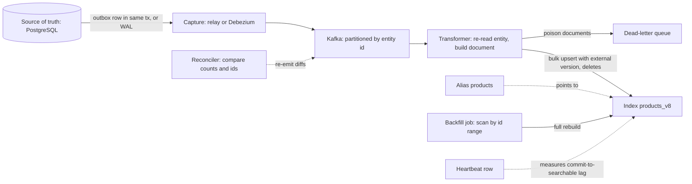

# Search Indexing Pipelines

> [!abstract] In one sentence
> The search index is a derived view of your database, and the pipeline that keeps it derived — capture every change reliably, transform rows into search documents, upsert idempotently in bulk, and rebuild from scratch behind an alias when the mapping changes — is where "search shows deleted products" and "I saved it but can't find it" are either prevented or born.

> [!tip] Deeper treatment in your system-design vault
> `system-design/09 Messaging and Event-Driven/Change Data Capture.md` — read it *after* you have written your own explanation below.

**Map:** [[Storage & Search MOC]] → [[HLD MOC]]

## Definition

A search indexing pipeline is the set of components that propagate state changes from a system of record (usually a relational or document database) into a [[Search Engines|search engine]] and keep the two converged. It has a **capture** stage (an [[Outbox Pattern|outbox]], [[Change Data Capture]] from the database log, or application events), a **transform** stage (join and denormalise the entity into the document shape the index wants, apply analysers' inputs, compute derived fields), a **load** stage (bulk upserts and deletes with version checks), and a **rebuild** path (full reindex into a fresh index, alias swap, backfill). Its key non-functional properties are **lag** (commit-to-searchable), **convergence** (the index eventually equals the transform of the source, including deletes) and **idempotency** (replays and duplicates do not corrupt it).

## Problem solved

The search index holds a *copy* in a *different shape* than the database — denormalised, analysed, missing some fields and adding others — and nothing keeps the two in sync by itself. The tempting shortcut, **dual writes** (save the row, then call the index from the same request), loses every race: the index call fails after the commit, the process dies between the two, two concurrent updates reach the index out of order, a bulk database fix bypasses the application entirely. Each produces drift that nobody sees until a customer finds a product that was deleted a week ago. Batch "sync everything nightly" jobs cap the damage at a day of staleness but cannot scale to large tables and cannot do deletes cheaply. A proper pipeline treats indexing as consuming an ordered, durable stream of changes — the same reasoning as the outbox pattern — so that every change is captured exactly once in order, transforms are replayable, and a full rebuild is a routine operation rather than an emergency.

## How it works

1. **Capture.** Either (a) the service writes an outbox row (`entity_type, entity_id, version, op`) in the same transaction as the change and a relay publishes it, or (b) Debezium tails the database's WAL and emits row-level change events with before/after images, or (c) the application publishes domain events. CDC captures *every* write path, including migrations and manual fixes, which is its main advantage; the outbox captures *intended* events with a clean schema. Both deliver [[At-Least-Once Delivery|at least once]] — so the transform must tolerate replays ([[Duplicate Message Processing]]) — keyed by entity id so that one entity's changes stay ordered on one partition ([[Topic Partitions]], [[Ordering Guarantees]]).
2. **Transform.** A consumer builds the document: it typically re-reads the current entity and its relations from the database (or a read replica) rather than trusting the event payload, because a search document for a product joins brand, category, price and stock, and because re-reading makes the transform naturally idempotent — the latest state always wins. Where joins are expensive, the pipeline maintains its own denormalised view, or the index uses `nested`/parent-child modelling.
3. **Load.** Documents are sent in **bulk** (hundreds to thousands per request, a few MB) as upserts carrying an **external version** — the row's `updated_at` or a monotonic version — so the engine rejects stale writes that arrive out of order (`version_type=external`, or optimistic concurrency on `_seq_no`). Deletes are explicit: a delete event becomes a delete-by-id (or a tombstone flag on the document that queries filter out). Failed items in a bulk response are retried individually with backoff and finally parked in a [[Dead-Letter Queues|dead-letter queue]].
4. **Lag control.** Commit-to-searchable lag = capture lag + consumer lag + bulk batching delay + refresh interval. Monitor it directly (index a heartbeat row every few seconds and measure when it appears in search) and alert on it. For read-your-writes — the agent who edits a merchant and searches immediately — options are: refresh after the write, route the agent's next query to include a database lookup, or patch the UI client-side.
5. **Reindex and alias swap.** Mapping changes (new analyser, new field type) require a new index. Create `products_v8`, run a full backfill from the source (scan by primary key range in parallel workers), *while* the live pipeline continues writing to both `v7` and `v8` (or replays the stream from the backfill's starting offset into `v8` afterwards), then atomically repoint the alias `products` → `v8` and delete `v7` later. Clients only ever query the alias, so the swap is invisible ([[Deployment and Rollback Strategies]] for an index).
6. **Backfill and repair.** The backfill path doubles as the repair tool: a periodic reconciliation compares source and index (counts per partition, checksums or sampled ids) and re-indexes differences. Treat "reindex this entity" as an idempotent command anyone can issue.
7. **Fan-in from several sources.** When a document depends on several tables (product, prices, inventory), a change to any of them must re-emit the *product*; model this as "which documents does this row affect" lookups in the transformer, or maintain the dependency in the outbox payload.

```java
// Idempotent, versioned upsert from a change event (Spring + OpenSearch client, shape only)
void onChange(EntityChanged ev) {                       // key = entityId, at-least-once
    if (ev.op() == DELETE) { bulk.add(delete(ev.id())); return; }
    Product p = repo.loadWithRelations(ev.id());       // re-read current state, not the event
    bulk.add(index("products")                          // alias -> products_v8
        .id(p.id()).version(p.version()).versionType(EXTERNAL)   // stale writes rejected
        .document(ProductDoc.from(p)));
    if (bulk.size() >= 500) flushWithRetries();         // partial failures -> retry -> DLQ
}
```

## Architecture



## Use cases

- "We are adding search over data that lives in our database" — any search feature, from day one; dual writes are the alternative you want to avoid.
- "Search shows stale or deleted items" — the symptom that a pipeline with versioning, deletes and reconciliation is missing.
- "We need to change the analyser or add a field" — the alias-swap reindex path.
- "Denormalised documents depend on several tables" — a transformer with dependency lookups and re-emission.
- "The same stream should also feed caches, feeds or a warehouse" — one capture stage, several consumers ([[Event-Driven Architecture]], [[Data Warehouses]]).

## Limitations

- Eventual consistency is intrinsic: there is always lag, and some product flows (edit-then-search, inventory checks) must not rely on the index for correctness.
- Re-reading entities per event adds database load proportional to change rate; bursts (bulk price updates) become read storms unless batched or coalesced by id.
- Ordering is per entity, not global; cross-entity invariants (a category rename across a million products) show mixed states during propagation.
- CDC exposes the physical schema; a column rename upstream silently breaks transforms unless contracts and tests exist ([[Schema Evolution]]).
- Full reindexes are expensive at scale (hours, extra cluster capacity, double writes) and need coordination with the live stream to avoid gaps.

## Trade-offs

| You gain | You sacrifice |
|---|---|
| Convergence: every committed change, including deletes, reaches the index | Immediacy: searchability lags the commit |
| Idempotent, replayable transforms that make rebuilds routine | Extra read load on the source for re-reads and backfills |
| Mapping changes with zero downtime via aliases | Temporary double capacity and double writes during reindex |
| One change stream reusable by other derived stores | A pipeline with offsets, DLQs and reconciliation to operate |

## Failure modes

- **Out-of-order overwrite**: two updates to one entity land in reverse order (two consumers, or a retry); the index shows the older state forever. Noticed by users; blast radius is per entity but widespread. External versioning or single-partition-per-key ordering prevents it.
- **Lost deletes**: the pipeline handles inserts and updates but a hard delete produces an event with no "after" image and is skipped; ghost documents accumulate. Noticed via reconciliation counts. Handle delete ops explicitly or use soft-delete flags filtered at query time.
- **Consumer lag spike**: a bulk import emits a million events; the index falls hours behind and users see stale prices. Noticed on the lag metric; coalesce by entity id, scale consumers by partition, raise refresh interval during the burst ([[Backpressure]]).
- **Poison document** (a field that violates the mapping, a 50 MB description): the bulk request fails, a naive consumer retries forever and blocks its partition. Per-item error handling and a DLQ are mandatory.
- **Reindex gap**: backfill finishes, alias swaps, but changes committed during the backfill were only written to the old index. Noticed as a window of stale data after every reindex. Dual-write during backfill or replay the stream from the backfill's start offset before swapping.

## Performance

Throughput is bounded by the engine's bulk indexing capacity (thousands to tens of thousands of documents per second per data node, workload-dependent) and by the transformer's re-read cost; bulk size (a few MB), concurrent bulk requests per node and refresh interval are the main knobs. Typical steady-state lag is seconds (capture sub-second with CDC, batching one to a few seconds, refresh one second). Backfills run at the engine's bulk limit; a 100-million-document reindex is hours, not minutes, and competes with live traffic unless it runs on added capacity or at reduced rate. Coalescing repeated changes to the same id within a window cuts both re-reads and index writes dramatically during bursts.

## Scalability

The pipeline scales by partition: more Kafka partitions keyed by entity id, more consumer instances, each owning a slice ([[Consumer Groups]]). The engine side scales by shards and bulk concurrency. At 10x change rate, the re-read load on the database is the first ceiling — use read replicas, coalescing or a denormalised view; at 10x corpus, reindex time and the double-capacity window dominate, pushing towards incremental mapping strategies (multi-fields, new indexes per month) and towards treating the backfill as a parallel, resumable batch job with checkpoints.

## Operational impact

Moderate to high: offsets and consumer lag, DLQ depth, bulk error rates, commit-to-searchable lag and reconciliation diffs all need dashboards and alerts; the reindex procedure needs a runbook and ideally automation (create index, backfill, replay, verify counts, swap, retire); schema changes upstream need contract tests. On-call will see "search is stale" as a pipeline incident rather than a search-cluster incident, so ownership must be explicit — the same organisational shape as the [[Outbox Pattern]] relay and the warehouse feed.

## Alternatives

- **Dual writes from the application** — wins only for prototypes; drifts in production, and the drift is silent.
- **Periodic full or incremental batch sync** (`updated_at > last_run`) — wins for small tables and tolerable staleness; misses hard deletes and scales poorly.
- **Database-native search** ([[Full-Text Search]] in PostgreSQL) — wins when it avoids the second store entirely; no pipeline at all.
- **Engine-side ingestion connectors** (Logstash JDBC input, OpenSearch ingestion from Kafka) — wins for simple one-table mappings; transforms with joins and dependency fan-in still need code.

## Real-world examples

- Debezium's documentation and the Elasticsearch sink connector for Kafka Connect are the standard open-source path from PostgreSQL/MySQL change logs to an index, with the outbox event router for intentional events.
- Shopify, Zalando and other retailers have written about product search pipelines fed by change events, with denormalised documents rebuilt from several services and alias-based reindexes.
- Algolia's and Elastic's reference architectures both recommend indexing from a change stream rather than from request handlers, and both expose index-alias or replica-swap features for rebuilds.
- In a stack like yours: an outbox in the merchant and transaction services relayed to MSK (keyed by entity id), a NestJS or Spring indexer re-reading from a read replica and bulk-upserting into OpenSearch with external versions, a reindex job that backfills `v+1` and swaps the alias, a heartbeat-based lag metric with an SLO, and a nightly reconciler comparing ids per day partition.

## Practical exercise

1. In Docker Compose: PostgreSQL, Kafka (or Redpanda), OpenSearch, and a small service with an outbox table; load 200k products with brand and category relations.
2. Implement the indexer with external versioning and bulk upserts; run two consumer instances and update one product 1,000 times concurrently; verify the index holds the final version.
3. Delete 1,000 rows through a direct SQL `DELETE`; observe that an outbox-only pipeline misses them, then add Debezium CDC (or soft deletes) and confirm they disappear from the index.
4. Add a heartbeat row updated every second; graph commit-to-searchable lag while running a bulk update of 100k rows; tune bulk size, consumer count and refresh interval.
5. Change the title analyser: backfill into `products_v2` while writes continue, replay the stream from the backfill's start offset, compare document counts, swap the alias under k6 load and check for stale reads.

## Related concepts

### Prerequisites
- [[Outbox Pattern]] and [[Change Data Capture]] — the two reliable capture mechanisms
- [[Search Engines]] — the destination's write model: bulk, versions, refresh, aliases
- [[At-Least-Once Delivery]] — the guarantee the pipeline must be designed around

### Related
- [[Idempotency]] — versioned upserts make replays safe
- [[Ordering Guarantees]] — per-entity partitioning keeps updates in order
- [[Eventual Consistency]] — the contract users and product flows must respect
- [[Dead-Letter Queues]] — where poison documents go
- [[Backpressure]] — coalescing and batching under bursts
- [[Inverted Indexes]] — why refresh and merges shape load behaviour

### Builds on this
- [[Data Warehouses]] — the same change stream feeds analytical derived stores
- [[CQRS]] — the search index is a read model fed by write-side events
- [[Design Search Autocomplete]] — suggestion indexes are built by the same pipeline

### Design problems where it applies
- [[Design Search Autocomplete]]
- [[Design a Logging System]]
- [[Design a RAG Knowledge Assistant]]
- [[Design an Inventory Management System]]

### Projects where it can be implemented
- [[Vault RAG Assistant]]
- [[Personal Notification Hub]]

### Resources
- [[Debezium]] — CDC connector and the outbox event router
- [[Debezium Outbox Event Router Docs]] — routing outbox rows to topics by aggregate
- [[Turning the Database Inside Out]] — derived indexes as consumers of the log
- [[Designing Data-Intensive Applications]] — chapter 11 on keeping derived data in sync

## Personal understanding

> [!question] Explain it without the source
> Write your own explanation here, from memory. Then compare it with the sections above and note what you missed.

### Mastery checklist
- [ ] I can explain it without the original resource
- [ ] I can describe the problem it solves
- [ ] I can compare it with its alternatives
- [ ] I can name its limitations and failure modes
- [ ] I can recognise when it is appropriate in a real system
- [ ] I have applied it in a system design
- [ ] I have validated my assumptions with an experiment or implementation

## Open questions

- [ ] For documents built from three services' data, should the transformer call those services, read their replicas, or should each service publish a denormalised view event?
- [ ] What is the cheapest reliable reconciliation for a 100-million-document index — counts per partition, sampled ids, or a full checksum pass?
- [ ] How should a reindex be sequenced with a database migration that renames the column the transform reads?
