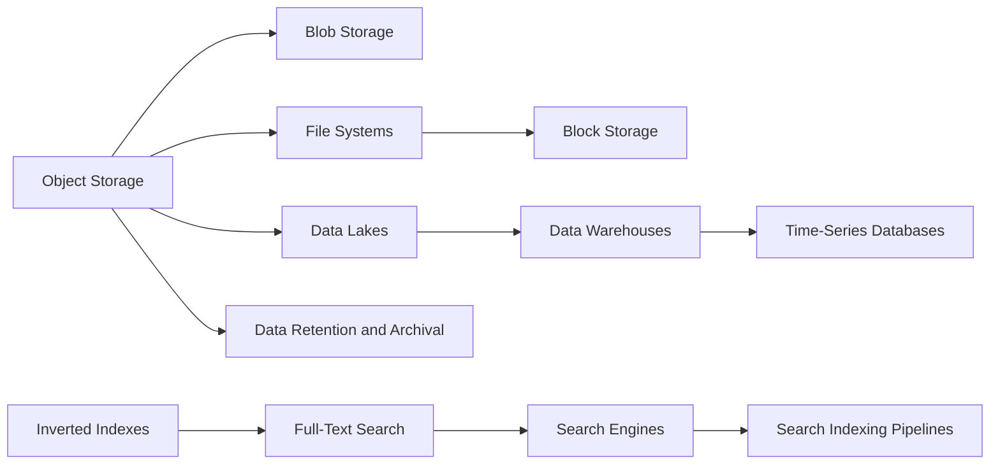

# Storage & Search

> [!abstract] Where bytes live when they are not rows: objects, files, blocks, warehouses, and search.
> Mostly vocabulary for SDE-2, with two exceptions worth real depth: object storage (S3) and how search stays in sync with the source of truth (indexing pipelines).

**Map:** [[HLD MOC]] → this · [[Start Here]] for the reading plan · [[Engineering Dashboard]] for progress

## Start with these

[[Object Storage]] → [[Search Engines]] → [[Inverted Indexes]] → [[Search Indexing Pipelines]] → [[Data Retention and Archival]]

## How the ideas connect

*Every node is a link — click to open the note. Arrows mean "read this first".*



## Concepts

### Core — know these cold for SDE-2

- [[Object Storage]] — Object storage keeps immutable blobs in a flat key namespace behind an HTTP API, engineered for eleven-nines durability through replication or erasure coding across…

### Important — read once, revisit when a design needs it

- [[Data Warehouses]] — A data warehouse is a separate analytical store that lays data out by column, compresses it heavily and scans billions of rows in seconds for aggregate queries, fed from…
- [[Time-Series Databases]] — A time-series database stores append-mostly, timestamp-ordered samples per labelled series, compresses them with delta and XOR encoding to about a byte or two per…
- [[Search Engines]] — A search engine such as Elasticsearch or OpenSearch is a separate, Lucene-based system that keeps a denormalised, analysed copy of your data in sharded and replicated…
- [[Full-Text Search]] — Full-text search turns documents and queries into normalised tokens through an analysis chain, matches them via an inverted index
- [[Inverted Indexes]] — An inverted index maps each term to a sorted posting list of the documents containing it
- [[Search Indexing Pipelines]] — A search indexing pipeline moves changes from the source of truth into the search index
- [[Data Retention and Archival]] — Data retention and archival is the explicit policy and machinery deciding how long each class of data lives in which tier

### Vocabulary — skim, link, move on

- [[Blob Storage]] — A blob is a large opaque byte value — a PDF, image or archive — and the design question is where its bytes live
- [[File Systems]] — A file system gives a hierarchical, mutable, POSIX view over storage
- [[Block Storage]] — Block storage presents a raw, addressable array of fixed-size blocks to a single host as a disk
- [[Data Lakes]] — A data lake lands raw data in open file formats on object storage and applies schema on read

## Where it shows up

**Design problems that lean on this category:** [[Design a Logging System]], [[Design a Metrics and Monitoring System]], [[Design a RAG Knowledge Assistant]], [[Design Search Autocomplete]], [[Design File Storage]], [[Design a Video Streaming Service]], [[Design a Real-Time Fraud Detection Pipeline]], [[Design a Payment System]]

**Projects that exercise it:** [[Vault RAG Assistant]], [[Double-Entry Ledger Service]], [[Personal Notification Hub]], [[Load Test and Latency Lab]], [[Streaming Fraud Rules Engine]], [[Live Ops Dashboard]]

## Progress in this category

Status and confidence come from each note's properties — update them in the note, the table updates itself (native Bases, no plugin).

```base
filters:
  and:
    - file.hasTag("concept")
    - category == "Storage & Search"
formulas:
  rank: 'if(priority == "high", 1, if(priority == "medium", 2, 3))'
properties:
  file.name:
    displayName: Concept
  formula.rank:
    displayName: "#"
views:
  - type: table
    name: Tracker
    order:
      - file.name
      - priority
      - status
      - confidence
      - last_reviewed
      - next_review
    sort:
      - property: formula.rank
        direction: ASC
      - property: file.name
        direction: ASC
    summaries:
      confidence: Average
```
