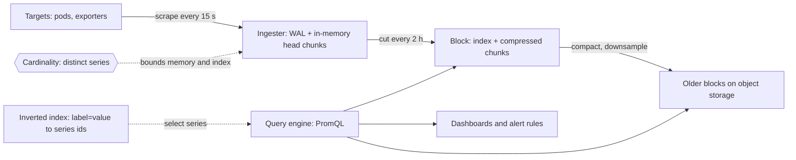

# Time-Series Databases

> [!abstract] In one sentence
> A TSDB is built around one assumption — data arrives as `(series, timestamp, value)` in roughly time order and is queried by time range and aggregate — and exploits it with per-series compression (Gorilla-style delta-of-delta and XOR), time-partitioned blocks, downsampling and retention tiers, which is why millions of samples per second fit on hardware that a general database could not.

> [!tip] Deeper treatment in your system-design vault
> `system-design/07 NoSQL and Storage Engines/Time Series and Analytics Stores.md` — read it *after* you have written your own explanation below.

**Map:** [[Storage & Search MOC]] → [[HLD MOC]]

## Definition

A time-series database stores **series** — a metric name plus a set of label key–value pairs, such as `http_requests_total{service="ledger", status="500", pod="ledger-7f"}` — each a sequence of `(timestamp, value)` samples appended over time. Writes are overwhelmingly inserts of recent data; queries select series by label matchers over a time range and aggregate (rate, sum, percentile, max) across series and time. Prometheus, VictoriaMetrics, InfluxDB, TimescaleDB (PostgreSQL with time partitioning and compression), ClickHouse used as a TSDB, and hosted systems such as Amazon Timestream, Grafana Mimir and Thanos are examples. The category also covers event-shaped data (IoT readings, trades, sensor telemetry) with the same append-and-range-query profile.

## Problem solved

Metrics at fleet scale are enormous in volume and tiny in information. A thousand pods emitting 2,000 series each every 15 seconds is over 130,000 samples per second, 11 billion a day — and each sample is 16 bytes raw. In a row store that is terabytes per month with a B-tree index on `(series, time)` that fragments under constant appends, and a `rate()` over a dashboard's 6-hour window touches millions of rows. Values are also predictable: timestamps arrive on a near-constant interval and values change slowly, so most bytes are redundant. General-purpose databases cannot exploit this. TSDBs solve the storage problem (compress to ~1–2 bytes per sample), the write problem (append-only in-memory heads flushed as immutable blocks), the query problem (indexes on labels to find series, then sequential reads of compressed chunks), and the lifecycle problem (expire or downsample by age automatically), making [[Metrics]], [[Monitoring]] and [[Alerting]] affordable.

## How it works

1. **Series identity and the inverted index.** Each unique combination of metric name and labels is a series with an id. An inverted index from `label=value` to series ids ([[Inverted Indexes]] — the same structure as text search) answers `{service="ledger", status=~"5.."}` by intersecting posting lists. Every new label value creates a new series; this is why **cardinality** — the number of distinct series — is the resource that governs memory and index size, and why putting a user id or request id in a label is the classic way to kill a TSDB.
2. **Append path.** Samples land in an in-memory **head** per series, grouped into chunks (Prometheus: ~120 samples per chunk). A write-ahead log makes the head crash-safe. Every couple of hours the head is cut into an immutable, time-bounded **block** on disk (index plus chunks); blocks are later compacted into larger ones. This is an LSM-like shape specialised for time: all data in a block falls in a known time range, so a range query opens only the relevant blocks ([[Partitioning]] by time).
3. **Compression (Gorilla).** Facebook's Gorilla paper introduced the encoding most TSDBs use: timestamps are stored as **delta-of-delta** (a regular 15 s interval compresses to a single bit per sample), and float values are **XOR**ed with the previous value, storing only the changed bits with a small header — an unchanged gauge costs one bit. The paper reported about 1.37 bytes per sample on Facebook's data, a figure widely reproduced in the same order of magnitude by Prometheus and others; it is workload-dependent (noisy counters compress worse).
4. **Query.** A PromQL expression selects series via the index, reads their chunks for the range, decodes, aligns samples to an evaluation step, applies functions (`rate` handles counter resets), then aggregates across series. Work is proportional to series × samples in range, which is why long ranges over high-cardinality selectors are slow and why **recording rules** precompute common aggregates.
5. **Retention and downsampling.** Raw samples are kept for days to weeks; older data is either deleted (Prometheus: `--storage.tsdb.retention.time=15d`) or **downsampled** into 5-minute and 1-hour aggregates (min, max, sum, count) stored in cheaper tiers — Thanos and Mimir do this on [[Object Storage]], VictoriaMetrics and TimescaleDB do it in continuous aggregates. Downsampled data loses the ability to compute new percentiles or spot sub-interval spikes, so what to keep is a conscious decision ([[Data Retention and Archival]]).
6. **Horizontal scale.** A single Prometheus is one node; scale-out comes from sharding scrape targets across instances and federating, or from distributed systems (Thanos, Mimir, VictoriaMetrics cluster) that shard series by hash, replicate ingestion, store blocks in object storage, and query across them with a store gateway — a design closely resembling [[Design a Metrics and Monitoring System]].

```yaml
# Prometheus: retention and a recording rule that precomputes the hot query
# prometheus.yml flags: --storage.tsdb.retention.time=15d --storage.tsdb.retention.size=200GB
groups:
- name: ledger
  interval: 30s
  rules:
  - record: service:http_requests:rate5m
    expr: sum by (service, status) (rate(http_requests_total[5m]))
  - alert: LedgerHigh5xx
    expr: service:http_requests:rate5m{service="ledger", status=~"5.."}
          / ignoring(status) group_left sum by (service) (service:http_requests:rate5m) > 0.01
    for: 5m
```

## Architecture



## Use cases

- "Metrics from hundreds of services and thousands of pods" — the defining case; nothing else stores them affordably ([[Metrics]], [[Monitoring]]).
- "Dashboards and alerts over rates and percentiles for the last hour, day, week" — range-and-aggregate queries with recording rules and downsampling.
- "IoT, telemetry, financial ticks, trading or risk signals at high ingest rates" — append-only, time-ordered, queried by range.
- "Retention that varies by age" — raw for 15 days, hourly aggregates for 2 years.
- "Usage metering or rate-limit accounting over windows" — time-bucketed counters, though serving-path limiters use [[Redis]] instead ([[Rate Limiting]]).

## Limitations

- Cardinality is a hard budget: per-user, per-request or per-URL labels produce millions of short-lived series and exhaust memory; such data belongs in [[Logging|logs]] or [[Tracing|traces]], not metrics.
- Not a general database: no joins beyond label matching, poor at point updates, awkward for out-of-order or very late data (bounded windows for backfill).
- Downsampling discards information; percentiles cannot be recomputed from averages, so histogram buckets must be stored if you want p99s over long ranges.
- Long-range queries over many series are expensive and can take down a single-node setup; query limits and recording rules are mandatory.
- Single-node TSDBs have no replication; durability and HA need the distributed variants with their own operational weight.

## Trade-offs

| You gain | You sacrifice |
|---|---|
| About 1–2 bytes per sample and millions of samples per second per node | Flexibility: the schema is series, time and value, nothing else |
| Fast range-and-aggregate queries over recent data | Cheap high-cardinality dimensions; labels are a budget |
| Automatic retention, downsampling and tiering | Full fidelity on old data unless you store histograms and raw tiers |
| Purpose-built query languages for rates and percentiles | SQL joins and transactional semantics |

## Failure modes

- **Cardinality explosion**: a deploy adds `user_id` to a label; series count jumps from 1 million to 50 million, memory climbs, scrapes fail, alerts go silent. Noticed via `prometheus_tsdb_head_series` and OOM kills; blast radius is all monitoring. Enforce label allow-lists at the client library and relabel at ingestion.
- **Alerting on a dead pipeline**: ingestion stops (WAL disk full, remote-write backlog) and absence of data looks like "all quiet". Noticed late; alert on staleness (`absent()`, `up == 0`) and on the TSDB's own health.
- **Expensive dashboard query**: a 30-day range over an unaggregated high-cardinality metric saturates the query engine and starves alert evaluation. Noticed as alert rule latency and query timeouts; add recording rules and query limits.
- **Retention misconfigured**: raw data expires before the incident review, or the disk fills because size-based retention is unset. Noticed when the data is needed; set both time and size retention and tier old blocks to object storage.
- **Counter resets and restarts misread**: `rate()` handles resets, but a naive `increase` over a restart or a scrape gap produces spikes; noticed as phantom traffic in dashboards. Use the functions designed for counters and understand their window semantics.

## Performance

Ingest is dominated by series lookups and head-chunk appends: a single Prometheus comfortably handles hundreds of thousands of samples per second and millions of active series, with memory proportional to active series (roughly a few kilobytes per series including index) rather than to samples. Disk cost is ~1–2 bytes per sample after Gorilla compression for typical metrics — order-of-magnitude, verify on your data. Query cost scales with series selected × samples decoded; a well-labelled query over a few series and an hour is milliseconds, while `sum(rate(x[5m]))` over 100,000 series and a week is seconds to minutes and should be a recording rule. Scrape interval is the fundamental trade: 15 s versus 60 s is 4× the samples for 4× the resolution.

## Scalability

Vertical first: a single node scales to millions of series on one box, which covers many organisations. Beyond that, shard scrape targets across instances (by service or Kubernetes namespace) and federate, or run a distributed TSDB that hashes series across ingesters, replicates (factor 3) for durability, writes blocks to object storage for cheap long-term retention, and fans queries out across ingesters and store gateways. At 10x series, the cardinality budget and relabelling rules matter more than any hardware; at 10x retention, object-storage tiers and downsampling keep cost linear in *compressed* bytes rather than raw.

## Operational impact

Moderate: a TSDB is monitoring's foundation, so its own health needs independent alerting (a watchdog alert that fires continuously and pages when it stops). Capacity planning is in series and samples per second; cardinality governance is an ongoing organisational task (label naming standards, limits per tenant in Mimir/VictoriaMetrics). Distributed deployments (Thanos, Mimir) are multi-component systems with compactors, store gateways and queriers to run, patch and size. Managed offerings (Grafana Cloud, AMP, Datadog) trade that for per-series or per-sample pricing, which makes cardinality a billing question too.

## Alternatives

- **[[Data Warehouses]] / columnar OLAP (ClickHouse, BigQuery)** — wins for ad-hoc analytics over event-level data with many dimensions and SQL joins; worse for the "last 5 minutes" alerting loop, though ClickHouse-based metrics stores exist.
- **TimescaleDB on PostgreSQL** — wins when you want SQL, joins with business tables and the same operational tooling as your OLTP database; scales less than purpose-built engines.
- **[[Logging]] with aggregation** — wins for high-cardinality, low-volume analysis (per-user debugging); orders of magnitude more expensive per data point at metrics volumes.
- **[[Redis]] counters and sorted sets** — wins for serving-path windows (rate limits, leaderboards) with millisecond reads; not a historical store.

## Real-world examples

- Facebook's Gorilla (2015) kept 26 hours of metrics in memory across a region with the compression scheme described above, serving the queries that monitoring tools hit hardest; it is the direct ancestor of Prometheus's TSDB format and of Beringei.
- Prometheus, built at SoundCloud and now the CNCF standard, pairs the pull model with a single-node TSDB; Thanos (Improbable) and Cortex (Weaveworks), succeeded by Grafana Mimir, extend it to object-storage-backed, multi-tenant clusters.
- Uber's M3 and Datadog's internal stores are purpose-built TSDBs at billions of series, where cardinality management is a product feature.
- In a stack like yours: Prometheus scraping Spring Actuator and NestJS `/metrics` endpoints on EKS, remote-writing to Mimir or Amazon Managed Prometheus with 15-day raw retention and downsampled long-term tiers on S3, recording rules for per-service error ratios that back the [[SLI SLO and SLA|SLOs]], and a cardinality policy that forbids account and transaction ids in labels.

## Practical exercise

1. Run Prometheus and Grafana in Docker Compose scraping a small Spring Boot or NestJS service every 15 s; generate traffic with k6.
2. Watch `prometheus_tsdb_head_series`, `prometheus_tsdb_storage_blocks_bytes` and the data directory size for an hour; compute bytes per sample from the number of samples ingested (`prometheus_tsdb_head_samples_appended_total`).
3. Add a `request_id` label to one metric, rerun the load, and watch series count and memory; then remove it and add a `metric_relabel_configs` drop rule.
4. Compare query latency for `sum by (status) (rate(http_requests_total[5m]))` over 1 hour and 7 days; add it as a recording rule and compare again.
5. Set `retention.time=1h` and watch blocks disappear; then export the same data to TimescaleDB with compression enabled and compare storage size and the SQL needed for the same rate query.

## Related concepts

### Prerequisites
- [[Metrics]] — what series, labels, counters and gauges are
- [[Inverted Indexes]] — the label index is one
- [[Partitioning]] — time-bounded blocks are partitioning by time

### Related
- [[Monitoring]] and [[Alerting]] — the consumers of every TSDB query
- [[Data Retention and Archival]] — retention tiers and downsampling
- [[Data Warehouses]] — the columnar sibling for event-level analytics
- [[Object Storage]] — long-term block storage in distributed TSDBs
- [[Logging]] — where high-cardinality data belongs instead

### Builds on this
- [[SLI SLO and SLA]] — SLIs are TSDB queries
- [[Error Budgets]] — burn-rate alerts are rate queries over windows
- [[Capacity Planning]] — trend queries over long retention
- [[Rate Limiting]] — windowed counters share the data shape, if not the store

### Design problems where it applies
- [[Design a Metrics and Monitoring System]]
- [[Design a Logging System]]
- [[Design a Real-Time Fraud Detection Pipeline]]

### Projects where it can be implemented
- [[Live Ops Dashboard]]
- [[Load Test and Latency Lab]]

### Resources
- [[Gorilla Time-Series Paper]] — the compression scheme and the in-memory design
- [[Google SRE Book - Monitoring Distributed Systems]] — what to store and why
- [[Designing Data-Intensive Applications]] — LSM trees and compaction, which TSDB blocks resemble

## Personal understanding

> [!question] Explain it without the source
> Write your own explanation here, from memory. Then compare it with the sections above and note what you missed.

### Mastery checklist
- [ ] I can explain it without the original resource
- [ ] I can describe the problem it solves
- [ ] I can compare it with its alternatives
- [ ] I can name its limitations and failure modes
- [ ] I can recognise when it is appropriate in a real system
- [ ] I have applied it in a system design
- [ ] I have validated my assumptions with an experiment or implementation

## Open questions

- [ ] How do native histograms in recent Prometheus versions change the cost of storing p99s compared with classic bucketed histograms?
- [ ] What is the actual series count and bytes-per-sample in our cluster, and which labels contribute most cardinality?
- [ ] For transaction-level risk signals that need per-account dimensions, where is the line between a TSDB, ClickHouse and the warehouse?
