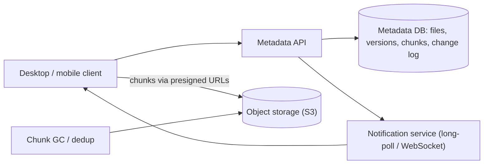

# Design File Storage

> [!abstract] The product in one sentence
> Upload a file from any device, see it on every other device within seconds, share it with permissions, and survive conflicts and flaky networks without corrupting anyone's copy.

> [!tip] How to use this note
> Every section below has **questions to settle** and **options with trade-offs**. Write *My decision and why* under each before looking at a reference solution. The goal is a design you can defend, not a design you can recite.

> [!tip] Reference solution in your system-design vault
> `system-design/15 Interview Playbook/Design Distributed File Storage.md` — compare *after* you have written your own design.

**Map:** [[Problem Bank MOC]] → [[HLD MOC]]

## Problem statement

Store bytes durably and cheaply, keep a metadata tree per user, sync changes across devices, share with others. Hard parts: large files on bad networks (resume), two devices editing offline, dedup, and "did my change reach the other device" semantics. Related: [[Design a Collaborative Document Editor]] (real-time merge is a different problem), [[Design a Video Streaming Service]] (upload pipeline).

**Questions to settle:** Sync whole files or chunks? Is last-writer-wins acceptable, or must conflicts be preserved as copies? Dedup across users — who pays, and what does it leak?

## Product context and intended users

Consumer and team storage. In fintech the same shape appears as a KYC document vault or statement archive, with stricter retention and an access log per download.

## Functional requirements

- Resumable upload and download; folder tree with rename, move, delete, versions.
- Share links and per-user permissions.
- Device sync with change notifications.
- **Questions to settle:** Trash and version retention? Selective sync per device?

## Non-functional requirements

- Durability delegated to object storage; sync propagation < 10 s; metadata p99 < 100 ms.
- **Questions to settle:** Must offline editing work for days, not minutes?

## Constraints and assumptions

- The client is a cold, flaky, untrusted process; files reach tens of GB.
- Metadata operations dwarf content operations in count; content dwarfs in bytes.

## Capacity estimation

| Quantity | Assumption | Result |
|---|---|---|
| Storage | 10M users × 1 GB; 30% dedup | ~7 PB in object storage |
| Metadata | 200 files/user | ~2B rows; shard by owner |
| Sync | 1% of users active per minute × 2 changes | ~3k changes/s, fanned to ~3 devices each |

*(Redo with your own assumptions; the shape of the reasoning is the point.)*

## API design

```http
POST /v1/uploads { "path": "/tax/2025.pdf", "size": 10485760, "chunkHashes": ["sha256:...", ...] } → 201 { "uploadId": "u_1", "missingChunks": [2, 5], "chunkUrls": { "2": "<presigned S3 URL>" } }
PUT  <presigned S3 URL>  (chunk bytes) → 200
POST /v1/uploads/u_1/commit { "parentVersion": 17 } → 200 { "fileId": "f_9", "version": 18 } | 409 { "conflict": true, "currentVersion": 19 }
GET  /v1/changes?cursor=c_4421 → 200 { "changes": [ ... ], "cursor": "c_4490" }
```

**Questions to settle:** Telling the client which chunks exist enables dedup but leaks existence — acceptable? Long-poll or WebSocket for change notification?

## Data model

`file(id, owner_id, parent_id, name, version, size, deleted_at)`; `file_version(file_id, version, chunk_list, created_by, created_at)`; `chunk(hash, size, refcount)` with bytes in [[Object Storage]] keyed by hash; `change_log(namespace_id, cursor, file_id, op)` with a monotonic cursor per namespace — the sync protocol is "give me changes after my cursor" ([[Data Modeling]]).

## High-level architecture



> [!example]- Excalidraw version — the same diagram as an editable canvas
> ![[Design File Storage.excalidraw]]
> [[Design File Storage.excalidraw|Open in Excalidraw]] — needs the Excalidraw plugin (see [[Plugins to Install]]).


## Component responsibilities

| Component | Owns | Does not own |
|---|---|---|
| Metadata API | Tree, versions, permissions, change log | Bytes |
| Block store | Chunk bytes, content addressing | Names and permissions |
| Notification service | Telling devices something changed | What changed |
| Chunk GC | Refcounts, deleting unreferenced chunks | User-visible delete semantics |

## Database selection and rationale

Metadata in PostgreSQL sharded by owner — tree moves and renames want transactions — or DynamoDB keyed by owner and path (scales, tree operations become client work). Bytes always in object storage, never database blobs. Owner is the shard key because sharing is the minority of access.

## Caching strategy

Hot folder metadata in Redis ([[Cache-Aside]]); chunk bytes behind a [[CDNs|CDN]] only for shared or public files. The client's local tree cache makes the app feel fast; the server's job is the cursor.

## Messaging and asynchronous processing

Commit writes the change log and publishes "namespace changed"; the notification service tells connected devices, which pull with their cursor — notify-then-pull, never push the payload ([[Pub-Sub]], [[Client State and Reconnection]]). Chunk GC, thumbnailing and virus scanning are async consumers.

## Scaling strategy

Metadata shards by owner; a shared folder lives in its owner's shard and others hold a pointer. Uploads go directly to S3 via presigned URLs so API pods never carry bytes. Notification [[Fan-Out]] is the bursty piece — one busy team folder wakes hundreds of devices.

## Consistency requirements

Within a namespace the change log is totally ordered and the cursor monotonic: a device never sees version 18 before 17. Across users, [[Eventual Consistency]]. Commit carries `parentVersion`; a mismatch returns 409 and the client writes "name (conflicted copy)" — never a silent overwrite ([[Optimistic and Pessimistic Locking]]).

## Failure scenarios

| Failure | Impact | Detection | Mitigation |
|---|---|---|---|
| Upload dies mid-way | Orphan chunks | Upload age | Resume from `missingChunks`; GC abandoned uploads after 24 h |
| Two devices edit offline | Conflicting versions | `parentVersion` mismatch | Conflicted copy; user resolves |
| Notification dropped | Device stale until next poll | Cursor age per device | Periodic pull as backstop; replay from cursor on reconnect |

## Security considerations

ACL checked on every metadata op and when issuing a presigned URL ([[Authorization]]). [[Encryption at Rest and in Transit]], with per-tenant keys for regulated documents. Share links are expiring capability tokens. One access-log line per download ([[Audit Logs]]).

## Observability

Sync lag (commit → other device ack), upload success by size bucket, conflict rate, dedup ratio, GC backlog. Alert on devices that cannot replay from their cursor.

## Cost considerations

Bytes dominate: tier to infrequent-access storage after 30 days ([[Data Retention and Archival]]); dedup and compression are the levers; download egress is the surprise line.

## Architectural trade-offs

| Decision | Chosen | Rejected | Why |
|---|---|---|---|
| Chunk-level vs file-level sync | *(yours)* | | |
| Notify-then-pull vs push the payload | *(yours)* | | |
| Relational vs key-value metadata | *(yours)* | | |

## Alternative designs

- **File-level, no dedup, S3 versioning** — far simpler; every edit re-uploads the whole file; right for small documents.
- **LAN peer sync** — fewer bytes through the cloud; another protocol to secure and debug.

## What I would implement first

Metadata service with versions and a change-log cursor; presigned chunk uploads to S3; commit with `parentVersion` conflict check; long-poll notifications. GC afterwards.

## What I would defer

Cross-user dedup, CDN, delta encoding, LAN sync, client-side encryption.

## Related

### Concepts
- [[Object Storage]] — where bytes live, always
- [[Client State and Reconnection]] — the cursor is the sync protocol
- [[Eventual Consistency]] — across users and devices
- [[Optimistic and Pessimistic Locking]] — `parentVersion` on commit
- [[Authorization]] — ACL on every operation and URL
- [[Fan-Out]] — one commit wakes many devices

### Projects
- *(none yet — propose one: a minimal sync client and server with conflict copies)*

### Resources
- [[System Design Interview (Alex Xu)]]
- [[Designing Data-Intensive Applications]]

## What I learned

*(Fill after a design session.)*

## What I would improve in a second iteration

*(Fill after a review or implementation.)*
