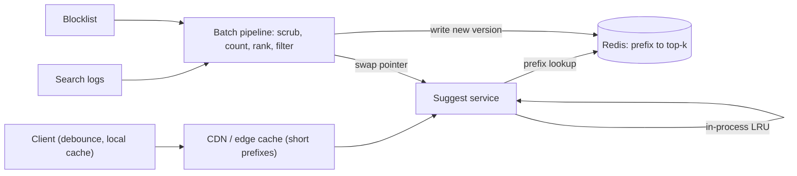

# Design Search Autocomplete

> [!abstract] The product in one sentence
> As the user types, show the five most likely completions for the current prefix fast enough that the suggestions never lag the keystrokes, and keep them fresh as what people search for changes.

> [!tip] How to use this note
> Every section below has **questions to settle** and **options with trade-offs**. Write *My decision and why* under each before looking at a reference solution. The goal is a design you can defend, not a design you can recite.

> [!tip] Reference solution in your system-design vault
> `system-design/15 Interview Playbook/Design Typeahead Autocomplete.md` — compare *after* you have written your own design.

**Map:** [[Problem Bank MOC]] → [[HLD MOC]]

## Problem statement

Given a prefix, return the top-k (say 5) suggestions ranked by popularity under a strict latency budget, because requests fire on every keystroke. Sources are historical queries or a catalogue (merchants, tickers, contacts). The read path is a cache problem; the build path is a batch pipeline; freshness decides the mix. Serving resembles [[Design a Distributed Cache]]; the aggregation pipeline resembles [[Design a Metrics and Monitoring System]].

**Questions to settle:** Global or personalised? How fresh — daily, hourly, or trending within minutes? Must offensive or sensitive completions be filtered?

## Product context and intended users

Every user of the search box, many times per session; a product team owning ranking quality; trust-and-safety owning the blocklist. In a fintech app the sources are catalogues (merchants, bill categories, funds) rather than free text, which makes the data smaller and the filtering stricter.

## Functional requirements

- `GET suggestions?q=pre` → top-k completions with scores, under a latency budget.
- Build from the last N days of query logs or a catalogue; weight recent queries higher.
- Blocklist and minimum-frequency filters; optional per-locale indexes.
- **Questions to settle:** Typo tolerance? Mid-word matching? Personal history mixed in?

## Non-functional requirements

- p99 under ~50 ms end to end including network; server-side under ~10 ms.
- Availability: degrade to "no suggestions", never block the search box.
- Freshness: new popular queries appear within the rebuild interval you choose.
- **Questions to settle:** Is a stale index for a day acceptable after a pipeline failure?

## Constraints and assumptions

- Prefixes are short (1–6 chars dominate); the long tail of prefixes is rarely requested.
- Query logs contain PII (account numbers typed into search) and must be scrubbed before aggregation.
- The client can debounce and cache: not every keystroke needs a server call.

## Capacity estimation

| Quantity | Assumption | Result |
|---|---|---|
| Requests | 5M DAU × 20 keystrokes/day, half debounced | ~600 RPS average, ~5k peak |
| Distinct queries | 50M after filtering | Fits memory on a few nodes |
| Precomputed table | 10M prefixes × 5 × ~40 B | ~2 GB — one Redis node, or in-process per pod |
| Rebuild | Daily over ~1B log lines | Minutes on a small batch cluster |

*(Redo with your own assumptions; the shape of the reasoning is the point.)*

## API design

```http
GET /v1/suggest?q=hdf&k=5&locale=en-IN
→ 200 { "q": "hdf", "suggestions": [ { "text": "hdfc bank", "score": 0.91 }, ... ], "version": "2026-10-19T02" }
```

**Questions to settle:** Return the index version so clients can detect staleness? Should the client send the previous results to let the server prune? Cacheable at the CDN for 1–6 character prefixes?

## Data model

**Precomputed table:** `prefix → [top-k (text, score)]` for every prefix up to some length — the serving structure. **Trie:** nodes with per-node cached top-k, built offline — same idea, more memory-compact, supports longer prefixes. **Source:** `query_counts(term, locale, window, count)` from the log pipeline. Everything is immutable per build version ([[Data Modeling]]).

## High-level architecture



## Component responsibilities

| Component | Owns | Does not own |
|---|---|---|
| Suggest service | Prefix normalisation, lookup, k, version swap | Ranking logic |
| Batch pipeline | Scrubbing, counting, decay, filtering, building the table | Serving |
| Serving store | Immutable versioned prefix tables | Freshness policy |
| Client | Debounce, local cache of recent prefixes, graceful no-op | Ranking |

## Database selection and rationale

**Options:** [[Redis]] hash or sorted set per prefix (simple, sub-ms, memory-priced); an in-process map per pod loaded from a snapshot in [[Object Storage]] (fastest, no hop, cold load on restart); a search engine's completion suggester (fuzziness and filtering built in, heavier to run — [[Search Engines]]). **Decision to make:** in-process snapshot versus shared Redis, decided by index size versus pod memory.

## Caching strategy

Three levels ([[Multi-Level Caching]]): the client caches per prefix for the session; the CDN caches 1–3 character prefixes for minutes because they are the hottest and least personal ([[CDNs]]); the service keeps an in-process LRU in front of Redis. Short prefixes are [[Hot Keys]] by design — serve them locally and never let them reach the store.

## Messaging and asynchronous processing

The build is a batch pipeline: logs → scrub PII → count by (term, window) → decay and blocklist → top-k per prefix → publish a new version ([[Search Indexing Pipelines]]). For trending within minutes, a streaming counter over a [[Kafka]] topic boosts scores in a small overlay merged at read. Version swap is atomic: write under a new key, then flip a pointer.

## Scaling strategy

Reads scale by replicating the immutable table — every pod or replica holds all of it; no sharding below tens of GB. Partition by locale if indexes diverge. The build is offline and scales by adding workers. The real limit is memory per node.

## Consistency requirements

None in the transactional sense. Suggestions are a snapshot; users may see different versions during a rollout, which is fine. Blocklist removals are the exception: they must take effect quickly — apply the blocklist at read time too, not only at build ([[Eventual Consistency]]).

## Failure scenarios

| Failure | Impact | Detection | Mitigation |
|---|---|---|---|
| Build pipeline fails | Index goes stale | Version age metric | Keep serving last version; alert after N hours |
| Redis unavailable | Lookups error | Suggest error rate | In-process fallback; return empty, never block search |
| Bad build | Nonsense suggestions go live | Size and sampled-prefix checks | Validate before pointer swap; instant rollback |
| Hot prefix storm | One key dominates Redis | Per-key QPS | Local LRU and CDN absorb it |

## Security considerations

Logs are the risk: typed account numbers and names reach the pipeline — scrub patterns before aggregation and drop queries below a frequency floor so one user's query never surfaces to others ([[Threat Modeling]]). Rate limit the endpoint; it is cheap to abuse. The blocklist needs an owner.

## Observability

Metrics: p99 per tier (client, CDN, service, store), hit ratios per tier, index version age, table size per build, empty-result ratio, blocklist hits. Quality: click-through rate on suggestions by position, tracked per build so a bad ranking change is visible the day it ships ([[Metrics]]).

## Cost considerations

Serving is cheap: a few GB of memory replicated. The batch job is the cost lever — daily is near-free, hourly multiplies it, streaming adds a Kafka consumer and an overlay store. Decide freshness by product value, not by what is possible ([[Performance vs Cost Trade-offs]]).

## Architectural trade-offs

| Decision | Chosen | Rejected | Why |
|---|---|---|---|
| Precomputed prefix table vs trie vs search-engine suggester | *(yours)* | | |
| In-process snapshot vs shared Redis | *(yours)* | | |
| Freshness: daily batch vs hourly vs streaming overlay | *(yours)* | | |

## Alternative designs

- **Database `LIKE 'prefix%'` with an index** — zero new infrastructure, fine for a catalogue of thousands of merchants; falls over on free-text logs and has no ranking without extra work.
- **Search engine completion suggester** — fuzzy matching and filtering out of the box; heavier to run and tune, worth it when typo tolerance is a requirement ([[Full-Text Search]]).

## What I would implement first

A daily batch job that scrubs logs, counts with decay, applies the blocklist and writes `prefix → top-5` into Redis under a versioned key with a pointer swap; a suggest service with an in-process LRU; client debounce; CDN caching for prefixes up to three characters; a version-age alert.

## What I would defer

Personalisation, typo tolerance, streaming trending overlay, per-locale indexes, mid-word matching.

## Related

### Concepts
- [[Latency]] — the whole problem is a latency budget
- [[Hot Keys]] — short prefixes dominate traffic
- [[Multi-Level Caching]] — client, CDN, process, store
- [[Search Indexing Pipelines]] — the offline build
- [[Redis]] — the serving store
- [[CDNs]] — caching the hottest prefixes at the edge
- [[Cache-Aside]] — the in-process tier

### Projects
- *(none yet — propose one)*

### Resources
- [[System Design Interview (Alex Xu)]]
- [[Latency Numbers Every Programmer Should Know]]
- [[AWS Builders Library - Caching Challenges]]

## What I learned

*(Fill after a design session.)*

## What I would improve in a second iteration

*(Fill after a review or implementation.)*
