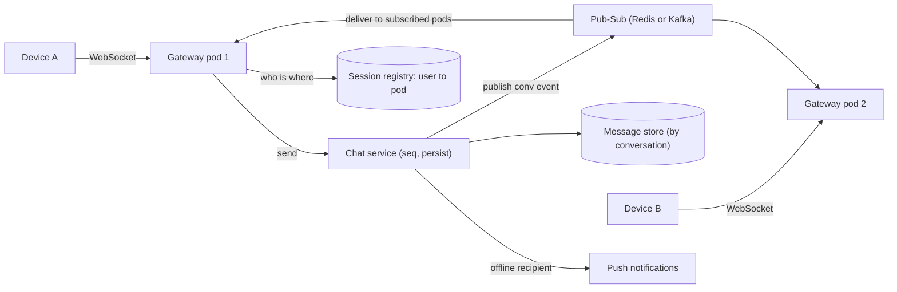

# Design a Chat System

> [!abstract] The product in one sentence
> Messages sent from any device arrive on every other device in the conversation within a second, in a consistent order, and are still there in the right order when a phone comes back online a day later.

> [!tip] How to use this note
> Every section below has **questions to settle** and **options with trade-offs**. Write *My decision and why* under each before looking at a reference solution. The goal is a design you can defend, not a design you can recite.

> [!tip] Reference solution in your system-design vault
> `system-design/15 Interview Playbook/Design a Chat System.md` — compare *after* you have written your own design.

**Map:** [[Problem Bank MOC]] → [[HLD MOC]]

## Problem statement

Design 1:1 and small-group chat: persistent connections for low-latency delivery, durable storage so history survives, sync across a user's devices, presence (online, typing), and sent/delivered/read receipts. The hard parts are routing a message to the right connection on the right gateway pod, ordering within a conversation, and reconciling state after a reconnect ([[Real-Time Systems]]). Push for offline users is [[Design a Notification System]]; message ids come from [[Design a Distributed ID Generator]].

**Questions to settle:** Group size limit (10, 500, 100k)? End-to-end encryption? Is message history unlimited, and searchable?

## Product context and intended users

Consumer or in-app support chat (think support conversations inside a fintech app, where transcripts are compliance records). Users have several devices; phones drop connections constantly. Product expects WhatsApp-grade behaviour: order, receipts and no lost messages.

## Functional requirements

- Send and receive text and media references in 1:1 and group conversations.
- History fetch with pagination; sync of missed messages per device.
- Presence and typing indicators; delivered and read receipts.
- **Questions to settle:** Edit and delete? Reactions? Message retention limits?

## Non-functional requirements

- Delivery p99 under ~500 ms for online recipients.
- No lost messages once the server acknowledges; order consistent within a conversation.
- Millions of concurrent connections; reconnect storms after a deploy must not cascade.
- **Questions to settle:** Is cross-conversation ordering ever needed? (Usually no.)

## Constraints and assumptions

- Gateways are stateless pods on EKS behind a [[Load Balancers|load balancer]] that supports long-lived connections; a user's devices may land on different pods.
- Mobile networks drop silently; clients must reconnect with a cursor ([[Client State and Reconnection]]).
- Message bodies are small; media goes to [[Object Storage]] via signed URLs.

## Capacity estimation

| Quantity | Assumption | Result |
|---|---|---|
| Connections | 10M DAU, 20% concurrent | 2M connections; at ~50k per pod, ~40 gateway pods |
| Messages | 10M DAU × 40 msgs/day | ~4.6k msg/s average, ~15k peak |
| Storage | 400M msgs/day × ~200 B | ~80 GB/day, ~30 TB/year before media |
| Fan-out | Average 3 recipients × 2 devices | ~90k deliveries/s at peak |

*(Redo with your own assumptions; the shape of the reasoning is the point.)*

## API design

```http
WS  /v1/connect?device=d_7           (auth via token; server sends {"type":"hello","cursor":"..."})
→   {"type":"send","convId":"c_1","clientMsgId":"u_42-17","text":"hi"}
←   {"type":"ack","clientMsgId":"u_42-17","msgId":"m_9f3","seq":1182}
←   {"type":"msg","convId":"c_1","msgId":"m_9f4","seq":1183,"from":"u_43","text":"hello"}
GET /v1/conversations/c_1/messages?afterSeq=1100&limit=50   (history and catch-up)
```

**Questions to settle:** One WebSocket for everything, or WebSocket for push and HTTP for sends (simpler retries and idempotency)? Is `clientMsgId` the idempotency key for resends ([[Idempotency]])?

## Data model

`conversation(id, type, member_ids[])`; `message(conv_id, seq, msg_id, sender_id, body, created_at)` partitioned by `conv_id`, clustered by `seq`; `device_cursor(user_id, device_id, conv_id, last_seq)`; `receipt(conv_id, user_id, delivered_seq, read_seq)`. A per-conversation sequence number gives total order; a time-sortable `msg_id` gives global uniqueness ([[Data Modeling]]).

## High-level architecture



## Component responsibilities

| Component | Owns | Does not own |
|---|---|---|
| Gateway pod | Connections, auth handshake, heartbeats, pushing frames | Persistence, ordering |
| Chat service | Assigning `seq`, persisting, publishing, receipts | Holding connections |
| Session registry | Which user-device sits on which pod, presence TTLs | Message content |
| Message store | Durable history by conversation | Routing |

## Database selection and rationale

**Options:** Cassandra or ScyllaDB partitioned by `conv_id` with `seq` clustering (write-heavy, range reads, the Discord pattern); PostgreSQL partitioned by conversation hash (transactions for seq assignment, simpler, caps earlier); DynamoDB with `conv_id` partition key and `seq` sort key (managed, hot partitions on busy groups). **Decision to make:** where the sequence number is assigned atomically — this decides the store ([[Sharding]]).

## Caching strategy

Recent messages per conversation in [[Redis]] (last ~100) so opening a chat does not hit the store; presence as keys with a TTL refreshed by heartbeats; the session registry in Redis with expiry so a dead pod's entries vanish ([[TTL]]). Member lists cached per conversation and invalidated on change.

## Messaging and asynchronous processing

Delivery is [[Pub-Sub]]: each gateway subscribes to channels for the conversations (or users) it hosts; the chat service publishes once and every relevant pod pushes. Receipts and presence are fire-and-forget, batched. Offline recipients get a push via the notification system. Redis Pub/Sub is simplest; [[Kafka]] gives replay but adds latency — a real decision for your stack.

## Scaling strategy

Gateways scale on connection count; the registry makes any pod reachable. Chat service scales by `conv_id`; the store by partition. Large groups are the ceiling: a 10k-member group is a 10k-way fan-out per message ([[Fan-Out]]) — cap group size or switch to pull for big groups. Reconnect storms after deploys need jittered backoff on clients and connection draining on pods.

## Consistency requirements

Total order within a conversation via `seq`; none across conversations ([[Ordering Guarantees]]). Delivery is at-least-once over reconnects — clients dedupe by `msg_id`. Read-your-own-writes on every device of the sender. Receipts are eventually consistent and may regress briefly after a reconnect.

## Failure scenarios

| Failure | Impact | Detection | Mitigation |
|---|---|---|---|
| Gateway pod dies | ~50k clients disconnect at once | Connection count drop | Jittered client reconnect; catch-up by cursor; drain before deploys |
| Pub-Sub drops a message | Online recipient misses it until sync | Gap in `seq` on client | Client requests `afterSeq` on any gap; periodic sync |
| Duplicate send on retry | Message appears twice | Same `clientMsgId` | Idempotent send keyed on `clientMsgId` |
| Hot conversation (huge group) | One partition and one channel saturate | Per-conversation msg/s | Group size cap; pull-based delivery above a threshold |

## Security considerations

Authenticate on connect with a short-lived [[JWT]]; re-validate on reconnect. Authorization per conversation membership on every send and history read. Transcripts in fintech are records — retention and legal hold apply ([[Data Retention and Archival]]). End-to-end encryption changes the design (server stores ciphertext, no search) — decide early.

## Observability

Metrics: connections per pod, send-to-deliver p99, messages/s, Pub-Sub lag, reconnects/s, sync gap requests, receipt lag. Alert on reconnect rate and delivery p99 — the two leading indicators of a bad deploy ([[Metrics]], [[Monitoring User-Facing Performance]]).

## Cost considerations

Gateway pods are cheap per connection but many; the message store grows forever unless retention is set. Pub-Sub traffic multiplies by subscribed pods. Media dominates storage — serve via [[CDNs]] with signed URLs and do not keep it in the message table.

## Architectural trade-offs

| Decision | Chosen | Rejected | Why |
|---|---|---|---|
| WebSocket for sends vs HTTP send + WebSocket push | *(yours)* | | |
| Store: wide-column vs partitioned PostgreSQL vs DynamoDB | *(yours)* | | |
| Fan-out push vs pull for large groups | *(yours)* | | |

## Alternative designs

- **Long polling over HTTP** — no persistent connections, works through every proxy; higher latency and far more request overhead at scale.
- **Per-user inbox queues** — every message is copied into each recipient's queue (mailbox model); trivial sync and offline handling, but N× storage and group writes become fan-out on write.

## What I would implement first

A WebSocket gateway with cursor-based catch-up, HTTP sends with `clientMsgId` idempotency, PostgreSQL partitioned by conversation with a per-conversation `seq`, Redis Pub/Sub for delivery and Redis for presence and the session registry. Then kill a gateway pod under load and watch the reconnect curve.

## What I would defer

Groups above a few hundred members, end-to-end encryption, search, message edits, multi-region.

## Related

### Concepts
- [[WebSockets]] — the connection model and its operational costs
- [[Client State and Reconnection]] — cursors, gaps and dedup on the client
- [[Real-Time Systems]] — the latency and fan-out budget
- [[Ordering Guarantees]] — per-conversation sequence numbers
- [[Distributed ID Generation]] — message ids
- [[Pub-Sub]] — routing to the right gateway pod
- [[Sharding]] — the store partitioned by conversation

### Projects
- [[Presence and Chat Service]] — build this end to end
- [[Live Ops Dashboard]] — the same gateway and reconnect problems with one-way data

### Resources
- [[Discord - How Discord Stores Trillions of Messages]]
- [[System Design Interview (Alex Xu)]]
- [[Redis Streams Docs]]

## What I learned

*(Fill after a design session.)*

## What I would improve in a second iteration

*(Fill after a review or implementation.)*
