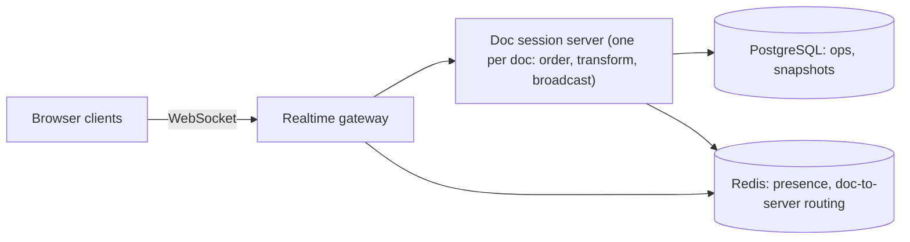

# Design a Collaborative Document Editor

> [!abstract] The product in one sentence
> Several people type into the same document at once, each sees the others' cursors and edits within ~100 ms, nobody's keystroke is lost or misplaced, offline edits merge on reconnect, and every version is recoverable.

> [!tip] How to use this note
> Every section below has **questions to settle** and **options with trade-offs**. Write *My decision and why* under each before looking at a reference solution. The goal is a design you can defend, not a design you can recite.

**Map:** [[Problem Bank MOC]] → [[HLD MOC]]

## Problem statement

Keep N replicas of a document convergent under concurrent edits at low latency, persist the edit history, broadcast presence, and handle reconnection and offline. Hard parts: the merge algorithm (OT with a central server versus CRDTs), ordering and acknowledgement of operations, and an op log that grows forever. Related: [[Design a Chat System]] (gateway and fan-out), [[Design File Storage]] (file-level sync is the simpler cousin).

**Questions to settle:** OT (server-ordered, small payloads) or CRDT (merges anywhere, bigger metadata, offline-friendly)? Rich text in scope, or plain text? A hard cap on concurrent editors per document?

## Product context and intended users

Shared notes, specs, redlining a contract in a fintech back office. Users: editors, viewers, and compliance, who need to know who changed what and when.

## Functional requirements

- Open a document, apply local edits instantly, receive remote edits; cursors and presence.
- Version history and restore; comments; offline edits merged on reconnect.
- Permissions: view, comment, edit.
- **Questions to settle:** Undo — local only or global? Import and export formats?

## Non-functional requirements

- Remote edit visible < 150 ms p95 in region; convergence guaranteed after quiet.
- No lost ops after acknowledgement; 100 concurrent editors per document.
- **Questions to settle:** Must the server show one canonical order, or is eventual convergence enough?

## Constraints and assumptions

- Browsers on bad networks; one hot document (the all-hands notes) concentrates load on one server.
- Op logs grow unbounded without compaction.

## Capacity estimation

| Quantity | Assumption | Result |
|---|---|---|
| Connections | 50k open docs × 3 editors | ~150k WebSocket connections across gateways |
| Ops | 1 op/s per active editor, ~100 B | ~150k ops/s broadcast — modest bandwidth, many small messages |
| History | 1M docs × 50k ops × 100 B | ~5 TB raw; snapshot and compact ops older than 30 days |

*(Redo with your own assumptions; the shape of the reasoning is the point.)*

## API design

```http
WS  /v1/docs/d_1/stream
→ client: { "type": "op", "clientId": "c9", "seq": 12, "baseVersion": 340, "ops": [{ "retain": 10 }, { "insert": "hi" }] }
← server: { "type": "ack", "clientSeq": 12, "version": 341 }
← server: { "type": "op", "version": 342, "from": "c4", "ops": [ ... ] }      (transformed, in order)
← server: { "type": "presence", "users": [{ "id": "u1", "cursor": 15 }] }
GET /v1/docs/d_1?version=300 → 200 { "snapshot": "...", "version": 300 }
```

**Questions to settle:** Is `baseVersion` plus server-side transform the contract (OT), or do clients send CRDT ops with no base? Batch ops per animation frame?

## Data model

`document(id, owner, current_version, snapshot_ref, acl)`; `op(doc_id, version, client_id, client_seq, ops, author, ts)` append-only, unique on `(doc_id, client_id, client_seq)` for dedup ([[Idempotency]]); `snapshot(doc_id, version, content)` every N ops. Document state is snapshot plus ops since ([[Event Sourcing]]). Presence lives in memory only.

## High-level architecture



> [!example]- Excalidraw version — the same diagram as an editable canvas
> ![[Design a Collaborative Document Editor.excalidraw]]
> [[Design a Collaborative Document Editor.excalidraw|Open in Excalidraw]] — needs the Excalidraw plugin (see [[Plugins to Install]]).


## Component responsibilities

| Component | Owns | Does not own |
|---|---|---|
| Gateway | Connections, auth, routing to the doc's server | Merging |
| Doc session server | Authoritative order, OT transform, broadcast, acks | Storage format |
| Storage | Op log, snapshots, history API | Real-time |
| Presence | Cursors, who is online | Durability |

## Database selection and rationale

Op log in PostgreSQL partitioned by document, snapshots in object storage, [[Redis]] for presence and the document-to-server map. A wide-column store for ops at very large scale. The hard part is the algorithm, not the storage.

## Caching strategy

The doc session server holds the live document and recent ops in memory — it *is* the cache; on takeover it rebuilds from snapshot plus ops. Snapshot every 100 ops so a cold open is fast.

## Messaging and asynchronous processing

All ops for a document flow through its one session server, which assigns version numbers — a total order per document ([[Ordering Guarantees]]). Broadcast goes back through the gateway, over Redis [[Pub-Sub]] when gateways are many. Snapshotting, history indexing and notifications are async.

## Scaling strategy

Partition by document: each document is pinned to one session server via a Redis lease; a server holds thousands. A hot document with a thousand viewers: viewers are read-only subscribers — [[Fan-Out]] through gateways, not through the doc server. Gateways scale on connections ([[WebSockets]]).

## Consistency requirements

Per document, a linearizable order chosen by the server; clients apply optimistically and transform incoming ops against their unacknowledged local ones ([[Client State and Reconnection]]). CRDTs remove the need for a server order and make offline merge automatic, at the price of metadata size and harder rich-text semantics. On reconnect, the client sends its last seen version and unacked ops; the server replays from that version and dedupes on `(clientId, seq)`.

## Failure scenarios

| Failure | Impact | Detection | Mitigation |
|---|---|---|---|
| Doc server dies | Its documents freeze for seconds | Lease expiry in Redis | Another server takes the lease, rebuilds from the log; clients reconnect and resend |
| Client offline for hours | Large divergence | `baseVersion` far behind | Transform against hours of ops (expensive), or CRDT merge; beyond a cap, a conflict copy |
| Two servers own one document | Divergent orders, corruption | Lease version mismatch on write | Fencing token checked on every op append ([[Distributed Locks]]) |

## Security considerations

ACL checked at connect and on every op — editor versus viewer ([[Authorization]]). Every op carries its author: the audit trail ([[Audit Logs]]). Size and rate limits per connection ([[Rate Limiting]]); sanitize content on render.

## Observability

Op round trip (send → ack) p95, broadcast lag, ops/s per document (hot-doc alert), reconnect rate, transform cost per op, snapshot lag, lease churn. A convergence check: periodic hash comparison across clients of a canary document.

## Cost considerations

Gateways (connections) and op storage; snapshots trade storage for restart speed. Modest otherwise.

## Architectural trade-offs

| Decision | Chosen | Rejected | Why |
|---|---|---|---|
| OT vs CRDT | *(yours)* | | |
| One session server per document vs stateless servers ordering in the database | *(yours)* | | |
| Keep every op forever vs compact | *(yours)* | | |

## Alternative designs

- **CRDT (Yjs, Automerge) with a dumb relay** — any peer merges, offline is free; larger documents, harder formatting semantics, and the server cannot validate ops as easily.
- **Lock-based editing** — one editor at a time, others view: trivially correct, not collaborative; fine for a contract-redline tool.

## What I would implement first

WebSocket gateway; one doc server with plain-text OT (retain, insert, delete), version numbers, acks and dedup; op log plus snapshots in PostgreSQL; presence in Redis; reconnect with resend. Prove convergence with a randomized test of concurrent clients.

## What I would defer

Rich text, CRDT mode, offline beyond minutes, comments, a history UI, multi-region.

## Related

### Concepts
- [[WebSockets]] — the edit stream
- [[Real-Time Systems]] — 150 ms is a product requirement
- [[Ordering Guarantees]] — one server, one order per document
- [[Client State and Reconnection]] — unacked ops and replay from version
- [[Eventual Consistency]] — convergence after quiet
- [[Event Sourcing]] — the document is its op log

### Projects
- [[Presence and Chat Service]] — the gateway and presence half
- [[Live Ops Dashboard]] — ordered fan-out over WebSockets

### Resources
- [[Kleppmann Distributed Systems Lecture Notes]]
- [[Designing Data-Intensive Applications]]

## What I learned

*(Fill after a design session.)*

## What I would improve in a second iteration

*(Fill after a review or implementation.)*
