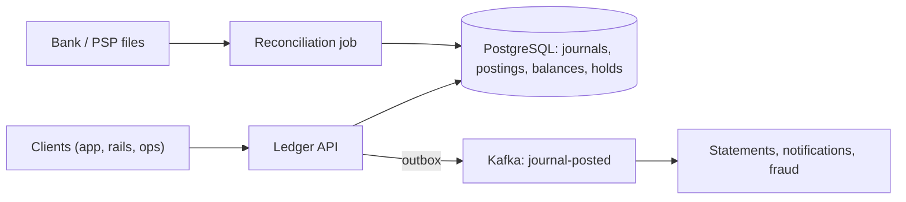

# Design a Digital Wallet and Ledger

> [!abstract] The product in one sentence
> A wallet whose balance is always explainable: every rupee is a double-entry posting, transfers are idempotent, holds reserve funds before capture, and the books reconcile to the bank every day.

> [!tip] How to use this note
> Every section below has **questions to settle** and **options with trade-offs**. Write *My decision and why* under each before looking at a reference solution. The goal is a design you can defend, not a design you can recite.

**Map:** [[Problem Bank MOC]] → [[HLD MOC]]

## Problem statement

Hold user and system accounts, move money between them atomically, support holds (authorize → capture or void), and produce an audit trail an auditor accepts. Hard parts: duplicates under retries, concurrent debits on one account, proving the balance. Related: [[Design a Payment System]] (the PSP side), [[Design an Inventory Management System]] (the same hold mechanism on stock).

**Questions to settle:** Is balance derived (sum of postings) or stored and verified? Are negative balances ever allowed? Integer minor units per currency, never floats — agreed?

## Product context and intended users

Prepaid wallet, neobank float, or internal settlement accounts. Users: the app, payment rails, finance ops and auditors.

## Functional requirements

- Transfer: debit A, credit B (plus fee legs) atomically, keyed by an idempotency key.
- Hold → capture (partial allowed) or void; auto-expire.
- Balance (ledger vs available), statements; reversal is a new journal, never an edit.
- **Questions to settle:** Multi-currency? Batch settlement into system accounts?

## Non-functional requirements

- Transfer p99 < 100 ms; a journal acknowledged with 201 is never lost.
- Sum of all postings is zero at every instant; audit trail immutable for 7+ years.
- **Questions to settle:** May balance reads be replica-stale while transfers stay strict?

## Constraints and assumptions

- Clients and queues retry — duplicates are guaranteed, not hypothetical.
- One merchant account receives a large share of all credits (a hot row).
- Regulators want statements that match the bank's files.

## Capacity estimation

| Quantity | Assumption | Result |
|---|---|---|
| Transfers | 500/s avg, 3k/s peak (salary day), 2–3 postings each | ~8k postings/s peak |
| Posting storage | 50M postings/day × 200 B | ~10 GB/day; partition by month, cold after 13 months |
| Hot account | One merchant gets 20% of credits | ~600 writes/s on one balance row — the serialization point |

*(Redo with your own assumptions; the shape of the reasoning is the point.)*

## API design

```http
POST /v1/transfers   Idempotency-Key: ik_7f3a
{ "from": "acc_user_1", "to": "acc_merchant_9", "amount": 125000, "currency": "INR", "legs": [{ "to": "acc_fee_pool", "amount": 1250 }], "ref": "order-123" }
→ 201 { "journalId": "j_1" } | 200 (same key + same body: replay) | 409 (same key, different body) | 422 { "code": "insufficient_funds" }
POST /v1/holds { "account": "acc_user_1", "amount": 50000, "ttlSec": 604800 } → 201 { "holdId": "h_2" }
POST /v1/holds/h_2/capture { "amount": 48000 } → 201 { "journalId": "j_2" }
GET  /v1/accounts/acc_user_1/balance → 200 { "ledger": 320000, "available": 270000, "asOf": "j_2" }
```

**Questions to settle:** Idempotency keys scoped per client or global? Retained for 24 h or forever (it is money)?

## Data model

`account(id, type, currency, allow_negative)`; `journal(id, idempotency_key UNIQUE, state, ref, actor, created_at)`; `posting(id, journal_id, account_id, amount signed)` with `sum(amount) = 0` per journal enforced inside the transaction; `balance(account_id, ledger, held, version)` as a projection updated in the same transaction and checked nightly against `sum(postings)`; `hold(id, account_id, amount, state, expires_at)`. Postings are append-only; corrections are new journals ([[Data Modeling]]).

## High-level architecture



## Component responsibilities

| Component | Owns | Does not own |
|---|---|---|
| Ledger API | Journals, postings, balance invariant, idempotency | Deciding whether a payment should happen |
| Hold manager | Expiry sweeps, capture/void | Pricing |
| Reconciliation | Postings vs balance, ledger vs bank; raising exceptions | Silently fixing anything |
| Statement projector | Read models from events | Truth |

## Database selection and rationale

PostgreSQL. A transfer is one transaction: insert the journal (the unique key is the duplicate guard), lock both balance rows in a fixed order (`FOR UPDATE … ORDER BY account_id` avoids deadlocks), check available, insert postings, update balances ([[Transactions]]). Read committed plus row locks is enough; serializable is unnecessary if you lock ([[Isolation Levels]]). Alternatives: DynamoDB transactions (item limits, no cross-partition sums); a purpose-built ledger engine. Relational until the hot row's lock wait is measured.

## Caching strategy

Balance reads from a [[Read Replicas|replica]] with an `asOf` journal id so staleness is visible; never check funds from a cache. Idempotency keys live in the database, not Redis — a lost key is a double payment.

## Messaging and asynchronous processing

`journal-posted` leaves via the [[Outbox Pattern]], so downstream never sees an uncommitted journal; consumers are at-least-once and dedupe on journal id. Inbound rail events (bank credit confirmed) become journals keyed by the rail's reference ([[Idempotency]]).

## Scaling strategy

Sharding by account is natural, but a transfer spans two accounts — either a saga with a `pending` journal state, or one database with partitioned postings (simpler; scales further than people assume). Hot system accounts: split into N sub-accounts summed on read, or batch credits into periodic journals.

## Consistency requirements

Strong on the write: a journal fully exists or not, and no balance drops below its floor after commit ([[ACID]]). Available = ledger − active holds, computed under the same row lock. Replaying a key returns the original response; the same key with a different body is 409, never a new journal.

## Failure scenarios

| Failure | Impact | Detection | Mitigation |
|---|---|---|---|
| Client times out and retries | Duplicate transfer | Same idempotency key | Unique key on journal; return original result |
| Balance row ≠ sum(postings) | Wrong balances shown | Nightly reconcile | Freeze the account; rebuild projection from postings |
| Bank file disagrees with ledger | Missing or extra money | Reconciliation exceptions | Ops exception queue; adjustment journals with approval |

## Security considerations

Every journal records actor, reason and reference ([[Audit Logs]]). Manual adjustments require maker–checker. The API's database role has no UPDATE or DELETE on postings ([[Least Privilege]]). PII lives outside the account tables.

## Observability

Journals/s, insufficient-funds rate, idempotent-replay rate (a spike means an upstream retry storm), lock wait on hot accounts, replica lag, reconcile exceptions. Page on any journal with a nonzero sum — it should be impossible.

## Cost considerations

Compute is tiny; the lines are PostgreSQL IOPS, posting storage and ops time on reconciliation exceptions. Multi-region is where cost jumps.

## Architectural trade-offs

| Decision | Chosen | Rejected | Why |
|---|---|---|---|
| Stored balance with nightly check vs derived-only | *(yours)* | | |
| Row locks at read committed vs serializable | *(yours)* | | |
| Single database vs sharded accounts with sagas | *(yours)* | | |

## Alternative designs

- **Pure event-sourced ledger** — the append log is the state, balances are projections: perfect audit and replay, but "available right now" needs a consistent projection and holds get awkward ([[Event Sourcing]]).
- **Purpose-built ledger engine** — throughput you will not need yet, and fewer people who can operate it ([[Build vs Buy Decisions]]).

## What I would implement first

Account, journal, posting, balance and hold tables in PostgreSQL; transfer as one transaction with ordered row locks and a unique idempotency key; hold expiry sweeper; outbox to Kafka; nightly posting-vs-balance reconcile that freezes mismatched accounts.

## What I would defer

Multi-currency, sharding, sub-account splitting, automated bank reconciliation, multi-region.

## Related

### Concepts
- [[Idempotency]] — the unique journal key is the whole duplicate story
- [[Transactions]] — journal, postings and balances commit together
- [[Isolation Levels]] — why row locks beat serializable here
- [[Event Sourcing]] — postings are the log; balances are a projection
- [[Audit Logs]] — actor and reason on every journal
- [[Outbox Pattern]] — events only after commit

### Projects
- [[Double-Entry Ledger Service]] — build exactly this

### Resources
- [[Brandur - Implementing Idempotency Keys]]
- [[PostgreSQL Transaction Isolation Docs]]

## What I learned

*(Fill after a design session.)*

## What I would improve in a second iteration

*(Fill after a review or implementation.)*
