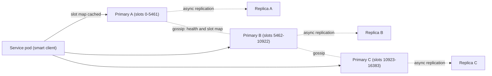

# Design a Distributed Cache

> [!abstract] The product in one sentence
> A shared in-memory key-value cache that many services read and write at sub-millisecond latency, spread over nodes so capacity grows by adding nodes and one node failure loses only one slice of data.

> [!tip] How to use this note
> Every section below has **questions to settle** and **options with trade-offs**. Write *My decision and why* under each before looking at a reference solution. The goal is a design you can defend, not a design you can recite.

> [!tip] Reference solution in your system-design vault
> `system-design/15 Interview Playbook/Design a Distributed Cache.md` — compare *after* you have written your own design.

**Map:** [[Problem Bank MOC]] → [[HLD MOC]]

## Problem statement

Design the cache itself, not a service that uses one: `GET`, `SET` with TTL, `DELETE` and atomic `INCR` over a cluster that survives node loss, bounds memory, and says what happens to a value when a node dies or a partition splits it ([[Distributed Caching]]). [[Design a Distributed Key-Value Store]] adds durability; [[Design a Rate Limiter]] is the most demanding consumer.

**Questions to settle:** Pure cache, or will someone treat it as a store? Which operations must be atomic? One shared cluster or one per team?

## Product context and intended users

Internal platform capability: teams caching database reads and sessions, the rate limiter needing atomic counters, operators who resize it. In a stack like yours this is "what ElastiCache gives you" — the exercise is explaining its behaviour and failure modes.

## Functional requirements

- `GET/SET/DELETE` with per-key TTL; `SET NX` and `INCR`.
- Keys partitioned across N nodes; adding or removing a node moves a minimal share.
- Eviction at a memory limit; optional replication per node.
- **Questions to settle:** Multi-key operations across nodes? Pub/sub in scope? Tenant namespaces?

## Non-functional requirements

- p99 under ~1 ms within an availability zone; ~100k ops/s per node.
- Losing one node lowers hit ratio, never cluster availability.
- No durability promised — the database behind it is the source of truth.
- **Questions to settle:** Is a stale read after failover acceptable, and for how long?

## Constraints and assumptions

- Single region, three AZs; a cross-AZ round trip is ~1 ms, which matters here ([[Latency]]).
- Values are small; blobs belong in [[Object Storage]].
- Thousands of short-lived client pods, so connections per node are a real limit ([[Connection Pooling]]).

## Capacity estimation

| Quantity | Assumption | Result |
|---|---|---|
| Working set | 50M keys × ~1 KB with overhead | ~50 GB — 3–4 primaries of 16–32 GB |
| Throughput | 300k ops/s peak, 90% reads | ~100k ops/s per primary unless one shard is hot |
| Replication | One replica per primary | Memory doubles; warm failover |
| Network | 300k ops/s × ~1.5 KB | ~450 MB/s — check NIC and cross-AZ cost |

*(Redo with your own assumptions; the shape of the reasoning is the point.)*

## API design

```http
GET /cache/{key}                                  → 200 { "value": ..., "ttlSeconds": 240 } | 404
PUT /cache/{key} { "value": ..., "ttlSeconds": 300, "ifNotExists": false }  → 200 | 412
DELETE /cache/{key}                               → 204
POST /cache/{key}/incr { "by": 1 }                → 200 { "value": 42 }
```

**Questions to settle:** Wire protocol spoken by a smart client that knows the slot map, or HTTP behind a proxy? Where does routing live — client, proxy tier, or redirects from any node?

## Data model

Per node: a hash table of key → (value, expiry, eviction metadata). Cluster level: a slot map — hash each key into a fixed number of slots (say 16,384) and assign ranges to nodes, so rebalancing moves ranges, not every key ([[Consistent Hashing]]). Hash tags like `{user:42}:profile` pin related keys to one slot.

## High-level architecture



## Component responsibilities

| Component | Owns | Does not own |
|---|---|---|
| Smart client | Key hashing, cached slot map, `MOVED` handling | Which node owns a slot |
| Primary node | Its slots, eviction, expiry, streaming to its replica | Other nodes' slots |
| Replica | A copy of one primary; promotion on failure | Writes while a replica |
| Membership layer | Failure detection, slot map, failover election | The data path |

## Database selection and rationale

**Node engine:** [[Redis]] semantics (single-threaded, simple atomicity, rich types) versus a multi-threaded memcached-style engine (more throughput, plain values, no replication). **Membership:** gossip between nodes ([[Gossip Protocols]]) versus an external coordinator like etcd ([[Consensus]], one more system to run). **Decision to make:** which pair — and whether to build this at all rather than run managed Redis Cluster ([[Build vs Buy Decisions]]).

## Caching strategy

Inside the cache the questions are eviction and expiry. [[Eviction Policies]]: sampled LRU usually suffices; LFU resists scans; `volatile-*` versus `allkeys-*` decides whether keys without a TTL are ever evicted. Expiry: lazy on read plus an active sweep ([[TTL]]). Callers still own [[Cache-Aside]] discipline and [[Cache Stampedes]] protection.

## Messaging and asynchronous processing

Replication is asynchronous: the primary acknowledges, then streams the write, so a write acknowledged just before failover can be lost. Slot migration moves keys in batches while both nodes answer, with `ASK` redirects for in-flight keys. Keyspace notifications over [[Pub-Sub]] can invalidate in-process caches.

## Scaling strategy

Add primaries and rebalance slots; clients see `MOVED` and refresh. Reads: replicas (stale by lag) or more primaries. The ceiling is [[Hot Keys]]: one key at 200k ops/s sits on one node however many you add — fix with a short-TTL local cache, the key replicated under several names, or request coalescing. Thousands of pods need a proxy tier ([[Reverse Proxies]]).

## Consistency requirements

Per key, linearizable: one thread owns the slot. Across keys, nothing. After failover, [[Eventual Consistency]] at best — lost acknowledged writes and a brief [[Split-Brain]] window where the old primary still accepts writes. **Decision to make:** does any caller use `SET NX` as a lock? Then this is the [[Distributed Locks]] problem and needs fencing.

## Failure scenarios

| Failure | Impact | Detection | Mitigation |
|---|---|---|---|
| Primary dies | Slots unavailable until promotion; writes in lag lost | Gossip marks it failed | Promote replica; callers fall back to the database |
| Partition isolates a minority | Stale reads, possibly accepted writes | Quorum unreachable | Minority stops serving after a timeout ([[Network Partitions]]) |
| Hot key | p99 spikes for every key on that node | Per-node ops/s skew | Local cache, key replication, shed at the client |
| Eviction storm | Hit ratio collapses; database takes the load | Hit ratio drop, DB QPS surge | Jittered TTLs, stampede protection |

## Security considerations

Holds session tokens and PII snapshots: no public endpoint, [[TLS]] across trust boundaries, ACLs per application, no secrets as values. In fintech decide what may be cached at all — card data never.

## Observability

Per node: ops/s, hit ratio, memory vs max, evictions/s, replication lag, latency histogram. Cluster: slot coverage, failover count. Alerts: hit ratio drop, unexpected evictions, lag growth, node near max memory ([[Metrics]]). A sampled per-key top-N finds hot keys.

## Cost considerations

Memory is the bill: replicas double it, large values waste it. Measure the hit ratio each extra GB buys and stop when the curve flattens. Managed Redis costs more than self-run on EKS but removes failover operations ([[Operational Simplicity]]).

## Architectural trade-offs

| Decision | Chosen | Rejected | Why |
|---|---|---|---|
| Routing: smart client vs proxy tier | *(yours)* | | |
| Replication: none vs one async replica per primary | *(yours)* | | |
| Membership: gossip vs external coordinator | *(yours)* | | |

## Alternative designs

- **Client-side hashing over independent nodes (memcached style)** — no cluster protocol, simplest to run; no replication, so a node loss is a cold slice and resharding needs client coordination.
- **Proxy-fronted cluster** — dumb clients, far fewer connections, invisible topology changes; one more hop and one more tier to scale.

## What I would implement first

A fixed slot map, a smart client with `MOVED` handling, one async replica per primary, sampled `allkeys-lru`, and a hit-ratio plus hot-key dashboard. Then fail a primary under load and record what was lost.

## What I would defer

Online slot migration, cross-region replication, multi-key transactions, tenant quotas.

## Related

### Concepts
- [[Distributed Caching]] — the problem family
- [[Consistent Hashing]] — why slots move cheaply
- [[Redis]] — the engine semantics most people assume
- [[Eviction Policies]] — bounded memory
- [[Hot Keys]] — the ceiling adding nodes does not raise
- [[Cache Consistency]] — what the cluster promises
- [[Replication]] — the lost-write window

### Projects
- [[Mini-KV Store]] — same partitioning and replication mechanics, with durability
- [[Load Test and Latency Lab]] — measure a failover under load

### Resources
- [[Scaling Memcache at Facebook]]
- [[Redis Eviction Policies Docs]]
- [[AWS Builders Library - Caching Challenges]]

## What I learned

*(Fill after a design session.)*

## What I would improve in a second iteration

*(Fill after a review or implementation.)*
