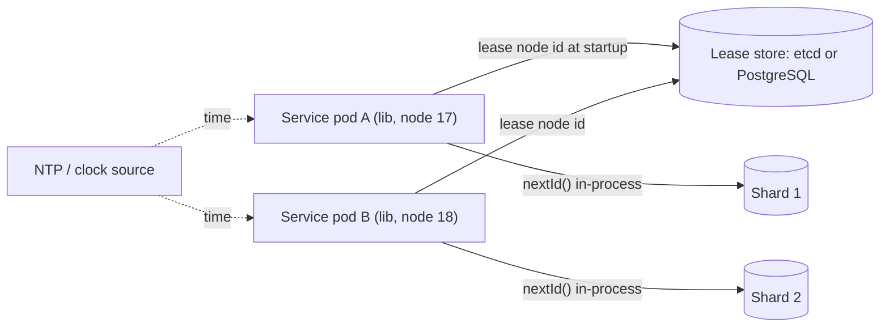

# Design a Distributed ID Generator

> [!abstract] The product in one sentence
> A library or service that hands every service a unique 64-bit ID in microseconds, sortable by creation time, without a central counter that every write must wait on.

> [!tip] How to use this note
> Every section below has **questions to settle** and **options with trade-offs**. Write *My decision and why* under each before looking at a reference solution. The goal is a design you can defend, not a design you can recite.

> [!tip] Reference solution in your system-design vault
> `system-design/15 Interview Playbook/Design a Distributed ID Generator.md` — compare *after* you have written your own design.

**Map:** [[Problem Bank MOC]] → [[HLD MOC]]

## Problem statement

Auto-increment stops working the moment a table is sharded or a service runs on many pods. Design a generator that produces unique IDs across hundreds of nodes, roughly ordered by time, that fit in a `BIGINT` and index well ([[Distributed ID Generation]]). Consumers: [[Design a URL Shortener]] (short keys), [[Design a Chat System]] (message ordering), [[Design a Message Queue]] (offsets are a special case).

**Questions to settle:** Must IDs be strictly monotonic, or is "sortable to the millisecond" enough? May they leak creation time and volume? 64-bit integer, or is 128-bit UUID acceptable?

## Product context and intended users

Internal library used by every service that inserts rows or emits events. In fintech, transaction and ledger IDs end up in customer statements, bank files and audit logs, so they must never collide — and a predictable sequence can leak business volume to anyone who sees two IDs.

## Functional requirements

- `nextId()` returns a unique 64-bit integer; `nextId(n)` returns a batch.
- IDs sort by generation time at millisecond granularity across nodes.
- Works with no network call on the hot path; survives node restarts.
- **Questions to settle:** Decode `createdAt` from the ID? Per-tenant or per-type prefixes?

## Non-functional requirements

- Latency: sub-microsecond in-process; throughput: millions/s per node.
- Uniqueness: zero collisions ever — correctness, not an SLO.
- Availability: generation never blocks on a coordinator being up.
- **Questions to settle:** How much clock skew must it tolerate before refusing to mint?

## Constraints and assumptions

- NTP keeps clocks within tens of milliseconds, but clocks jump backwards after corrections and VM pauses ([[Clocks and Time]]).
- Pods are ephemeral; node identity must be assigned, not derived from hostnames.
- A 64-bit ID stored in PostgreSQL `BIGINT` indexes far better than a random 128-bit UUID ([[Indexing]]).

## Capacity estimation

| Quantity | Assumption | Result |
|---|---|---|
| Bit budget | 41 bits ms timestamp, 10 bits node, 12 bits sequence | 69 years, 1,024 nodes, 4,096 IDs/ms/node |
| Peak per node | 4,096 per ms | ~4M/s — far above any service's write rate |
| Node ids | 200 pods × 3 services | 600 of 1,024 — tight; plan the allocation scheme |
| Epoch | Custom epoch at service launch | Pushes the 69-year rollover out; document it |

*(Redo with your own assumptions; the shape of the reasoning is the point.)*

## API design

```http
# In-process library (preferred)
long id = ids.next();            // 41-bit ms | 10-bit node | 12-bit seq
long[] batch = ids.next(100);

# Optional service for languages without the library
POST /v1/ids { "count": 100 } → 200 { "ids": [ ... ] }
```

**Questions to settle:** Library in every service (no hop, but node-id assignment becomes a startup dependency) versus a service (one hop, one owner, one failure domain)? Batch hand-out to amortise the hop?

## Data model

The ID itself is the data model: `[sign 1][timestamp 41][node 10][sequence 12]`. The only stored state is node-id leases: `node_lease(node_id, holder, expires_at)` in etcd, ZooKeeper, [[Redis]] or a PostgreSQL table ([[Data Modeling]]).

## High-level architecture



> [!example]- Excalidraw version — the same diagram as an editable canvas
> ![[Design a Distributed ID Generator.excalidraw]]
> [[Design a Distributed ID Generator.excalidraw|Open in Excalidraw]] — needs the Excalidraw plugin (see [[Plugins to Install]]).


## Component responsibilities

| Component | Owns | Does not own |
|---|---|---|
| Generator library | Bit packing, sequence rollover, clock-regression handling | Node-id uniqueness |
| Lease store | Handing out node ids, expiry, renewal | Minting IDs |
| Clock source | Monotonic time within a node | Cross-node ordering |

## Database selection and rationale

Only the lease store needs a database. **Options:** etcd or ZooKeeper (lease primitives with TTL, already run for Kubernetes); a PostgreSQL table with `SELECT ... FOR UPDATE` (no new infrastructure, no TTL without a sweeper); Redis `SET NX EX` (simple, but a failover can hand the same id out twice). **Decision to make:** which store, and whether a stale lease can ever be reused safely ([[Distributed Locks]]).

## Caching strategy

Nothing to cache on the hot path. If a central service is chosen, clients cache a batch of pre-allocated ranges so a service outage of seconds is invisible — the same trick as database sequence caching, with the same cost: IDs are burned on restart and ordering across clients blurs.

## Messaging and asynchronous processing

None on the hot path by design. Lease renewal is a background heartbeat; if it fails for longer than the lease TTL the node must stop minting, not keep going — the uncomfortable but correct choice ([[Coordination vs Availability]]).

## Scaling strategy

Scale by adding nodes up to the node-id budget; beyond 1,024, steal bits from the sequence or timestamp. Per-node throughput is already far above need. The real scaling question is database write locality: time-ordered IDs append to the right of the B-tree, which is good for inserts and bad for hot-spotting a single shard if you shard by ID range ([[Sharding]]).

## Consistency requirements

Uniqueness is absolute; ordering is approximate. Two IDs from different nodes in the same millisecond have no defined order, and clock skew can order a later ID before an earlier one. If callers need a strict order, they need a single sequencer or a database sequence — say so rather than pretending ([[Consistency Models]]).

## Failure scenarios

| Failure | Impact | Detection | Mitigation |
|---|---|---|---|
| Clock jumps backwards | Duplicate timestamps, possible collision | Last-timestamp check in generator | Refuse to mint until clock catches up, or wait; alert |
| Two pods share a node id | Collisions under load | Duplicate-key errors in databases | Lease with fencing; fail startup without a lease |
| Lease store down | New pods cannot start | Startup failures | Long lease TTL; existing pods keep minting |
| Sequence overflow in one ms | Must wait for the next ms | Spin counter metric | Acceptable; it means 4M/s on one node |

## Security considerations

Sequential IDs reveal volume ("order 100233 today, 100890 tomorrow") and let attackers enumerate resources. Options: a second, random public identifier for external APIs; never use the internal ID in URLs without [[Authorization]] checks; keep timestamps non-decodable externally if they matter ([[Threat Modeling]]).

## Observability

Metrics: IDs minted/s per node, sequence-exhaustion waits, clock-regression events, lease renewal failures, lease age. One alert that matters: any collision detected downstream, which must page ([[Alerting]]). Log node-id assignment at startup for forensics.

## Cost considerations

Near zero: a library and a tiny lease store you probably already run. A central ID service costs a hop per write and an on-call rotation; justify it only for polyglot stacks where maintaining the library everywhere costs more ([[Operational Simplicity]]).

## Architectural trade-offs

| Decision | Chosen | Rejected | Why |
|---|---|---|---|
| Library vs central service | *(yours)* | | |
| Node identity: leases vs static config vs derived | *(yours)* | | |
| Clock regression: wait vs refuse vs tolerate | *(yours)* | | |

## Alternative designs

- **Database ticket server** — one table, `UPDATE ... RETURNING` a range per client; strictly ordered and trivial, but a single point of failure and a hop per batch (Flickr style).
- **UUIDv7 or ULID** — 128 bits, time-ordered, no coordination at all; larger indexes and no node identity, but zero infrastructure — often the pragmatic SDE-2 answer.

## What I would implement first

A Snowflake-style library with a custom epoch, node ids leased from the existing PostgreSQL with a startup failure if no lease, refuse-to-mint on clock regression, and a collision canary test across 50 pods. Compare index size against UUIDv7 before deciding.

## What I would defer

A central ID service, per-tenant prefixes, decodable public IDs, cross-region node-id ranges.

## Related

### Concepts
- [[Distributed ID Generation]] — the problem family
- [[Clocks and Time]] — why timestamps are untrustworthy
- [[Indexing]] — why ordered 64-bit beats random 128-bit
- [[Sharding]] — IDs as shard keys and hot ranges
- [[Coordination vs Availability]] — leases on startup, none on the hot path
- [[Leader Election]] — the alternative of a single sequencer

### Projects
- *(none yet — propose one)*

### Resources
- [[System Design Interview (Alex Xu)]]
- [[Fly.io Gossip Glomers Challenges]]
- [[Discord - How Discord Stores Trillions of Messages]]

## What I learned

*(Fill after a design session.)*

## What I would improve in a second iteration

*(Fill after a review or implementation.)*
