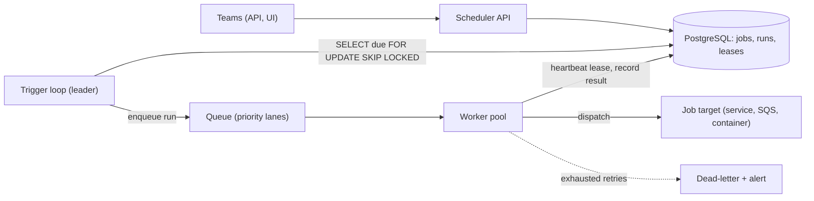

# Design a Distributed Job Scheduler

> [!abstract] The product in one sentence
> A service where teams register "run this at 02:00 daily" or "run this once at T", which fires each run on time on some healthy worker, exactly once in effect, with retries, priorities and a history you can query.

> [!tip] How to use this note
> Every section below has **questions to settle** and **options with trade-offs**. Write *My decision and why* under each before looking at a reference solution. The goal is a design you can defend, not a design you can recite.

**Map:** [[Problem Bank MOC]] → [[HLD MOC]]

## Problem statement

Replace the cron pods and `@Scheduled` methods scattered across services with one scheduler: durable job definitions, a trigger loop that fires on time, leases so two workers never run the same run, retries, priorities and run history. The hard parts are duplicate execution during failover and runs silently never happening. Related: [[Design a Workflow Orchestrator]] (multi-step workflows), [[Design a Message Queue]] (the dispatch layer).

**Questions to settle:** Does the scheduler *execute* jobs or only *dispatch* them (webhook, queue message)? Is "on time" seconds or minutes? Exactly-once in effect, or at-least-once with idempotent jobs?

## Product context and intended users

Platform service for every team: settlement batches, reconciliation, reports, retries of stuck payouts. In fintech a settlement job that runs twice double-pays and one that silently skips breaks a cut-off — so visibility of missed runs matters as much as correctness.

## Functional requirements

- Register jobs with a cron expression or a one-off time, payload, timeout, retry policy, priority.
- Fire each due run once; record attempts, status and output per run.
- Pause, resume, trigger now, and backfill missed runs on request.
- **Questions to settle:** Dependencies between jobs? Concurrency limits per job? Time zones and DST?

## Non-functional requirements

- Firing accuracy within ~1–5 s of schedule at p99; thousands of jobs, hundreds of runs per minute.
- No lost runs after a scheduler crash; no duplicate effects after a worker crash.
- Scheduler availability independent of any one worker or node.
- **Questions to settle:** Is a 60-second firing delay during failover acceptable?

## Constraints and assumptions

- Worker clocks drift; the database clock is the reference ([[Clocks and Time]]).
- Jobs are owned by other teams and may hang, so timeouts are mandatory.
- Workers run on Kubernetes and get killed without warning during deploys.

## Capacity estimation

| Quantity | Assumption | Result |
|---|---|---|
| Jobs | 5k definitions, mostly hourly or daily | ~2k runs/hour; ~500 in one minute at :00 |
| Poll load | Due-run poll every 1 s | One indexed query/s — trivial |
| Run history | 50k runs/day × ~2 KB | ~36 GB/year — partition by month, archive at 90 days |
| Workers | 30 s average run, 500-run burst | ~250 concurrent; size pools per priority |

*(Redo with your own assumptions; the shape of the reasoning is the point.)*

## API design

```http
POST /v1/jobs { "name": "settle-upi", "cron": "0 2 * * *", "tz": "Asia/Kolkata", "target": "sqs:settlement", "payload": {...}, "timeoutSec": 900, "retry": { "max": 3, "backoff": "exp" }, "priority": 1 }
→ 201 { "jobId": "j_1" }
POST /v1/jobs/j_1/trigger  { "idempotencyKey": "manual-2026-10-19" }  → 202 { "runId": "r_88" }
GET  /v1/jobs/j_1/runs?status=failed  → 200 { "runs": [...] }
```

**Questions to settle:** Dispatch target as a queue message (decoupled, needs a consumer) versus an HTTP callback (simple, scheduler must retry it) versus an in-cluster container run (full control, heaviest)?

## Data model

`job(id, cron, tz, target, payload, timeout, retry_policy, priority, enabled, next_fire_at)`; `run(id, job_id, scheduled_for, state, attempt, lease_owner, lease_until, started_at, ended_at, error)`. `next_fire_at` is indexed — the whole scheduler is one query on it. Run states: `scheduled → leased → running → succeeded | failed | timed_out`, append-only transitions ([[Data Modeling]]).

## High-level architecture



## Component responsibilities

| Component | Owns | Does not own |
|---|---|---|
| Trigger loop | Computing due runs, creating run rows, enqueueing | Executing jobs |
| Worker | Leasing a run, heartbeats, timeouts, dispatch, result | Deciding when to run |
| Job store | Definitions, runs, leases, history | Queueing |
| Dispatch targets | The actual work, idempotent on `runId` | Scheduling |

## Database selection and rationale

**Options:** PostgreSQL (transactions, `FOR UPDATE SKIP LOCKED` for leases, one system — the pragmatic default); a delay queue (SQS delays cap at 15 minutes, so not for cron); [[Redis]] sorted sets by fire time (fast, weaker durability and leases). **Decision to make:** PostgreSQL for everything until the poll query shows up in metrics, then a queue in front of workers ([[Optimistic and Pessimistic Locking]]).

## Caching strategy

Minimal. Cache job definitions in the trigger loop and recompute `next_fire_at` on change. Never cache due-run queries; the point is reading the truth. Dashboard reads of run history can use a replica ([[Read Replicas]]).

## Messaging and asynchronous processing

The trigger loop's output is a queue so a burst of 500 runs at :00 is absorbed, not spawned as 500 threads ([[Message Queues]]). Priority lanes are separate queues, not a field. Retries are new attempts with backoff and jitter scheduled back into the store, not queue redelivery, so history stays in one place ([[Retry Strategies]]). Exhausted attempts enter a [[Dead-Letter Queues|dead-letter]] state that pages the owning team.

## Scaling strategy

Workers scale on queue depth. The trigger loop is the single point: one leader elected via a lease ([[Leader Election]]) with hot standbys, or loops sharded by `job_id` hash. Partition `run` by time; keep `job` small. Per-job timeouts and concurrency limits stop one runaway job occupying every worker ([[Bulkheads]]).

## Consistency requirements

Each run is leased by at most one worker: a lease with expiry plus a fencing token passed to the target, so a worker that paused and woke late cannot complete a reassigned run ([[Distributed Locks]]). Exactly-once *effect* is the target's job — idempotent on `runId` ([[Idempotency]]). Missed runs after downtime need an explicit per-job policy: fire once, fire all, or skip.

## Failure scenarios

| Failure | Impact | Detection | Mitigation |
|---|---|---|---|
| Trigger leader dies | Nothing fires until standby takes over | Leader heartbeat age | Lease election; standby in seconds; backfill missed |
| Worker dies mid-run | Run stuck "running" | Lease expiry without heartbeat | Reassign on expiry; idempotent target; fencing token |
| Job hangs | Worker slot occupied forever | Run exceeds timeout | Abandon at timeout, mark `timed_out`, retry per policy |
| Clock skew or DST | Runs fire early, late or twice | DB `now()` vs wall clock | Schedule in UTC from the DB clock; test DST |

## Security considerations

Jobs run with the owning team's identity, not the scheduler's ([[Least Privilege]]): dispatch carries a scoped service token, never a shared super-token. Payloads may hold account ids — encrypt at rest, redact in the UI. Every manual trigger and definition change is audited ([[Audit Logs]]).

## Observability

Metrics: runs scheduled/fired/succeeded/failed per job, firing delay p99, lease expirations, queue depth per priority. The alert that matters most: "job X was due at T and has no run row" — missed runs are silent otherwise ([[Alerting]]). A per-job timeline UI pays for itself in the first incident.

## Cost considerations

The scheduler is cheap: a small PostgreSQL and a few pods. Workers are the cost — executing job code centrally concentrates spend and blast radius; dispatching to the owner's queue keeps both with the owner. Compare against EventBridge Scheduler plus SQS before building ([[Build vs Buy Decisions]]).

## Architectural trade-offs

| Decision | Chosen | Rejected | Why |
|---|---|---|---|
| Execute jobs vs dispatch to owners | *(yours)* | | |
| Single leader trigger loop vs sharded loops | *(yours)* | | |
| Missed-run policy after downtime | *(yours)* | | |

## Alternative designs

- **Kubernetes CronJobs per team** — nothing to build; no cross-team visibility, retries and leases are per job, and missed-run detection is everyone's problem.
- **Temporal-style durable execution** — schedules become workflows with timers; far more capable, heavier to operate, and overkill if jobs are single-step ([[Temporal]]).

## What I would implement first

PostgreSQL job and run tables, a leader-elected trigger loop using `FOR UPDATE SKIP LOCKED`, SQS dispatch with two priority queues, lease heartbeats with fencing tokens on `runId`, and a "due but no run" alert. Backfill policy as a per-job flag from day one.

## What I would defer

Job dependencies, in-cluster execution, time-zone-aware UI, run output storage, multi-region.

## Related

### Concepts
- [[Distributed Locks]] — leases and fencing for runs
- [[Leader Election]] — one trigger loop at a time
- [[Idempotency]] — exactly-once effect lives in the target
- [[Retry Strategies]] — backoff with jitter, bounded attempts
- [[Message Queues]] — absorbing the :00 burst
- [[Clocks and Time]] — DST, skew, the database clock
- [[Dead-Letter Queues]] — exhausted runs must page someone

### Projects
- [[Durable Job Scheduler]] — build exactly this on PostgreSQL
- [[Lock Service with Fencing Tokens]] — the lease primitive underneath

### Resources
- [[Temporal Docs on Durable Execution]]
- [[PostgreSQL Transaction Isolation Docs]]
- [[AWS Architecture Blog - Exponential Backoff and Jitter]]

## What I learned

*(Fill after a design session.)*

## What I would improve in a second iteration

*(Fill after a review or implementation.)*
