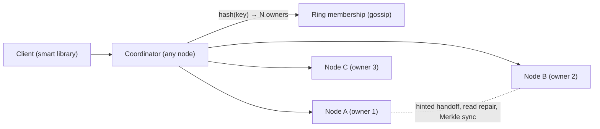

# Design a Distributed Key-Value Store

> [!abstract] The product in one sentence
> A store that keeps serving GETs and PUTs while nodes die and the network splits, spreads keys evenly over a cluster you grow one node at a time, and lets each request choose how much consistency it pays for.

> [!tip] How to use this note
> Every section below has **questions to settle** and **options with trade-offs**. Write *My decision and why* under each before looking at a reference solution. The goal is a design you can defend, not a design you can recite.

> [!tip] Reference solution in your system-design vault
> `system-design/15 Interview Playbook/Design a Key-Value Store.md` — compare *after* you have written your own design.

**Map:** [[Problem Bank MOC]] → [[HLD MOC]]

## Problem statement

Build Dynamo-lite: partition keys with [[Consistent Hashing]], replicate each to N nodes, serve with tunable R and W [[Quorums]], survive partitions with hinted handoff, and repair divergence with anti-entropy. Hard parts: membership without a master, concurrent writes to one key, and rebalancing without downtime. Related: [[Design a Distributed Cache]] (same partitioning, no durability), [[Design a Message Queue]].

**Questions to settle:** Leaderless (Dynamo) or a leader per partition (Raft groups)? Last-writer-wins or vector clocks with client resolution? Durable on disk, or memory-first?

## Product context and intended users

A capstone exercise. The production equivalents — DynamoDB, Cassandra, Riak — sit under session stores, carts and idempotency keys: workloads that prefer availability and tolerate a stale read.

## Functional requirements

- `get`, `put`, `delete` by key; TTL; per-request R and W.
- Add and remove nodes online.
- **Questions to settle:** Range scans (needs ordered partitioning)? Compare-and-set? Multi-key transactions — explicitly out?

## Non-functional requirements

- p99 get < 10 ms in region; writes succeed through a single-node failure and most partitions.
- No acknowledged write lost with W ≥ 2; adding a node moves only ~1/N of keys.
- **Questions to settle:** Which is worse for your workload — a stale read or a refused write?

## Constraints and assumptions

- Nodes fail and return; clocks are unreliable; clients retry.
- Disk, not CPU, is the bottleneck.

## Capacity estimation

| Quantity | Assumption | Result |
|---|---|---|
| Data | 1 TB logical, N = 3 | 3 TB raw; 12 nodes at ~500 GB each with headroom |
| Ops | 50k reads/s, 10k writes/s | ~5k ops/s/node; each write touches 3 nodes, each read R |
| Ring | 12 nodes × 256 virtual nodes | Even spread; one new node takes ~8% of keys |

*(Redo with your own assumptions; the shape of the reasoning is the point.)*

## API design

```http
GET  /v1/keys/cart:42?r=2 → 200 { "value": "...", "context": "<vector clock>" } | 404
PUT  /v1/keys/cart:42?w=2 { "value": "...", "context": "<from the last GET>", "ttlSec": 86400 } → 200 { "context": "..." } | 409 { "siblings": [ ... ] }
DELETE /v1/keys/cart:42 → 204   (a tombstone, not a removal)
GET  /internal/ring → 200 { "members": [ ... ], "version": 91 }
```

**Questions to settle:** Expose siblings to the client (Riak) or resolve server-side (LWW, CRDT)? How long are tombstones kept?

## Data model

Per node: a write-ahead log and memtable flushed to sorted files (LSM), or an embedded engine like RocksDB — the engine is a build-vs-buy choice. Each value carries a version (vector clock or hybrid timestamp) and TTL. Ring state `member(node, tokens, status, heartbeat)` is gossiped; hinted writes are stored locally tagged with the intended owner.

## High-level architecture



## Component responsibilities

| Component | Owns | Does not own |
|---|---|---|
| Coordinator | Routing, quorum logic, read repair, returning conflicts | Storage |
| Storage engine | WAL, memtable, SSTables, compaction | Replication |
| Membership | Ring, gossip, failure detection | Data |
| Anti-entropy | Merkle comparison, hint replay | The request path |

## Database selection and rationale

We *are* the database; the only choice is the engine. Write a simple append log with an in-memory index first (educational), move to an LSM or embed RocksDB when compaction and crash recovery become the lesson.

## Caching strategy

Nothing beyond the engine's block cache. The client library caches the ring so it routes to owners directly and skips the coordinator hop.

## Messaging and asynchronous processing

Node-to-node RPC over [[gRPC]] for replication, hints and repair; gossip for membership with failure detection by missed heartbeats ([[Gossip Protocols]], [[Failure Detection]]). Hints replay as a background queue when the owner returns; anti-entropy compares Merkle trees per key range on a schedule.

## Scaling strategy

Add a node: it claims tokens on the ring and owners stream those ranges to it; virtual nodes keep the spread even and let bigger machines take more tokens. Hash partitioning hates [[Hot Keys]] — a celebrity cart hammers three nodes; mitigate with client caching or key splitting.

## Consistency requirements

R + W > N gives the quorum's view, not linearizability — and sloppy quorums with hints weaken even that; say so in the interview ([[Consistency Models]], [[Eventual Consistency]]). Concurrent writes: vector clocks detect them and the client resolves; LWW with [[Clocks and Time|unreliable clocks]] silently drops writes. Deletes are tombstones kept for a repair window or they resurrect. This is [[CAP Theorem]] and [[PACELC]] made concrete: AP, with latency traded for consistency per request.

## Failure scenarios

| Failure | Impact | Detection | Mitigation |
|---|---|---|---|
| Node down briefly | Writes still succeed | Gossip marks it suspect | Hinted handoff to the next node; replay on return |
| Network partition | Divergent versions of a key | Vector-clock siblings | Client resolves on read; read repair; Merkle anti-entropy |
| Disk corruption | One replica gone | Checksums, failed reads | Re-replicate the range from other owners; N = 3 tolerates one |

## Security considerations

Node-to-node mTLS and a cluster token — an open gossip port is a cluster takeover. Client auth and per-namespace ACLs if shared. Encrypt SSTables at rest for regulated data ([[Encryption at Rest and in Transit]]).

## Observability

Per-node p99 by operation, quorum failures, pending hints, Merkle repair bytes, ring-version skew across nodes, compaction backlog, disk per node. Alert on ring disagreement lasting over a minute — membership [[Split-Brain]].

## Cost considerations

Storage × 3 plus replication and repair traffic. The real cost is operating a stateful system by hand — which is why DynamoDB exists. This build is for understanding, not replacement.

## Architectural trade-offs

| Decision | Chosen | Rejected | Why |
|---|---|---|---|
| Leaderless vs Raft groups per partition | *(yours)* | | |
| Vector clocks vs last-writer-wins | *(yours)* | | |
| Sloppy vs strict quorum | *(yours)* | | |

## Alternative designs

- **Raft-replicated partitions (TiKV shape)** — linearizable per key, no siblings; a failover pause and much more machinery ([[Consensus]]).
- **Single leader with async replicas** — simplest possible; a leader failure loses recent writes or blocks.

## What I would implement first

Single-node append log with a hash index; a consistent-hash ring with virtual nodes in a client library; N = 3, R = W = 2; gossip membership; hinted handoff. Then vector clocks, then Merkle repair, then an LSM engine — each step broken on purpose in [[Chaos Lab]].

## What I would defer

Range queries, compare-and-set, multi-datacenter, compaction tuning, an admin UI.

## Related

### Concepts
- [[Consistent Hashing]] — the ring and virtual nodes
- [[Quorums]] — R, W, N and what they do not promise
- [[Replication]] — N copies, leaderless
- [[Eventual Consistency]] — the contract with the client
- [[Gossip Protocols]] — membership without a master
- [[Clocks and Time]] — why LWW loses writes

### Projects
- [[Mini-KV Store]] — build exactly this, step by step
- [[Chaos Lab]] — partition it and watch

### Resources
- [[Dynamo Paper]]
- [[Designing Data-Intensive Applications]]

## What I learned

*(Fill after a design session.)*

## What I would improve in a second iteration

*(Fill after a review or implementation.)*
