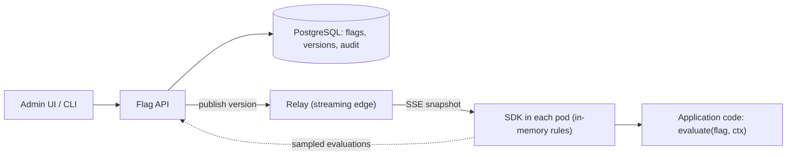

# Design a Feature Flag Service

> [!abstract] The product in one sentence
> Any service asks "is `new-settlement-path` on for this user?" and gets an answer in microseconds from local memory, the whole fleet converges on a change within seconds, and the kill switch works when everything else is on fire.

> [!tip] How to use this note
> Every section below has **questions to settle** and **options with trade-offs**. Write *My decision and why* under each before looking at a reference solution. The goal is a design you can defend, not a design you can recite.

**Map:** [[Problem Bank MOC]] → [[HLD MOC]]

## Problem statement

Store flag definitions and targeting rules, distribute them to every instance, evaluate locally, audit who changed what. Hard parts: evaluation must never block a request, propagation must be fast and verifiable, and the system must fail safe when the service is unreachable. Related: [[Design an IAM Service]] (policies distribute the same way), [[Design a Distributed Cache]].

**Questions to settle:** Local evaluation (SDK holds the rules) or remote (a call per check)? Default when unreachable — last known, or the compiled-in value? Booleans only, or runtime config values too?

## Product context and intended users

Every service and frontend; release managers, on-call (kill switches), product (experiments). In fintech, a flag gating a money path is a change-controlled artifact — who flipped it and why must be answerable.

## Functional requirements

- Flags with variants and targeting: attributes, percentage rollout, allowlists; environments.
- SDK `evaluate(flag, context)` → variant plus reason; streaming updates.
- Audit log with who, when, why; kill switch overriding all rules.
- **Questions to settle:** Experiment assignment and stats in scope? Flag expiry and cleanup?

## Non-functional requirements

- Evaluation < 10 µs p99 in process; propagation < 5 s p99 to 2k instances.
- SDK survives a service outage indefinitely; identical results for identical context and ruleset version.
- **Questions to settle:** Is 5 s acceptable for a kill switch, or does it need sub-second?

## Constraints and assumptions

- Java and TypeScript SDKs must evaluate identically — hashing, not randomness, for buckets.
- 2k pods either polling or holding a streaming connection.

## Capacity estimation

| Quantity | Assumption | Result |
|---|---|---|
| Evaluations | 2k pods × 5k/s | 10M/s, all local — zero server load |
| Ruleset | 500 flags × 2 KB | ~1 MB per environment, fetched once per pod at start |
| Updates | 50 changes/day → 2k pods | 100k pushes/day — trivial streaming, awkward as 1-s polling |

*(Redo with your own assumptions; the shape of the reasoning is the point.)*

## API design

```http
GET  /v1/environments/prod/rules?since=812   (SDK; SSE stream or long-poll) → 200 { "version": 813, "flags": [ ... ] } | 304
POST /v1/flags { "key": "new-settlement-path", "type": "boolean", "default": false, "owner": "payments" } → 201
PATCH /v1/flags/new-settlement-path/environments/prod
      { "rules": [{ "if": { "org": ["acme"] }, "serve": true }, { "rollout": { "true": 10 } }], "reason": "PAY-123" } → 200 { "version": 814 }
POST /v1/flags/new-settlement-path/environments/prod/kill → 200 { "version": 815 }
```

**Questions to settle:** Full ruleset snapshot per update (simple, idempotent) or deltas (smaller, ordering problems)?

## Data model

`flag(key, type, default, owner, archived_at)`; `flag_env(flag, env, enabled, rules, version)`; `ruleset_version(env, version, snapshot, author, reason, ts)` — every version is a full snapshot, so rollback is "serve version N" ([[Versioning and Migrations]]); `segment(key, rules)` for reusable targeting; `audit_event`.

## High-level architecture



> [!example]- Excalidraw version — the same diagram as an editable canvas
> ![[Design a Feature Flag Service.excalidraw]]
> [[Design a Feature Flag Service.excalidraw|Open in Excalidraw]] — needs the Excalidraw plugin (see [[Plugins to Install]]).


## Component responsibilities

| Component | Owns | Does not own |
|---|---|---|
| Flag API | CRUD, versioning, validation, audit | Evaluation |
| Relay | Fan-out of snapshots to thousands of SDKs | Truth |
| SDK | Fetch, cache, deterministic evaluation, fallback | Rule authoring |
| Evaluation analytics | Which flags are still used | Serving |

## Database selection and rationale

PostgreSQL: small, relational, every change versioned. The latest snapshot is also written to object storage behind a CDN so SDKs can bootstrap while the API is down ([[Object Storage]]). The product is distribution and evaluation, not storage.

## Caching strategy

The SDK is a cache of the whole ruleset — [[Cache Consistency]] is the entire design. Bootstrap from last-known-good on disk, then stream. Relays cache one snapshot per environment and answer pollers with ETag and 304; polling is the backstop, not the path ([[TTL]]).

## Messaging and asynchronous processing

A published version goes to a topic; relays push snapshots to SDKs over one long-lived SSE connection per pod ([[Pub-Sub]]). Snapshots, not deltas: an SDK that misses a message simply applies the next version. Sampled evaluation events flow back for dead-flag detection and experiment stats.

## Scaling strategy

Evaluation scales with the applications. Relays scale on connection count; one snapshot per environment, not per flag. Multi-region means relays per region with one database.

## Consistency requirements

Within a pod, evaluation is consistent with its ruleset version, and the version is returned in `reason` so a log line can say "v813 served true". Across pods, [[Eventual Consistency|eventually consistent]] within seconds — fine for releases, not for a money gate: evaluate once per transaction and pass the result along. Percentage rollouts bucket on `hash(flagKey, userId)` so a user is sticky.

## Failure scenarios

| Failure | Impact | Detection | Mitigation |
|---|---|---|---|
| Flag service down | No updates; evaluation continues | SDK connection errors | Last known good; CDN bootstrap; alert on stale age |
| Bad rule serves true to everyone | Incident in every service at once | Evaluation mix shift | Kill switch; one-click rollback to version N−1 ([[Deployment and Rollback Strategies]]) |
| Some pods stale | Split behaviour | Version reported per pod | Dashboard of pods behind head; forced re-fetch |

## Security considerations

Prod changes to flags tagged `money` need a reviewer. SDK keys are per environment and read-only. Targeting contexts may carry PII — hash user ids client-side. Every change in [[Audit Logs]] with a reason; [[Least Privilege]] on who may kill what.

## Observability

Ruleset version per pod (the one dashboard that matters), propagation latency, SDK staleness, evaluations per flag (dead flags), error rate split by variant — is the new path worse? Alert on a prod change without a reason.

## Cost considerations

Near-zero compute; relay connections and the sampled evaluation stream are the lines. The hidden cost is flag debt: stale flags left in code ([[Technical Debt]]).

## Architectural trade-offs

| Decision | Chosen | Rejected | Why |
|---|---|---|---|
| Local vs remote evaluation | *(yours)* | | |
| Streaming vs polling | *(yours)* | | |
| Build vs buy (LaunchDarkly, Unleash) | *(yours)* | | |

## Alternative designs

- **ConfigMap reloaded on change** — nothing to run; no targeting, no audit, no control over propagation.
- **Remote evaluation service** — rules never leave the server and consistency is instant; a network call per check and a hard dependency ([[Build vs Buy Decisions]] applies to both).

## What I would implement first

PostgreSQL flags with versioned snapshots; API with audit and reasons; SSE relay; Java and TS SDKs with in-memory evaluation, deterministic bucketing, disk bootstrap and version reporting; kill switch and rollback.

## What I would defer

Experiments and stats, segment UI, multi-region relays, flag-cleanup automation, browser SDK.

## Related

### Concepts
- [[Feature Flags]] — the concept behind the service
- [[Deployment and Rollback Strategies]] — flags decouple deploy from release
- [[Pub-Sub]] — version published, relays fan out
- [[Cache Consistency]] — the SDK is a cache; convergence is the product
- [[Audit Logs]] — who flipped the money flag
- [[Graceful Degradation]] — last known good when the service is gone

### Projects
- [[Feature Flag Service and SDK]] — build exactly this

### Resources
- [[Martin Fowler - Feature Toggles]]
- [[Unleash Feature Flags]]

## What I learned

*(Fill after a design session.)*

## What I would improve in a second iteration

*(Fill after a review or implementation.)*
