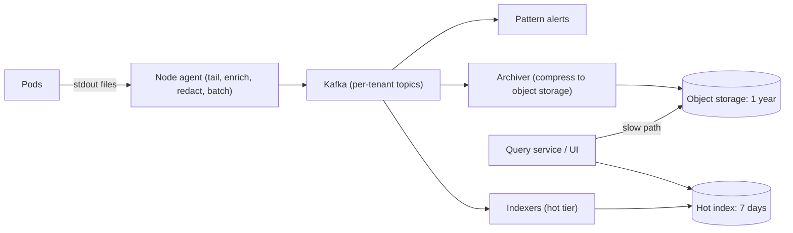

# Design a Logging System

> [!abstract] The product in one sentence
> Every pod's structured log lines are searchable by service, trace id and free text within seconds of being written, kept hot for days and cold for a year, at a cost that does not grow faster than the business.

> [!tip] How to use this note
> Every section below has **questions to settle** and **options with trade-offs**. Write *My decision and why* under each before looking at a reference solution. The goal is a design you can defend, not a design you can recite.

**Map:** [[Problem Bank MOC]] → [[HLD MOC]]

## Problem statement

Design the ELK-or-Loki-shaped pipeline: node agents tail container logs, a buffer decouples producers from indexers, an indexing tier makes recent data searchable, cold storage holds the rest, a query UI unifies them. The tension: index everything (fast, expensive) versus index labels only and grep the rest (cheap, slower) ([[Logging]]). The numeric sibling is [[Design a Metrics and Monitoring System]]; the buffer is [[Design a Message Queue]].

**Questions to settle:** Full-text over bodies, or labels plus grep? Days hot, months warm, years cold? Are logs compliance records or debugging exhaust?

## Product context and intended users

On-call engineers searching by `trace_id` during incidents; security and compliance pulling audit records; finance watching the bill. In fintech some log streams are evidence — transaction decisions, auth events — and need stricter retention and access than debug noise.

## Functional requirements

- Collect structured JSON lines from every pod and host; enrich with pod, namespace, version.
- Search by labels and time; full-text where enabled; tail live; save queries and alerts on patterns.
- Retention tiers per stream; export to the warehouse; redaction rules.
- **Questions to settle:** Per-team quotas? Sampling of debug-level logs? Log-based metrics?

## Non-functional requirements

- Ingest-to-searchable under ~30 s; queries over the last hour under ~5 s.
- No silent loss under normal operation; bounded loss (minutes) under indexer outage.
- One noisy service must not degrade search for others ([[Bulkheads]]).
- **Questions to settle:** How much loss is acceptable when an agent's buffer fills?

## Constraints and assumptions

- Volume is bursty and skewed: a handful of services produce most bytes; an error loop can 100× one service in a minute.
- Lines carry PII unless redacted at the source; the pipeline cannot be the only control.
- Kubernetes rotates container log files; agents must handle rotation without duplication.

## Capacity estimation

| Quantity | Assumption | Result |
|---|---|---|
| Volume | 2k pods × 50 lines/s × ~500 B | ~100k lines/s, ~50 MB/s, ~4 TB/day |
| Hot index | 7 days at ~1.5× raw with full-text | ~40 TB — label-only indexing cuts ~10× |
| Cold storage | 1 year compressed ~10:1 | ~150 TB in object storage |
| Buffer | 1-hour indexer outage | ~180 GB in Kafka — size retention for the outage you want to survive |

*(Redo with your own assumptions; the shape of the reasoning is the point.)*

## API design

```http
POST /v1/ingest  (agent → buffer, batched, gzip)  [ { "ts": "...", "svc": "payments", "level": "error", "trace_id": "...", "msg": "..." }, ... ]
GET  /v1/query?q={svc="payments"} |= "timeout"&start=...&end=...&limit=500   → 200 { "streams": [...] }
GET  /v1/tail?q={svc="payments",level="error"}                                  (streaming)
```

**Questions to settle:** Agents write straight to Kafka (fewer hops, agents need Kafka clients) or to an ingest API (validation and auth in one place, one more tier)? Is the query language label-first (Loki) or free-text-first (Lucene)?

## Data model

A stream is a label set (`svc`, `env`, `pod`) plus ordered `(timestamp, line)` entries. Hot tier: an [[Inverted Indexes|inverted index]] over tokens per time-bucketed index (Elasticsearch style) or a small label index pointing at compressed chunks in object storage (Loki style). Cold tier: Parquet files partitioned by day and service ([[Data Modeling]]).

## High-level architecture



> [!example]- Excalidraw version — the same diagram as an editable canvas
> ![[Design a Logging System.excalidraw]]
> [[Design a Logging System.excalidraw|Open in Excalidraw]] — needs the Excalidraw plugin (see [[Plugins to Install]]).


## Component responsibilities

| Component | Owns | Does not own |
|---|---|---|
| Node agent | Tailing, rotation, enrichment, redaction, local buffer | Indexing |
| Buffer (Kafka) | Absorbing bursts, replay, per-tenant isolation | Search |
| Indexers + hot store | Parsing, indexing, serving recent queries | Long retention |
| Archiver + query service | Cold files, federated queries across tiers | Collection |

## Database selection and rationale

**Options:** Elasticsearch or OpenSearch (full-text, aggregations, mature; memory-hungry at scale); Loki (label index plus object-storage chunks; cheap, grep-style, weaker ad-hoc text search); ClickHouse (columnar, great compression, SQL rather than log-native UX). **Decision to make:** does anyone truly need full-text over bodies, or do `trace_id` and labels cover incidents? That answer changes cost by an order of magnitude ([[Search Engines]]).

## Caching strategy

Query result caching for repeated dashboard queries and the live tail; index metadata (which chunks cover which labels and time range) cached in the query service so most queries never list object storage. No caching on the ingest path — it is sequential writes ([[Cache-Aside]]).

## Messaging and asynchronous processing

[[Kafka]] is the spine: agents produce, indexers and archivers consume independently, so an indexer outage does not stop archiving and replay rebuilds the hot tier. Per-tenant or per-tier topics isolate a noisy service. Pattern alerts are a stream consumer. Retention on the topic defines how long an outage can last before loss ([[Consumer Groups]]).

## Scaling strategy

Agents scale with nodes. Kafka scales by partitions keyed by service. Indexers scale on consumer lag; the hot store scales by time-bucketed indices rotated daily. Quotas per tenant at the agent and at Kafka are the real scaling control — without them one error loop takes the cluster ([[Backpressure]]). Cold queries scale by parallel scanning of partitioned files.

## Consistency requirements

Logs are append-only and at-least-once: a restarted agent may resend a batch, so lines carry an id for dedup at index time ([[Duplicate Message Processing]]). Ordering is per stream by timestamp, not global; clock skew across nodes means merged views may interleave slightly wrong ([[Clocks and Time]]). Searchability lags by seconds and that is acceptable.

## Failure scenarios

| Failure | Impact | Detection | Mitigation |
|---|---|---|---|
| Indexers down | Search stale; Kafka fills | Consumer lag | Retention sized for the outage; archiver unaffected; replay |
| Error loop in one service | 100× volume floods pipeline | Bytes/s per tenant | Per-tenant quota and sampling at the agent |
| Agent buffer overflow | Lines lost on that node | Dropped-lines counter | Disk-backed buffer; prioritise error level |
| Hot store disk full | Indexing halts | Disk usage, index age | Enforce rotation; cold-only mode ([[Graceful Degradation]]) |

## Security considerations

Logs are the most common PII leak: redact at the agent by schema and pattern, and reject lines that fail redaction for sensitive streams. Access control per stream so support cannot read auth logs ([[Authorization]], [[Least Privilege]]). Audit streams are write-once with longer retention and their access is itself logged ([[Audit Logs]]).

## Observability

The pipeline's own metrics: lines in/out per stage, dropped and sampled lines per tenant, Kafka lag, ingest-to-searchable latency, query p99 per tier, hot store disk and heap, cost per GB per tenant ([[Metrics]]). Alert on lag and drops; a daily cost-per-team report drives the behaviour change that quotas enforce.

## Cost considerations

Hot indexed storage is 10–50× the cost of compressed cold storage per GB — the tiering decision *is* the budget. Levers: label-only indexing, shorter hot retention, sampling debug logs, per-team quotas and showback. Managed SaaS per-GB ingest pricing is where most logging bills explode ([[Performance vs Cost Trade-offs]]).

## Architectural trade-offs

| Decision | Chosen | Rejected | Why |
|---|---|---|---|
| Full-text index vs label index plus grep | *(yours)* | | |
| Kafka buffer vs agents writing directly to the store | *(yours)* | | |
| Hot retention window and tier boundaries | *(yours)* | | |

## Alternative designs

- **Object storage plus query engine only** (Parquet in S3, Athena or ClickHouse over it) — no hot tier, very cheap, minutes of latency; fine for audit and analytics, poor for live debugging.
- **Managed SaaS** — zero operations, best UX; per-GB pricing and data residency questions, and the bill becomes a product constraint ([[Build vs Buy Decisions]]).

## What I would implement first

Fluent Bit agents with redaction and disk buffers, Kafka with per-tier topics and quotas, Loki-style label indexing with chunks in S3 and 7-day hot retention, an archiver to Parquet, and a drops-and-lag dashboard per tenant. Measure what fraction of incident queries need full text before buying an inverted index.

## What I would defer

Full-text search, log-based metrics, pattern alerts, multi-cluster federation, per-field schemas.

## Related

### Concepts
- [[Logging]] — structure, levels, what to log
- [[Kafka]] — the buffer that makes outages survivable
- [[Inverted Indexes]] — what full-text costs
- [[Full-Text Search]] — when it is really needed
- [[Object Storage]] — the cold tier
- [[Data Retention and Archival]] — tiers and compliance
- [[Backpressure]] — quotas and sampling

### Projects
- *(none yet — propose one)*

### Resources
- [[OpenTelemetry Observability Primer]]
- [[Kafka Design Documentation]]
- [[Google SRE Book - Monitoring Distributed Systems]]

## What I learned

*(Fill after a design session.)*

## What I would improve in a second iteration

*(Fill after a review or implementation.)*
