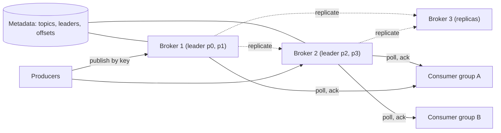

# Design a Message Queue

> [!abstract] The product in one sentence
> A broker that accepts messages from producers, stores them durably, and hands them to consumers at least once with a defined ordering, so that producers and consumers can fail and scale independently.

> [!tip] How to use this note
> Every section below has **questions to settle** and **options with trade-offs**. Write *My decision and why* under each before looking at a reference solution. The goal is a design you can defend, not a design you can recite.

> [!tip] Reference solution in your system-design vault
> `system-design/09 Messaging and Event-Driven/Message Queues vs Event Logs.md` — compare *after* you have written your own design.

**Map:** [[Problem Bank MOC]] → [[HLD MOC]]

## Problem statement

Design the broker, not an application on it: publish, durable storage, delivery to consumer groups, acks, redelivery, ordering within a partition, replication across brokers. You have used RabbitMQ, [[Kafka]] and SQS; the exercise is explaining *why* they differ by making the same choices yourself ([[Message Queues]]). Consumers of this design: [[Design a Notification System]], [[Design a Distributed Job Scheduler]].

**Questions to settle:** Queue semantics (deleted after ack) or log semantics (retained, offsets)? Is replay required? Push or pull?

## Product context and intended users

Internal infrastructure for async work, event fan-out and buffering bursts. In fintech the hard requirement is "an acknowledged publish is never lost" — a lost payment event is a reconciliation incident — plus per-account ordering for ledger-affecting events.

## Functional requirements

- Publish to a topic; consume via named consumer groups; ack, nack with redelivery.
- Ordered delivery within a partition key; retention by time or size.
- Dead-lettering after N failed deliveries; visibility into lag per group.
- **Questions to settle:** Delayed messages? Priorities? Transactions across topics?

## Non-functional requirements

- Durability: acknowledged publishes survive loss of one broker.
- Throughput: ~100k messages/s per partition on sequential disk; latency p99 under ~10 ms publish-to-ack.
- Availability: a broker failure pauses only its partitions, for seconds.
- **Questions to settle:** Is [[Exactly-Once Semantics|exactly-once]] required anywhere, or is idempotent consumption enough?

## Constraints and assumptions

- Sequential disk writes are fast; random reads are not — the storage design follows from this.
- Consumers crash mid-batch, so [[At-Least-Once Delivery]] with idempotent handlers is the baseline.
- Network partitions happen; replication must have a defined leader ([[Network Partitions]]).

## Capacity estimation

| Quantity | Assumption | Result |
|---|---|---|
| Ingest | 50k msg/s × ~1 KB | ~50 MB/s — one disk handles it; partition for consumers, not bytes |
| Retention | 7 days at 50 MB/s | ~30 TB raw, ~90 TB at 3× replication |
| Partitions | 10 topics × 12 partitions | Group parallelism capped at 12 per topic |
| Catch-up | 1-minute outage at 50k/s | 3M messages to drain — size consumers for catch-up |

*(Redo with your own assumptions; the shape of the reasoning is the point.)*

## API design

```http
POST /topics/{topic}/messages { "key": "acct-42", "value": "...", "headers": {} }  → 201 { "partition": 3, "offset": 9912 }
POST /groups/{group}/poll { "topic": "payments", "max": 100, "waitMs": 500 }       → 200 { "messages": [...], "lease": "l-1" }
POST /groups/{group}/ack { "lease": "l-1", "offsets": {"3": 9912} }              → 204
POST /groups/{group}/nack { "lease": "l-1", "messageId": "...", "retryAfterMs": 5000 } → 204
```

**Questions to settle:** Offset-based acks (commit "I have processed up to N") or per-message acks with visibility timeouts (SQS style)? Long-poll or a persistent streaming connection?

## Data model

Per partition: append-only segment files of (offset, timestamp, key, value) with a sparse offset index; old segments deleted by retention. Per consumer group: a committed offset per partition (log style) or an in-flight set with visibility deadlines (queue style). Metadata: topic → partitions → leader and replicas ([[Topic Partitions]]).

## High-level architecture



## Component responsibilities

| Component | Owns | Does not own |
|---|---|---|
| Broker | Segment storage, serving its partitions, replication | Which broker leads a partition |
| Controller | Partition assignment, leader election, group membership | Message bytes |
| Producer client | Partitioning by key, batching, idempotent retries | Delivery to consumers |
| Consumer client | Polling, offset commits or acks, rebalancing | Retention |

## Database selection and rationale

**Storage options:** your own append-only segments on local disk (fastest; you own the format and recovery); an embedded store like RocksDB (simpler indexing, less control over sequential I/O); object storage with a local write-ahead buffer (cheap retention, higher latency). **Metadata:** a [[Consensus]]-backed store, because leader election must not split-brain. **Decision to make:** local segments plus Raft metadata, or tiered storage from day one.

## Caching strategy

The OS page cache *is* the read cache: consumers that keep up never touch disk, and a lagging consumer reading old segments evicts hot pages for everyone — the noisy-consumer problem. Index files are cached in-process. No separate tier; adding [[Redis]] here is a smell.

## Messaging and asynchronous processing

Replication is the asynchronous machinery: followers pull from the leader; a publish is acknowledged once enough in-sync replicas confirm. Redelivery after timeout or nack is a scheduled re-enqueue; dead-lettering moves the message to a per-topic DLQ ([[Dead-Letter Queues]]). Group rebalancing pauses consumption briefly — handlers must tolerate it.

## Scaling strategy

Partitions are the unit: more partitions means more consumer parallelism and more brokers, with ordering only within a key ([[Consumer Groups]]). Slow consumers are handled by lag, not by pushing back on producers — that is the point of a buffer ([[Backpressure]]). Hot keys concentrate on one partition; choose keys at the granularity you need ordering, not finer.

## Consistency requirements

Within a partition, total order under a single leader; across partitions, none ([[Ordering Guarantees]]). A publish is durable when a quorum of replicas acknowledges, else it may be lost on failover. Delivery is at-least-once; exactly-once needs idempotent producers plus transactional offset commits — decide if any consumer truly needs it ([[Delivery Semantics]], [[Idempotency]]).

## Failure scenarios

| Failure | Impact | Detection | Mitigation |
|---|---|---|---|
| Leader broker dies | Its partitions pause until election | Controller heartbeats | Elect in-sync replica; producers retry idempotently |
| Consumer crashes before ack | Message processed twice | Duplicate ids downstream | Idempotent handlers ([[Duplicate Message Processing]]) |
| Disk fills | Broker stops accepting | Disk usage per broker | Retention enforcement, alert at 70%, topic quotas |
| Lag grows unbounded | Retention expires unread messages | Lag in seconds per group | Scale consumers, DLQ poison messages |

## Security considerations

[[TLS]] between clients and brokers; per-topic ACLs so a service only touches what it owns ([[Authorization]]); encrypt segments at rest when payloads carry PII. In fintech retention is a compliance question — payment events may need keeping, personal data may need deleting ([[Data Retention and Archival]]).

## Observability

Per partition: end offset, bytes in/out, under-replicated flag. Per group: lag in messages and seconds, rebalances, redeliveries, DLQ depth. Broker: disk usage, page-cache hit rate, request latency ([[Metrics]]). Alert on lag in seconds and under-replicated partitions, not depth alone.

## Cost considerations

Storage is retention × replication factor; 7 days at 3× is a default most teams never question. Tiered storage to S3 cuts it sharply at the cost of slow replays. MSK versus SQS: SQS has no partitions or replay but no brokers to run — for plain work queues it wins on [[Operational Simplicity]].

## Architectural trade-offs

| Decision | Chosen | Rejected | Why |
|---|---|---|---|
| Queue semantics vs retained log | *(yours)* | | |
| Ack model: offsets vs per-message visibility timeouts | *(yours)* | | |
| Replication ack: leader-only vs quorum | *(yours)* | | |

## Alternative designs

- **Database-backed queue** (`SELECT ... FOR UPDATE SKIP LOCKED`) — transactional with business data, trivial to run; throughput caps in the low thousands/s and polling load grows with consumers.
- **Redis Streams** — in-memory log with consumer groups and pending lists; very fast, but durability and retention are bounded by memory.

## What I would implement first

A single broker with append-only segments, one topic with N partitions, offset-based consumer groups with long polling, and lag metrics. Then add a follower with quorum acks and kill the leader under load to see what is lost.

## What I would defer

Tiered storage, transactions and exactly-once, delayed messages, multi-region replication.

## Related

### Concepts
- [[Message Queues]] — the problem family
- [[Kafka]] — the log-based reference design
- [[Delivery Semantics]] — what "delivered" means
- [[Consumer Groups]] — parallelism and rebalancing
- [[Topic Partitions]] — the unit of ordering and scale
- [[Ordering Guarantees]] — per key, not global
- [[Replication]] — durability across brokers
- [[Backpressure]] — lag as the buffer's purpose

### Projects
- [[Chaos Lab]] — kill a leader and partition the brokers; observe what is lost

### Resources
- [[Kafka Design Documentation]]
- [[Redis Streams Docs]]
- [[Confluent - Exactly-Once Semantics in Kafka]]
- [[Designing Data-Intensive Applications]]

## What I learned

*(Fill after a design session.)*

## What I would improve in a second iteration

*(Fill after a review or implementation.)*
