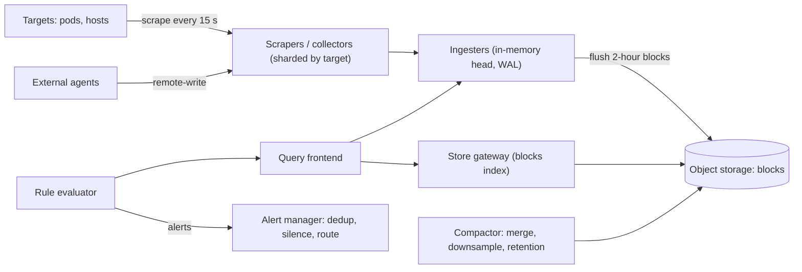

# Design a Metrics and Monitoring System

> [!abstract] The product in one sentence
> Every service and host emits counters, gauges and histograms; engineers graph them over any window in a second or two and get paged when a rule fires — including during the incident that is breaking everything else.

> [!tip] How to use this note
> Every section below has **questions to settle** and **options with trade-offs**. Write *My decision and why* under each before looking at a reference solution. The goal is a design you can defend, not a design you can recite.

**Map:** [[Problem Bank MOC]] → [[HLD MOC]]

## Problem statement

Design Prometheus-plus-long-term-storage from first principles: ingestion from thousands of targets, a store for append-only timestamped samples with high-cardinality labels, a query layer for dashboards, an alert evaluator, retention tiers. The constraint that shapes everything: the monitoring system must be more available than what it monitors ([[Monitoring]]). Alert delivery is [[Design a Notification System]]; the unstructured sibling is [[Design a Logging System]].

**Questions to settle:** Pull (scrape) or push (agents)? What cardinality is allowed — per pod, per user, per request? How long must raw resolution stay queryable?

## Product context and intended users

Internal: every engineering team for dashboards and alerts, SRE for SLOs ([[SLI SLO and SLA]]), finance for cost per tenant. Managed options exist; the exercise is understanding what you pay Datadog for and where self-hosted Prometheus breaks (cardinality, long-term storage, HA).

## Functional requirements

- Ingest samples `(metric, labels, timestamp, value)` from services and hosts.
- Query by label selectors with aggregation (`rate`, `sum by`, percentiles from histograms) over arbitrary windows.
- Alert rules evaluated continuously; notify with dedup and silences.
- **Questions to settle:** Exemplars linking to traces? Multi-tenant isolation? Recording rules?

## Non-functional requirements

- Ingest ~100k samples/s; 1-hour queries under ~1 s, 30-day queries in a few seconds.
- Alert evaluation delay under ~1 minute, on a path independent of dashboards.
- Minutes of data loss on a node crash is acceptable; hours is not.
- **Questions to settle:** Do any rules need 10-second resolution?

## Constraints and assumptions

- Samples are tiny and arrive in order per series; compression is the lever (delta-of-delta timestamps, XOR values).
- Cardinality explodes when someone labels by user id — the design must bound it, not hope.
- Prometheus-style scraping is the norm on Kubernetes; agents push from outside the cluster.

## Capacity estimation

| Quantity | Assumption | Result |
|---|---|---|
| Series | 2k pods × 500 series each | 1M active series; churn on deploys doubles it briefly |
| Samples | 1M series / 15 s scrape | ~67k samples/s; ~5.8B/day |
| Raw storage | ~1.5 B per sample compressed | ~9 GB/day; 15 days hot ≈ 135 GB per replica |
| Long-term | 5-minute downsampled, 1 year | ~2 GB/day equivalent → ~700 GB/year in object storage |

*(Redo with your own assumptions; the shape of the reasoning is the point.)*

## API design

```http
GET  /metrics                                   (scraped: "http_requests_total{route=\"/pay\",code=\"200\"} 1027")
POST /api/v1/write  (remote-write batches of samples, snappy-compressed protobuf)
GET  /api/v1/query_range?query=sum by (route) (rate(http_requests_total[5m]))&start=...&end=...&step=15s
POST /api/v1/rules { "alert": "HighErrorRate", "expr": "...", "for": "5m", "labels": {"severity":"page"} }
```

**Questions to settle:** Expose a PromQL-compatible API (ecosystem compatibility) or a simpler bespoke query language? Push via remote-write only, or also a StatsD-style UDP path for legacy hosts?

## Data model

A series is identified by the hash of its sorted label set; samples are appended per series into time-bounded blocks (say 2 hours) with an inverted index from label pairs to series ids. Blocks are immutable once closed; compaction merges them and downsamples ([[Time-Series Databases]], [[Inverted Indexes]]). Alert rules and silences live in a small relational store.

## High-level architecture



## Component responsibilities

| Component | Owns | Does not own |
|---|---|---|
| Scrapers / collectors | Target discovery, scraping, relabeling, batching | Storage |
| Ingesters | Recent samples in memory, WAL, block flush | Historical queries |
| Store gateway + compactor | Block index, downsampling, retention | Ingest |
| Rule evaluator + alert manager | Evaluating rules, dedup, silences, routing | Delivering pages |

## Database selection and rationale

**Options:** a purpose-built TSDB (Prometheus TSDB, VictoriaMetrics, Mimir, Thanos on object storage) — columnar per series, compression designed for this; a general columnar store (ClickHouse) — great for ad-hoc analytics, weaker ecosystem for alerting; a relational or key-value store — wrong shape, 10× the storage. **Decision to make:** which TSDB and whether long-term blocks live on local disk or object storage ([[Object Storage]]).

## Caching strategy

Query results cached by (query, step-aligned range) so dashboards refreshing every 30 s reuse most of the computation; recording rules precompute expensive aggregations into new series. Block index headers cached in the store gateway. Chunks for hot ranges cached in memory ([[Cache-Aside]]).

## Messaging and asynchronous processing

Optionally put [[Kafka]] between collectors and ingesters to absorb bursts and let several consumers (ingest, streaming alerts, cost metering) read the same stream — at the price of another system and extra latency. Compaction, downsampling and retention run as background jobs over immutable blocks. Alert notifications go through the notification system asynchronously with grouping.

## Scaling strategy

Shard ingestion by series hash across ingesters with replication factor 3 so one loss drops nothing ([[Sharding]], [[Replication]]). Queries fan out to all ingesters plus the store gateway and merge; the frontend splits long ranges by day and runs them in parallel ([[Fan-Out]]). The enemy is cardinality: enforce per-tenant series limits and drop high-cardinality labels at relabeling ([[Backpressure]]).

## Consistency requirements

Eventual and approximate by design: samples arrive late, scrapes get missed, replicas differ briefly; queries deduplicate across replicas. What must be reliable is alert evaluation — a rule must never silently stop, so the evaluator is watched by a heartbeat alert that fires if it goes quiet ([[Eventual Consistency]]).

## Failure scenarios

| Failure | Impact | Detection | Mitigation |
|---|---|---|---|
| Ingester crash | Up to 2 hours of head lost without WAL | Series count drop | WAL replay; replication factor 3 |
| Cardinality explosion | Memory blow-up, slow queries for all | Series churn per tenant | Hard per-tenant limits; drop at relabel |
| Query of death | Store gateway OOM | Bytes scanned per query | Query limits, time sharding, result cache |
| Monitoring down during incident | No alerts when needed most | Dead-man heartbeat to external pager | Alert path in a separate failure domain |

## Security considerations

Metrics leak topology and business volume: authenticate scrape endpoints inside the mesh, authorise queries per tenant, and never put PII in labels — a user id as a label is both a cardinality bomb and a data-protection problem ([[Least Privilege]]). Alert webhooks must be signed.

## Observability

Monitor the monitor from somewhere else: samples ingested/s, active series, WAL size, compaction lag, query p99 by range length, rule evaluation duration and lateness, alert manager notification failures. A dead-man switch alert that must keep firing to an external pager proves the whole path works ([[Alerting]]).

## Cost considerations

Memory for active series is the biggest line (each series holds a head chunk in RAM); storage is small thanks to compression; object storage makes long retention nearly free. Cardinality is cost — a per-tenant series budget is the governance lever. Compare against managed per-series pricing before self-hosting ([[Build vs Buy Decisions]]).

## Architectural trade-offs

| Decision | Chosen | Rejected | Why |
|---|---|---|---|
| Pull scraping vs push agents | *(yours)* | | |
| Local-disk TSDB vs object-storage blocks | *(yours)* | | |
| Kafka buffer vs direct ingest | *(yours)* | | |

## Alternative designs

- **Single Prometheus per cluster with federation** — simplest possible; no HA, retention bounded by one disk, cross-cluster queries awkward. Right answer for a small platform.
- **Managed SaaS (Datadog, Grafana Cloud)** — nothing to run, best-in-class UI; cost scales with series and hosts, and your data leaves your account ([[Build vs Buy Decisions]]).

## What I would implement first

Prometheus-compatible scraping with strict relabeling, a replicated ingester tier writing 2-hour blocks to S3 behind a WAL, a query frontend with result caching, a rule evaluator with a dead-man alert on a separate path, and a series-budget dashboard per team. Prove the alert path works when the query path is down.

## What I would defer

Exemplars, multi-region, tenant billing, 1-second resolution, anomaly detection.

## Related

### Concepts
- [[Time-Series Databases]] — the storage engine
- [[Metrics]] — counters, gauges, histograms done right
- [[Alerting]] — rules, dedup, the independent path
- [[Monitoring]] — the four golden signals
- [[Data Retention and Archival]] — downsampling and tiers
- [[Kafka]] — the optional ingest buffer
- [[Backpressure]] — cardinality limits as backpressure

### Projects
- [[Live Ops Dashboard]] — the query-and-display half in miniature
- [[Load Test and Latency Lab]] — generate the metrics you then store

### Resources
- [[Gorilla Time-Series Paper]]
- [[Google SRE Book - Monitoring Distributed Systems]]
- [[Google SRE Workbook - Implementing SLOs]]
- [[OpenTelemetry Observability Primer]]

## What I learned

*(Fill after a design session.)*

## What I would improve in a second iteration

*(Fill after a review or implementation.)*
