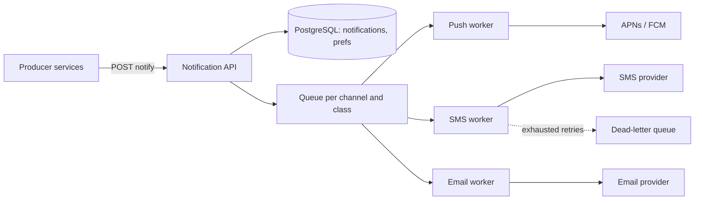

# Design a Notification System

> [!abstract] The product in one sentence
> One internal service that any product team calls to notify a user, which picks channels, applies preferences and limits, renders templates, and delivers through third-party providers with retries — and never sends the same OTP twice.

> [!tip] How to use this note
> Every section below has **questions to settle** and **options with trade-offs**. Write *My decision and why* under each before looking at a reference solution. The goal is a design you can defend, not a design you can recite.

> [!tip] Reference solution in your system-design vault
> `system-design/15 Interview Playbook/Design a Notification Service.md` — compare *after* you have written your own design.

**Map:** [[Problem Bank MOC]] → [[HLD MOC]]

## Problem statement

Build the service behind "notify user 42 that their transfer completed": resolve channels, deduplicate, check preferences and quiet hours, render templates, deliver via APNs/FCM, SMS and email providers with [[At-Least-Once Delivery]] to the provider and no visible duplicates to the user. The retry half overlaps with [[Design a Webhook Delivery System]]; the fan-out half with [[Design a Social Feed]].

**Questions to settle:** Transactional only (OTP, payment status) or also campaigns to millions? Who owns templates? Is in-app a channel or a separate inbox product?

## Product context and intended users

Producers: payments, KYC, support, growth. Recipients: app users on mobile and web. In fintech the critical path is OTPs and transaction alerts — seconds matter and duplicates confuse users; marketing is a different workload and must not share a queue with OTPs.

## Functional requirements

- `notify(userId, eventType, payload)` → resolve channels, render, deliver; status queryable per notification.
- Per-user preferences, per-channel opt-out, quiet hours; mandatory classes that bypass them.
- Dedup by idempotency key; per-user rate limits per channel; scheduled sends.
- **Questions to settle:** Delivery and read receipts? Localisation? Batching digests?

## Non-functional requirements

- Critical class: p99 end-to-end under ~5 s to provider handoff; others within minutes.
- No lost notifications once accepted; no visible duplicates for critical classes.
- Provider outages must not block other channels or other tenants ([[Bulkheads]]).
- **Questions to settle:** Is "accepted" durable before the producer gets 202?

## Constraints and assumptions

- Providers have their own rate limits and intermittent failures; SMS is the slowest and most expensive.
- Device tokens churn; a share of push sends fail with "unregistered".
- Producers may retry on timeout, so duplicate requests are normal ([[Idempotency]]).

## Capacity estimation

| Quantity | Assumption | Result |
|---|---|---|
| Notifications/day | 5M users × 4/day | ~20M/day ≈ 230/s average, ~2k/s at peak |
| Campaign burst | 5M users in 30 min | ~2.8k/s on top of baseline — queue it, do not scale for it |
| Storage | ~1 KB per notification record, 90 days | ~1.8 TB — partition by time, archive to S3 |
| Provider calls | 1.3 channels per notification | ~2.6k calls/s peak; check each provider's ceiling |

*(Redo with your own assumptions; the shape of the reasoning is the point.)*

## API design

```http
POST /v1/notifications
Idempotency-Key: pay-7f3a-completed
{ "userId": "42", "event": "transfer.completed", "class": "transactional", "data": {...}, "channels": ["push","sms"] }
→ 202 { "notificationId": "n_9c1", "status": "accepted" }

GET /v1/notifications/n_9c1 → 200 { "status": "delivered", "attempts": [...] }
PUT /v1/users/42/preferences { "sms": false, "quietHours": "22:00-07:00" }
```

**Questions to settle:** Do producers pick channels or does the service decide from event class? Sync HTTP or events on [[Kafka]] as the ingress?

## Data model

`notification(id, user_id, event, class, status, idem_key)`; `attempt(notification_id, channel, provider, status, error, at)`; `preference(user_id, channel, enabled, quiet_hours)`; `device(user_id, token, platform)`; `template(event, channel, locale, body)`. Unique index on `idem_key`. Attempts are append-only — that is your audit trail ([[Data Modeling]]).

## High-level architecture



> [!example]- Excalidraw version — the same diagram as an editable canvas
> ![[Design a Notification System.excalidraw]]
> [[Design a Notification System.excalidraw|Open in Excalidraw]] — needs the Excalidraw plugin (see [[Plugins to Install]]).


## Component responsibilities

| Component | Owns | Does not own |
|---|---|---|
| Notification API | Validation, idempotency, preference checks, enqueue | Delivery |
| Channel workers | Rendering, provider calls, retries, attempt records | Deciding whether to send |
| Preference service | Opt-outs, quiet hours, device tokens | Templates |
| Provider adapters | Rate limits, auth, error mapping per provider | Business rules |

## Database selection and rationale

**Options:** PostgreSQL for notifications, preferences and attempts (transactions, unique idempotency keys, familiar); DynamoDB or Cassandra for attempt history at very high volume (write-heavy, time-partitioned); [[Redis]] for dedup windows and rate-limit counters. **Decision to make:** one relational store until write volume forces a split, versus a key-value store for history from day one ([[SQL vs NoSQL]]).

## Caching strategy

Cache preferences and device tokens per user with a short TTL ([[Cache-Aside]]) — they are read on every send and rarely change. Cache compiled templates in-process. Dedup window ("sent OTP to user 42 in the last 60 s") lives in Redis with a TTL, which is a rate limiter, not a cache ([[Rate Limiting]]).

## Messaging and asynchronous processing

A queue per channel and class, so SMS slowness never delays push and campaigns never delay OTPs ([[Message Queues]]). Workers retry with backoff and jitter ([[Retry Strategies]]); exhausted attempts go to a [[Dead-Letter Queues|dead-letter queue]] with an alert. Accept-then-enqueue must be atomic — use an [[Outbox Pattern]] or accept that a crash between them loses a notification. In a stack like yours SQS per channel is simplest; Kafka if producers already emit domain events.

## Scaling strategy

Workers scale on queue depth per channel. For campaigns a planner splits "segment X" into batches of a few thousand recipients, each one message, so no worker owns a million sends ([[Fan-Out]]). Provider throughput is the ceiling — add accounts or a second vendor before adding workers.

## Consistency requirements

Idempotency is the consistency story: one key yields one notification under producer retries and worker redelivery. Provider calls are not idempotent, so a crash after the call but before the ack produces a duplicate — bound it with a short dedup window per (user, event) and accept rare doubles for non-critical classes ([[Duplicate Message Processing]]). Preferences are eventually consistent; an opt-out may lag by the cache TTL.

## Failure scenarios

| Failure | Impact | Detection | Mitigation |
|---|---|---|---|
| SMS provider down | SMS queue backs up; OTPs late | Provider error rate, queue age | Circuit breaker, failover vendor, fall back to push for OTP |
| Worker crash mid-send | Duplicate after redelivery | Attempt count > 1 per notification | Dedup window; record attempt before calling provider |
| Campaign floods queues | Transactional delayed behind marketing | Queue age per class | Separate queues and worker pools per class |
| Stale device tokens | Push silently fails | Unregistered error ratio | Prune tokens on provider feedback |

## Security considerations

Payloads carry PII and sometimes balances: send providers only what the template needs, encrypt stored payloads, restrict producers to the event types they own via service identity ([[Authorization]]). OTP content never appears in logs. Audit who sent what to whom.

## Observability

Per channel and class: accepted/s, delivered/s, failed/s, accept-to-handoff p99, queue age, provider error rate, dedup hits, DLQ depth ([[Metrics]]). Trace one notification by id across API, worker and provider ([[Distributed Tracing]]). Alert on queue age for the transactional class, not depth.

## Cost considerations

SMS dominates: 10M SMS/month at fractions of a cent is real money, so route OTPs to push when a device is registered and keep SMS as fallback. Push and email are near-free. Attempt storage is small; the retention policy decides it ([[Data Retention and Archival]]).

## Architectural trade-offs

| Decision | Chosen | Rejected | Why |
|---|---|---|---|
| Ingress: sync API vs event subscription | *(yours)* | | |
| Queue topology: per channel and class vs one queue with priorities | *(yours)* | | |
| Duplicate policy: strict dedup window vs accept rare doubles | *(yours)* | | |

## Alternative designs

- **Each product service calls providers directly** — fastest to ship; preferences, dedup and rate limits get reimplemented inconsistently and every team learns provider failure modes alone.
- **Event subscriber** — the service subscribes to domain events on Kafka and decides what to notify; producers stay ignorant, but the event-to-notification mapping becomes a hidden rules engine.

## What I would implement first

A synchronous accept API with idempotency keys in PostgreSQL, one SQS queue per channel split transactional/marketing, push and email workers with backoff and a DLQ, and a queue-age dashboard per class. SMS with a circuit breaker second.

## What I would defer

Campaign planner, digests, localisation, read receipts, a second vendor per channel.

## Related

### Concepts
- [[Fan-Out]] — campaigns and multi-channel expansion
- [[Message Queues]] — per-channel isolation
- [[Idempotency]] — producers retry; users must not see doubles
- [[Retry Strategies]] — backoff and jitter against flaky providers
- [[Dead-Letter Queues]] — where exhausted sends go
- [[Rate Limiting]] — per-user, per-channel caps
- [[Outbox Pattern]] — atomic accept-and-enqueue

### Projects
- [[Personal Notification Hub]] — same dedup and preference problems at hobby scale
- [[Webhook Relay]] — the outbound delivery half

### Resources
- [[AWS Builders Library - Timeouts Retries and Backoff]]
- [[Stripe - Idempotency]]
- [[BullMQ]]

## What I learned

*(Fill after a design session.)*

## What I would improve in a second iteration

*(Fill after a review or implementation.)*
