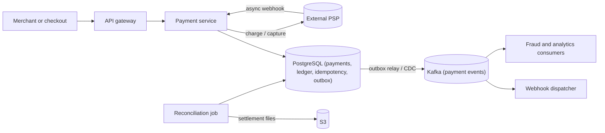

# Design a Payment System

> [!abstract] The product in one sentence
> Let merchants and internal products charge, capture and refund customers through one or more payment service providers (PSPs), with every rupee accounted for in a ledger that reconciles to the penny against what the PSP actually settled.

> [!tip] How to use this note
> Every section below has **questions to settle** and **options with trade-offs**. Write *My decision and why* under each before looking at a reference solution. The goal is a design you can defend, not a design you can recite.

> [!tip] Reference solution in your system-design vault
> `system-design/15 Interview Playbook/Design a Payment System.md` — compare *after* you have written your own design.

**Map:** [[Problem Bank MOC]] → [[HLD MOC]]

## Problem statement

Build the service that sits between checkout and the outside world of card networks, UPI rails and bank transfers. A caller says "charge this customer ₹1,250 for order 8812"; the system must do that **at most once** no matter how many times the request is retried, record the outcome durably, tell the caller and downstream systems what happened, and later prove that its own records match the PSP's settlement report.

**Questions to settle:** Are we an *orchestrator over PSPs* (Stripe, Adyen, a UPI switch) or the processor itself? Pay-in only, or pay-outs and refunds too? Which methods on day one? Do we ever touch a card number (PCI DSS scope) or does the client tokenise directly with the PSP? Is the ledger owned here or by a separate [[Design a Digital Wallet and Ledger|wallet and ledger]] service?

## Product context and intended users

Internal product teams (checkout, subscriptions, marketplaces) who want a payment API they cannot misuse; finance and operations who need reconciliation, refunds and dispute handling; risk, who need every attempt visible to the [[Design a Real-Time Fraud Detection Pipeline|fraud pipeline]]; and auditors who need an immutable trail. The product is *correctness*: a payment system that is 99.99% available but occasionally double-charges is a failed product.

## Functional requirements

- Create a payment (authorise), capture (fully or partially), void, refund (partial, multiple), and query status.
- Idempotent creation keyed by a client-supplied `Idempotency-Key`; replays return the original outcome.
- Drive a PSP through its lifecycle, including asynchronous outcomes delivered by PSP webhooks (3-DS, UPI collect, bank redirects).
- Record every money movement as balanced ledger entries; never update a balance in place.
- Emit events (`payment.succeeded`, `payment.failed`, `refund.settled`) to internal consumers and to merchants via [[Design a Webhook Delivery System|webhooks]].
- Reconcile daily against PSP settlement files and surface breaks to operations.
- **Questions to settle:** Multi-PSP routing and failover on day one? Partial captures? Multi-currency and FX? Who owns dispute and chargeback workflows?

## Non-functional requirements

- Exactly-once *effects*: a given idempotency key produces at most one PSP charge, however many requests, retries or crashes occur.
- Durability: an acknowledged state transition is never lost; [[Recovery Point Objective]] is zero for payment state.
- Latency: p99 under ~300 ms of our own overhead; the PSP round trip (often 1–5 s) dominates and is outside our control.
- Availability: prefer *refusing* a payment over *not knowing* whether it happened; a stuck `PENDING` must resolve within minutes.
- Auditability: every state change carries who, when, why, and the PSP reference; records retained for 7+ years.
- **Questions to settle:** Is the ledger strongly consistent with payment state (same transaction) or eventually consistent (projection)? What stuck-payment resolution time is acceptable?

## Constraints and assumptions

- PSPs are slow, occasionally unavailable, and return ambiguous outcomes (timeouts after the charge actually succeeded). Most expose their own idempotency keys — use them.
- Card data stays out of our systems: client-side tokenisation keeps us in PCI SAQ-A territory instead of full PCI DSS.
- Amounts are integers in minor units with an explicit currency; floats are forbidden everywhere.
- Java/TypeScript services on EKS, PostgreSQL, Kafka and SQS available; assume a single region initially.

## Capacity estimation

| Quantity | Assumption | Result |
|---|---|---|
| Payments per day | 2M, with a 10× peak during sales | ~23/s average, ~250/s peak |
| Writes per payment | payment row + 3 attempts/transitions + 4 ledger entries + 2 outbox events | ~10 rows, ~5 KB per payment |
| Storage growth | 2M × 5 KB, 7-year retention | ~10 GB/day, ~25 TB total — partition by month, archive to S3 |
| PSP calls | 1.3 calls per payment (retries, captures) | ~325/s peak — PSP rate limits, not our DB, are the ceiling |
| Status reads | 10 reads per payment (polling clients, dashboards) | ~2.5k RPS peak — serve from a replica, not the primary |
| Reconciliation | 1 settlement file per PSP per day, 2M lines | A batch job, not a streaming problem |

*(Redo with your own assumptions; the shape of the reasoning is the point.)*

## API design

```http
POST /v1/payments
Idempotency-Key: 7c9e6679-7425-40de-944b-e07fc1f90ae7
{ "amount": 125000, "currency": "INR", "method": { "type": "card", "token": "tok_..." },
  "capture": "automatic", "reference": "order-8812" }
→ 201 { "id": "pay_01J...", "status": "requires_action" | "authorized" | "succeeded" | "failed", "psp_ref": "..." }
→ 200 (same key, same body) — the original response, replayed
→ 422 (same key, different body) — key reuse with a different request

POST /v1/payments/{id}/capture      { "amount": 125000 }   Idempotency-Key required
POST /v1/refunds                    { "payment_id": "pay_01J...", "amount": 50000, "reason": "..." }
GET  /v1/payments/{id}              → full state machine history and ledger journal ids
POST /v1/psp/webhooks/{psp}         ← PSP callback, signature verified, processed idempotently by event id
```

**Questions to settle:** Synchronous response until the PSP answers, or `202` plus polling/webhook? How long is an idempotency key retained (24 h, 30 days, forever)? Is the key scoped per merchant so two tenants cannot collide? See [[Designing APIs and Contracts]].

## Data model

`payment` (id, merchant_id, amount, currency, status, version, psp, psp_ref, created_at) with a strict state machine (`created → requires_action → authorized → captured | voided`, `captured → partially_refunded → refunded`, plus `failed`). `payment_attempt` records each PSP call with request/response hashes. `idempotency_key` (merchant_id, key, request_hash, response, state, locked_until) is the heart of exactly-once. `ledger_journal` and `ledger_entry` are append-only double-entry rows: a capture debits *PSP receivable* and credits *merchant payable*; a refund reverses with new entries, never deletes. `outbox` holds events written in the same transaction. `reconciliation_item` links settlement lines to payments and records breaks.

**Questions to settle:** Running balances on accounts or computed from entries? Does the ledger live in this schema or behind a service boundary? Use [[Data Modeling]] to decide what is a fact (entries) versus a projection (status).

## High-level architecture



## Component responsibilities

| Component | Owns | Does not own |
|---|---|---|
| Payment service | State machine, idempotency, PSP orchestration, ledger postings | Merchant webhooks delivery, fraud decisions |
| PSP connector (per provider) | Mapping our model to one PSP's API, its idempotency keys, timeouts | Business rules on retries |
| Ledger module or service | Balanced journals, immutability, balance queries | Deciding *whether* to move money |
| Outbox relay | Publishing committed events to Kafka at least once | Event semantics |
| Reconciliation job | Matching settlement lines to payments, raising breaks | Fixing breaks automatically |
| Webhook dispatcher | Signed delivery to merchants, retries, DLQ | Payment state |

## Database selection and rationale

**Options:** PostgreSQL (ACID multi-row [[Transactions]], unique constraints for idempotency keys, mature tooling — the default for money); DynamoDB (conditional writes and transactions, but cross-item transactions are limited and reconciliation queries are awkward); MongoDB (multi-document transactions exist, weaker fit for relational reconciliation); an event store with projections (perfect audit, higher operational complexity). The decisive question is whether payment status, idempotency record, ledger entries and outbox event can commit *atomically* — with PostgreSQL that is one transaction. Choose [[Isolation Levels]] deliberately: `READ COMMITTED` plus `SELECT ... FOR UPDATE` on the payment row is usually enough; `SERIALIZABLE` buys safety at the cost of retry handling.

## Caching strategy

Almost none on the write path — never make a money decision from a cache. Reasonable caches: merchant configuration and PSP routing rules (in-process, short [[TTL]]), payment status reads served from a [[Read Replicas|read replica]] with a staleness budget, and a short-lived idempotency response cache in [[Redis]] to answer hot replays without touching the primary. **Question to settle:** is a stale status read ever harmful (a client that captures based on a cached `authorized`)?

## Messaging and asynchronous processing

The write path is synchronous up to "state persisted"; everything after is asynchronous via the [[Outbox Pattern]] so that an event is published if and only if the transaction committed. [[Kafka]] carries payment events to fraud, analytics, notifications and the webhook dispatcher; SQS with a visibility timeout suits PSP retry work items and PSP webhook processing. Every consumer must tolerate [[Duplicate Message Processing]] — [[At-Least-Once Delivery]] is the only honest guarantee, and consumers dedup by event id. In a stack like yours, a Debezium-style [[Change Data Capture]] relay or a polling publisher both work; the polling publisher is simpler to operate.

## Scaling strategy

The PSP is the bottleneck long before the database. Scale the service horizontally (stateless), keep per-merchant PSP rate limits, and shard PostgreSQL by `merchant_id` only when a single primary cannot absorb writes — ledger partitioning by month keeps indexes small ([[Partitioning]]). Reconciliation scales as a batch job over partitioned data. Multi-PSP routing adds resilience and leverage on fees but multiplies connector surface area.

## Consistency requirements

Per payment: linearizable state transitions guarded by optimistic version checks ([[Optimistic and Pessimistic Locking]]). Idempotency: a unique constraint on (merchant, key) plus a locked `in_progress` state so a concurrent duplicate waits or receives `409`, never a second charge. Ledger: every journal balances to zero, enforced by a constraint or trigger, and entries are immutable. Cross-service flows (fraud check → charge → notify) are a [[Saga Pattern|saga]] with compensation, not a distributed transaction. **Question to settle:** when the PSP times out, do you *query* it before marking failed, or mark `unknown` and let reconciliation decide?

## Failure scenarios

| Failure | Impact | Detection | Mitigation |
|---|---|---|---|
| PSP timeout after charge actually succeeded | Customer charged, we show failed | Attempt stuck `unknown`, PSP webhook arrives later | Never mark failed on timeout; query PSP by our idempotency key; reconcile |
| Duplicate request from client retry | Potential double charge | Idempotency key hit | Key table with request hash and locked state; return original response |
| DB failover mid-transaction | In-flight transaction lost, no partial state | Connection errors, replica promotion | Client retries with same key; transaction atomicity guarantees no half-posted ledger |
| Outbox relay lagging | Events late, webhooks late, fraud blind | Outbox age metric | Alert on oldest unpublished event; relay is horizontally restartable |
| Reconciliation break | Ledger disagrees with PSP settlement | Daily break count > 0 | Ops queue with aging; root-cause categories (timing vs real) |
| Refund exceeds captured amount | Money leaks | Constraint violation | Invariant checked in the same transaction as the refund journal |

## Security considerations

Keep card data out of scope through client-side tokenisation; what remains is still sensitive (amounts, references, PII). Encrypt at rest and in transit ([[Encryption at Rest and in Transit]]), keep PSP credentials in a secrets manager with rotation ([[Secrets Management]]), verify PSP webhook signatures and reject replays, and make [[Audit Logs]] append-only with actor and reason for every manual action (refund, void, reconciliation override). Apply [[Least Privilege]] so operations tooling cannot post arbitrary ledger entries.

## Observability

Metrics: authorisation success rate per PSP and method, PSP latency, payments stuck in `PENDING` or `unknown` beyond N minutes, idempotency replay and conflict rates, outbox age, reconciliation breaks by category, and the ledger invariant (sum of all entries equals zero) checked continuously. Logs: structured, with payment id and idempotency key on every line; never log tokens. Traces across gateway → service → PSP connector ([[Distributed Tracing]]). Alert on stuck payments and invariant violations before anything else.

## Cost considerations

PSP fees (1–3% of volume) dwarf infrastructure. Multi-AZ PostgreSQL, Kafka and a reconciliation job cost thousands per month; a 0.1% double-charge rate costs far more in refunds, support and trust. Spend on correctness tooling (invariant checks, replay harness) before spending on throughput. Multi-PSP routing is a fee-optimisation lever worth real money at volume but only after single-PSP correctness is proven.

## Architectural trade-offs

| Decision | Chosen | Rejected | Why |
|---|---|---|---|
| Ledger inside the payment transaction vs separate service | *(yours)* | | |
| Synchronous charge vs `202` + async outcome | *(yours)* | | |
| Idempotency key retention and scope | *(yours)* | | |
| Orchestration (service calls) vs choreography (events) | *(yours)* | | |
| Single PSP first vs multi-PSP abstraction | *(yours)* | | |

## Alternative designs

- **Fully event-sourced payment aggregate** — the event log is the audit trail and ledger source; perfect replayability, but projections, versioning and tooling are a real cost ([[Event Sourcing]]).
- **Thin pass-through to one PSP** — let Stripe-like providers own idempotency and ledgering; fastest to ship, but your books are theirs and switching PSPs becomes a migration.
- **Separate payment and ledger services with a saga** — cleaner ownership boundaries, at the price of eventual consistency between status and entries and a compensation story for every step.

## What I would implement first

One PostgreSQL schema with `payment`, `idempotency_key`, `ledger_journal`/`ledger_entry` and `outbox`, all written in a single transaction; one PSP connector with provider-side idempotency keys and a 10 s timeout that moves attempts to `unknown` rather than `failed`; a polling outbox publisher to Kafka; a daily reconciliation job that produces a break report; and a dashboard whose top number is "payments in a non-terminal state older than 10 minutes". Test by killing the service between the PSP call and the commit.

## What I would defer

Multi-PSP routing and failover, partial captures, FX and multi-currency settlement, dispute automation, and extracting the ledger into its own service.

## Related

### Concepts
- [[Idempotency]] — the whole problem in one word
- [[Transactions]] — status, idempotency record, ledger and outbox commit together
- [[Outbox Pattern]] — events only for committed state
- [[Saga Pattern]] — cross-service flows with compensation, not 2PC
- [[Audit Logs]] — immutable trail for every manual action
- [[Exactly-Once Semantics]] — achievable for effects via keys, not via delivery
- [[Timeouts and Retries]] — PSP ambiguity is a timeout problem
- [[Data Retention and Archival]] — 7-year retention shapes partitioning

### Projects
- [[Double-Entry Ledger Service]] — build the ledger half and plug it in
- [[Webhook Relay]] — the merchant-facing event delivery half

### Resources
- [[Stripe - Idempotency]]
- [[Brandur - Implementing Idempotency Keys]]
- [[microservices.io - Transactional Outbox]]
- [[AWS Builders Library - Idempotent APIs]]

## What I learned

*(Fill after a design session.)*

## What I would improve in a second iteration

*(Fill after a review or implementation.)*
