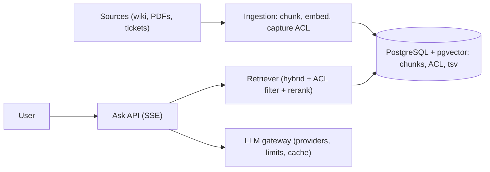

# Design a RAG Knowledge Assistant

> [!abstract] The product in one sentence
> Ask a question about your company's documents and get a streamed, cited answer that uses only documents you are allowed to see — with a way to tell whether answers got better or worse after a change.

> [!tip] How to use this note
> Every section below has **questions to settle** and **options with trade-offs**. Write *My decision and why* under each before looking at a reference solution. The goal is a design you can defend, not a design you can recite.

**Map:** [[Problem Bank MOC]] → [[HLD MOC]]

## Problem statement

Ingest documents (wiki, PDFs, tickets), chunk and embed them, retrieve relevant chunks per question, build a prompt, stream the answer with citations, and measure quality. Hard parts: retrieval quality (not the model), permission-aware retrieval, freshness, and an LLM on the critical path for latency and cost. Related: [[Design Search Autocomplete]] (the indexing-pipeline shape), [[Design an API Gateway]].

**Questions to settle:** Answer only from retrieved text, or allow general knowledge? Must answers be reproducible (pinned model, temperature 0)? Who labels the golden set that defines "correct"?

## Product context and intended users

Internal support, compliance Q&A over policies, developer docs. In fintech, citing the wrong KYC policy is a compliance incident — citations and ACL filtering are requirements, not polish.

## Functional requirements

- Connectors ingest and re-ingest on change; hybrid retrieval (vector + keyword) with ACL filter.
- Streamed answer with chunk citations; feedback (rating, correction).
- Eval harness over a golden set; per-session conversation memory.
- **Questions to settle:** Multi-tenant index isolation from day one?

## Non-functional requirements

- First token < 2 s p95, full answer < 10 s; retrieval < 200 ms; ingestion lag < 15 min.
- ACL enforced on 100% of retrievals; cost per answer bounded.
- **Questions to settle:** What freshness do policy documents actually need?

## Constraints and assumptions

- LLM providers rate-limit and fail; embeddings are bound to a model version (re-embed on change).
- Sources carry their own permission systems that must be mirrored at ingest.

## Capacity estimation

| Quantity | Assumption | Result |
|---|---|---|
| Corpus | 200k docs → 4M chunks × 1536 floats | ~25 GB vectors + text — one PostgreSQL with pgvector |
| Queries | 500 users × 20/day | ~0.1 QPS avg, 2 QPS peak — tiny; tokens dominate cost |
| Ingestion | 5k changed docs/day | ~100k embeddings/day, batchable |

*(Redo with your own assumptions; the shape of the reasoning is the point.)*

## API design

```http
POST /v1/ask { "question": "...", "sessionId": "s_1", "filters": { "source": ["wiki"] } }   (SSE)
→ event: retrieval { "chunks": [{ "docId": "d_1", "chunkId": 3, "score": 0.82 }] }
→ event: token { "t": "The " } ...
→ event: done { "answerId": "a_9", "citations": [ ... ], "usage": { "in": 3200, "out": 400 }, "modelVersion": "...", "corpusVersion": 118 }
POST /v1/feedback { "answerId": "a_9", "rating": "down", "note": "..." } → 202
POST /v1/sources/wiki/reindex { "docIds": ["d_1"] } → 202
```

**Questions to settle:** Send retrieval results before the answer so the UI shows sources early? SSE or WebSocket?

## Data model

`document(id, source, uri, acl, version, content_hash, updated_at)`; `chunk(id, doc_id, ordinal, text, embedding, tsv, metadata)` — embedding via [[pgvector]], `tsv` for keyword search; `answer(id, session_id, question, chunk_ids, prompt_hash, model, corpus_version, tokens, latency)`; `feedback`; `eval_case(question, expected_doc_ids, expected_answer)`. The content hash skips re-embedding unchanged documents.

## High-level architecture



> [!example]- Excalidraw version — the same diagram as an editable canvas
> ![[Design a RAG Knowledge Assistant.excalidraw]]
> [[Design a RAG Knowledge Assistant.excalidraw|Open in Excalidraw]] — needs the Excalidraw plugin (see [[Plugins to Install]]).


## Component responsibilities

| Component | Owns | Does not own |
|---|---|---|
| Ingestion pipeline | Connectors, chunking, embedding, ACL capture | Answering |
| Retriever | Hybrid search, ACL filter, rerank | Generation |
| Ask API | Prompt assembly, streaming, answer log | Provider management |
| LLM gateway | Routing, rate limits, caching, cost | Retrieval |

## Database selection and rationale

PostgreSQL with pgvector and full-text search: chunks, vectors, keyword index and ACL in one store with transactional re-indexing ([[Search Engines]], [[Inverted Indexes]]). A dedicated vector database only when the HNSW index no longer fits memory or QPS demands it — not before 10M chunks.

## Caching strategy

Question embeddings cached by hash; full answers cached for FAQs keyed by normalized question, ACL set and corpus version, invalidated on reindex ([[Cache-Aside]], [[Cache Invalidation]]). Retrieval results are never shared across users — ACL.

## Messaging and asynchronous processing

Source change events feed an ingestion queue; embedding workers batch, with provider rate limits as the [[Backpressure]] source. LLM calls carry a timeout, one retry with jitter and a fallback model — never unbounded ([[Timeouts and Retries]]). Answer and feedback logging is async.

## Scaling strategy

The query path is bound by the provider, not us — concurrency limits per tenant at the gateway ([[Rate Limiting]]). Ingestion scales by workers. Partition the index by tenant or source so ACL filtering is a partition, not a post-filter that empties the top-k.

## Consistency requirements

The index is eventually consistent (minutes); each answer records its corpus version so a stale answer is explainable. ACL changes travel the same path as content — a revoked document still retrievable is the worst bug. Re-embedding on model change is blue/green: build v2, swap, drop v1 ([[Versioning and Migrations]]).

## Failure scenarios

| Failure | Impact | Detection | Mitigation |
|---|---|---|---|
| Provider down or slow | No answers | Gateway errors, p95 | Fallback provider; degrade to "here are the sources"; per-provider [[Circuit Breakers]] |
| ACL filter bug | Document text leaks | Eval case with a forbidden document | Filter in the SQL `WHERE`, not application code; red-team tests |
| Chunking change tanks quality | Wrong answers, silently | Eval score drop | Eval gate in CI; keep the old index for rollback |

## Security considerations

ACL captured at ingest, enforced per user at retrieval ([[Authorization]]). Retrieved text is data, not instructions — prompt injection lives in documents. PII redaction before embedding. Question logs are sensitive: retention policy. Provider data-handling terms reviewed ([[Encryption at Rest and in Transit]]).

## Observability

Time to first token, retrieval latency, recall@k on the golden set, rating rate, cost per answer, ingestion lag, provider error rate. The eval dashboard is the product metric; latency is secondary.

## Cost considerations

Tokens dominate: prompt size (k chunks × chunk size) is the lever; embeddings on re-index are second. Cache FAQs, cap k, use a small model for reranking.

## Architectural trade-offs

| Decision | Chosen | Rejected | Why |
|---|---|---|---|
| pgvector vs dedicated vector database | *(yours)* | | |
| Hybrid vs vector-only retrieval | *(yours)* | | |
| Cached answers vs always fresh | *(yours)* | | |

## Alternative designs

- **Keyword search plus LLM summarization** — no embeddings at all; surprisingly good on technical docs, weaker on paraphrase.
- **Managed RAG (Bedrock Knowledge Bases, Vertex)** — quick to ship; limited control over chunking and ACL, opaque cost.

## What I would implement first

One source connector; chunking and embedding into pgvector with ACL; hybrid retrieval in SQL with the ACL in the `WHERE`; SSE answers with citations; answer log; a 50-question golden set and an eval script that runs on every pipeline change.

## What I would defer

Rerankers, conversation memory, multi-tenant isolation, tool use, fine-tuning.

## Related

### Concepts
- [[Search Engines]] — retrieval is the hard part
- [[Search Indexing Pipelines]] — ingest, chunk, embed, re-index
- [[Inverted Indexes]] — the keyword half of hybrid search
- [[Latency]] — first token versus full answer
- [[Authorization]] — ACL inside the query
- [[Timeouts and Retries]] — bounded calls to a flaky provider

### Projects
- [[Vault RAG Assistant]] — this system, over this vault
- [[LLM Gateway]] — the provider layer in front of it

### Resources
- [[pgvector]]
- [[AWS Builders Library - Timeouts Retries and Backoff]]

## What I learned

*(Fill after a design session.)*

## What I would improve in a second iteration

*(Fill after a review or implementation.)*
