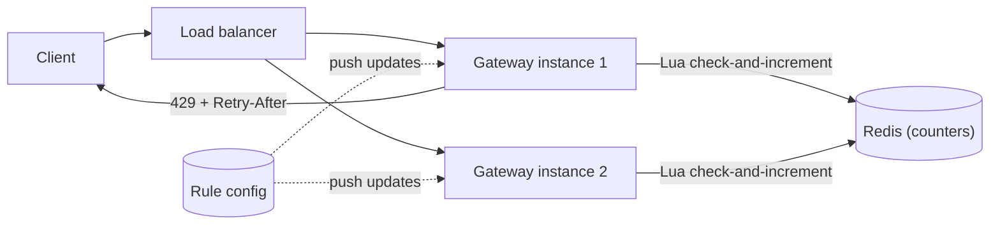

# Design a Rate Limiter

> [!abstract] The product in one sentence
> Protect APIs and downstream capacity by enforcing per-client request limits consistently across every instance of the service, without adding noticeable latency or a new single point of failure.

> [!tip] How to use this note
> Every section below has **questions to settle** and **options with trade-offs**. Write *My decision and why* under each before looking at a reference solution. The goal is a design you can defend, not a design you can recite.

> [!tip] Reference solution in your system-design vault
> `system-design/15 Interview Playbook/Design a Rate Limiter.md` — compare *after* you have written your own design.

**Map:** [[Problem Bank MOC]] → [[HLD MOC]]

## Problem statement

Build a rate limiter that enforces rules such as "100 requests per minute per API key" and "10 login attempts per hour per IP" for a platform serving many services behind an [[API Gateways|API gateway]]. It must give the same answer regardless of which gateway instance handles the request, add minimal latency, and behave predictably when its own dependencies fail.

**Questions to settle:** Is this a library inside each service, a gateway feature, or a standalone service? Which dimensions are limited (user, API key, IP, endpoint, tenant)? Are limits static or configurable at runtime?

## Product context and intended users

Internal platform capability used by (a) product teams who declare limits per endpoint, (b) the gateway/edge that enforces them, (c) external API consumers who receive `429 Too Many Requests` with `Retry-After`. In a fintech context, limits also protect money-moving endpoints from abuse and runaway clients, so correctness under load matters more than squeezing the last millisecond.

## Functional requirements

- Allow or deny a request given a key (client id, IP, endpoint) and a rule (N requests per window).
- Support multiple rules per request (per-user and per-endpoint simultaneously); deny if any rule is exceeded.
- Return `429` with `Retry-After` and `X-RateLimit-Remaining` headers.
- Rules configurable without redeploy; changes take effect within seconds.
- **Questions to settle:** Burst allowance? Different limits per plan tier? Allow-listing internal callers?

## Non-functional requirements

- Decision latency: p99 under ~2 ms added to the request path (number to defend, not to memorise).
- Accuracy: a few percent over-admission at window edges is acceptable; systematic under-admission is not (it costs customers).
- Availability: the limiter must not take the API down with it — decide fail-open vs fail-closed per rule.
- Scale: tens of thousands of decisions per second across a fleet; millions of distinct keys.
- **Questions to settle:** Is exact accounting ever required (billing-grade quotas) or is approximate fine?

## Constraints and assumptions

- Gateway instances are stateless and horizontally scaled behind a [[Load Balancers|load balancer]]; a client's requests land on different instances.
- [[Redis]] is available as managed infrastructure (ElastiCache) — but assume it can fail over or be partitioned.
- Clocks across instances are roughly synchronised (NTP) but must not be trusted for sub-second ordering ([[Clocks and Time]]).

## Capacity estimation

| Quantity | Assumption | Result |
|---|---|---|
| Decisions per second | 20k RPS platform-wide, 2 rules per request | ~40k limiter checks/s |
| Distinct keys | 2M active clients × 2 rules | ~4M counters |
| Memory per counter | ~100 B (key + counter + expiry) in Redis | ~400 MB — fits one Redis node, replicate for safety |
| Redis ops | 1 Lua call per check | ~40k ops/s — within a single node's range, but plan for sharding by key |

*(Redo with your own assumptions; the shape of the reasoning is the point.)*

## API design

```http
POST /v1/ratelimit/check
{ "key": "user:42", "rules": ["api:default"], "cost": 1 }
→ 200 { "allowed": true, "remaining": 57, "resetSeconds": 23 }
→ 200 { "allowed": false, "retryAfterSeconds": 23 }
```

**Questions to settle:** In-process library API vs network call? Should the check also *consume* (atomic check-and-increment) or is there a separate `consume`? Batch checks for multiple rules in one round trip?

## Data model

Per (key, rule): a counter plus window metadata. Options: a single integer with TTL (fixed window), a sorted set of timestamps (sliding log), two integers (sliding window counter), or tokens + last-refill timestamp (token bucket). Rules live in a small config store: `rule_id → {limit, window, burst, failure_mode}`.

## High-level architecture



> [!example]- Excalidraw version — the same diagram as an editable canvas
> ![[Design a Rate Limiter.excalidraw]]
> [[Design a Rate Limiter.excalidraw|Open in Excalidraw]] — needs the Excalidraw plugin (see [[Plugins to Install]]).


## Component responsibilities

| Component | Owns | Does not own |
|---|---|---|
| Gateway middleware | Extracting the key, calling the limiter, setting headers | Storing counters |
| Counter store (Redis) | Atomic increments, expiry | Rule semantics |
| Rule config service | Limits per endpoint/tier, distribution to instances | Enforcement |
| Metrics/alerts | Deny rates, limiter latency, Redis errors | — |

## Database selection and rationale

**Options:** Redis (in-memory, atomic Lua, TTLs — the natural fit); in-process memory only (fastest, but per-instance limits become N× the global limit); a relational database (durable but far too slow for per-request writes); DynamoDB (durable, atomic counters, higher latency and cost per op). **Decision to make:** Redis for shared counters, with an in-process pre-check to shed obviously over-limit clients cheaply — or local-only limits if approximate per-instance enforcement is acceptable for the use case.

## Caching strategy

The counters *are* the cache. Consider a small in-process cache of "this key is blocked until T" to avoid hammering Redis from an abusive client — this is also the mitigation for [[Hot Keys]] when one client dominates traffic.

## Messaging and asynchronous processing

Mostly synchronous. Asynchronous paths: rule changes pushed to instances via [[Pub-Sub]]; audit events for sustained denials; batching counter increments (trade accuracy for throughput) if Redis becomes the bottleneck.

## Scaling strategy

Scale gateways horizontally (stateless). Scale counters by sharding keys across Redis nodes ([[Distributed Caching]], [[Consistent Hashing]]); a key never spans nodes, so atomicity holds. For global limits across regions, decide between regional limits (simple, slightly over-admits globally) and a central store (accurate, adds cross-region latency) — see [[Coordination vs Availability]].

## Consistency requirements

Per-key atomicity is required (check-and-increment in one Lua script, otherwise two instances race and over-admit). Global exactness is not. **Decision to make:** which [[Rate Limiting]] algorithm — fixed window (simplest, 2× burst at edges), sliding log (exact, memory-heavy), sliding window counter (good accuracy, O(1) memory), token bucket (burst-friendly, intuitive for clients).

## Failure scenarios

| Failure | Impact | Detection | Mitigation |
|---|---|---|---|
| Redis unavailable | Every check errors | Error rate on limiter calls | Fail-open for ordinary endpoints, fail-closed for abuse-sensitive ones; short timeouts; [[Circuit Breakers|circuit breaker]] |
| Redis failover | Counters lost or stale for seconds | Replication lag metrics | Accept brief over-admission; never block on persistence |
| Hot key (one client at 10k RPS) | One Redis shard saturates | Per-key QPS, shard CPU | Local block cache, key splitting, shed at the edge |
| Clock skew between instances | Windows misaligned | Compare instance vs Redis time | Use Redis `TIME` inside Lua as the single clock |
| Config push lost | Instances enforce stale limits | Config version mismatch metric | Periodic pull as fallback |

## Security considerations

Limits keyed on trusted identity (authenticated user or API key) first, IP second (NAT and proxies make IPs weak; trust `X-Forwarded-For` only from your own edge — see [[Reverse Proxies]]). Rate limiting is also a security control against credential stuffing and enumeration; keep those rules fail-closed.

## Observability

Metrics: decisions/s, deny ratio per rule, limiter latency p50/p99, Redis error rate, hot keys. Logs: sampled denials with key and rule. Alerts: deny ratio spike (possible attack or broken client), limiter p99 breach, fail-open activations. Dashboards per rule so product teams can see their own limits.

## Cost considerations

Dominated by Redis memory and ops; cost scales with distinct keys × rules, not with traffic denied. A local pre-check cuts Redis ops for abusive clients. Managed Redis with Multi-AZ roughly doubles the cost for the failover guarantee — decide whether approximate limits during failover justify running single-AZ.

## Architectural trade-offs

| Decision | Chosen | Rejected | Why |
|---|---|---|---|
| Algorithm | *(yours)* | | |
| Fail-open vs fail-closed | *(yours, per rule class)* | | |
| Library vs gateway vs service | *(yours)* | | |
| Regional vs global limits | *(yours)* | | |

## Alternative designs

- **Per-instance local limiting only** — zero network cost, limits are N× global; fine for coarse protection of a service's own capacity.
- **Centralised limiter service** — one place to reason about, but a new hop and a new failure domain on every request.
- **Edge-provider limiting (CDN/WAF)** — pushes the problem outward; coarse, but stops volumetric abuse before it reaches you ([[CDNs]]).

## What I would implement first

A gateway middleware with a sliding window counter in Redis via one Lua script, fail-open with a 5 ms timeout, headers on every response, and a dashboard of deny ratios. Measure added latency under load before anything else.

## What I would defer

Global multi-region limits, per-tenant tiering, batched increments, and abuse-detection analytics.

## Related

### Concepts
- [[Rate Limiting]] — the algorithms
- [[Redis]] — atomic Lua, TTLs, failover behaviour
- [[API Gateways]] — where enforcement usually lives
- [[Hot Keys]] — the one-abusive-client problem
- [[Graceful Degradation]] — fail-open vs fail-closed thinking
- [[Timeouts and Retries]] — the limiter call itself needs a timeout

### Projects
- [[Rate Limiter Library]]
- [[LLM Gateway]] — token-based limits are the same problem with a different cost function

### Resources
- [[Cloudflare - Rate Limiting at Scale]]
- [[Bucket4j]]
- [[System Design Interview (Alex Xu)]]

## What I learned

*(Fill after a design session.)*

## What I would improve in a second iteration

*(Fill after a review or implementation.)*
