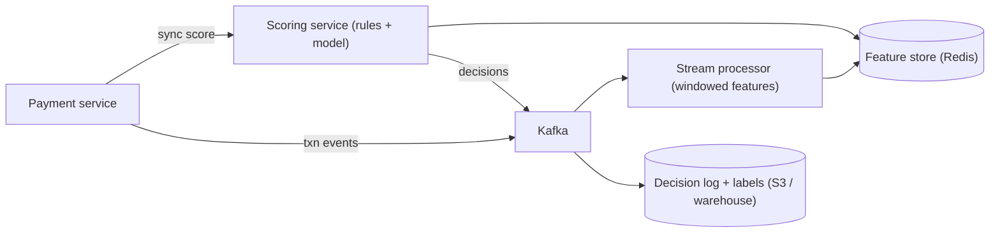

# Design a Real-Time Fraud Detection Pipeline

> [!abstract] The product in one sentence
> Every transaction gets a decision — allow, step-up, block — in under 100 ms, computed from the last seconds-to-days of behaviour, with rules analysts can ship today, a snapshot that explains each decision later, and a loop from chargebacks back into training.

> [!tip] How to use this note
> Every section below has **questions to settle** and **options with trade-offs**. Write *My decision and why* under each before looking at a reference solution. The goal is a design you can defend, not a design you can recite.

**Map:** [[Problem Bank MOC]] → [[HLD MOC]]

## Problem statement

A synchronous scoring call in the payment path plus an asynchronous pipeline that keeps features, rules and models fresh. Hard parts: computing windowed features ("transactions from this device in the last 5 minutes") fast and without double counting, deciding what to do at the deadline, and closing the loop from late labels. Related: [[Design a Payment System]], [[Design a Digital Wallet and Ledger]].

**Questions to settle:** Does the pipeline decide or advise — who owns the block? What does a false positive cost versus a false negative in your product? At the 100 ms deadline: allow, block or step-up?

## Product context and intended users

Payments, wallet top-ups, lending. Users: the payment service (caller), risk analysts (rules), data science (models), ops (case review) and compliance, who will ask "why was this blocked" months later.

## Functional requirements

- `score(txn)` → decision, score, reasons, rule-set and model versions.
- Windowed velocity features per card, device, account, merchant.
- Rules with shadow mode and hot deploy; replay a day of traffic against a new rule.
- Feedback endpoint for labels (chargebacks, confirmed fraud).
- **Questions to settle:** Must every decision be reproducible — feature snapshot stored?

## Non-functional requirements

- p99 < 100 ms end to end; a decision is always returned, even if degraded.
- Feature freshness ≤ 1 s; decisions retained with inputs for a year.
- **Questions to settle:** What precision and recall is the business actually asking for?

## Constraints and assumptions

- Scoring sits on the payment critical path; the caller has its own timeout.
- Streams arrive out of order and duplicated; labels arrive weeks late.
- Card numbers are tokenized before they reach this system (PCI scope).

## Capacity estimation

| Quantity | Assumption | Result |
|---|---|---|
| Scoring | 2k txn/s peak, ~5 feature lookups each | ~10k Redis reads/s; stateless scorers scale on RPS |
| Feature store | 50M entities × 20 features × 32 B | ~32 GB hot in Redis; rebuildable from the stream |
| Decision log | 50M/day × 2 KB with snapshot | ~100 GB/day → object storage, queryable for a year |

*(Redo with your own assumptions; the shape of the reasoning is the point.)*

## API design

```http
POST /v1/score { "txnId": "t_1", "amount": 450000, "currency": "INR", "cardToken": "tok_..", "deviceId": "d_9", "merchantId": "m_3", "ts": 1760000000 }
→ 200 { "decision": "step_up", "score": 0.82, "reasons": ["velocity_5m_gt_5", "new_device"], "modelVersion": "v14", "ruleSetVersion": 231 }
POST /v1/feedback { "txnId": "t_1", "label": "fraud", "source": "chargeback" } → 202
POST /v1/rules { "name": "high_amount_new_device", "expr": "amount > 100000 && device_age_days < 1", "mode": "shadow" } → 201
```

**Questions to settle:** Synchronous call, or the payment service consumes a decision event (decoupled, slower)? Return reasons to the caller, or only to the case tool (fraudsters probe)?

## Data model

Feature store: [[Redis]] hashes keyed by entity with counters per window, maintained by stream processors. `decision(txn_id, score, decision, reasons, feature_snapshot, model_v, rules_v, ts)` append-only — the snapshot is what makes a decision explainable later. `rule(id, version, expr, mode, author, approved_by)` and `label(txn_id, label, source, ts)` in PostgreSQL.

## High-level architecture



## Component responsibilities

| Component | Owns | Does not own |
|---|---|---|
| Scoring service | Fetch features, evaluate rules and model, decide within the deadline, log | Updating features |
| Stream processor | Windowed aggregates, dedup by txn id | Decisions |
| Rules service | Versioning, shadow mode, approval | Executing rules |
| Case and feedback | Labels, training sets, analyst tooling | The real-time path |

## Database selection and rationale

Features in Redis (sub-millisecond point reads, TTL per window). Decisions to Kafka and on to object storage or a warehouse (volume, analytics). Rules and labels in PostgreSQL (small, audited). The real decision: Redis is not the only copy of long-window features — rebuild from Kafka on loss, or snapshot daily.

## Caching strategy

The feature store is the cache. Model artifacts and risk lists load in process, swapped by version. Decisions are never cached — every transaction is new.

## Messaging and asynchronous processing

[[Kafka]] partitions transaction events by entity so one card's events are seen in order by one processor ([[Topic Partitions]], [[Ordering Guarantees]]). Processors dedupe on txn id — a retried event must not inflate a velocity counter ([[Idempotency]], [[Duplicate Message Processing]]). Replay is re-consuming a day with a new rule set in shadow.

## Scaling strategy

Scorers are stateless. Stream processors scale with partitions; a hot merchant skews one partition — salt the key or pre-aggregate ([[Hot Keys]]). Redis clustered by entity. Model inference in process for tree models; a separate service with a strict latency budget for heavier ones.

## Consistency requirements

Features are eventually consistent (≤ 1 s): ten transactions in 200 ms may all see `count = 0`. For short windows, increment the counter synchronously inside scoring so the burst sees itself. The decision log is at-least-once. Rule-set and model versions are pinned per decision so the same inputs re-evaluate identically.

## Failure scenarios

| Failure | Impact | Detection | Mitigation |
|---|---|---|---|
| Scoring exceeds 100 ms | Payment latency, or no decision | Deadline timer | Rules-only path; a default per product — allow small, step-up large ([[Graceful Degradation]]) |
| Feature store down | Scores meaningless | Redis errors | Rules plus static lists; alert; rebuild from the stream |
| Bad rule deployed | Mass false positives | Block rate vs baseline | Shadow first; auto-rollback on a block-rate breach; kill switch ([[Feature Flags]]) |

## Security considerations

Tokenized card data only. Rule changes need approval and land in [[Audit Logs]]. Reasons and scores never reach end users. Model and rule versions are immutable artifacts.

## Observability

p99 scoring latency by stage (features, rules, model); decision mix with anomaly alerts; feature freshness lag; consumer lag; rule hit rates; and — slowest but most important — precision and recall once labels land ([[Metrics]], [[Alerting]]).

## Cost considerations

Redis memory for features and decision-log storage are the infrastructure lines. The dominant cost is human: analyst time and revenue lost to false positives — put that number next to the latency budget.

## Architectural trade-offs

| Decision | Chosen | Rejected | Why |
|---|---|---|---|
| Synchronous inline scoring vs asynchronous advisory | *(yours)* | | |
| Default at the deadline: allow vs step-up | *(yours)* | | |
| Redis-only features vs replayable from Kafka | *(yours)* | | |

## Alternative designs

- **Rules only, with a vendor score as one input** — ships in weeks; vendor latency and cost on every transaction, less control.
- **Score after authorization, reverse on fraud** — zero added latency; reversals cost money and goodwill.

## What I would implement first

Synchronous scoring service with a rules engine and a hard deadline; Kafka transaction stream → windowed counters in Redis with idempotent increments; decision log with feature snapshot; shadow mode; feedback endpoint. The model comes after the labels do.

## What I would defer

Model serving, graph features (shared devices), auto-retraining, multi-region.

## Related

### Concepts
- [[Kafka]] — the event stream features are built from
- [[Real-Time Systems]] — a deadline, not just a latency target
- [[Latency]] — the 100 ms budget split across stages
- [[Graceful Degradation]] — a decision even when the model is gone
- [[Idempotency]] — counters that survive duplicate events
- [[Redis]] — the feature store

### Projects
- [[Streaming Fraud Rules Engine]] — windowed features, rules, replay

### Resources
- [[Kafka Design Documentation]]
- [[AWS Builders Library - Avoiding Fallback]]

## What I learned

*(Fill after a design session.)*

## What I would improve in a second iteration

*(Fill after a review or implementation.)*
