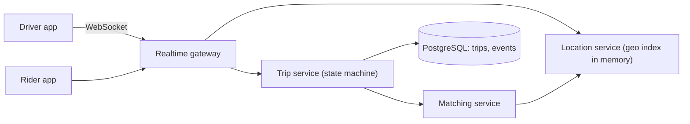

# Design a Ride-Sharing Service

> [!abstract] The product in one sentence
> A rider requests a trip, the system finds a nearby driver in seconds, both watch each other move in real time, the trip walks a strict state machine, and the money settles exactly once.

> [!tip] How to use this note
> Every section below has **questions to settle** and **options with trade-offs**. Write *My decision and why* under each before looking at a reference solution. The goal is a design you can defend, not a design you can recite.

> [!tip] Reference solution in your system-design vault
> `system-design/15 Interview Playbook/Design a Ride Sharing Service.md` — compare *after* you have written your own design.

**Map:** [[Problem Bank MOC]] → [[HLD MOC]]

## Problem statement

Ingest driver locations continuously, index them for nearest-driver queries, match a request to one driver (never two), run the trip state machine, price with surge, pay at the end. Hard parts: a write-heavy location stream, matching under contention, and a trip that carries money. Related: [[Design a Payment System]], [[Design a Chat System]] (the WebSocket gateway is the same).

**Questions to settle:** Match on straight-line distance or ETA? Offer to one driver at a time, or broadcast? What happens to a trip when the driver's phone dies?

## Product context and intended users

Rider app, driver app, city ops, finance. The fintech part is at the end: fare, driver payout, refunds and disputes — a ledger problem wearing a map.

## Functional requirements

- Driver location every few seconds; request → match → accept → pickup → drop-off → fare.
- Live ETA and map; cancellation with fees; surge per area.
- **Questions to settle:** Scheduled rides? Pooling?

## Non-functional requirements

- Match in < 5 s p99; ingest 50k+ location updates/s; trip state is never lost.
- **Questions to settle:** Is a 10-second-stale driver position acceptable for matching?

## Constraints and assumptions

- Mobile networks drop; GPS is noisy; a stadium at 10 pm is one hot cell.
- Drivers and riders both commit fraud — location spoofing, fake trips.

## Capacity estimation

| Quantity | Assumption | Result |
|---|---|---|
| Location writes | 200k drivers online, update every 4 s | 50k/s — in memory, never a database row per update |
| Trips | 1M/day, 5× peak | ~60 requests/s; matching is cheap next to location |
| Trip events | 1M × ~5 KB | ~5 GB/day; cold after 90 days |

*(Redo with your own assumptions; the shape of the reasoning is the point.)*

## API design

```http
WS   /v1/drivers/stream   ← { "type": "location", "lat": 12.97, "lng": 77.59, "heading": 90, "ts": 1760000000 }  (batched)
POST /v1/trips { "idempotencyKey": "req-77", "pickup": { ... }, "dropoff": { ... }, "product": "standard" } → 201 { "tripId": "t_1", "state": "matching", "quoteId": "q_5" }
POST /v1/trips/t_1/offers/o_3/accept  (driver) → 200 | 409 { "reason": "already_taken" }
GET  /v1/trips/t_1 → 200 { "state": "en_route", "driver": { ... }, "etaSec": 240 }
```

**Questions to settle:** Lock the quote at request time, or re-price at match? How long does an offer wait before moving to the next driver?

## Data model

`trip(id, rider_id, driver_id, state, quote_id, fare, version)` plus append-only `trip_event(trip_id, seq, type, payload)` — the state machine is replayable; `driver_status(driver_id, state, cell, last_seen)`. Locations live in an in-memory geo index keyed by cell (geohash or S2), partitioned by city, not in the trip database ([[Data Modeling]], [[Partitioning]]).

## High-level architecture



> [!example]- Excalidraw version — the same diagram as an editable canvas
> ![[Design a Ride-Sharing Service.excalidraw]]
> [[Design a Ride-Sharing Service.excalidraw|Open in Excalidraw]] — needs the Excalidraw plugin (see [[Plugins to Install]]).


## Component responsibilities

| Component | Owns | Does not own |
|---|---|---|
| Realtime gateway | Connections, auth, batching | Business state |
| Location service | Geo index, nearest-k | Who gets the trip |
| Matching | Candidate ranking, offers, driver lock | Pricing |
| Trip service | State machine, fare, payment trigger | Locations |

## Database selection and rationale

Trips in PostgreSQL — transactions on state transitions and financial records. Locations in [[Redis]] geo sets or a custom in-memory index per city: too frequent and too disposable for a relational row each. Trip events to Kafka for analytics and surge. Two stores on purpose, because the access patterns differ by three orders of magnitude.

## Caching strategy

Last position per driver for the rider's map; route and ETA results per cell pair for a minute; surge multiplier per cell with a short [[TTL]]. Trip state is never served from cache on the write path.

## Messaging and asynchronous processing

Location updates go gateway → location service directly for latency, with a sampled copy to [[Kafka]] for surge and analytics. Trip events on Kafka drive notifications, payouts and fraud ([[Event-Driven Architecture]]). Settling the fare is a [[Saga Pattern]]: charge the rider, credit the driver's ledger, compensate on failure — never a two-phase commit across PSP and ledger.

## Scaling strategy

Partition the geo index by cell; a hot cell at a stadium is a [[Hot Keys]] problem — split cells adaptively or accept degraded matching there. The gateway scales on connections, sticky by driver id. Matching is stateless per request except for the driver lock.

## Consistency requirements

A driver holds at most one trip: a short [[Distributed Locks|lock]] on driver id at offer time (Redis `SET NX` with TTL) and a conditional update on accept — the lock is the optimization, the database check is the guarantee. Trip transitions are versioned. Locations are eventually consistent and that is fine; fares are not.

## Failure scenarios

| Failure | Impact | Detection | Mitigation |
|---|---|---|---|
| Driver phone dies mid-trip | Trip stuck `en_route` | No location for 60 s | Rider can end the trip; ops tooling; fare from last known position |
| Two drivers accept one offer | Double dispatch | Conditional update rejects the second | 409 to the loser; re-offer |
| Geo index node lost | Drivers invisible in a region | Match latency per cell | Drivers re-report within 4 s; the index rebuilds itself |

## Security considerations

Location updates authenticated per connection ([[Authentication]]); fare and payout changes audited; GPS spoofing and fake-trip signals feed the fraud pipeline ([[Design a Real-Time Fraud Detection Pipeline]]); retention policy on home locations (PII).

## Observability

Match time p50/p99, offers per match, cancel rate, location lag per region, gateway connection churn, stuck trips by state age. Trace a trip end to end by trip id ([[Distributed Tracing]]).

## Cost considerations

Location ingest and the gateway are the compute lines; maps-provider calls for ETA are the surprise bill — cache hard. The trip database is small.

## Architectural trade-offs

| Decision | Chosen | Rejected | Why |
|---|---|---|---|
| Sequential offers vs broadcast to nearby drivers | *(yours)* | | |
| Redis geo vs a custom in-memory index | *(yours)* | | |
| Quote locked at request vs re-priced at match | *(yours)* | | |

## Alternative designs

- **Broadcast, first accept wins** — faster pickups, worse driver experience, more contention on accept.
- **One trip monolith with Redis geo** — entirely adequate for one city; split out location when its write rate forces you to.

## What I would implement first

WebSocket gateway; Redis geo index per city; trip service with an event-sourced state machine in PostgreSQL; sequential offers with a driver lock and conditional accept; fare computed at drop-off and handed to the payment system.

## What I would defer

ETA-based matching, pooling, surge, scheduled rides, multi-region.

## Related

### Concepts
- [[Real-Time Systems]] — positions and matches have deadlines
- [[WebSockets]] — the driver and rider connections
- [[Kafka]] — trip events for payouts, surge, analytics
- [[Distributed Locks]] — one driver, one trip
- [[Saga Pattern]] — settling the fare across PSP and ledger
- [[Hot Keys]] — the stadium cell

### Projects
- [[Live Ops Dashboard]] — stream driver positions over WebSockets

### Resources
- [[Uber - Domain-Oriented Microservice Architecture]]
- [[System Design Interview (Alex Xu)]]

## What I learned

*(Fill after a design session.)*

## What I would improve in a second iteration

*(Fill after a review or implementation.)*
