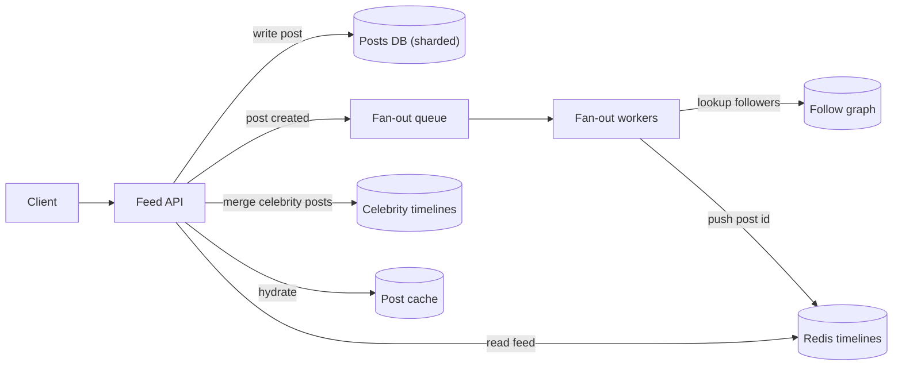

# Design a Social Feed

> [!abstract] The product in one sentence
> Open the app and see a fresh, ordered list of posts from the people you follow in well under a second, even when one of them has 20 million followers and just posted.

> [!tip] How to use this note
> Every section below has **questions to settle** and **options with trade-offs**. Write *My decision and why* under each before looking at a reference solution. The goal is a design you can defend, not a design you can recite.

> [!tip] Reference solution in your system-design vault
> `system-design/15 Interview Playbook/Design a News Feed.md` — compare *after* you have written your own design.

**Map:** [[Problem Bank MOC]] → [[HLD MOC]]

## Problem statement

Users post and follow; each home feed shows followees' posts, newest first or ranked. The core tension: compute the feed when a post is written (fan-out on write — cheap reads, expensive writes for popular authors) or when it is read (cheap writes, expensive reads). The delivery half overlaps with [[Design a Notification System]]; the realtime half with [[Design a Chat System]].

**Questions to settle:** Chronological or ranked? How many followees can a user have, and how many followers can an author have? Is "see your own post immediately" required?

## Product context and intended users

Consumer app, read-heavy by two orders of magnitude: most users read many times a day and post rarely. A few accounts (brands, celebrities) have millions of followers. Product cares about freshness and stable scrolling more than exact ordering.

## Functional requirements

- Create a post; follow and unfollow; fetch home feed with cursor pagination.
- New posts from followees appear within seconds; deleted posts disappear.
- Media attached by reference ([[Object Storage]]), never inline.
- **Questions to settle:** Ranking signals? Ads injected server-side? Muting and blocking?

## Non-functional requirements

- Feed fetch p99 under ~300 ms server-side; post creation under ~200 ms.
- Freshness: a new post visible to followers within ~5 s.
- Availability over consistency: a slightly stale feed is fine, an empty one is not.
- **Questions to settle:** Is missing a post briefly acceptable? Showing one twice?

## Constraints and assumptions

- Read:write ratio ~100:1; follow graph is skewed — median user follows ~200, max follower count ~20M.
- Feed only needs the most recent ~1,000 post ids per user; older history is paged from the author's timeline.
- Posts are immutable except deletion, which simplifies caching.

## Capacity estimation

| Quantity | Assumption | Result |
|---|---|---|
| Reads | 10M DAU × 10 feed loads/day | ~1.2k RPS average, ~5k peak |
| Writes | 10M DAU × 0.1 posts/day | ~12 posts/s — tiny until fan-out multiplies it |
| Fan-out | 12 posts/s × 200 median followers | ~2.4k inserts/s; one 20M-follower post is 20M inserts |
| Timeline cache | 10M users × 1,000 ids × ~16 B | ~160 GB in Redis — shard, or keep only active users |

*(Redo with your own assumptions; the shape of the reasoning is the point.)*

## API design

```http
POST /v1/posts { "text": "...", "mediaIds": ["m_1"] }        → 201 { "postId": "p_9" }
GET  /v1/feed?cursor=eyJ0cyI6...&limit=20                     → 200 { "items": [...], "nextCursor": "..." }
POST /v1/users/{id}/follow                                    → 204
```

**Questions to settle:** Cursor by (timestamp, postId) or by opaque position in the cached list? Does the feed endpoint return hydrated posts or ids that the client fetches ([[Designing APIs and Contracts]])?

## Data model

`post(id, author_id, created_at, text, media[])`; `follow(follower_id, followee_id)` indexed both ways; `timeline(user_id) → list of post ids` in [[Redis]] (fan-out on write). Post ids from a time-sortable generator so a list of ids is already ordered ([[Distributed ID Generation]]). Author timelines are a separate per-author list used for the celebrity path ([[Data Modeling]]).

## High-level architecture



> [!example]- Excalidraw version — the same diagram as an editable canvas
> ![[Design a Social Feed.excalidraw]]
> [[Design a Social Feed.excalidraw|Open in Excalidraw]] — needs the Excalidraw plugin (see [[Plugins to Install]]).


## Component responsibilities

| Component | Owns | Does not own |
|---|---|---|
| Feed API | Reading timelines, merging celebrity posts, hydration, cursors | Fan-out |
| Fan-out workers | Follower lookup, pushing ids to timelines, trimming lists | Ranking |
| Follow graph store | Edges in both directions, follower counts | Post content |
| Post store and cache | Post content, deletion tombstones | Timeline membership |

## Database selection and rationale

**Posts:** a sharded relational store or a wide-column store keyed by author and time — both fine; the difference is operational ([[SQL vs NoSQL]]). **Follow graph:** relational with two indexes, or adjacency lists in a key-value store; a graph database is rarely justified for one-hop queries. **Timelines:** Redis lists capped at ~1,000 entries. **Decision to make:** where the follow graph lives, because fan-out reads it hardest ([[Sharding]]).

## Caching strategy

The timeline cache *is* the product: a miss means rebuilding from the follow graph, which is the fan-out-on-read path used as fallback. Post content cached by id with [[Cache-Aside]] and deletion tombstones. Inactive users' timelines expire ([[TTL]]) and are rebuilt lazily on return — this bounds memory to active users.

## Messaging and asynchronous processing

Post creation publishes an event; fan-out workers consume it, look up followers in pages, and push ids ([[Message Queues]], [[Fan-Out]]). Celebrity posts are *not* fanned out: authors above a follower threshold are flagged, and readers merge their recent posts at read time. Deletion is also an event — remove from timelines lazily, filter tombstones at read.

## Scaling strategy

Reads scale by sharding timelines in Redis by `user_id` ([[Distributed Caching]]). Writes scale by parallelising fan-out across workers and bounding it with the celebrity threshold. The follow graph becomes a [[Hot Keys]] problem for popular authors — cache follower lists in pages. Ranking, if added, runs as a separate scorer over the candidate set, not inside the feed read.

## Consistency requirements

[[Eventual Consistency]] everywhere except read-your-own-writes: insert the author's own post into their timeline synchronously so it appears immediately. Followers may see a post seconds late; unfollow may leave a few posts until trimmed. Pagination must be stable under concurrent inserts — cursor on (post id), never offset.

## Failure scenarios

| Failure | Impact | Detection | Mitigation |
|---|---|---|---|
| Fan-out backlog | Feeds stale for minutes | Queue age, fan-out lag | Scale workers; prioritise active users; fall back to on-read merge |
| Redis shard loss | Those users see empty feeds | Miss ratio spike on one shard | Rebuild from follow graph on miss |
| Celebrity post storm | 20M inserts in seconds | Fan-out job size histogram | Threshold flag; merge at read instead |
| Viral post stampede | Posts DB overloaded on few ids | DB QPS concentration | Request coalescing, TTL jitter ([[Cache Stampedes]]) |

## Security considerations

Private accounts and blocks must be enforced at fan-out *and* at read (a block after fan-out must hide already-pushed posts). Rate limit posting and following to blunt spam ([[Rate Limiting]]). Media URLs signed and short-lived. Authorization is per post, not per feed ([[Authorization]]).

## Observability

Metrics: feed p99, timeline hit ratio, fan-out lag (post created to last follower insert), fan-out job size p99, Redis memory per shard, celebrity merge latency. Alert on fan-out lag and hit ratio, the two numbers that predict "my feed is stale or empty" complaints ([[Metrics]]).

## Cost considerations

Redis memory for timelines is the big line: bound entries per user and expire inactive users. Fan-out compute is proportional to follower counts; the celebrity threshold is a cost knob, not just a latency fix. Object storage and CDN for media are usage-priced and separate ([[CDNs]]).

## Architectural trade-offs

| Decision | Chosen | Rejected | Why |
|---|---|---|---|
| Fan-out on write vs on read vs hybrid | *(yours)* | | |
| Celebrity threshold and merge strategy | *(yours)* | | |
| Timeline store: Redis lists vs sorted sets vs DB table | *(yours)* | | |

## Alternative designs

- **Pure fan-out on read** — no timeline cache; each read merges followees' recent posts. Trivial writes, no stale cache, but read latency grows with followees and the posts DB takes every read.
- **Precomputed ranked batches** — an offline job builds each user's next N pages; cheap, predictable reads, but freshness drops to the job interval.

## What I would implement first

Fan-out on write to Redis lists capped at 1,000 ids, a celebrity flag above ~50k followers merged at read, cursor pagination on post id, synchronous self-insert, and a fan-out lag dashboard. Measure where read latency goes before adding ranking.

## What I would defer

Ranking, ads, mute and block edge cases, multi-region replication of timelines.

## Related

### Concepts
- [[Fan-Out]] — the central decision
- [[Redis]] — timeline lists and their memory maths
- [[Hot Keys]] — celebrity authors and viral posts
- [[Sharding]] — posts and timelines by id
- [[Eventual Consistency]] — what "fresh" really promises
- [[Cache-Aside]] — post hydration and tombstones
- [[Message Queues]] — the fan-out pipeline

### Projects
- *(none yet — propose one)*

### Resources
- [[System Design Interview (Alex Xu)]]
- [[The Tail at Scale]]
- [[Discord - How Discord Stores Trillions of Messages]]

## What I learned

*(Fill after a design session.)*

## What I would improve in a second iteration

*(Fill after a review or implementation.)*
