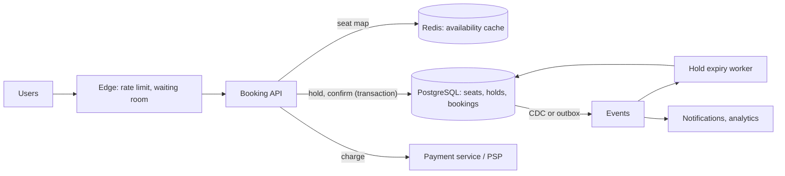

# Design a Ticket Booking System

> [!abstract] The product in one sentence
> Let users see available seats for an event, hold the ones they pick for a few minutes, pay, and get a confirmed ticket — with no seat ever sold twice, even when the whole city hits "buy" at 10:00:00.

> [!tip] How to use this note
> Every section below has **questions to settle** and **options with trade-offs**. Write *My decision and why* under each before looking at a reference solution. The goal is a design you can defend, not a design you can recite.

**Map:** [[Problem Bank MOC]] → [[HLD MOC]]

## Problem statement

Events have fixed seat inventory. Users browse, select, hold, pay and confirm. The invariant is simple — a seat has at most one confirmed owner — but it must hold under a flash-sale burst, payment timeouts, double clicks and crashed pods. Payment itself is [[Design a Payment System]]; the stock half generalises to [[Design an Inventory Management System]].

**Questions to settle:** Reserved seating or quantity-based? Hold duration (5 min? 10?) and can it be extended? Is a waiting room acceptable product behaviour during flash sales?

## Product context and intended users

Consumer-facing: fans buying concert or train tickets; venue operators managing inventory; support refunding and reassigning. Traffic is spiky by nature — flat for days, then a sale opens. The product promise is fairness and no double-booking; speed matters less than correctness here.

## Functional requirements

- List events; view seat map with availability; hold up to N seats for T minutes.
- Pay against a hold; confirm; release holds on expiry or cancellation.
- Refund and reassignment by operators; booking history per user.
- **Questions to settle:** Partial fulfilment of a multi-seat hold? Resale? Dynamic pricing?

## Non-functional requirements

- Zero oversell — a correctness invariant, not an SLO.
- Hold and confirm p99 under ~500 ms in steady state; graceful queueing during a sale.
- Availability of browsing even when booking is throttled ([[Graceful Degradation]]).
- **Questions to settle:** How stale may the seat map be? Seconds is usually fine.

## Constraints and assumptions

- Inventory per event is small (thousands to tens of thousands of seats); contention, not volume, is the problem.
- Payment is an external provider with seconds of latency and timeouts whose outcome is unknown.
- Users double-submit; clients retry; every mutating call needs an idempotency key ([[Idempotency]]).

## Capacity estimation

| Quantity | Assumption | Result |
|---|---|---|
| Flash sale | 1M users, 10k seats, first 60 s | ~15k hold attempts/s; 99% must fail fast |
| Steady state | 50k bookings/day | ~1/s — the sale is the design driver |
| Seat map reads | 1M users polling every 5 s | 200k RPS — cached, never queried |
| Holds | 10k seats × 5-min expiry | ≤10k active holds per event — trivial |

*(Redo with your own assumptions; the shape of the reasoning is the point.)*

## API design

```http
GET  /v1/events/{id}/seats                                  → 200 { "version": 8812, "seats": [...] }
POST /v1/holds  Idempotency-Key: k1 { "eventId": "e1", "seatIds": ["A12","A13"] }
→ 201 { "holdId": "h_7", "expiresAt": "..." } | 409 { "unavailable": ["A13"] }
POST /v1/bookings Idempotency-Key: k2 { "holdId": "h_7", "paymentMethodId": "pm_1" }
→ 201 { "bookingId": "b_3", "status": "confirmed" } | 402 | 410 (hold expired)
```

**Questions to settle:** Hold then pay in two calls (clear state machine) or one call that does both (fewer round trips, harder failure handling)? Does `POST /holds` fail fast or queue?

## Data model

`event(id, venue, starts_at, status)`; `seat(event_id, seat_id, state, hold_id, booking_id, version)` with `state ∈ {available, held, booked}`; `hold(id, user_id, seat_ids[], expires_at, state)`; `booking(id, hold_id, user_id, payment_id, state)`. The `seat` row is the unit of contention; `version` enables optimistic updates. State changes are append-only events for audit ([[Data Modeling]]).

## High-level architecture



> [!example]- Excalidraw version — the same diagram as an editable canvas
> ![[Design a Ticket Booking System.excalidraw]]
> [[Design a Ticket Booking System.excalidraw|Open in Excalidraw]] — needs the Excalidraw plugin (see [[Plugins to Install]]).


## Component responsibilities

| Component | Owns | Does not own |
|---|---|---|
| Booking API | Hold and confirm transactions, idempotency, state machine | Charging cards |
| Availability cache | Fast seat-map reads, approximate counts | Truth about ownership |
| Expiry worker | Releasing expired holds, compensations | Deciding hold length |
| Payment service | Authorisation, capture, refunds | Seat state |

## Database selection and rationale

**Options:** PostgreSQL with `SELECT ... FOR UPDATE` on seat rows (pessimistic, simple, serialises per seat) or `UPDATE ... WHERE version = ?` (optimistic, retries under high contention); [[Redis]] Lua scripts for holds (fast and atomic, but failover durability is the oversell risk); DynamoDB conditional writes (managed, needs `TransactWriteItems` for multi-seat). **Decision to make:** relational transactions for truth and Redis only as cache — or Redis holds with a reconciliation safety net ([[Optimistic and Pessimistic Locking]]).

## Caching strategy

Availability is read 1,000× more than written: publish a versioned snapshot per event to Redis and let clients poll it, refreshed on state change or every second. Never make a booking decision from the cache. Event metadata and seat maps are static and belong on a CDN ([[Cache-Aside]], [[CDNs]]).

## Messaging and asynchronous processing

Hold expiry is a scheduled scan of `expires_at` or a delayed message, idempotent because a user may confirm at the same second. Payment webhooks arrive asynchronously and out of order — reconcile against the booking state machine. Emails, analytics and seat-map refreshes consume an [[Outbox Pattern]] stream so the transaction stays small.

## Scaling strategy

Reads scale with the cache and CDN. Writes do not need to scale — they need to be *shed*: a per-event token bucket at the edge admits only as many hold attempts per second as the database can serialise ([[Rate Limiting]]); a waiting room queues the rest fairly. Partition by `event_id` if many sales run at once ([[Sharding]]).

## Consistency requirements

Strong for seat state: hold and confirm are serialisable transactions on seat rows ([[Transactions]], [[Isolation Levels]]). Payment is a saga — hold → charge → confirm — with compensation (release, refund) when a step fails or times out with unknown outcome ([[Saga Pattern]]). The availability view lags by a second or two, and the UI must say so.

## Failure scenarios

| Failure | Impact | Detection | Mitigation |
|---|---|---|---|
| Payment outcome unknown | Hold expires while charge succeeds | Webhook vs booking state mismatch | Extend hold while charge pending; reconcile; refund orphans |
| Expiry and confirm race | Seat released and booked at once | Invariant check on seat row | Expire only if still `held` with matching `hold_id` |
| Flash-sale overload | Lock queue explodes | Lock wait time, p99 | Edge admission control, waiting room, fail fast on 409 |
| Double submit | Two holds for one user | Same idempotency key | Idempotency table; per-user hold limit |

## Security considerations

Bots are the main threat: rate limit per user and device, require login before hold, CAPTCHA on the waiting room. Tickets are bearer assets — sign QR codes, bind to the buyer. Payment data never enters this system beyond a provider token (PCI scope). Audit every seat state change ([[Audit Logs]]).

## Observability

Metrics: hold attempts/s, hold success ratio, confirm p99, lock wait time, hold expiry rate, payment pending age, oversell invariant checker (a job that proves no seat has two bookings). Alert on pending payments older than the hold window and on any invariant violation ([[Alerting]]).

## Cost considerations

Steady state is tiny; the sale needs headroom for an hour. Pre-scale pods before the sale from a schedule rather than paying for peak always; the database is one sized instance because contention, not throughput, is the limit. Waiting-room infrastructure is cheaper than a bigger database ([[Performance vs Cost Trade-offs]]).

## Architectural trade-offs

| Decision | Chosen | Rejected | Why |
|---|---|---|---|
| Pessimistic vs optimistic seat locking | *(yours)* | | |
| Holds in PostgreSQL vs Redis | *(yours)* | | |
| Fail fast vs waiting room during sales | *(yours)* | | |

## Alternative designs

- **Redis-first holds with async persistence** — a Lua script decrements availability in microseconds; the database catches up. Handles the burst; a Redis failover can oversell unless a reconciler fixes it.
- **Lottery instead of first-come** — collect requests for a window, allocate randomly, charge winners. Removes the burst entirely; product must accept a different fairness model.

## What I would implement first

PostgreSQL seat rows with `FOR UPDATE` holds, two-call hold-then-book with idempotency keys, an expiry job guarded by `hold_id`, a Redis seat-map snapshot per event, and an oversell invariant checker. Load-test the hold endpoint to find the lock-queue knee before building a waiting room.

## What I would defer

Waiting room, dynamic pricing, resale, partial fulfilment, multi-region.

## Related

### Concepts
- [[Optimistic and Pessimistic Locking]] — the seat row under contention
- [[Transactions]] — hold and confirm atomically
- [[Isolation Levels]] — what serialisable costs and prevents
- [[Idempotency]] — double clicks and retried calls
- [[Saga Pattern]] — hold, charge, confirm with compensation
- [[Rate Limiting]] — admission control at the edge
- [[Distributed Locks]] — if holds move to Redis

### Projects
- [[Load Test and Latency Lab]] — find the lock-queue knee under a simulated sale
- [[Double-Entry Ledger Service]] — where refunds land

### Resources
- [[PostgreSQL Transaction Isolation Docs]]
- [[Stripe - Idempotency]]
- [[AWS Builders Library - Load Shedding]]

## What I learned

*(Fill after a design session.)*

## What I would improve in a second iteration

*(Fill after a review or implementation.)*
