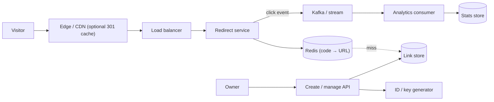

# Design a URL Shortener

> [!abstract] The product in one sentence
> Turn a long URL into a short, stable code and redirect anyone who opens it in a few milliseconds, while counting clicks and keeping abusers out.

> [!tip] How to use this note
> Every section below has **questions to settle** and **options with trade-offs**. Write *My decision and why* under each before looking at a reference solution. The goal is a design you can defend, not a design you can recite.

> [!tip] Reference solution in your system-design vault
> `system-design/15 Interview Playbook/Design a URL Shortener.md` — compare *after* you have written your own design.

**Map:** [[Problem Bank MOC]] → [[HLD MOC]]

## Problem statement

Build a service that maps a long URL to a short code (`sho.rt/aZ3k9Q`), redirects every visitor of the short link to the original URL, and reports how often each link was opened. It is overwhelmingly read-heavy, latency on the redirect path is the product, and the write path must never hand out the same code twice.

**Questions to settle:** Is this a public product (anyone creates links) or an internal tool (marketing, transactional SMS)? Do links expire? Are custom aliases (`sho.rt/summer-sale`) required? Is click analytics a core feature or a nice-to-have?

## Product context and intended users

Three audiences: (a) link creators — marketing teams, customer-communication services that embed links in SMS and push, API integrators; (b) visitors who click, from any client, and who only notice the service when it is slow or wrong; (c) analysts who want click counts by link, time and referrer. In a fintech setting the links often sit inside payment reminders and KYC flows, so a link that resolves to the wrong destination or is hijacked is a security incident, not a bug.

## Functional requirements

- Create a short code for a long URL; optionally accept a custom alias and an expiry.
- Redirect `GET /{code}` to the long URL; return `404` for unknown and `410` for expired codes.
- Record each click (timestamp, referrer, coarse user agent, country) without slowing the redirect.
- Let the owner read click statistics and disable a link.
- **Questions to settle:** Is the same long URL allowed to produce several codes (per creator) or should it be deduplicated? Can a link's destination be edited after creation?

## Non-functional requirements

- Redirect latency: p99 under ~20 ms server-side; a cache hit should be well under 5 ms.
- Availability: the redirect path is the one that matters — target it higher (say 99.99%) than the creation path (99.9%).
- Uniqueness: a code is never reused, even after deletion.
- Scale: hundreds of millions of links, tens of thousands of redirects per second at peak.
- **Questions to settle:** Is a click count that is a few minutes stale acceptable? May a redirect serve a stale destination for a while after an edit?

## Constraints and assumptions

- Codes are 7 characters of base62 (~3.5 trillion combinations) — enough for decades at the assumed write rate.
- Visitors arrive from anywhere; most traffic is anonymous and cacheable.
- Analytics must not hold up the redirect; losing a small fraction of click events during an outage is acceptable (decide whether that still holds for billing-grade click reporting).
- The store can be a managed cloud database; the cache is [[Redis]].

## Capacity estimation

| Quantity | Assumption | Result |
|---|---|---|
| New links | 100M per month | ~40 writes/s average, plan for 400/s bursts |
| Redirects | 100:1 read:write ratio | ~4k reads/s average, ~40k/s peak |
| Storage per link | ~500 B (code, URL, owner, timestamps, flags) | ~50 GB/month, ~3 TB over 5 years |
| Hot set | 20% of links get 80% of clicks; ~10M links hot per day | ~3 GB in Redis — fits a single replicated node |
| Click events | 4k/s × ~200 B | ~70 GB/day raw; keep raw 90 days, aggregates forever |

*(Redo with your own assumptions; the shape of the reasoning is the point.)*

## API design

```http
POST /v1/links
{ "url": "https://example.com/very/long?x=1", "alias": null, "expiresAt": "2027-01-01T00:00:00Z" }
→ 201 { "code": "aZ3k9Q", "shortUrl": "https://sho.rt/aZ3k9Q" }

GET /aZ3k9Q
→ 302 Location: https://example.com/very/long?x=1   (or 301 — decide)

GET /v1/links/aZ3k9Q/stats?from=2026-10-01&to=2026-10-19
→ 200 { "clicks": 18234, "byDay": [...], "topReferrers": [...] }

DELETE /v1/links/aZ3k9Q → 204
```

**Questions to settle:** 301 (browsers and CDNs cache it, redirect load drops, but you lose click visibility and cannot edit the destination) vs 302/307 (every click reaches you — analytics and edits work, at the cost of serving every request). Does creation take an idempotency key so a retried SMS job does not mint duplicate codes ([[Idempotency]])?

## Data model

`links(code PK, long_url, owner_id, created_at, expires_at, status)` with a secondary index on `owner_id`. Optionally `url_hash → code` if deduplication per owner is wanted. Click events are append-only (`code, ts, referrer, country, ua_class`) and roll up into `link_daily_stats(code, day, clicks)`. **Questions to settle:** Store the long URL once per code or normalise shared destinations? How large can a long URL be (2 KB? 8 KB?) and does that change the row-size assumption?

## High-level architecture



## Component responsibilities

| Component | Owns | Does not own |
|---|---|---|
| Redirect service | Lookup, expiry check, redirect status code, emitting the click event | Creating codes, aggregating stats |
| Create/manage API | Validation, alias uniqueness, owner auth, writing the link row | Serving redirects |
| ID / key generator | Unique, non-guessable codes | URL storage |
| Link store | Durable code → URL mapping | Click counts |
| Analytics pipeline | Consuming click events, roll-ups, stats queries | The redirect path's latency |
| Cache | Hot code → URL entries with TTL | Being the source of truth |

## Database selection and rationale

The access pattern is a point lookup by primary key with a tiny write rate. **Options:** a key-value store such as DynamoDB (single-digit-millisecond reads, scales without [[Sharding]] work, conditional writes give alias uniqueness for free, but owner queries need a secondary index); PostgreSQL (simple, transactional, owner queries are trivial, but a single primary caps writes and 3 TB needs partitioning eventually — see [[Database Scaling]]); Cassandra (write-friendly, overkill at 40 writes/s). **Decision to make:** which store and why — and whether the answer changes at 10× the assumed write rate. In a stack like yours, PostgreSQL behind [[Redis]] is the boring starting point; DynamoDB wins if you want zero capacity planning for the table.

## Caching strategy

[[Cache-Aside]]: the redirect looks up Redis, on a miss reads the store and populates with a TTL (hours to a day). Negative caching for unknown codes defends against enumeration scans. A viral link is a textbook [[Hot Keys]] case — one key at 20k reads/s on one Redis shard; mitigations are an in-process LRU on each redirect instance, key replication, or letting the CDN absorb it with a short-TTL redirect. [[Cache Invalidation]] only matters if destinations can be edited or links disabled: delete the key on write, accept a few seconds of staleness, or version the key. Sharding the cache itself is its own problem — see [[Design a Distributed Cache]]. **Questions to settle:** May "disable link" take up to one TTL to propagate?

## Messaging and asynchronous processing

Click recording is fire-and-forget from the redirect path onto [[Kafka]] (or Redis Streams / SQS in a smaller deployment): the redirect never waits on analytics. Consumers aggregate per minute and per day; a replayable log lets you rebuild stats after a consumer bug. **Options:** one event per request (precise, high volume) vs in-process batching with a periodic flush (cheap, loses the last batch on a crash). Either way it is [[At-Least-Once Delivery]] — decide whether duplicate clicks are tolerable or need an event id for dedup.

## Scaling strategy

Redirect instances are stateless — scale horizontally behind the [[Load Balancers|load balancer]]. The cache scales by sharding codes across Redis nodes with [[Consistent Hashing]]; the store scales by partitioning on `code`, a random and well-distributed key. Geographic scale comes from [[CDNs]] and multi-region [[Read Replicas]] of the link store; creation can stay single-region because writes are rare and a few hundred milliseconds of creation latency is acceptable.

## Consistency requirements

Creation must be strongly consistent for uniqueness: the code (or alias) write is a conditional insert that fails on conflict. Reads can be eventually consistent — a new link that takes a second to appear on a replica is fine, as long as the creator's own immediate "preview" request is served from the primary or the cache ([[Eventual Consistency]]). **Decision to make:** the [[Distributed ID Generation]] scheme — a central counter encoded in base62 (simple, sequential and therefore guessable), a random 7-char code with a collision check (unguessable, retries climb as the space fills), hashing the URL (deduplicates but leaks "same URL" and can collide), or pre-generated key pools handed to instances in batches (no hot-path coordination, needs a key service). The full choice space is in [[Design a Distributed ID Generator]].

## Failure scenarios

| Failure | Impact | Detection | Mitigation |
|---|---|---|---|
| Redis down | Every redirect hits the store; latency climbs, store may saturate | Cache error rate, store CPU | In-process cache as a second level, store sized for the uncached peak, [[Circuit Breakers|circuit breaker]] that sheds analytics first |
| Store primary failover | Creation fails for tens of seconds; redirects keep working from cache and replicas | Write error rate | Retry creation with the same idempotency key; the redirect path never depends on the primary |
| Viral link (hot key) | One shard or one instance saturates | Per-key QPS top-N | Local LRU, CDN caching with short TTL, key replication |
| Analytics consumer lag | Stats stale by minutes or hours | Consumer lag metric | Scale consumers; stats UI shows an "as of" timestamp |
| Malicious destination | Phishing via your domain; domain reputation damage | Safe-browsing checks, abuse reports | Validate and scan URLs at creation, block lists, per-link kill switch |
| Code exhaustion or counter corruption | Creation errors or duplicates | Uniqueness-constraint violations | Conditional insert as the last line of defence |

## Security considerations

Non-guessable codes if links carry anything sensitive — a sequential counter lets anyone enumerate every link ever created. [[Rate Limiting]] on creation and on lookup slows scanners; it is the same mechanism as [[Design a Rate Limiter]]. Validate destinations (scheme allow-list, no redirect to internal hosts), scan against phishing lists, and make owners prove ownership before editing. For links sent in customer messages consider short expiries and HTTPS-only ([[HTTP and HTTPS]]). Keep an [[Audit Logs|audit log]] of who created or disabled which link.

## Observability

Metrics: redirects/s, cache hit ratio, redirect p50/p99, 404/410 ratio (a scanning signal), creation error rate, analytics consumer lag. Logs: sampled redirects with code and status; every creation and deletion. Alerts: cache hit ratio drop, p99 breach, 404 ratio spike, consumer lag beyond a few minutes. Dashboards per owner so marketing can see their own links without asking engineering.

## Cost considerations

The redirect fleet and the cache dominate; the store is cheap at this write rate. A 301 with CDN caching can remove most origin traffic — the trade is analytics fidelity. Click events are the largest storage item: keep raw events for a bounded window and aggregates forever ([[Data Retention and Archival]]). Multi-region doubles infrastructure for a latency gain that only matters if visitors are global.

## Architectural trade-offs

| Decision | Chosen | Rejected | Why |
|---|---|---|---|
| 301 vs 302/307 | *(yours)* | | |
| Code generation scheme | *(yours)* | | |
| Store (KV vs relational) | *(yours)* | | |
| Click capture (per event vs batched) | *(yours)* | | |
| Custom aliases (global vs per-owner namespace) | *(yours)* | | |

## Alternative designs

- **Hash-based codes with no ID service** — `base62(sha256(url + owner))[:7]`, collision-checked on insert; no coordination and natural dedup, but a different URL can collide and the code reveals nothing about creation order.
- **Static redirects pushed to the edge** — publish code → URL pairs to a CDN key-value store; near-zero origin load, but propagation delay on edits and no fine-grained analytics.
- **Relational-only with no cache** — for an internal tool at a few hundred redirects per second a single PostgreSQL with a covering index is enough; add the cache when measurements say so.

## What I would implement first

One service with two routes: creation using a pre-generated key pool (a table of unused codes claimed in batches of 1,000 per instance) and a 302 redirect with [[Cache-Aside]] on Redis, a 24-hour TTL and negative caching. Click events go to a stream and one consumer writes daily aggregates. Load-test the redirect path to find the knee before adding anything else.

## What I would defer

Custom aliases, destination editing, multi-region replication, real-time stats, safe-browsing integration, and per-owner dashboards.

## Related

### Concepts
- [[Distributed ID Generation]] — the code scheme is the central decision
- [[Cache-Aside]] — the read path pattern
- [[Hot Keys]] — one viral link
- [[Redis]] — the cache and possibly the key pool
- [[CDNs]] — absorbing redirect traffic at the edge
- [[Sharding]] — when the store outgrows one node
- [[Idempotency]] — safe retries on creation
- [[HTTP and HTTPS]] — 301 vs 302 vs 307 semantics and caching headers

### Projects
- [[Load Test and Latency Lab]] — measure the redirect path's knee and cache-miss behaviour

### Resources
- [[System Design Interview (Alex Xu)]]
- [[Scaling Memcache at Facebook]] — read-heavy caching lessons that apply directly
- [[AWS Builders Library - Caching Challenges]]

## What I learned

*(Fill after a design session.)*

## What I would improve in a second iteration

*(Fill after a review or implementation.)*
