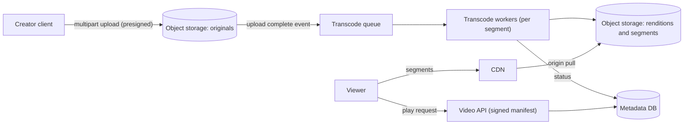

# Design a Video Streaming Service

> [!abstract] The product in one sentence
> Creators upload a video once; minutes later anyone can watch it on any device and network, starting within a second or two, with the player picking a quality that does not stall.

> [!tip] How to use this note
> Every section below has **questions to settle** and **options with trade-offs**. Write *My decision and why* under each before looking at a reference solution. The goal is a design you can defend, not a design you can recite.

> [!tip] Reference solution in your system-design vault
> `system-design/15 Interview Playbook/Design a Video Streaming Service.md` — compare *after* you have written your own design.

**Map:** [[Problem Bank MOC]] → [[HLD MOC]]

## Problem statement

Design video on demand (not live): resumable uploads of multi-GB files, a transcoding pipeline producing several renditions and HLS/DASH segments, storage that is cheap for the long tail, a playback path served almost entirely by a [[CDNs|CDN]], and a metadata service for titles, views and permissions. Recommendations are a boundary, not part of this design. The upload and chunking half overlaps with [[Design File Storage]].

**Questions to settle:** Public platform or private library (training videos, KYC recordings)? Live streaming in scope? Target start-up time and which devices?

## Product context and intended users

Creators who upload and expect processing to finish in minutes; viewers on mobile networks where bandwidth varies second to second; operators who watch transcoding cost. Video is a pipeline-plus-CDN problem: the application servers barely touch bytes.

## Functional requirements

- Resumable chunked upload; processing status visible to the creator.
- Transcode to a ladder of resolutions and bitrates; package as HLS or DASH segments; generate thumbnails.
- Playback via manifest URL with adaptive bitrate; metadata CRUD, view counts, access control.
- **Questions to settle:** Captions and multiple audio tracks? DRM? Download for offline?

## Non-functional requirements

- Playback start under ~2 s on a good network; rebuffer ratio under ~1%.
- Processing: a 10-minute video available within ~10 minutes of upload.
- Durability of originals: effectively never lost ([[Object Storage]] class durability).
- **Questions to settle:** How much of the catalogue must be instantly playable versus restorable from cold storage?

## Constraints and assumptions

- Bytes flow client → object storage → transcoders → object storage → CDN; application servers only issue signed URLs and manifests.
- Transcoding is CPU-bound and embarrassingly parallel per segment; cost scales with renditions × duration.
- Viewing is heavily skewed: a small fraction of videos takes most views.

## Capacity estimation

| Quantity | Assumption | Result |
|---|---|---|
| Uploads | 10k videos/day × 10 min × ~1 GB raw | ~10 TB/day of originals; cold tier after processing |
| Renditions | 5 renditions ≈ 30% of raw size combined | ~3 TB/day hot-serveable; ~1 PB/year |
| Transcode compute | ~1 CPU-minute per video-minute per rendition | ~500k CPU-minutes/day — autoscaled spot workers |
| Egress | 1M daily views × 10 min × ~3 Mbps | ~2.2 PB/month through the CDN — the dominant cost |

*(Redo with your own assumptions; the shape of the reasoning is the point.)*

## API design

```http
POST /v1/videos { "title": "..." }                                → 201 { "videoId": "v1", "upload": { "url": "...", "chunkSize": 8388608 } }
PUT  {uploadUrl}?part=12   (binary chunk, resumable via listing completed parts)
POST /v1/videos/v1/complete { "parts": [...] }                    → 202 { "status": "processing" }
GET  /v1/videos/v1/play     → 200 { "manifest": "https://cdn/.../master.m3u8?sig=...", "expiresAt": "..." }
```

**Questions to settle:** Direct-to-S3 multipart with presigned URLs (no bytes through your servers) or an upload service that validates as it goes? Signed manifest URLs or signed cookies for segments?

## Data model

`video(id, owner_id, title, status, duration, visibility)`; `rendition(video_id, profile, codec, bitrate, path)`; `upload(id, video_id, parts_done[])`; `view_event(video_id, user_id, ts, seconds_watched)` — append-only, aggregated later. Bytes live in object storage keyed by `video_id/rendition/segment`; the database holds only paths ([[Data Modeling]]).

## High-level architecture



## Component responsibilities

| Component | Owns | Does not own |
|---|---|---|
| Upload path | Presigned multipart, completion, validation | Transcoding |
| Transcode pipeline | Splitting, encoding, packaging, thumbnails, retries | Serving |
| Metadata service | Video records, status, permissions, signed URLs | Bytes |
| CDN plus origin | Segment delivery, caching, edge TLS | Access decisions beyond signature checks |

## Database selection and rationale

**Metadata:** PostgreSQL (relational catalogue, permissions, transactions on status); **view events:** an append stream into [[Kafka]] then a warehouse, never row-per-view in the primary DB; **bytes:** S3 with lifecycle tiers ([[Object Storage]]). **Decision to make:** whether a document store suits the catalogue better than relational; usually not until the schema becomes genuinely polymorphic ([[SQL vs NoSQL]]).

## Caching strategy

The CDN is the cache: segments are immutable, so cache forever with content-addressed paths; manifests cache briefly. Behind it, an origin shield reduces S3 requests for popular titles ([[Multi-Level Caching]]). Metadata and manifests cached in [[Redis]] with [[Cache-Aside]]. Thumbnails are the hidden hot path — tens per page view.

## Messaging and asynchronous processing

Upload completion emits an event; a queue feeds transcode workers; each rendition and segment is an independent job so a failed worker retries one piece, not the video ([[Message Queues]], [[Retry Strategies]]). Jobs are idempotent on `(video_id, rendition, segment)` — output overwrite is harmless ([[Idempotency]]). Status aggregation marks a video playable when the lowest rendition completes; others follow.

## Scaling strategy

Transcoding scales horizontally on queue depth with spot instances; split long videos into segments to parallelise. Delivery scales with the CDN, not with you. The metadata service is ordinary web scale with [[Read Replicas]]. Isolate priority lanes so a creator's 4-hour upload does not delay everyone's 30-second clips ([[Bulkheads]]).

## Consistency requirements

Weak everywhere except permissions: a video made private must stop being playable within seconds — short signed-URL lifetimes make this true without purging the CDN. Status may lag; view counts are approximate and aggregated ([[Eventual Consistency]]). Upload completion and metadata update must be atomic or re-driven by a reconciler.

## Failure scenarios

| Failure | Impact | Detection | Mitigation |
|---|---|---|---|
| Transcode worker dies mid-job | One segment missing; video stuck | Job age past timeout | Visibility timeout and retry; idempotent output |
| Corrupt or hostile upload | Transcoder crashes repeatedly | Retry count per job | Validate container and limits before queueing; poison job DLQ |
| CDN origin stampede on a viral video | S3 request spike, slow starts | Origin request rate per key | Origin shield; pre-warm top titles ([[Cache Stampedes]]) |
| Object storage region outage | Nothing plays | Origin error rate | Cross-region replication of renditions; CDN failover origin |

## Security considerations

Presigned upload URLs scoped to one key and short-lived; signed playback URLs or cookies per viewer with expiry; private videos never served from guessable paths ([[Authorization]]). Scan uploads for malware before processing. For regulated content (KYC video), encrypt at rest with per-tenant keys and keep access logs ([[Encryption at Rest and in Transit]]).

## Observability

Pipeline: queue depth, time from upload to playable p50/p99, failures per rendition profile. Playback: start-up time, rebuffer ratio, bitrate distribution, CDN hit ratio, origin egress — these come from the player, so ship client beacons ([[Monitoring User-Facing Performance]]). Alert on upload-to-playable p99 and CDN hit ratio.

## Cost considerations

Egress dominates, then transcoding compute, then storage. Levers: a smaller rendition ladder for low-view videos (encode more only when a video gets views), lifecycle rules moving originals to cold storage, spot workers, CDN contracts. Per-view cost is the metric to track ([[Performance vs Cost Trade-offs]]).

## Architectural trade-offs

| Decision | Chosen | Rejected | Why |
|---|---|---|---|
| Direct-to-storage upload vs upload service | *(yours)* | | |
| Eager full ladder vs lazy transcoding on demand | *(yours)* | | |
| Signed URLs vs DRM for access control | *(yours)* | | |

## Alternative designs

- **Managed media pipeline** (cloud transcoding service plus packager) — nothing to run; cost per minute is higher and customisation limited, usually the right call below very large scale ([[Build vs Buy Decisions]]).
- **Just-in-time packaging** — store one mezzanine rendition per bitrate, package HLS or DASH segments at the edge on request; halves storage, adds origin CPU and start-up latency.

## What I would implement first

Presigned multipart upload to S3, an SQS-fed transcoding worker producing a three-rendition HLS ladder per segment with idempotent outputs, PostgreSQL metadata with status, signed manifest URLs behind a CDN, and an upload-to-playable dashboard. Measure start-up time from a real phone before touching the ladder.

## What I would defer

DRM, captions, live streaming, lazy transcoding, multi-region origins, recommendations.

## Related

### Concepts
- [[Object Storage]] — where every byte lives
- [[CDNs]] — the playback path
- [[Message Queues]] — the transcoding pipeline
- [[Idempotency]] — per-segment jobs that can rerun
- [[Data Retention and Archival]] — storage tiers for originals
- [[Bulkheads]] — priority lanes in the pipeline
- [[Multi-Level Caching]] — edge, shield, origin

### Projects
- *(none yet — propose one)*

### Resources
- [[System Design Interview (Alex Xu)]]
- [[System Design Primer (GitHub)]]
- [[The Tail at Scale]]

## What I learned

*(Fill after a design session.)*

## What I would improve in a second iteration

*(Fill after a review or implementation.)*
