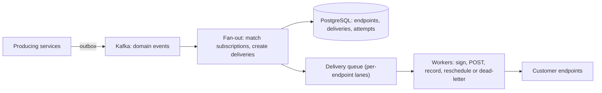

# Design a Webhook Delivery System

> [!abstract] The product in one sentence
> When something happens on the platform, every subscribed customer endpoint hears about it at least once, signed, within a bounded time — and one customer's dead server never slows anyone else's deliveries.

> [!tip] How to use this note
> Every section below has **questions to settle** and **options with trade-offs**. Write *My decision and why* under each before looking at a reference solution. The goal is a design you can defend, not a design you can recite.

**Map:** [[Problem Bank MOC]] → [[HLD MOC]]

## Problem statement

Fan out internal domain events to customer-registered HTTPS endpoints with signing, retries, isolation and visibility. Hard parts: endpoints are slow, down or hostile; retries multiply load; and nothing may be lost between "it happened" and "we sent it". Related: [[Design a Notification System]] (same fan-out, different recipients), [[Design a Message Queue]].

**Questions to settle:** Ordering per endpoint, or none? How long do we retry — hours or days? Do customers get a replay API, which means storing events longer?

## Product context and intended users

A payment platform telling merchants `payment.succeeded` and `payout.failed`. Merchants build reconciliation on these; a missed webhook becomes a support ticket and a manual settlement.

## Functional requirements

- Register endpoints with a secret and event filters; HMAC-signed delivery with timestamp.
- Retry with backoff to a cap; dead-letter with manual replay; attempt log per event.
- Auto-disable an endpoint after N days of failure, with notice.
- **Questions to settle:** Fat payload, or thin (id and type; the customer fetches)?

## Non-functional requirements

- First attempt within 5 s of the event (p99); at-least-once; retries span 3 days.
- One bad endpoint affects nobody else; 10k endpoints, 5k events/s peak.
- **Questions to settle:** What delivery SLO is actually promised in the contract?

## Constraints and assumptions

- Endpoint latency is unbounded — we time out at 10 s.
- Customers retry on their side too; payloads must stay within the tenant's scope.

## Capacity estimation

| Quantity | Assumption | Result |
|---|---|---|
| Deliveries | 5k events/s × 2 endpoints avg | 10k POSTs/s peak |
| Retries | 5% fail, up to 8 attempts over 3 days | +40% attempts; ~80 GB/day of attempt log at 1 KB |
| In flight | 10k/s × 500 ms avg | ~5k concurrent — 50k if one endpoint hangs at 10 s, hence per-endpoint caps |

*(Redo with your own assumptions; the shape of the reasoning is the point.)*

## API design

```http
POST /v1/endpoints { "url": "https://m.example/hooks", "events": ["payment.succeeded"], "secret": "whsec_..." } → 201 { "endpointId": "ep_1" }
→ delivery:  POST https://m.example/hooks
   Webhook-Id: evt_9   Webhook-Timestamp: 1760000000   Webhook-Signature: v1,<hmac-sha256(ts.body)>
   { "id": "evt_9", "type": "payment.succeeded", "created": 1760000000, "data": { ... } }
GET  /v1/events/evt_9/attempts → 200 { "attempts": [{ "n": 1, "status": 503, "at": "..." }, ...] }
POST /v1/events/evt_9/replay → 202
```

**Questions to settle:** Is `Webhook-Id` the customer's dedup key (then document it loudly)? Signature over timestamp plus body, with a tolerance window?

## Data model

`endpoint(id, tenant_id, url, secret_ref, filters, status, disabled_at)`; `event(id, tenant_id, type, payload, created_at)`; `delivery(id, event_id, endpoint_id, state, attempt, next_attempt_at, last_status)` — one row per event-endpoint pair, indexed on `next_attempt_at`; `attempt` rows appended. The delivery row is the source of truth; queues are transport ([[Data Modeling]]).

## High-level architecture



## Component responsibilities

| Component | Owns | Does not own |
|---|---|---|
| Fan-out | Subscription matching, delivery rows | HTTP |
| Workers | Signing, timeouts, recording status, scheduling the retry | Deciding subscriptions |
| Retry scheduler | Due `next_attempt_at` → queue | Execution |
| Dead-letter and replay | Visibility, manual replay, endpoint disabling | Auto-fixing customer servers |

## Database selection and rationale

PostgreSQL for endpoints, deliveries and attempts — merchants read the attempt log, so it is the product, not a side effect. Kafka or SQS is transport only. DynamoDB with TTL becomes attractive when attempt volume outgrows a relational table; not before.

## Caching strategy

Endpoint config (URL, secret, filters) cached in workers, invalidated on change ([[Cache Invalidation]]). Nothing else — every delivery is unique.

## Messaging and asynchronous processing

Producers write events through the [[Outbox Pattern]], so an event exists exactly when the business transaction committed. Delivery is [[At-Least-Once Delivery]]; `Webhook-Id` is the customer's dedup key ([[Idempotency]]). Retries use exponential backoff with jitter, scheduled via `next_attempt_at` rather than queue redelivery, so history stays in one place ([[Retry Strategies]]). Exhausted deliveries enter a [[Dead-Letter Queues|dead-letter]] state and notify the merchant.

## Scaling strategy

Workers scale on queue depth. Isolation is the real problem: cap in-flight requests per endpoint (or give each endpoint its own lane) so one 10-second timeout cannot occupy the pool ([[Bulkheads]]); open a [[Circuit Breakers|circuit breaker]] per endpoint after a failure streak. Very large customers get their own partition.

## Consistency requirements

Ordering is best effort. If a customer needs it, deliver one-at-a-time per endpoint and accept head-of-line blocking — a per-endpoint setting, not a global one. Delivery state transitions are idempotent on attempt number. A replay sends the same bytes as the original.

## Failure scenarios

| Failure | Impact | Detection | Mitigation |
|---|---|---|---|
| Endpoint down for hours | Backlog for that endpoint only | Failure streak per endpoint | Breaker open; backoff to hours; disable after N days |
| Worker dies after POST, before recording | Duplicate delivery | Undetectable | Expected under at-least-once; customers dedupe on id |
| Fan-out consumer lag | Late first attempts everywhere | Kafka lag, delivery age p99 | Scale consumers; alert on age SLO |

## Security considerations

HMAC-SHA256 over timestamp and body with a per-endpoint secret; reject stale timestamps. Secrets encrypted and rotatable with an overlap window ([[Secrets Management]]). HTTPS only; block private IP ranges (SSRF). Payloads scoped to the tenant. mTLS as an option for banks.

## Observability

Success rate by endpoint and event type, time-to-first-attempt p99, retry queue depth, breaker states, dead-letter count. A merchant-facing attempts view is support's best friend. Alert on per-tenant success-rate drops ([[Monitoring]]).

## Cost considerations

Workers and egress are small; the attempt log is the storage line — prune attempts at 30 days, keep events 90. Bulkheads also cap the bill: slow endpoints burn worker time.

## Architectural trade-offs

| Decision | Chosen | Rejected | Why |
|---|---|---|---|
| Ordered per endpoint vs concurrent delivery | *(yours)* | | |
| Fat vs thin payload | *(yours)* | | |
| Per-endpoint lanes vs shared queue with in-flight cap | *(yours)* | | |

## Alternative designs

- **Managed delivery (EventBridge API destinations, SNS HTTP)** — retries for free; limited signing control and little per-attempt visibility.
- **Pull model** — customers poll an events API with a cursor: no isolation problem at all, but the customer does the work. Offer both.

## What I would implement first

Outbox → Kafka → fan-out creating delivery rows; SQS as transport; workers with a 10-s timeout, HMAC signing and backoff via `next_attempt_at`; per-endpoint in-flight cap and breaker; attempts API; dead-letter with replay.

## What I would defer

Ordered mode, thin payloads, mTLS, merchant dashboard, multi-region egress.

## Related

### Concepts
- [[At-Least-Once Delivery]] — the contract, and why ids matter
- [[Retry Strategies]] — backoff with jitter over days
- [[Dead-Letter Queues]] — exhausted deliveries must be visible
- [[Bulkheads]] — one slow endpoint cannot take the pool
- [[Outbox Pattern]] — events exist iff the transaction committed
- [[Idempotency]] — the customer's side of the bargain

### Projects
- [[Webhook Relay]] — build exactly this

### Resources
- [[Stripe - Idempotency]]
- [[AWS Architecture Blog - Exponential Backoff and Jitter]]

## What I learned

*(Fill after a design session.)*

## What I would improve in a second iteration

*(Fill after a review or implementation.)*
