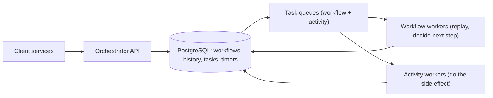

# Design a Workflow Orchestrator

> [!abstract] The product in one sentence
> Write a multi-step business process — onboard a customer, settle a batch, refund a payment — as ordinary code, and have it survive crashes, wait days for a timer or a human, retry each step, compensate on failure, and show every step's history.

> [!tip] How to use this note
> Every section below has **questions to settle** and **options with trade-offs**. Write *My decision and why* under each before looking at a reference solution. The goal is a design you can defend, not a design you can recite.

**Map:** [[Problem Bank MOC]] → [[HLD MOC]]

## Problem statement

Durable execution: persist workflow progress so a crashed worker resumes exactly where it stopped; timers that fire after days; activities with retries, timeouts and heartbeats; external signals; sagas with compensation. Hard parts: deterministic replay of workflow code, exactly-once *effects* from at-least-once activities, and scaling workers without two of them advancing the same workflow. Related: [[Design a Distributed Job Scheduler]] (the single-step cousin), [[Design a Payment System]] (the typical saga).

**Questions to settle:** Event-sourced replay (Temporal) or an explicit state machine (Step Functions)? Who owns idempotency — orchestrator or activity? Must workflows run for months, outliving several deploys?

## Product context and intended users

Backend teams running KYC onboarding, payouts, dunning, subscription billing. In fintech, "the refund workflow died at step 3" must be answerable in seconds, and step 3 must never happen twice.

## Functional requirements

- Define workflows as code; start with an id (deduplicated); signals and queries.
- Activities with retry policy, timeouts and heartbeat; durable timers; child workflows.
- Compensation on failure; history view; versioning of running workflows.
- **Questions to settle:** Code (expressive, needs determinism rules) or a DSL (inspectable, limited)?

## Non-functional requirements

- No lost progress after a crash; activities at-least-once with idempotent effects.
- 10k concurrent workflows, ~1k state transitions/s; history kept 90 days.
- **Questions to settle:** Is ~50 ms of persistence per transition acceptable to every team?

## Constraints and assumptions

- Workers die on every deploy; running workflows outlive the code that started them.
- Activity code is written by other teams and may not be idempotent — the platform must make that failure visible.

## Capacity estimation

| Quantity | Assumption | Result |
|---|---|---|
| Workflows | 1M/day × 10 steps | ~10M history events/day × 1 KB ≈ 10 GB/day |
| Transitions | ~1k/s peak | Each is one transaction: append events + enqueue next task |
| Timers | 500k pending (multi-day waits) | One indexed `fire_at` poll — same shape as the scheduler |

*(Redo with your own assumptions; the shape of the reasoning is the point.)*

## API design

```http
POST /v1/workflows { "type": "RefundPayment", "workflowId": "refund-ord-123", "input": { ... }, "taskQueue": "payments" } → 201 | 409 (already running)
POST /v1/workflows/refund-ord-123/signal { "name": "approved", "payload": { ... } } → 202
GET  /v1/workflows/refund-ord-123 → 200 { "state": "running", "currentStep": "credit_ledger", "history": [ ... ] }
POST /v1/task-queues/payments/poll  (worker, long-poll) → 200 { "taskToken": "...", "activity": "credit_ledger", "attempt": 2, "input": { ... } }
POST /v1/tasks/<token>/complete { "result": { ... } } → 204 | 409 (lease expired)
```

**Questions to settle:** Long-poll task queues (Temporal style) or push via SQS — who owns backpressure?

## Data model

`workflow(id, type, state, task_queue, version, started_at, closed_at)`; `history_event(workflow_id, seq, type, payload)` append-only — the source of truth, replayed to rebuild state ([[Event Sourcing]]); `task(id, workflow_id, kind, queue, lease_owner, lease_until, attempt)`; `timer(workflow_id, fire_at, seq)`. A snapshot every N events keeps replay cheap.

## High-level architecture



> [!example]- Excalidraw version — the same diagram as an editable canvas
> ![[Design a Workflow Orchestrator.excalidraw]]
> [[Design a Workflow Orchestrator.excalidraw|Open in Excalidraw]] — needs the Excalidraw plugin (see [[Plugins to Install]]).


## Component responsibilities

| Component | Owns | Does not own |
|---|---|---|
| History service | Events, tasks, timers, leases | Business logic |
| Workflow worker | Replay history, run deterministic code, emit commands | Side effects |
| Activity worker | Side effects, heartbeat, idempotency | Sequencing |
| Timer service | `fire_at` polling | Retry policy |

## Database selection and rationale

PostgreSQL: appending history and enqueueing the next task in one transaction is the atomicity that makes it durable ([[Transactions]]). Partition history by workflow id; archive closed workflows to object storage. Alternatives: Cassandra (Temporal's default — scale at operational cost), DynamoDB (conditional writes; limited transactions). Relational, sharded by workflow id when needed.

## Caching strategy

Workflow workers keep rebuilt state in memory (sticky execution) so replay only happens on failover; invalidated when a workflow moves. Nothing on the write path.

## Messaging and asynchronous processing

Task queues are orchestrator tables with leases and `FOR UPDATE SKIP LOCKED`, or an external queue ([[Message Queues]]). Activity tasks are at-least-once, so activities are idempotent on a key derived from workflow id and activity id, not attempt ([[Idempotency]]). Retries follow a per-activity policy with backoff ([[Retry Strategies]]); non-retryable failures trigger compensation ([[Saga Pattern]]).

## Scaling strategy

Workers are stateless and scale per task queue — a queue per domain is a [[Bulkheads|bulkhead]]. The history service shards by workflow id; a workflow never spans shards, so no cross-shard transaction exists. Timer scans partition the same way.

## Consistency requirements

At most one workflow task in flight per workflow: a lease plus fencing by event sequence, so two workers cannot both advance it ([[Distributed Locks]]). Workflow code must be deterministic — no wall clock, randomness or I/O outside activities ([[Clocks and Time]]); running instances are versioned with explicit branches. An activity completing with a stale lease gets 409; its side effect may already have happened, which is why idempotency is mandatory.

## Failure scenarios

| Failure | Impact | Detection | Mitigation |
|---|---|---|---|
| Worker dies mid-activity | Activity runs again | Heartbeat or lease expiry | Retry; idempotent activity; stale completion rejected |
| Non-deterministic code deployed | Replay diverges, workflows stuck | Replay mismatch error | Version branches; replay recorded histories in CI |
| Looping workflow grows history | Slow replay, huge rows | Events per workflow | Continue-as-new at N events; snapshots |

## Security considerations

Activities run under the owning team's identity, not the orchestrator's ([[Least Privilege]]). Inputs and results may contain PII — encrypt payloads, redact in the UI. Signals are authenticated. History is an audit trail: immutable, retained per policy ([[Audit Logs]]).

## Observability

Workflows by state and age (stuck beyond SLA), task-queue backlog and latency, activity failure rate by type, timer lag, replay time p99, history size. A per-workflow timeline, with workflow id as the trace id, pays for itself in the first incident ([[Distributed Tracing]]).

## Cost considerations

Database IOPS for history and the archive are the lines; worker compute belongs to the teams. This is a large build — price Temporal Cloud or Step Functions first ([[Build vs Buy Decisions]]).

## Architectural trade-offs

| Decision | Chosen | Rejected | Why |
|---|---|---|---|
| Replay-based execution vs explicit state machine | *(yours)* | | |
| Task queues in the database vs SQS | *(yours)* | | |
| Build vs Temporal | *(yours)* | | |

## Alternative designs

- **Choreography with events and per-service sagas** — no central service; the process is invisible and painful to debug ([[Event-Driven Architecture]]).
- **Managed DSL state machine (Step Functions)** — inspectable and operated for you; expressiveness limits and per-transition pricing.

## What I would implement first

History and task tables in PostgreSQL; long-poll task queues with leases; a tiny deterministic workflow SDK (activities, timers, signals) in Java or TypeScript; retries and compensation; a history viewer. Prove it with the refund saga.

## What I would defer

Child workflows, versioning tooling, sticky caching, sharding, a DSL, multi-region.

## Related

### Concepts
- [[Saga Pattern]] — compensation is a first-class step
- [[Event Sourcing]] — history is the state
- [[Idempotency]] — the activity's obligation under at-least-once
- [[Retry Strategies]] — per-activity policy with backoff
- [[Distributed Locks]] — one worker per workflow, fenced by sequence
- [[Clocks and Time]] — why workflow code cannot read the clock

### Projects
- [[Durable Job Scheduler]] — the single-step precursor to build first

### Resources
- [[Temporal Docs on Durable Execution]]
- [[microservices.io - Saga Pattern]]

## What I learned

*(Fill after a design session.)*

## What I would improve in a second iteration

*(Fill after a review or implementation.)*
