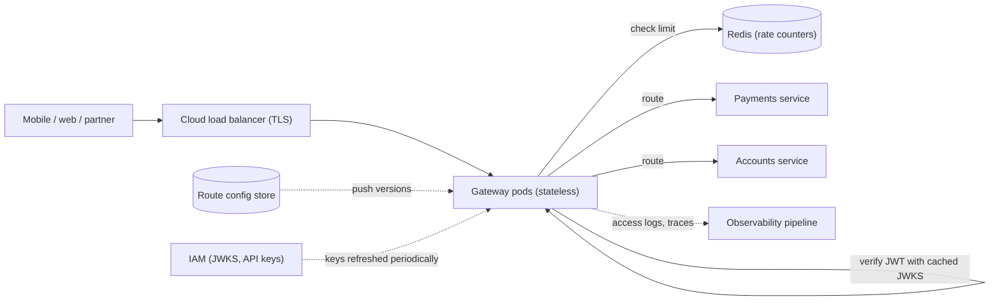

# Design an API Gateway

> [!abstract] The product in one sentence
> One edge layer that terminates client connections, verifies identity, enforces limits, routes to the right backend and records every request — adding a millisecond or two, not a new place for business logic to hide.

> [!tip] How to use this note
> Every section below has **questions to settle** and **options with trade-offs**. Write *My decision and why* under each before looking at a reference solution. The goal is a design you can defend, not a design you can recite.

> [!tip] Reference solution in your system-design vault
> `system-design/03 Traffic Management/API Gateway.md` — compare *after* you have written your own design.

**Map:** [[Problem Bank MOC]] → [[HLD MOC]]

## Problem statement

Mobile and web clients call dozens of backend services. Design the layer in front of them that handles TLS, routing, [[Authentication]], [[Rate Limiting]], request shaping, retries and observability once, so individual services do not ([[API Gateways]]). The limiter inside it is [[Design a Rate Limiter]]; the token issuer behind it is [[Design an IAM Service]].

**Questions to settle:** One gateway for everything, or one per client type (mobile BFF, partner API, internal)? Does it aggregate responses from several services, or strictly proxy? Who owns route config — platform or product teams?

## Product context and intended users

Platform-owned, used by every product team (routes, limits), security (auth policy), and external partners (API keys, versioned contracts). In fintech the gateway is also the audit choke point: every money-moving call passes through it, so its logs and identity propagation are compliance evidence.

## Functional requirements

- Route by path, host and header to backend services; weighted routing for canaries.
- Validate [[JWT]] or API keys, reject early, forward verified identity to backends.
- Per-client rate limits, request/response size limits, header transformation, CORS.
- **Questions to settle:** Response caching? Protocol translation (REST to [[gRPC]])? WebSocket pass-through?

## Non-functional requirements

- Added latency p99 under ~5 ms; no single instance holds state a request depends on.
- Availability higher than any backend — it is in front of all of them.
- Config changes live within seconds, with rollback.
- **Questions to settle:** Fail-open or fail-closed when the auth or limiter dependency is down?

## Constraints and assumptions

- Stateless instances on EKS behind a cloud [[Load Balancers|load balancer]]; TLS may terminate at either.
- Backends are discovered via Kubernetes services or a registry ([[Service Discovery]]).
- Token verification must be local (cached public keys), never a call per request.

## Capacity estimation

| Quantity | Assumption | Result |
|---|---|---|
| Traffic | 20k RPS average, 3× peak | 60k RPS; at ~5k RPS per pod, ~12 pods plus headroom |
| Latency budget | TLS + auth + limiter + proxy | ~0.3 + 0.1 + 1 + 0.5 ≈ 2 ms added |
| Config | 300 routes × 1 KB | Trivial; propagation is the problem, not size |
| Logs | 60k RPS × ~500 B | ~30 MB/s at peak — sample 2xx |

*(Redo with your own assumptions; the shape of the reasoning is the point.)*

## API design

The gateway's own API is its configuration:

```http
PUT /admin/routes/payments
{ "match": { "path": "/v1/payments/*" }, "upstream": "payments-svc:8080",
  "auth": "jwt", "rateLimit": "per-user-100rpm", "timeoutMs": 2000, "retries": 0 }
→ 200 { "version": 418 }

GET /admin/routes?version=418 → 200 { "routes": [...] }
```

**Questions to settle:** Declarative config in Git applied by CI, or a live admin API? Retries at the gateway at all — safe only for idempotent routes ([[Idempotency]]).

## Data model

`route(id, match, upstream, policies[], version)`; `consumer(api_key_hash, plan, limits)`; `policy(type, params)`. Routes are versioned as a whole snapshot so instances can report which version they serve ([[Versioning and Migrations]]).

## High-level architecture



## Component responsibilities

| Component | Owns | Does not own |
|---|---|---|
| Gateway pod | TLS, routing, auth check, limits, timeouts, logging | Business validation, data transformation beyond headers |
| Config control plane | Route versions, validation, rollout | Serving traffic |
| IAM | Issuing tokens, publishing keys | Enforcing per-route policy |
| Backends | Authorization decisions on resources | Rate limiting, client auth |

## Database selection and rationale

The gateway should need almost none. **Options:** config in Git plus a control-plane service (auditable, slower propagation); a small PostgreSQL for consumers and API keys, fully cached in the gateway; [[Redis]] for limiter counters only. **Decision to make:** Envoy, Kong or NGINX with plugins versus a Spring Cloud Gateway or NestJS service you fully control ([[Build vs Buy Decisions]]).

## Caching strategy

Cache JWKS public keys and API-key lookups in-process with a short TTL and background refresh ([[Cache-Aside]]). Route tables are fully in memory. Response caching for public `GET`s is tempting; keep it behind explicit per-route opt-in with `Cache-Control`, or it becomes an invisible correctness bug.

## Messaging and asynchronous processing

Access logs and audit events go out asynchronously to a [[Kafka]] topic or the log pipeline, never on the request path. Config propagation is push via [[Pub-Sub]] or a watch, with periodic pull as fallback. Nothing else should be async in a proxy.

## Scaling strategy

Horizontal, stateless pods on CPU and connection count; the load balancer spreads clients. The shared state is only the limiter's Redis ([[Distributed Caching]]). Keep upstream connections pooled per backend ([[Connection Pooling]]). The scaling risk is organisational: every team adds "just one plugin" until the gateway is a monolith on the critical path — bound plugins to a short approved list.

## Consistency requirements

Route and key config may be eventually consistent across instances for seconds; a mixed fleet during rollout must be acceptable. Revoked tokens are the exception: a short JWT lifetime plus a small revocation list checked locally, because a per-request revocation call defeats the design ([[Eventual Consistency]]).

## Failure scenarios

| Failure | Impact | Detection | Mitigation |
|---|---|---|---|
| Backend slow | Connections exhaust; every route degrades | Upstream p99, pool saturation | Per-route timeouts, [[Circuit Breakers|circuit breaker]], [[Bulkheads|bulkhead]] per upstream |
| Limiter Redis down | Checks error | Limiter error rate | Fail-open with alert; fail-closed for login |
| Bad config pushed | Routes vanish or misroute | Error spike after version change | Validate, canary one pod, instant rollback |
| JWKS refresh fails | New-key tokens rejected | Verification failure ratio | Keep last-good keys; overlap keys during rotation |

## Security considerations

The gateway is the trust boundary: strip client-supplied identity headers, set its own ([[Least Privilege]]); validate `iss`, `aud`, `exp` on every [[JWT]]; hash API keys at rest; enforce body size and [[Input Validation]] basics before backends see bytes. mTLS to backends so nothing bypasses the gateway. Rate limit login and OTP routes fail-closed.

## Observability

Per route: RPS, p50/p99, error ratio by status, upstream latency, retries, limiter denials. Per pod: connections, CPU, config version. Propagate trace and request ids into every backend ([[Distributed Tracing]]). Alert on error ratio per route and on config version skew across pods.

## Cost considerations

Compute is small relative to backends; logs are the surprise cost at scale — sample 2xx access logs, keep all 4xx/5xx. Managed gateways price per million requests, which flips the build/buy maths at high volume. The hidden cost is the platform team's time as the plugin list grows.

## Architectural trade-offs

| Decision | Chosen | Rejected | Why |
|---|---|---|---|
| Off-the-shelf proxy with plugins vs custom service | *(yours)* | | |
| One gateway vs BFF per client type | *(yours)* | | |
| Fail-open vs fail-closed per dependency | *(yours)* | | |

## Alternative designs

- **Service mesh sidecars** — auth, retries and telemetry per pod with no central hop; more uniform, but far more moving parts and no single place for client-facing policy.
- **Thin cloud gateway plus library** — the load balancer does TLS and routing; a shared middleware library in each service does auth and limits. Fewer hops, but N deployments per policy change.

## What I would implement first

Envoy or Spring Cloud Gateway with declarative routes in Git, local JWT verification with cached JWKS, per-route timeouts and breakers, a Redis-backed limiter failing open on ordinary routes, and per-route dashboards. No more plugins until someone proves a need.

## What I would defer

Response aggregation, caching, protocol translation, partner developer portal, multi-region routing.

## Related

### Concepts
- [[API Gateways]] — the pattern and its anti-patterns
- [[Rate Limiting]] — the first policy everyone asks for
- [[JWT]] — local verification and rotation
- [[Circuit Breakers]] — protection from slow backends
- [[Reverse Proxies]] — the mechanics underneath
- [[Service Discovery]] — finding upstreams
- [[Distributed Tracing]] — the gateway starts every trace

### Projects
- [[LLM Gateway]] — the same shape with token-based limits
- [[Rate Limiter Library]] — the limiter plugged in

### Resources
- [[Uber - Domain-Oriented Microservice Architecture]]
- [[JWT Best Current Practices RFC 8725]]
- [[AWS Builders Library - Load Shedding]]

## What I learned

*(Fill after a design session.)*

## What I would improve in a second iteration

*(Fill after a review or implementation.)*
