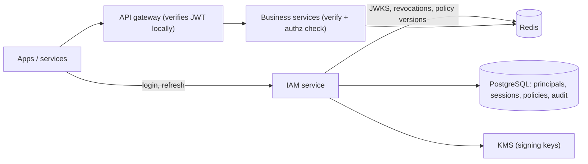

# Design an IAM Service

> [!abstract] The product in one sentence
> One service that proves who a caller is, says what they may do, issues short-lived tokens every other service can verify locally, rotates keys without downtime, and records every auth decision that matters.

> [!tip] How to use this note
> Every section below has **questions to settle** and **options with trade-offs**. Write *My decision and why* under each before looking at a reference solution. The goal is a design you can defend, not a design you can recite.

> [!tip] Reference solution in your system-design vault
> `system-design/11 Auth and IAM/Designing an IAM Service.md` — compare *after* you have written your own design.

**Map:** [[Problem Bank MOC]] → [[HLD MOC]]

## Problem statement

Centralize login for users and services, token issuance and verification, sessions and revocation, and authorization policy for N services. Hard parts: keeping verification local and fast while revocation still works, rotating signing keys safely, and a permission model that doesn't become a table of exceptions. Related: [[Design an API Gateway]] (where tokens are checked), [[Design a Feature Flag Service]] (policies distribute the same way).

**Questions to settle:** Stateless JWT or opaque tokens with introspection? RBAC, ABAC or relationship-based? Authoritative for identity, or federating to an external IdP?

## Product context and intended users

Every internal service, the mobile and web apps, partner APIs and ops. In fintech, auth decisions are audit evidence and step-up (OTP before a payout) is a product feature, not an afterthought.

## Functional requirements

- Login with password, OTP, OAuth; issue access and refresh tokens; service credentials.
- Permission check API; role and policy management; session list and revoke.
- Audit query: who did what, when, from where.
- **Questions to settle:** Multi-tenant orgs from day one? Step-up auth for money actions?

## Non-functional requirements

- Verification adds ≤ 1 ms inside each service (local); issuance p99 < 100 ms.
- Availability above every dependent; revocation effective within a minute.
- **Questions to settle:** What revocation latency is acceptable versus a check on every request?

## Constraints and assumptions

- Signing keys are the crown jewels; IAM down means everything is down.
- Tokens leak — into logs, URLs, crash reports. Short lifetimes are the defence.

## Capacity estimation

| Quantity | Assumption | Result |
|---|---|---|
| Verifications | 50k req/s across the fleet | Local JWT verify — zero load on IAM |
| Issuance | 200 logins/s + 2k refreshes/s | Small; bound by the sessions table |
| Audit events | 10M/day × 500 B | ~5 GB/day; a year hot, then archive |

*(Redo with your own assumptions; the shape of the reasoning is the point.)*

## API design

```http
POST /oauth/token { "grant_type": "password | refresh_token | client_credentials", ... }
→ 200 { "access_token": "<JWT, 10 min>", "refresh_token": "<opaque, 30 d, rotating>", "expires_in": 600 }
GET  /.well-known/jwks.json → 200 { "keys": [{ "kid": "2026-10", ... }, { "kid": "2026-09", ... }] }
POST /v1/authz/check { "subject": "user:42", "action": "payout:approve", "resource": "org:7/payout:99", "context": { "amount": 500000 } }
→ 200 { "allow": false, "reason": "requires_role:finance_admin", "policyVersion": 88 }
POST /v1/sessions/s_1/revoke → 204
```

**Questions to settle:** Roles inside the JWT (fast, stale for up to 10 minutes) or fetched at check time (fresh, a call)? Refresh-token rotation with reuse detection?

## Data model

`principal(id, type user|service, tenant_id, status)`; `credential(principal_id, kind, hash)`; `session(id, principal_id, refresh_hash, device, last_used, revoked_at)`; `role`, `role_binding(principal_id, role, scope)`; `policy(id, version, doc)`; `signing_key(kid, public_key, not_before, not_after)` with private material in a KMS, never in the database ([[Secrets Management]]); `audit_event(ts, actor, action, target, outcome, ip)` append-only.

## High-level architecture



## Component responsibilities

| Component | Owns | Does not own |
|---|---|---|
| IAM service | Issuance, sessions, key rotation, policy admin | Per-request verification |
| Verifier library | JWKS cache, claim checks, revocation set | Policy |
| Authorization engine | Policy evaluation, decision cache | Identity |
| Audit pipeline | Durable, append-only events | Retention decisions |

## Database selection and rationale

PostgreSQL for principals, sessions, bindings and policies: small, relational, transactional. Revocation set and JWKS in [[Redis]]. The decision that matters is ownership — no service keeps its own user table; IAM is the only owner of identity ([[Data Ownership and Lifecycle]]).

## Caching strategy

Each service caches JWKS (refetch on unknown `kid`), caches authz decisions for seconds keyed by subject, action, resource and policy version, and refreshes a small revocation set every 30 s ([[Cache-Aside]], [[TTL]]). Ten-minute access tokens bound the revocation window by construction.

## Messaging and asynchronous processing

Revocations and policy changes publish on a topic; services update local caches ([[Pub-Sub]]). Audit events go to Kafka and an immutable store — a slow database must never drop an audit event.

## Scaling strategy

Verification scales with the services, not IAM. IAM is stateless behind its database; sessions shard by principal. The one hot RPC is the authz check — keep it in a library with a cache and make the remote call the fallback.

## Consistency requirements

Access-token validity is eventually consistent by design: a revoked session's token lives up to 10 minutes unless the revocation set is checked. Refresh tokens are strictly consistent — a database row, rotated on every use; reuse of an old one revokes the whole family. Policy version travels in every decision so the audit trail says which policy allowed it.

## Failure scenarios

| Failure | Impact | Detection | Mitigation |
|---|---|---|---|
| IAM down | No logins or refreshes; existing tokens still verify | Health checks | Local verification carries traffic for ~10 min; multi-AZ |
| Signing key compromised | Forged tokens | Anomalous issuance, secret scanning | Publish new `kid`, keep old for verify only, then drop; force re-login |
| Revocation set lost | Revoked tokens accepted until expiry | Redis health | Short TTL bounds damage; rebuild from database |

## Security considerations

Short-lived [[JWT]] with `kid`, `aud`, `exp`; reject `alg: none`. Refresh tokens opaque, hashed at rest, rotated with reuse detection. mTLS or client credentials for services ([[OAuth]]). MFA and step-up for money actions. Login [[Rate Limiting]]. Scopes follow [[Least Privilege]]. Every grant, revoke and policy change in [[Audit Logs]]. Threat-model token theft explicitly ([[Threat Modeling]]).

## Observability

Login success and failure by reason, issuance rate, JWKS fetch errors in clients, authz deny rate by policy (a spike is a bad policy deploy), revocation propagation lag, credential-stuffing patterns. Audit completeness is itself an SLO.

## Cost considerations

A small service. KMS calls per signature become a real line at high issuance — sign with a key held in memory under KMS envelope encryption, not a KMS call per token. Audit storage grows linearly.

## Architectural trade-offs

| Decision | Chosen | Rejected | Why |
|---|---|---|---|
| Stateless JWT vs opaque tokens with introspection | *(yours)* | | |
| Roles in the token vs lookup at check time | *(yours)* | | |
| Build vs managed IdP (Cognito, Keycloak, Auth0) | *(yours)* | | |

## Alternative designs

- **Opaque tokens plus introspection** — instant revocation; every request costs a call or a cache, and IAM becomes the hottest service you run.
- **Managed IdP for identity, your own authz service** — most of the risk outsourced, the policy model stays yours; per-user pricing and lock-in ([[Build vs Buy Decisions]]).

## What I would implement first

Principals and sessions in PostgreSQL; the OAuth token endpoint with 10-minute JWTs and rotating refresh tokens; JWKS with two keys and a rotation runbook; a verifier library with JWKS and revocation-set caches; an RBAC check API; audit events via an outbox.

## What I would defer

ABAC and relationship-based policies, multi-tenant policy isolation, step-up flows, federation, passkeys.

## Related

### Concepts
- [[Authentication]] — proving who the caller is
- [[Authorization]] — the check API and policy model
- [[JWT]] — local verification, short lifetimes, `kid`
- [[OAuth]] — grant types and refresh rotation
- [[Secrets Management]] — private keys live in the KMS
- [[Audit Logs]] — every grant and revoke is evidence

### Projects
- *(none yet — propose one: a token service plus verifier library with a key-rotation test)*

### Resources
- [[JWT Best Current Practices RFC 8725]]
- [[OAuth 2.0 RFC 6749]]

## What I learned

*(Fill after a design session.)*

## What I would improve in a second iteration

*(Fill after a review or implementation.)*
