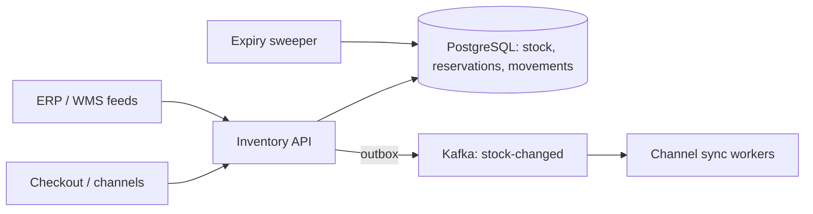

# Design an Inventory Management System

> [!abstract] The product in one sentence
> A service that answers "can I sell 3 of SKU X from warehouse W right now" correctly during a flash sale, holds stock for a checkout, commits it on payment, releases it on timeout, and keeps every channel's view close enough to true.

> [!tip] How to use this note
> Every section below has **questions to settle** and **options with trade-offs**. Write *My decision and why* under each before looking at a reference solution. The goal is a design you can defend, not a design you can recite.

**Map:** [[Problem Bank MOC]] → [[HLD MOC]]

## Problem statement

One source of truth for on-hand, reserved and available quantity per SKU per location; a reserve → commit/release flow; adjustments from receiving, returns and cycle counts; stock-changed events to storefront, marketplaces and ERP. Hard parts: contention on hot SKUs, never overselling, never losing stock to leaked reservations. Related: [[Design a Ticket Booking System]] (same hold-and-expiry mechanism), [[Design a Digital Wallet and Ledger]] (stock is a balance too).

**Questions to settle:** Is oversell ever acceptable (backorder) or absolute? Is "available" per warehouse, or global with allocation at reserve time? Are reservations soft (TTL) or hard until checkout finishes?

## Product context and intended users

Commerce platform, or a fintech shipping physical cards. Users: checkout, warehouse ops, channel integrations, finance — stock is a balance-sheet item, so adjustments need ledger-grade audit.

## Functional requirements

- Reserve N units with an idempotency key and TTL; commit; release; auto-expire.
- Adjust stock with reason code and actor; immutable movement log.
- Query availability; publish stock-changed events.
- **Questions to settle:** Partial reservation allowed? Multi-SKU cart reserved atomically?

## Non-functional requirements

- Reserve p99 < 50 ms; availability reads at ~10× the write rate.
- Zero oversell in absolute mode; movement log never lost; channel lag of seconds.
- **Questions to settle:** How stale may a marketplace listing be before it costs money?

## Constraints and assumptions

- A flash sale puts 95% of writes on 1% of SKUs.
- ERP feeds arrive late and out of order; checkout may die after reserving.

## Capacity estimation

| Quantity | Assumption | Result |
|---|---|---|
| Stock rows | 1M SKUs × 20 locations | 20M rows, ~4 GB with indexes — one PostgreSQL |
| Reservations | 2k/s peak, concentrated on hot SKUs | ~20 conditional updates/s on one hot row |
| Movements | 5M/day × 300 B | ~1.5 GB/day; partition by month, archive at 13 months |

*(Redo with your own assumptions; the shape of the reasoning is the point.)*

## API design

```http
POST /v1/reservations { "idempotencyKey": "order-123", "lines": [{ "sku": "S1", "locationId": "W7", "qty": 2 }], "ttlSec": 900 }
→ 201 { "reservationId": "rsv_9", "expiresAt": "..." } | 409 { "shortfall": [{ "sku": "S1", "available": 1 }] }
POST /v1/reservations/rsv_9/commit → 200        POST /v1/reservations/rsv_9/release → 200
POST /v1/stock/adjust { "sku": "S1", "locationId": "W7", "delta": -3, "reason": "damaged", "idempotencyKey": "cc-55" } → 200
GET  /v1/availability?sku=S1 → 200 { "byLocation": { "W7": 41 }, "total": 120 }
```

**Questions to settle:** Return the shortfall (helps the UI, leaks demand) or fail fast? Is commit called by checkout or driven by a payment-succeeded event?

## Data model

`stock(sku, location_id, on_hand, reserved, version)` — available is `on_hand − reserved`, computed, never stored; `reservation(id, idempotency_key UNIQUE, state, expires_at)` with lines; `movement(id, sku, location_id, delta, kind, ref_id, actor, created_at)` append-only. The movement log is the audit trail, and `on_hand` must equal the sum of movements — reconcile nightly ([[Data Modeling]]).

## High-level architecture



## Component responsibilities

| Component | Owns | Does not own |
|---|---|---|
| Inventory API | Reserve/commit/release, adjustments, idempotency | Pricing, order state |
| Expiry sweeper | Releasing expired reservations | Choosing TTLs |
| Channel sync | Pushing availability out, retries | Truth |
| Reconciliation | Movements vs on_hand, ERP diffs | Fixing silently |

## Database selection and rationale

PostgreSQL. The oversell guard is one conditional update inside the reservation transaction — `UPDATE stock SET reserved = reserved + 2 WHERE sku = … AND on_hand − reserved >= 2` — never read-then-write ([[Optimistic and Pessimistic Locking]], [[Transactions]]). Alternatives: Redis atomic decrement with the database behind (fast; two sources of truth); DynamoDB conditional writes (scales; multi-line carts are harder). Relational first; Redis only when the hot row shows lock waits.

## Caching strategy

Availability reads from a cache fed by stock-changed events; reserve decisions never come from cache. A cached "41 available" may be wrong and that is fine — the write is what is guarded ([[Cache-Aside]], [[Cache Invalidation]]).

## Messaging and asynchronous processing

Stock changes publish through the [[Outbox Pattern]] in the same transaction, so channels never see a change the database didn't commit. Channel sync is at-least-once; consumers dedupe on movement id ([[Duplicate Message Processing]]). ERP feeds are ingested as movements with sequence numbers, never as overwrites.

## Scaling strategy

Shard stock by SKU hash; one SKU lives on one shard. A multi-SKU cart then spans shards — reserve per line and release on partial failure, a small [[Saga Pattern]]. Hot SKUs: serialize reservation writes per SKU through a queue instead of letting 2k requests contend on one row ([[Hot Keys]]).

## Consistency requirements

Available quantity is strongly consistent at the write; everywhere else it is [[Eventual Consistency|eventually consistent]], and the API is what channels call when they need the truth. Reserve, commit, release and adjust are idempotent on the client key — a retried commit must not double-decrement ([[Idempotency]]). Global availability across locations is the hard case: allocate to one location at reserve time, or accept oversell risk with backorders.

## Failure scenarios

| Failure | Impact | Detection | Mitigation |
|---|---|---|---|
| Checkout dies after reserve | Stock locked, lost sales | Expired-reservation count | TTL sweeper; idempotent release |
| Outbox consumer lag | Channel sells against stale availability | Lag per topic | Channels reserve via the API, not the cache |
| ERP feed out of order | on_hand drifts from truth | Nightly reconcile diff | Sequence numbers; reject stale; adjustment movement with approval |

## Security considerations

Adjustments are money-adjacent: reason code, actor identity, two-person approval above a threshold ([[Least Privilege]]). The movement table is the audit log — append-only at the database-role level ([[Audit Logs]]).

## Observability

Reserve latency, 409 shortfall rate (a demand signal), expiry rate, outbox lag, reconcile diff count. The alert that matters: any row where `on_hand ≠ sum(movements)`.

## Cost considerations

One PostgreSQL and a few pods; the movement log is the storage line. The real cost is oversell apologies and sales lost to leaked holds — measure both.

## Architectural trade-offs

| Decision | Chosen | Rejected | Why |
|---|---|---|---|
| Conditional update in the database vs Redis counter on the hot path | *(yours)* | | |
| Per-location availability vs global with allocation | *(yours)* | | |
| Soft TTL reservation vs hard hold until checkout ends | *(yours)* | | |

## Alternative designs

- **Event-sourced inventory** — every movement is the state, balances are projections: perfect audit and replay, but "available now" needs a consistent projection ([[Event Sourcing]]).
- **Redis-first with write-behind to the database** — fastest reserve path; a Redis failover can lose reservations, so only with a durable movement log underneath.

## What I would implement first

Stock, reservation and movement tables in PostgreSQL; reserve as a conditional update in one transaction; TTL sweeper; outbox to Kafka; nightly reconcile of `on_hand` against movements.

## What I would defer

Multi-location allocation, backorders, the Redis hot path, bidirectional ERP sync.

## Related

### Concepts
- [[Optimistic and Pessimistic Locking]] — the conditional update is the oversell guard
- [[Idempotency]] — reserve, commit and adjust are all keyed
- [[Transactions]] — reservation row and stock update commit together
- [[Outbox Pattern]] — stock events only after commit
- [[Eventual Consistency]] — channels see a lagging view
- [[Hot Keys]] — the flash-sale SKU

### Projects
- *(none yet — propose one: a reservation service load-tested under contention with [[Load Test and Latency Lab]])*

### Resources
- [[PostgreSQL Transaction Isolation Docs]]
- [[AWS Builders Library - Idempotent APIs]]

## What I learned

*(Fill after a design session.)*

## What I would improve in a second iteration

*(Fill after a review or implementation.)*
