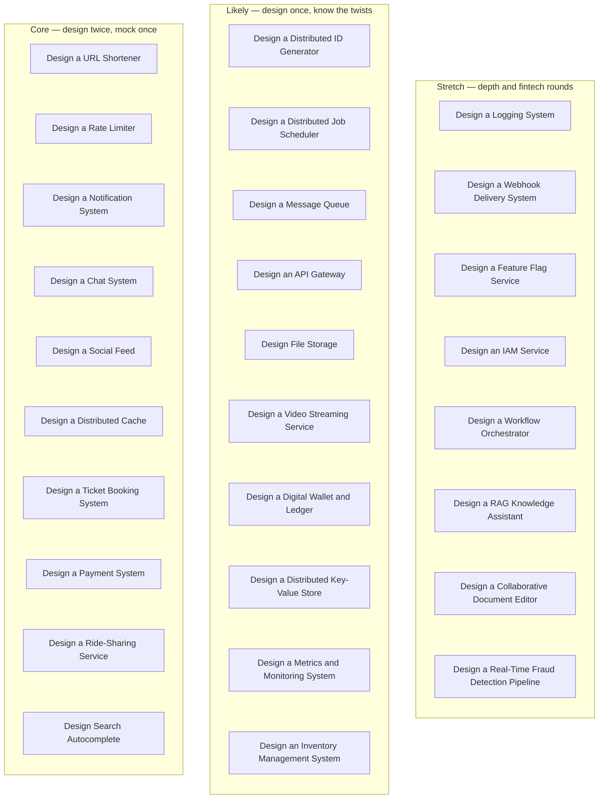

# System Design Problem Bank

> [!abstract] How these notes work
> Each problem note is a **decision sheet**, not a model answer. Every section lists the questions a strong interviewer asks and the options with their trade-offs; you write *my decision and why* before looking at any reference. Statuses: `not-started` → `exploring` (requirements and estimation done) → `designing` (architecture and trade-offs written) → `implementing` (a project builds it) → `reviewed` (compared with a reference or a person) → `needs-revision`. Track `confidence` separately, and set `last_worked` every time you touch one.

**Map:** [[HLD MOC]] · [[Start Here]] (which problems to do in which week) · [[Interview Prep MOC]] (tiers, probes per problem, the sprint) · [[Engineering Dashboard]]

> [!tip] Interview tiers
> Every problem carries `interview_tier`: **core** (ten problems to design twice and mock), **likely** (second-round material) or **stretch** (depth and fintech rounds). The live tables are in [[Interview Prep MOC]] and the per-problem probes in [[Interview Probe Questions]].

## How to run a 45-minute design session

1. Read only *Problem statement* and *Product context*. Close the note.
2. On paper or in Excalidraw: requirements (5 min) → numbers (5 min) → high-level architecture (15 min) → two deep dives on the riskiest parts (15 min) → failures and trade-offs (5 min).
3. Reopen the note and fill the *My decision and why* lines from what you drew. Only then open the *Reference solution* pointer, if there is one.
4. Set `status`, `confidence`, `last_worked`, and a `next_review` 2–4 weeks out.

## The bank at a glance

*Grouped by `interview_tier`; every box opens the problem. Design the core column twice under time before the sprint.*

> [!example]- Excalidraw version — the same diagram as an editable canvas
> ![[Problem Bank MOC.excalidraw]]
> [[Problem Bank MOC.excalidraw|Open in Excalidraw]] — needs the Excalidraw plugin (see [[Plugins to Install]]).

## Core systems

*The building blocks every other system is made of — expect one of these in most SDE-2 rounds.*

- [[Design a URL Shortener]] — Short links with redirects at scale: ID generation, 301 vs 302, read-heavy caching, analytics.
- [[Design a Rate Limiter]] — A distributed limiter deciding allow/deny in a millisecond: algorithms, shared counters, fail-open vs fail-closed.
- [[Design a Distributed Cache]] — A Redis-cluster-like cache: partitioning, replication, eviction, consistency, hot keys.
- [[Design a Notification System]] — Multi-channel notifications (push, SMS, email, in-app): fan-out, dedup, retries, preferences, rate limits.
- [[Design a Message Queue]] — A durable queue/log from first principles: storage, acks, visibility, ordering, consumer groups, replication.
- [[Design a Distributed ID Generator]] — Unique, roughly sortable 64-bit IDs across many nodes with no coordination on the hot path.
- [[Design an API Gateway]] — The edge: routing, auth, rate limiting, transformations, observability — and keeping it from becoming a monolith.
- [[Design a Distributed Job Scheduler]] — Cron at scale: scheduling, leases, exactly-once execution, retries, priorities, visibility into runs.

## Consumer and real-time systems

*Feeds, chat, booking, streaming, search, monitoring — read-heavy, fan-out-heavy, or latency-bound.*

- [[Design a Social Feed]] — Twitter/Instagram home timeline: fan-out on write vs read, ranking, the celebrity problem, pagination.
- [[Design a Chat System]] — 1:1 and group chat: WebSocket gateway, message storage and sync, presence, delivery receipts, offline users.
- [[Design a Ticket Booking System]] — Seat selection under contention: holds and expiry, overselling prevention, payment integration, flash-sale traffic.
- [[Design a Video Streaming Service]] — Upload → transcode → CDN → adaptive playback: pipelines, storage tiers, metadata, recommendations as a boundary.
- [[Design Search Autocomplete]] — Top-k suggestions per prefix in tens of milliseconds: tries vs precomputed tables, offline build, hot prefixes.
- [[Design a Metrics and Monitoring System]] — Collect, store and query time series from thousands of hosts: ingestion, TSDB, aggregation, alerting, retention.
- [[Design a Logging System]] — Centralised logs at scale: agents, buffering, indexing, search, retention tiers, cost control.

## Business-critical systems

*Money, inventory, files, rides — where correctness and auditability outrank raw scale.*

- [[Design a Payment System]] — Moving money correctly: idempotency, ledgers, PSP integration, reconciliation, exactly-once effects.
- [[Design an Inventory Management System]] — Stock levels across warehouses and channels: reservations, consistency, oversell prevention, eventual sync.
- [[Design File Storage]] — Dropbox/Drive: chunking, dedup, sync protocol, metadata service, sharing and permissions.
- [[Design a Ride-Sharing Service]] — Uber: location ingestion, geo-indexing, matching, trip state machine, surge, payments.

## Additional problems — fintech, AI, developer tools

*Chosen for your interests and your day job: ledgers, fraud, IAM, webhooks, flags, RAG, workflows, a KV store, co-editing.*

- [[Design a Digital Wallet and Ledger]] — Balances that are always right: double-entry ledger, idempotent transfers, holds, reconciliation, audit.
- [[Design a Real-Time Fraud Detection Pipeline]] — Score transactions in under 100 ms: streaming features, rules + models, feedback loops, false-positive cost.
- [[Design an IAM Service]] — Authentication and authorization as a platform: token issuance, key rotation, sessions, policies, audit.
- [[Design a Webhook Delivery System]] — Reliable outbound events to customer endpoints: at-least-once, retries with backoff, signing, DLQ, per-endpoint isolation.
- [[Design a Feature Flag Service]] — Evaluate flags in microseconds across many services: config distribution, targeting rules, audit, kill switches.
- [[Design a RAG Knowledge Assistant]] — Question answering over private documents: ingestion, chunking, embeddings, vector search, LLM streaming, evaluation.
- [[Design a Workflow Orchestrator]] — Durable multi-step workflows (Temporal-like): state persistence, timers, retries, sagas, worker scaling.
- [[Design a Distributed Key-Value Store]] — Mini-Dynamo: consistent hashing, replication, quorums, hinted handoff, anti-entropy — the capstone.
- [[Design a Collaborative Document Editor]] — Google-Docs-style real-time co-editing: OT vs CRDT, presence, conflict resolution, offline edits.

## Status board

![[Problems.base#All]]

## Related

- Concepts: [[HLD MOC]] · the chains in [[Knowledge Graph]]
- Build one: [[Projects MOC]]
- Reference solutions for many of these exist in your `system-design` vault (`15 Interview Playbook/`) — each problem note names its own.
