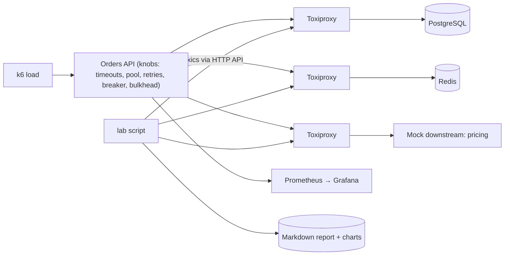

# Chaos Lab

> [!abstract] Why this project exists
> Every concept note in this vault has a *Failure modes* section, and almost none of those failures have been watched happening. A small lab — one service, its database, its cache, a proxy that can be told to misbehave, and a load generator — turns each failure mode into a 20-minute experiment with a chart. It is the cheapest project here and the one that moves the most notes from "can explain" to "have seen", which is exactly what an interviewer hears in your answers.

**Map:** [[Projects MOC]] → [[Engineering Dashboard]]

## Problem being solved

You cannot design for failures you have never observed. The lab makes the common ones reproducible on a laptop: a slow dependency filling a connection pool, a retry storm after a blip, a circuit breaker that never opens because its thresholds are wrong, a partition that leaves a cache serving stale data, a health check that lies. Each experiment has a hypothesis, a toxic, a measurement and a write-up — the same loop as a production incident, without the production.

## Intended users

- Kunal, running one experiment per week from the catalogue below and writing the result into the matching concept note's *Practical exercise* or *Personal understanding*.
- Every other project in this vault, which gets its failure-injection tests from the same stack.
- Teammates who want to see what a timeout setting actually does before changing it.

## Product requirements

- One `docker compose up` brings up the target service, PostgreSQL, Redis, Toxiproxy on both links, k6 and Grafana with a prebuilt dashboard.
- Experiments are scripts: `./lab run slow-db` applies the toxic, runs the load, captures the metrics window and writes a Markdown report with the charts.
- The target service is deliberately configurable: timeouts, pool sizes, retry policy, breaker thresholds and bulkhead limits all come from environment variables, so an experiment can be rerun with one knob changed.
- Each experiment states a hypothesis and the metric that confirms or refutes it.
- At least twelve catalogued experiments covering the Networking, Distributed Systems and Observability chains.
- Reports are reproducible: same toxic, same load profile, same duration.

## Minimum viable version

A Spring Boot "orders" API that reads from PostgreSQL and Redis and calls a mock downstream "pricing" service, all wired through Toxiproxy. A k6 script applies a steady load. The first experiment, `slow-db`, adds 500 ms latency on the database link and shows the connection pool saturating and p99 climbing; the second, `no-timeout`, removes the client timeout and shows the pool never recovering. Grafana panels: request rate, error rate, p50/p99, pool usage, breaker state.

- Compose stack with Toxiproxy on the DB, Redis and downstream links.
- Target service with every resilience knob in environment variables (Resilience4j for breakers and bulkheads).
- `lab` script: apply toxic, run k6, snapshot metrics, render report.
- Experiments 1–4: slow-db, no-timeout, retry-storm, breaker-opens.

## Architecture



> [!example]- Excalidraw version — the same diagram as an editable canvas
> ![[Chaos Lab.excalidraw]]
> [[Chaos Lab.excalidraw|Open in Excalidraw]] — needs the Excalidraw plugin (see [[Plugins to Install]]).


Later stages add a second API replica behind nginx (to watch health checks and load balancing under failure), a Kafka link for the messaging experiments, and the [[Mini-KV Store]] cluster as a target for partition experiments.

## Tech stack

- **Java 21 + Spring Boot + Resilience4j** — the target; see [[Resilience4j]].
- **Toxiproxy** — latency, jitter, bandwidth, timeout, reset and packet loss on each link; see [[Toxiproxy]].
- **k6** — load profiles as code; **Prometheus + Grafana** — the dashboard the reports screenshot.
- **Bash or TypeScript `lab` runner** — applies toxics through Toxiproxy's HTTP API and renders reports.
- **Docker Compose** — everything on one laptop.

## Data model

```text
Experiment (experiments/*.yaml):
  name: slow-db
  hypothesis: "With a 2 s client timeout and a 10-connection pool, 500 ms DB latency caps throughput at ~20 rps and p99 rises above 2 s"
  toxics: [{ proxy: db, type: latency, attributes: { latency: 500, jitter: 100 } }]
  knobs: { DB_TIMEOUT_MS: 2000, DB_POOL_SIZE: 10 }
  load: { rps: 100, duration: 3m }
  metrics: [http_req_duration p99, db_pool_active, http_req_failed]
Report: reports/<date>-<name>.md with charts and the hypothesis verdict
```

## APIs

```text
./lab list                         # catalogue
./lab run <experiment> [--knob K=V]
./lab compare <report-a> <report-b>
Toxiproxy: POST /proxies/{name}/toxics, POST /proxies/{name} {enabled:false}, POST /reset
Target: GET /orders/{id} (db + cache + downstream), GET /health/live, GET /health/ready
```

## Experiment catalogue

| # | Experiment | Concept notes it exercises | What you expect to see |
|---|---|---|---|
| 1 | slow-db | [[Timeouts and Retries]], [[Connection Pooling]] | pool saturates, p99 climbs, throughput caps |
| 2 | no-timeout | [[Timeouts and Retries]] | pool never recovers after the toxic is removed |
| 3 | retry-storm | [[Retry Storms]], [[Retry Strategies]] | 3 retries × 5 layers multiplies load; jitter flattens it |
| 4 | breaker-opens | [[Circuit Breakers]] | breaker opens at the configured error rate, half-open probes, recovery |
| 5 | bulkhead | [[Bulkheads]] | a slow downstream stops stealing threads from healthy endpoints |
| 6 | cache-down | [[Graceful Degradation]], [[Cache-Aside]] | DB load spikes when Redis dies; soft/hard TTL fallback |
| 7 | partition-redis | [[Network Partitions]] | reads time out versus serve stale, depending on policy |
| 8 | lying-health | [[Health Checks]], [[Load Balancers]] | a readiness check that ignores dependencies keeps a sick instance in rotation |
| 9 | reset-peer | [[TCP and UDP]], [[Keep-Alive Connections]] | pooled connections die silently; validation-on-borrow fixes it |
| 10 | slow-start | [[Retry Storms]], [[Backpressure]] | restarting under load triggers a thundering herd of reconnects |
| 11 | gc-pause | [[Distributed Locks]], [[Failure Detection]] | `kill -STOP` the service for 30 s: leases expire, health flaps |
| 12 | partial-partition | [[Split-Brain]], [[Quorums]] | with the Mini-KV cluster: two nodes see each other, the third sees neither |

## Relevant HLD concepts

- [[Timeouts and Retries]] — the first four experiments are this note made visible.
- [[Circuit Breakers]] and [[Bulkheads]] — thresholds you can tune and watch.
- [[Retry Storms]] — the amplification arithmetic from the AWS article, measured.
- [[Network Partitions]] — Toxiproxy `timeout` and `reset_peer` toxics as partition stand-ins.
- [[Graceful Degradation]] — what the service does when Redis or the downstream vanishes, by policy.
- [[Connection Pooling]] — pool size and timeout interactions are the most common production surprise.
- [[Health Checks]] — liveness versus readiness, and what a lying check costs.
- [[Failure Detection]] — suspicion timeouts under injected jitter.
- [[Fault Tolerance]] — the lab is where the word becomes specific.
- [[Production Incident Analysis]] — every report uses the incident write-up structure: hypothesis, timeline, evidence, change.
- [[Load Balancers]] — the two-replica stage shows how routing reacts to a sick instance.
- [[Testing Strategies]] — failure injection as a test type the other projects reuse.

## Milestones

> [!info] The loop
> 1. Build a working minimal version → 2. Measure its behaviour → 3. Identify bottlenecks and failure modes → 4. Improve the architecture based on evidence → 5. Document the trade-offs (an entry in `04 Projects/Decisions`).

- [ ] M1 — Minimal working version. Exit: stack up in one command; experiments 1–4 run and produce reports with charts; each report records the hypothesis verdict.
- [ ] M2 — Catalogue. Exit: experiments 5–10 implemented; one experiment per week written into the matching concept note.
- [ ] M3 — Cluster targets. Exit: experiments 11–12 against the [[Mini-KV Store]]; two API replicas behind nginx for the health-check experiment.
- [ ] M4 — Improved. Exit: one evidence-driven change to the *target service's* defaults (timeout, pool, breaker) with before/after reports — the lab recommending real settings.
- [ ] M5 — Documented. Exit: a "failure modes I have seen" summary note linking every report; ADR template for resilience settings.

## Current tasks

- [ ] Compose stack with Toxiproxy on three links and Grafana provisioning.
- [ ] Target service with environment-driven knobs and Resilience4j wiring.
- [ ] `lab` runner: toxics, k6 run, metrics snapshot, Markdown report.
- [ ] Experiments 1–4 as YAML with hypotheses.
- [ ] Baseline report with no toxics for comparison.

## Technical challenges

- [ ] Which toxic best approximates a real partition for a TCP client — `timeout` (black hole), `reset_peer`, or disabling the proxy — and do clients behave differently for each?
- [ ] How do you make experiments reproducible when k6, the JVM warm-up and Docker networking add their own noise? (Warm-up phase, repeat three times, report the median.)
- [ ] Can the lab prove a breaker threshold is *wrong* — never opens, or flaps — rather than just show it opening?
- [ ] What is the smallest set of Grafana panels that tells the story of every experiment?

## Testing strategy

- **Smoke** — the stack starts, the baseline passes its latency assertion, every toxic can be applied and reset.
- **Experiment assertions** — each YAML carries a k6 threshold that encodes the hypothesis (e.g. `p(99) > 2000`), so a run passes when the failure is reproduced.
- **Regression** — rerun the catalogue after changing the target's defaults; reports diff.

## Deployment plan

Laptop only. A `make demo` target runs experiments 1 and 4 back to back for a ten-minute walkthrough.

## Monitoring and observability

- Request rate, error rate, p50/p99 latency; pool active/idle/pending; breaker state; bulkhead rejections.
- Toxic currently applied (annotated on the Grafana timeline).
- JVM threads and GC pauses (experiment 11).

## GitHub repository

*(not created yet — suggested name: kunal/chaos-lab)*

## Live demo

*(none yet)* — `./lab run retry-storm` with and without jitter, two charts side by side.

## Performance considerations

The target must be fast enough that the toxic, not the service, is the bottleneck: keep handlers trivial and pre-warm the JVM before measuring.

## Lessons learned

*(Fill as you go.)*

## Future enhancements

- Kafka link and consumer-lag experiments for the [[Streaming Fraud Rules Engine]] — [[Backpressure]].
- Kubernetes version with pod kills and node pressure — [[Deployment and Rollback Strategies]].
- Automated weekly run that posts reports to the [[Personal Notification Hub]] — [[Alerting]].
- Game-day scripts for the team — [[Production Incident Analysis]].

## Related

### Design problems
- [[Design a Message Queue]]
- [[Design a Distributed Key-Value Store]]

### Also exercised
*Concept notes that point at this project but are not discussed above — the long tail of what building it will touch.*
- [[Availability]] · [[Bottleneck Analysis]] · [[Capacity Planning]] · [[Consumer Groups]] · [[DNS]] · [[Disaster Recovery]] · [[Distributed Tracing]] · [[Error Budgets]] · [[File Systems]] · [[Gossip Protocols]] · [[Kafka]] · [[Latency]] · [[Logging]] · [[Monitoring]] · [[Recovery Time Objective]] · [[Reliability]] · [[Replication]] · [[Reverse Proxies]] · [[Service Discovery]] · [[Synchronous vs Asynchronous Communication]]

### Decisions
- *(record ADRs in 04 Projects/Decisions using the Architecture Decision Template)*
