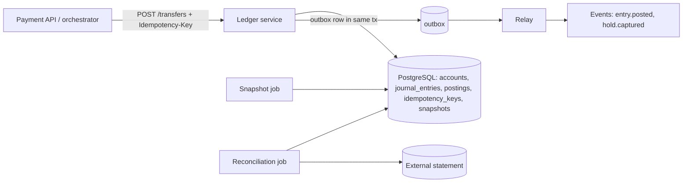

# Double-Entry Ledger Service

> [!abstract] Why this project exists
> You work in fintech, and the ledger is the one component where "eventually consistent" is a bug report. Interviewers for [[Design a Payment System]] push on exactly the things a ledger makes concrete: idempotent money movement, balances under concurrent writes, holds that expire, and how you prove the books balance. Build the ledger once, properly, with the tests that prove it, and every payment design you draw afterwards has a solid centre.

**Map:** [[Projects MOC]] → [[Engineering Dashboard]]

## Problem being solved

Money moves between accounts (customer wallets, merchant settlement, fees, suspense) and every movement must be recorded exactly once, balance to zero across its postings, be impossible to lose or silently change, and be reconstructible for an auditor years later. Balances must be fast to read without being wrong under concurrent transfers. Failed or partial operations across external systems (a card processor, a bank rail) must leave the ledger consistent through holds and reversals, never through edits.

## Intended users

- A wallet or payments team that needs `transfer`, `hold`, `capture`, `reverse` with guarantees it can state in writing.
- Finance and risk, who need daily reconciliation and an audit trail that cannot be rewritten.
- Kunal, to answer "how do you prevent double-spending with retries and concurrent requests?" with a design that has been load-tested.

## Product requirements

- Append-only: journal entries and postings are never updated or deleted; corrections are new entries.
- Every entry's postings sum to zero per currency; the database enforces it (a deferred constraint or a trigger), not only the application.
- Idempotent transfers: a retried `POST /transfers` with the same idempotency key returns the original result; concurrent duplicates get one entry.
- Holds (authorisations) reserve available balance with an expiry; capture and release are entries of their own.
- Available balance never goes below zero for customer accounts under concurrent transfers (proven by test), while settlement accounts may.
- Balance reads p99 under 10 ms at 1,000 transfers/s on a laptop, using snapshots plus a tail scan.
- Reconciliation job compares ledger balances against a simulated external statement and reports breaks.

## Minimum viable version

A Spring Boot service over PostgreSQL with four tables: `accounts`, `journal_entries`, `postings`, `idempotency_keys`. `POST /transfers` runs one transaction: insert the idempotency key (unique on `(actor, key)`; conflict → return stored response), lock the debited account row (`SELECT ... FOR UPDATE`) in a fixed account-id order to avoid deadlocks, check available balance, insert the entry and two postings, update cached balances, commit. A nightly-style `snapshot` job writes per-account balances at an entry id so reads scan only newer postings.

- Schema with a zero-sum check per entry and `CHECK (balance >= 0)` for customer accounts.
- Idempotent `POST /transfers` with stored responses and 409 on concurrent duplicates.
- Holds: `POST /holds`, `POST /holds/{id}/capture`, `POST /holds/{id}/release`, expiry sweeper.
- Balance endpoint from snapshot + tail; reconciliation CLI against a CSV "bank statement".

## Architecture



At the improved stage the outbox feeds downstream consumers (notifications, analytics), hot accounts (the fee account, a merchant with thousands of payments a minute) are measured and handled with balance shards or deferred aggregation, and read scaling moves balance reads to a replica with explicit staleness.

## Tech stack

- **Java 21 + Spring Boot + JDBC (no ORM for the hot path)** — the SQL is the design; keep it visible.
- **PostgreSQL** — row locks, deferred constraints, `SERIALIZABLE` where it matters; Flyway migrations.
- **Testcontainers + jqwik** — property tests that generate random transfer histories and check invariants.
- **k6** — concurrent transfer load including deliberate duplicates and races.
- **Micrometer + Grafana** — balance-read latency and lock wait time are the headline metrics.

## Data model

```sql
accounts(id, owner_type, currency, kind: customer|merchant|fee|suspense|settlement,
         balance NUMERIC(20,4), available NUMERIC(20,4), version BIGINT, CHECK (kind <> 'customer' OR available >= 0))
journal_entries(id BIGINT PK, external_ref, kind: transfer|hold|capture|release|reversal, posted_at, metadata jsonb)
postings(id, entry_id, account_id, amount NUMERIC(20,4), currency, INDEX (account_id, id))
-- deferred constraint: SUM(amount) per (entry_id, currency) = 0, checked at commit
holds(id, account_id, amount, status: open|captured|released|expired, expires_at, entry_id)
idempotency_keys(actor_id, key, request_hash, response_code, response_body, locked_at, created_at, UNIQUE (actor_id, key))
balance_snapshots(account_id, as_of_entry_id, balance, available, taken_at)
outbox(id, aggregate, type, payload, created_at, published_at)
```

## APIs

```http
POST /v1/transfers         Idempotency-Key: <uuid>   { from, to, amount, currency, ref } → 201 { entryId }
POST /v1/holds             Idempotency-Key: <uuid>   { account, amount, currency, expiresIn } → 201 { holdId }
POST /v1/holds/{id}/capture  Idempotency-Key       { amount? }  → 201 { entryId }
POST /v1/holds/{id}/release  Idempotency-Key                     → 201 { entryId }
POST /v1/entries/{id}/reverse Idempotency-Key                    → 201 { entryId }
GET  /v1/accounts/{id}/balance                                   → { balance, available, asOfEntryId }
GET  /v1/accounts/{id}/postings?cursor=
```

## Relevant HLD concepts

- [[Idempotency]] — keyed requests, stored responses, 409 for in-flight duplicates; see [[Brandur - Implementing Idempotency Keys]].
- [[Transactions]] and [[ACID]] — one transaction per money movement; atomicity is the product.
- [[Isolation Levels]] — what Read Committed lets through under concurrent transfers, and where `SERIALIZABLE` or explicit locks are required.
- [[Optimistic and Pessimistic Locking]] — row locks in account-id order versus a version column; measure both.
- [[Event Sourcing]] — the journal is the event log; balances are a derived view that can be rebuilt.
- [[Outbox Pattern]] — downstream events are committed with the entry, never published separately.
- [[Audit Logs]] — append-only tables plus hash chaining of entries make tampering detectable.
- [[Data Modeling]] — accounts, entries, postings: the double-entry model and why amounts are decimals.
- [[Distributed ID Generation]] — entry ids must be monotonic for snapshots to work; a sequence suffices on one database.
- [[Saga Pattern]] — holds, captures and reversals are the compensation steps of a payment saga.
- [[Exactly-Once Semantics]] — exactly-once *effect* comes from idempotency plus the outbox, not from a transport.
- [[Read Replicas]] and [[Sharding]] — where the design goes when one database is not enough, with the consistency cost named.

## Milestones

> [!info] The loop
> 1. Build a working minimal version → 2. Measure its behaviour → 3. Identify bottlenecks and failure modes → 4. Improve the architecture based on evidence → 5. Document the trade-offs (an entry in `04 Projects/Decisions`).

- [ ] M1 — Minimal working version. Exit: a property test of 100,000 random transfers, holds and reversals ends with every entry summing to zero and no customer balance below zero; duplicate requests produce one entry.
- [ ] M2 — Measured. Exit: transfer throughput and p99 latency at 1 account, 100 accounts and 10,000 accounts (hot-account versus spread); balance-read p99 with and without snapshots.
- [ ] M3 — Hot account. Exit: one account receiving 50% of all postings handled with an evidence-driven technique (deferred aggregation, balance shards or batched postings) within 2× the spread-case p99.
- [ ] M4 — Reconciled. Exit: reconciliation job finds every injected break (missing entry, amount drift, duplicate) in a 1-million-entry ledger in under a minute.
- [ ] M5 — Documented. Exit: ADRs for locking strategy, isolation level, idempotency retention and the hot-account technique; outbox feeding one consumer.

## Current tasks

- [ ] Flyway schema with the zero-sum deferred constraint and the non-negative customer balance check.
- [ ] `POST /transfers` with idempotency keys, ordered row locks and stored responses.
- [ ] Holds with expiry sweeper; capture and release as entries.
- [ ] Snapshot job and the snapshot-plus-tail balance read.
- [ ] jqwik property test generating random histories and checking invariants after every step.

## Technical challenges

- [ ] Under Read Committed, which exact interleaving lets two transfers overdraw an account without `FOR UPDATE`, and does the `CHECK` constraint catch it or merely abort one?
- [ ] At what postings-per-second does the fee account's row lock become the ceiling, and which hot-account technique keeps correctness simplest?
- [ ] How long should idempotency keys be retained — and what does a retry after expiry do to the books?
- [ ] Can balance reads on a replica be made safe by returning `asOfEntryId`, and when must a reader insist on the primary?

## Testing strategy

- **Unit** — posting arithmetic, decimal handling, hold state machine: pure, no I/O.
- **Property** — jqwik generates random operation sequences across accounts and asserts invariants (zero-sum, non-negative, idempotent replay) after each operation.
- **Concurrency** — 200 threads transferring between 10 accounts with 5% duplicates; assert exactly one entry per key and no overdraft.
- **Failure injection** — kill the service between the idempotency insert and the postings; restart; retried request completes once.

## Deployment plan

Docker Compose with the ledger, PostgreSQL, the relay, a consumer stub and k6. Optionally a managed PostgreSQL on AWS with a read replica to measure replica lag against `asOfEntryId`.

## Monitoring and observability

- Transfers by outcome (posted, duplicate-returned, rejected-insufficient, conflict) and p50/p99 latency.
- Lock wait time on account rows; the hot-account histogram.
- Balance-read latency and snapshot age.
- Reconciliation breaks found per run (any non-zero outside an experiment is an alert).
- Outbox lag (oldest unpublished row).

## GitHub repository

*(not created yet — suggested name: kunal/ledger)*

## Live demo

*(none yet)* — the k6 run with 5% duplicate requests and a Grafana panel showing entries posted = unique keys, plus the reconciliation report.

## Performance considerations

Everything funnels through row locks on the debited account; the design question is how much contention to accept before spreading it. Snapshots keep balance reads bounded; the snapshot cadence is a measured trade-off between read cost and job cost.

## Lessons learned

*(Fill as you go.)*

## Future enhancements

- Multi-currency with FX entries and a rate table — [[Data Modeling]].
- Hash-chained entries for tamper evidence — [[Audit Logs]].
- Sharding by account owner with cross-shard transfers via a saga — [[Sharding]], [[Saga Pattern]].
- Streaming the outbox into the [[Streaming Fraud Rules Engine]] — [[Change Data Capture]].

## Related

### Design problems
- [[Design a Payment System]]
- [[Design a Digital Wallet and Ledger]]
- [[Design a Ticket Booking System]]

### Also exercised
*Concept notes that point at this project but are not discussed above — the long tail of what building it will touch.*
- [[At-Least-Once Delivery]] · [[Authorization]] · [[Availability]] · [[BASE]] · [[Backups and Restoration]] · [[CQRS]] · [[Cache Consistency]] · [[Connection Pooling]] · [[Coordination vs Availability]] · [[Data Ownership and Lifecycle]] · [[Data Retention and Archival]] · [[Data Warehouses]] · [[Database Scaling]] · [[Delivery Semantics]] · [[Designing APIs and Contracts]] · [[Designing Systems for Changing Requirements]] · [[Designing for Maintainability]] · [[Disaster Recovery]] · [[Distributed Locks]] · [[Distributed Transactions]] · [[Domain-Driven Design]] · [[Duplicate Message Processing]] · [[Encryption at Rest and in Transit]] · [[Evaluating Architectural Complexity]] · [[Event Schema Evolution]] · [[Event Schemas]] · [[Functional vs Non-Functional Requirements]] · [[Hexagonal Architecture]] · [[Incremental Delivery]] · [[Indexing]] · [[Least Privilege]] · [[Modular Monoliths]] · [[Monoliths]] · [[Object Storage]] · [[Ordering Guarantees]] · [[PACELC]] · [[Query Execution and Optimization]] · [[REST]] · [[Recovery Point Objective]] · [[Recovery Time Objective]] · [[Relational Database Internals]] · [[Reliability]] · [[SQL vs NoSQL]] · [[Schema Evolution]] · [[Separation of Concerns]] · [[Synchronous vs Asynchronous Communication]] · [[Technical Debt]] · [[Testing Strategies]] · [[Threat Modeling]] · [[Versioning and Migrations]]

### Decisions
- *(record ADRs in 04 Projects/Decisions using the Architecture Decision Template)*
