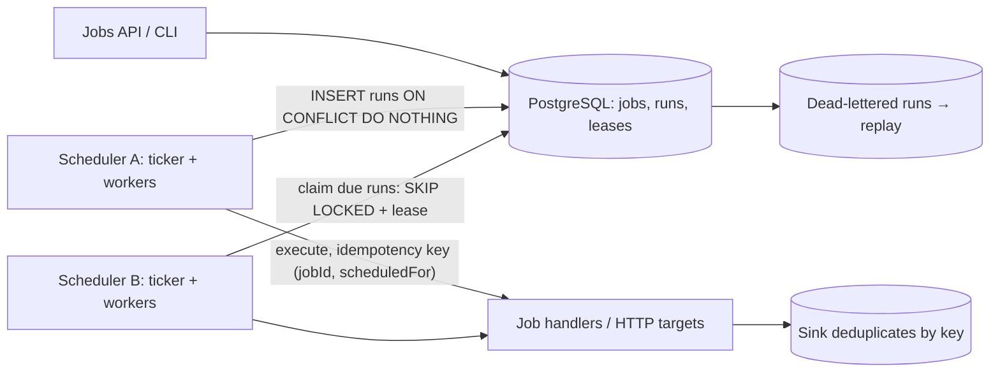

# Durable Job Scheduler

> [!abstract] Why this project exists
> "Design a distributed job scheduler" is a favourite because it hides three hard problems in a familiar wrapper: making sure a job runs once even with several schedulers, making retries safe, and dealing with time (cron, time zones, missed ticks after an outage). Most teams reach for a queue and a leader election immediately; this project starts with one database table and adds machinery only when a measurement says the table is not enough — which is the engineering judgement the interview is testing.

**Map:** [[Projects MOC]] → [[Engineering Dashboard]]

## Problem being solved

Services need recurring and one-off jobs — nightly reconciliation, hourly digests, delayed webhooks — to run on time, exactly once per scheduled tick, with retries and a visible history, across several scheduler instances for availability. The system must cope with schedulers crashing mid-run, clocks that disagree, jobs that overrun their interval, and a backlog after an outage, and it must make all of that observable from one table.

## Intended users

- Teams replacing `@Scheduled` annotations that silently run on every pod.
- The [[Personal Notification Hub]] and [[Double-Entry Ledger Service]] projects (digests and snapshots are scheduled jobs).
- Kunal, to answer "how do you guarantee a job runs exactly once?" with leases, idempotency keys and a test that kills the scheduler mid-run.

## Product requirements

- Jobs defined by cron expression (with time zone) or a one-off `run_at`; schedule changes take effect without restart.
- Each scheduled tick runs at most once across all scheduler instances, and at least once eventually (unless cancelled) — proven under crashes.
- Execution is idempotent by `(jobId, scheduledFor)`; the handler receives that key and the run is deduplicated at the sink.
- Retries with backoff and a maximum attempt count; exhausted runs land in a dead-letter state with manual replay.
- Overlap policy per job: skip, queue or allow; misfire policy after downtime: run once, run all missed, or skip.
- Tick latency p99 under 2 s for 1,000 jobs due in the same minute, on a laptop.
- Full run history with status, attempts, duration, worker and error, queryable per job.

## Minimum viable version

A Spring Boot service with PostgreSQL tables `jobs`, `runs` and `leases`. A ticker thread on every instance computes due runs every second: `INSERT INTO runs ... ON CONFLICT (job_id, scheduled_for) DO NOTHING` so concurrent instances cannot create duplicate ticks. Workers claim due runs with `SELECT ... FOR UPDATE SKIP LOCKED`, set a lease (`leased_until`), execute the handler (an HTTP call or an in-process bean), extend the lease while running, and record the outcome. Expired leases are reclaimed by any instance. Handlers get the idempotency key and a sample sink deduplicates on it.

- Schema and the duplicate-proof tick insertion.
- Claim loop with leases, heartbeat extension and reclaim of expired leases.
- Retry with exponential backoff and a dead-letter state; `POST /runs/{id}/replay`.
- Cron parsing with time zones; misfire policy `run_once_after_downtime`.

## Architecture



At the improved stage the project measures where the single-table design stops: when the claim query becomes the bottleneck, when leases need a dedicated lock service ([[Lock Service with Fencing Tokens]]), and whether a leader-elected ticker beats every-instance-ticks-with-conflicts. Only if the numbers demand it does a queue (Redis Streams or SQS) carry run execution.

## Tech stack

- **Java 21 + Spring Boot + JDBC** — the claim loop is SQL; keep it readable.
- **PostgreSQL** — jobs, runs, leases and history in one place; partitioned `runs` by month in M4.
- **cron-utils** for parsing and next-execution computation with zones.
- **Testcontainers + a crash-injecting test harness** — kill the JVM between claim and completion.
- **Grafana** — tick latency, backlog and lease reclaims.

## Data model

```sql
jobs(id, name, schedule_cron, timezone, run_at, handler, payload jsonb, overlap_policy, misfire_policy,
     max_attempts, backoff jsonb, enabled, next_run_at, updated_at)
runs(id, job_id, scheduled_for, status: due|running|succeeded|failed|dead, attempt, leased_by, leased_until,
     started_at, finished_at, error, idempotency_key, UNIQUE (job_id, scheduled_for), INDEX (status, scheduled_for))
run_log(run_id, attempt, worker, started_at, finished_at, outcome, error)
```

## APIs

```http
POST /v1/jobs            { name, schedule: "0 */5 * * * *", timezone: "Asia/Kolkata", handler: "http", payload: { url } }
PATCH /v1/jobs/{id}      { enabled, schedule, overlapPolicy, misfirePolicy }
POST /v1/jobs/{id}/trigger            → ad-hoc run now (own idempotency key)
GET  /v1/jobs/{id}/runs?status=&since=
POST /v1/runs/{id}/replay             → re-queue a dead run
Handler contract: POST {url}  Headers: X-Job-Id, X-Scheduled-For, Idempotency-Key  → 2xx success, 5xx retry, 4xx dead
```

## Relevant HLD concepts

- [[Distributed Locks]] — leases on runs; what a lease without a fencing token can and cannot guarantee.
- [[Leader Election]] — a single ticker versus every instance ticking with conflict resolution; M3 compares them.
- [[Idempotency]] — `(jobId, scheduledFor)` as the key; the sink dedupes; retries become safe.
- [[At-Least-Once Delivery]] — a crash after the handler succeeded but before the record is written means a second execution; the design must survive it.
- [[Retry Strategies]] — backoff with jitter per run; attempts capped.
- [[Dead-Letter Queues]] — dead runs are rows with a replay action, not log lines.
- [[Clocks and Time]] — cron in time zones, DST transitions, and schedulers whose clocks disagree by seconds.
- [[Optimistic and Pessimistic Locking]] — `SKIP LOCKED` is pessimistic; the lease heartbeat is a lightweight optimistic check.
- [[Transactions]] — claim and lease in one transaction; completion and next-run computation in another.
- [[Message Queues]] — the `runs` table is a queue; the M4 question is whether it should be.
- [[Outbox Pattern]] — handlers that publish events should do so via an outbox, keyed by the run.
- [[Operational Simplicity]] — one database, one table to look at when something is wrong.
- [[Split-Brain]] — two tickers believing they are alone is harmless only because of the unique constraint.

## Milestones

> [!info] The loop
> 1. Build a working minimal version → 2. Measure its behaviour → 3. Identify bottlenecks and failure modes → 4. Improve the architecture based on evidence → 5. Document the trade-offs (an entry in `04 Projects/Decisions`).

- [ ] M1 — Minimal working version. Exit: 100 jobs on various crons run for an hour across two instances with zero duplicate ticks and zero missed ticks; a scheduler killed mid-run is reclaimed and the run completes once at the sink.
- [ ] M2 — Measured. Exit: tick latency p50/p99 with 100, 1,000 and 10,000 jobs due in the same minute; claim-query cost versus worker count; backlog drain rate after a 10-minute outage under each misfire policy.
- [ ] M3 — Coordination compared. Exit: every-instance ticking versus a leader-elected ticker measured for duplicate attempts (conflicts) and tick latency; decision recorded.
- [ ] M4 — Improved. Exit: one evidence-driven change (partitioned runs, batched claims, or a queue for execution) with before/after data.
- [ ] M5 — Documented. Exit: ADRs for execution guarantee, lease design, misfire and overlap defaults; run-history retention policy.

## Current tasks

- [ ] Schema with the `(job_id, scheduled_for)` unique constraint and the status index.
- [ ] Ticker computing due runs per second with cron-utils and time zones.
- [ ] Claim loop with `SKIP LOCKED`, lease heartbeat and expired-lease reclaim.
- [ ] HTTP handler with the idempotency header and a deduplicating sample sink.
- [ ] Crash-injection test harness and the two-instance Compose setup.

## Technical challenges

- [ ] What lease length and heartbeat interval minimise both duplicate execution (reclaimed too early) and delayed recovery (reclaimed too late), under 200 ms GC pauses?
- [ ] How should a DST transition be handled for a 02:30 daily job in Asia/Kolkata versus Europe/Berlin — and does the library agree with the policy?
- [ ] At what job count does `SELECT ... SKIP LOCKED` on one table degrade, and does an index on `(status, scheduled_for)` or batching claims fix it first?
- [ ] Is a leader-elected ticker simpler or more fragile than letting every instance tick and relying on the unique constraint?

## Testing strategy

- **Unit** — next-run computation across zones and DST, backoff schedule, misfire policies with a fake clock.
- **Integration** — Testcontainers PostgreSQL: concurrent claims, lease expiry and reclaim, replay of dead runs.
- **Crash** — harness kills the process at each of five points in the run lifecycle and asserts the sink saw exactly one effect per tick.
- **Load** — 10,000 jobs due at once; assert tick latency and no lost runs.

## Deployment plan

Docker Compose with two scheduler instances, PostgreSQL, the sample sink and Grafana. A Kubernetes deployment with three replicas and a chaos test that deletes a pod every few minutes is the realistic validation.

## Monitoring and observability

- Tick latency (scheduled_for → started_at) p50/p99 and backlog of due runs (alert above 60 s).
- Runs by status; dead-letter rate; replays.
- Lease reclaims per hour (each one is a scheduler that died or stalled).
- Claim-query latency and rows locked per claim.

## GitHub repository

*(not created yet — suggested name: kunal/durable-cron)*

## Live demo

*(none yet)* — two schedulers running, one killed with `kill -9` mid-run, the run history showing the reclaim and the sink showing one effect.

## Performance considerations

Everything runs through one `runs` table: keep the claim query index-only, batch claims per worker, and partition history by month so the hot set stays small. Only after those are exhausted does execution move to a queue.

## Lessons learned

*(Fill as you go.)*

## Future enhancements

- Job dependencies and DAGs, which is where this becomes [[Design a Workflow Orchestrator]] — [[Saga Pattern]].
- Priority and per-tenant fairness — [[Bulkheads]].
- Fencing tokens from the [[Lock Service with Fencing Tokens]] on handlers that cannot deduplicate — [[Distributed Locks]].
- A Temporal comparison for the same workload — [[Temporal]].

## Related

### Design problems
- [[Design a Distributed Job Scheduler]]
- [[Design a Workflow Orchestrator]]

### Also exercised
*Concept notes that point at this project but are not discussed above — the long tail of what building it will touch.*
- [[ACID]] · [[Backups and Restoration]] · [[Data Retention and Archival]] · [[Delivery Semantics]] · [[Distributed Transactions]] · [[Duplicate Message Processing]] · [[Evaluating Architectural Complexity]] · [[Hexagonal Architecture]] · [[Indexing]] · [[Isolation Levels]] · [[Modular Monoliths]] · [[Monoliths]] · [[Relational Database Internals]] · [[Schema Evolution]] · [[Versioning and Migrations]]

### Decisions
- *(record ADRs in 04 Projects/Decisions using the Architecture Decision Template)*
