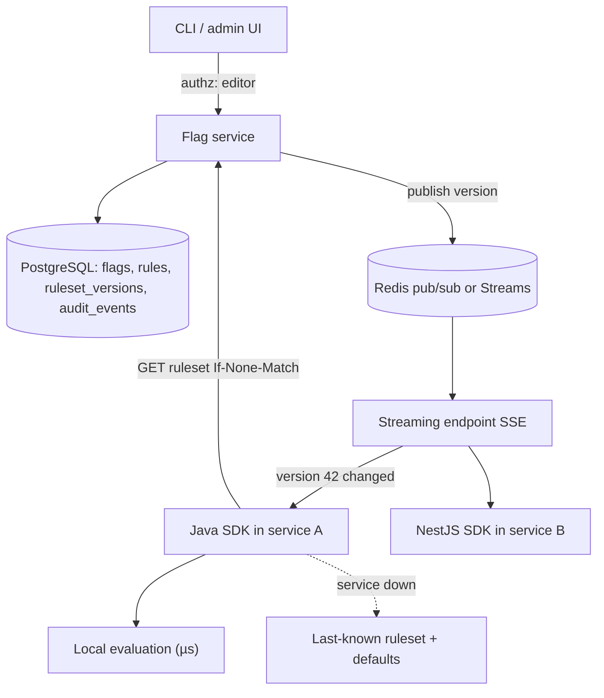

# Feature Flag Service and SDK

> [!abstract] Why this project exists
> Feature flags are the mechanism behind safe deploys, gradual rollouts and kill switches, and the design problem hides a good caching question: the SDK must answer in microseconds, agree across thousands of instances within seconds of a change, and keep working when the flag service is down. Build the service and the SDK, measure propagation, and compare it against [[Unleash Feature Flags]] to make [[Build vs Buy Decisions]] a real exercise rather than a slide.

**Map:** [[Projects MOC]] → [[Engineering Dashboard]]

## Problem being solved

Teams need to turn features on for a percentage of users, specific accounts or environments without deploying, see who changed what and when, and trust that the flag check never slows a request or fails it. The SDK therefore evaluates locally against a cached ruleset; the service's job is to distribute ruleset changes quickly and safely, record every change, and expose a small management API with proper authorization.

## Intended users

- Application teams embedding the SDK in Spring Boot and NestJS services.
- Product and release managers flipping flags from a UI or CLI, with an audit trail.
- Kunal, to answer "how does a flag change reach 500 pods in under five seconds without a request-path dependency?" with a measured number.

## Product requirements

- Flag types: boolean, percentage rollout (stable per user via hashing), variant (A/B), and targeting rules (attribute match, allow-lists, environments).
- SDK evaluation p99 under 50 µs with no network call on the request path; a cold SDK starts from a bundled or last-known ruleset.
- Propagation: a change reaches 95% of connected SDKs within 5 s (streaming) and 100% within one poll interval (fallback).
- Service unavailability degrades to the last-known ruleset and a configured default per flag, never to errors.
- Every change is an audit event with actor, before and after, and reason; rulesets are versioned and roll back by version.
- Management API with role-based authorization (viewer, editor per project, admin); SDK keys are per environment and revocable.
- Ruleset schema evolves without breaking older SDKs (additive fields, unknown rule types ignored safely).

## Minimum viable version

A Spring Boot service with PostgreSQL: `projects`, `environments`, `flags`, `rules`, `ruleset_versions`, `audit_events`. Every change bumps the environment's ruleset version and writes an audit row in the same transaction. SDKs authenticate with an environment key and `GET /sdk/ruleset` with an `If-None-Match` ETag; the Java SDK polls every 30 s, evaluates locally, and exposes `isEnabled(flag, context)` and `variant(flag, context)`. A CLI flips flags and prints the audit log.

- Schema, versioned rulesets and audit rows in one transaction.
- Ruleset endpoint with ETag; Java SDK with polling, local evaluation and defaults.
- Percentage rollout by consistent hashing of `(flagKey, userId)` into 10,000 buckets.
- CLI for create, toggle, rollout percentage and audit listing.

## Architecture



> [!example]- Excalidraw version — the same diagram as an editable canvas
> ![[Feature Flag Service and SDK.excalidraw]]
> [[Feature Flag Service and SDK.excalidraw|Open in Excalidraw]] — needs the Excalidraw plugin (see [[Plugins to Install]]).


At the improved stage the service pushes change notifications over server-sent events (SDKs then fetch the new version), a CDN or edge cache fronts the ruleset endpoint for thousands of SDKs, and a TypeScript SDK proves the ruleset contract is language-neutral. Measurement focuses on propagation time and on what happens during a flag service outage.

## Tech stack

- **Java 21 + Spring Boot** — the service and the primary SDK (a plain library with no Spring dependency).
- **TypeScript SDK** — for NestJS services; same evaluation test suite as the Java SDK.
- **PostgreSQL** — rulesets and audit; **Redis** pub/sub for change notifications in M3.
- **Testcontainers + k6** — propagation measurement with hundreds of simulated SDK clients.
- **Unleash in Docker** — the buy-side comparison for M5.

## Data model

```sql
projects(id, name)
environments(id, project_id, name, sdk_key_hash, ruleset_version)
flags(id, project_id, key, type: boolean|percentage|variant, default_value, description, archived_at)
rules(id, flag_id, environment_id, position, condition jsonb, serve jsonb, rollout_pct, enabled)
ruleset_versions(environment_id, version, ruleset jsonb, created_at, created_by)   -- immutable snapshots
audit_events(id, actor_id, environment_id, flag_key, action, before jsonb, after jsonb, reason, created_at)
users(id, email) · roles(user_id, project_id, role: viewer|editor|admin)
```

## APIs

```http
GET  /sdk/v1/ruleset            Authorization: Bearer env_...   If-None-Match: "42" → 304 | 200 { version, flags[...] }
GET  /sdk/v1/stream             SSE: { version: 43 } on change, heartbeat every 15 s
POST /api/v1/flags              { key, type, default }      (editor)
PUT  /api/v1/flags/{key}/rules  { rules[], reason }         (editor) → new ruleset version
POST /api/v1/environments/{id}/rollback { version }         (admin)
GET  /api/v1/audit?flag=&since=
```

```java
FlagClient flags = FlagClient.builder().sdkKey(key).pollInterval(Duration.ofSeconds(30)).defaults(Map.of("new-checkout", false)).build();
if (flags.isEnabled("new-checkout", Context.user(userId).attr("country", "IN"))) { ... }
```

## Relevant HLD concepts

- [[Feature Flags]] — categories, lifetimes and the carrying cost; the service enforces expiry reminders.
- [[Cache-Aside]] and [[Cache Invalidation]] — the SDK is a cache of the ruleset; version numbers plus notifications are the invalidation scheme.
- [[Cache Consistency]] — instances may disagree for a few seconds; the design states the bound and measures it.
- [[Pub-Sub]] — change notifications fan out to SDKs; the ruleset itself is fetched, not pushed, to keep payloads small.
- [[Audit Logs]] — the audit row and the ruleset version are written in one transaction, or the trail is worthless.
- [[Authorization]] — roles per project; SDK keys are read-only credentials per environment.
- [[Backward Compatibility]] — old SDKs must tolerate new rule types; the ruleset schema is versioned.
- [[Designing for Extensibility]] — rule conditions are data, so new targeting attributes need no SDK release.
- [[Build vs Buy Decisions]] — M5 writes the comparison against Unleash honestly.
- [[Multi-Level Caching]] — SDK memory → edge cache → service → database; each level has a staleness bound.

## Milestones

> [!info] The loop
> 1. Build a working minimal version → 2. Measure its behaviour → 3. Identify bottlenecks and failure modes → 4. Improve the architecture based on evidence → 5. Document the trade-offs (an entry in `04 Projects/Decisions`).

- [ ] M1 — Minimal working version. Exit: boolean, percentage and targeting flags evaluate identically in the Java SDK and a reference evaluator; audit log complete for every change.
- [ ] M2 — Measured. Exit: SDK evaluation p99; propagation time to 200 simulated SDKs with 30 s polling; service CPU per 1,000 SDKs polling.
- [ ] M3 — Streaming. Exit: SSE notifications bring 95% propagation under 5 s; SDKs survive a 10-minute service outage on last-known rulesets with zero evaluation errors.
- [ ] M4 — Improved. Exit: one evidence-driven change (ETag-cached rulesets behind a CDN, delta updates, or per-flag streaming) with before/after data.
- [ ] M5 — Documented. Exit: ADRs for evaluation locality, propagation design and audit guarantees; build-versus-buy write-up against Unleash with the same workload.

## Current tasks

- [ ] Schema, ruleset snapshots and audit events in one transaction.
- [ ] Ruleset endpoint with ETag and the environment-key authentication.
- [ ] Java SDK: polling, local evaluation, percentage hashing, defaults and last-known fallback.
- [ ] CLI for flag management and audit listing.
- [ ] Simulated SDK fleet and the propagation measurement harness.

## Technical challenges

- [ ] What hashing scheme keeps a user's percentage-rollout assignment stable when the percentage changes from 10% to 20% (nobody drops out)?
- [ ] During a flag service outage, should a brand-new instance start with bundled defaults or refuse to start — and who decides per flag?
- [ ] How large does a ruleset get before polling 1,000 SDKs every 30 s is a cost problem, and do deltas or a CDN fix it better?
- [ ] How do you guarantee two SDK languages evaluate rules identically — a shared conformance suite, or a shared evaluator in WebAssembly?

## Testing strategy

- **Unit** — rule evaluation, percentage bucketing, default handling: a conformance fixture set shared by both SDKs.
- **Integration** — Testcontainers PostgreSQL: version bump and audit in one transaction; rollback restores an exact earlier ruleset.
- **Propagation** — the simulated fleet records when each SDK sees version N; the harness reports the distribution.
- **Failure injection** — service down, slow, or returning malformed rulesets; SDK keeps serving last-known values.

## Deployment plan

Docker Compose with the service, PostgreSQL, Redis, two sample apps (Java, NestJS) and the simulated fleet; Unleash alongside for the comparison. One Kubernetes deployment to see what rolling restarts do to SSE connections.

## Monitoring and observability

- Propagation time distribution per change (the headline metric).
- SDK fleet: connected streams, poll rate, ruleset version histogram (how many instances lag).
- Evaluation errors and fallback-to-default counts per flag.
- Audit events per day and flags past their expiry date.

## GitHub repository

*(not created yet — suggested name: kunal/flagd-lite)*

## Live demo

*(none yet)* — flip a flag in the CLI and watch 200 simulated SDKs change colour on a grid within seconds; then stop the service and show evaluations continuing.

## Performance considerations

Evaluation must be a pure in-memory function; anything that touches I/O on the request path is a bug. The service's cost scales with SDK count × poll frequency, which is why notifications plus ETags matter more than service throughput.

## Lessons learned

*(Fill as you go.)*

## Future enhancements

- Experiment assignment and exposure events for A/B analysis — [[Event-Driven Architecture]].
- Scheduled changes and flag expiry enforcement — [[Technical Debt]].
- Edge evaluation for frontends with a slimmed public ruleset — [[CDNs]].
- OpenFeature provider implementations for both SDKs — [[Designing APIs and Contracts]].

## Related

### Design problems
- [[Design a Feature Flag Service]]

### Also exercised
*Concept notes that point at this project but are not discussed above — the long tail of what building it will touch.*
- [[Cache Stampedes]] · [[JWT]] · [[OAuth]] · [[Secrets Management]] · [[Write-Through Caching]]

### Decisions
- *(record ADRs in 04 Projects/Decisions using the Architecture Decision Template)*
