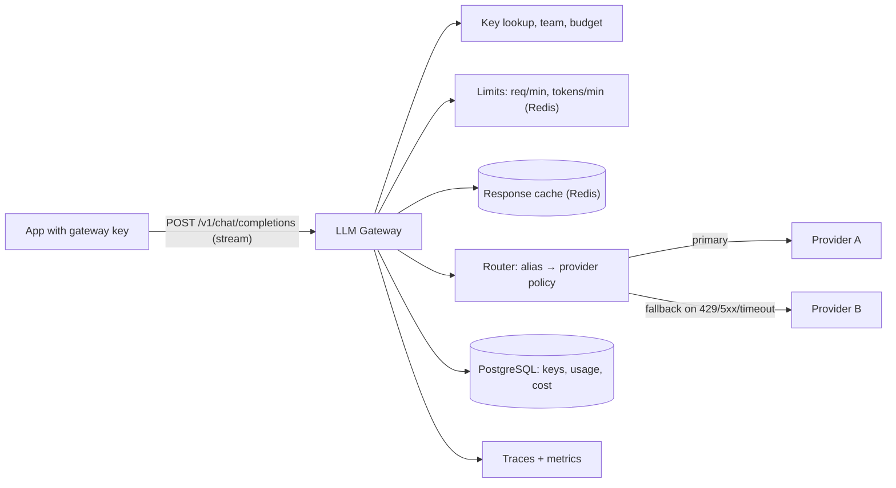

# LLM Gateway

> [!abstract] Why this project exists
> An API gateway is abstract until the upstream is slow, expensive and rate-limited — which describes every LLM provider. Putting one gateway in front of two providers forces every gateway concern at once: routing, per-tenant limits measured in tokens rather than requests, caching responses that cost real money, timeouts on calls that legitimately take 30 seconds, and failover when a provider returns 429s. It is [[Design an API Gateway]] with stakes you can see on an invoice.

**Map:** [[Projects MOC]] → [[Engineering Dashboard]]

## Problem being solved

Several internal applications call LLM APIs with their own keys, their own retry logic and no shared view of cost. The gateway gives them one endpoint and one key each, enforces budgets and rate limits per team, routes requests to the cheapest capable provider, falls back when a provider fails, caches identical requests, streams responses, and records cost per request so that "what did this feature cost last week?" is a query, not an investigation.

## Intended users

- Application teams (the [[Vault RAG Assistant]] is the first) that want a stable API and no provider-specific code.
- Whoever owns the LLM bill and needs limits per team and alerts before a budget is gone.
- Kunal, to answer "how would you design an API gateway?" with routing, limits, caching and failover that have been load-tested.

## Product requirements

- One OpenAI-compatible `POST /v1/chat/completions` (streaming and non-streaming) in front of at least two providers, chosen by model alias and policy.
- Per-key limits: requests per minute and tokens per minute, plus a monthly budget in currency; limit decisions under 2 ms.
- Exact cost accounting per request from provider usage fields, attributed to key, team and feature tag.
- Response cache for identical (model, messages, parameters) requests with a configurable TTL; cache hits cost nothing and return in under 20 ms.
- Timeouts per model (first-token and total), retries only for safe failures, and automatic fallback to the next provider on 429, 5xx or timeout.
- Provider API keys never leave the gateway; the gateway's own keys are hashed at rest and rotatable.
- Every request traced end to end with provider latency, tokens and cost on the span.

## Minimum viable version

A NestJS service with a config file of providers and model aliases. Requests are authenticated by a gateway API key (hashed lookup in PostgreSQL), checked against a per-key token bucket in Redis (requests and tokens, using the request's estimated tokens then reconciled with actuals), routed to the first provider in the alias list, and proxied with streaming passthrough. Usage from the provider's response is written to a `usage` table with computed cost. A cache keyed by a hash of the normalised request stores non-streaming responses in Redis.

- Key management (create, hash, revoke) and a CLI to mint keys.
- Routing by alias with a static provider list; streaming passthrough.
- Token-bucket limits in Redis via the [[Rate Limiter Library]]; budget check against the month-to-date sum.
- Usage and cost table; a `GET /usage` report per key and team.

## Architecture



> [!example]- Excalidraw version — the same diagram as an editable canvas
> ![[LLM Gateway.excalidraw]]
> [[LLM Gateway.excalidraw|Open in Excalidraw]] — needs the Excalidraw plugin (see [[Plugins to Install]]).


At the improved stage routing becomes policy-driven (cheapest provider meeting a latency SLO, measured live), the cache gains semantic matching for near-duplicate prompts as an experiment, budgets become enforced in near real time with an alert at 80%, and a circuit breaker per provider stops sending traffic to one that is failing.

## Tech stack

- **TypeScript + NestJS** — HTTP streaming proxying is natural in Node; the work stack for services.
- **Redis** — token buckets, the response cache and provider health counters.
- **PostgreSQL** — keys, teams, budgets and the usage ledger (append-only, like a tiny [[Double-Entry Ledger Service]]).
- **OpenTelemetry** — one span per request with provider, model, tokens and cost attributes.
- **k6** — mixed streaming and cached load against a mock provider that can be told to be slow or to 429.

## Data model

```sql
teams(id, name, monthly_budget_minor, alert_threshold_pct)
api_keys(id, team_id, key_hash, name, limits jsonb, feature_tag, created_at, revoked_at)
providers(id, name, base_url, secret_ref, models jsonb)         -- secret_ref points at the secret store
model_aliases(alias, candidates: [{provider, model, price_in, price_out, max_latency_ms}])
usage(id, key_id, team_id, alias, provider, model, tokens_in, tokens_out, cost_minor, latency_ms, cached bool, fallback bool, trace_id, created_at)
-- Redis
rl:req:{key}, rl:tok:{key}           token buckets
cache:{sha256(normalised request)}   → response JSON, EX ttl
health:{provider}                    → rolling error and latency counters
```

## APIs

```http
POST /v1/chat/completions   Authorization: Bearer gw_...   { model: "fast", messages, stream: true, metadata: { feature: "vault-rag" } }
→ text/event-stream (provider chunks passed through) or JSON; headers: X-Gateway-Provider, X-Gateway-Cached, X-Gateway-Cost
GET  /v1/usage?team=&from=&to=&groupBy=feature   → tokens, cost, cache hit rate, fallback rate
POST /admin/keys  /admin/keys/{id}/revoke  /admin/aliases
```

## Relevant HLD concepts

- [[API Gateways]] — the project is one; the discipline is keeping business logic out of it.
- [[Rate Limiting]] — limits in tokens, not requests, with estimate-then-reconcile; see [[Rate Limiter Library]].
- [[Cache-Aside]] and [[Multi-Level Caching]] — the response cache, its key normalisation and what a hit is worth in money.
- [[Circuit Breakers]] — per-provider breakers driven by error rate and latency; half-open probes on a schedule.
- [[Timeouts and Retries]] — first-token versus total timeouts; retries are safe only before any token has been streamed.
- [[Graceful Degradation]] — fallback to a cheaper model, a cached answer, or a clear error — decided per alias.
- [[API Keys]] and [[Secrets Management]] — gateway keys hashed; provider secrets from a secret store, never config files.
- [[Distributed Tracing]] — the span that carries tokens and cost is what makes the usage report trustworthy.
- [[Performance vs Cost Trade-offs]] — routing policy is literally a cost-versus-latency decision per request.
- [[Strangler Pattern]] — applications migrate to the gateway one at a time behind the compatible API.
- [[HTTP and HTTPS]] — chunked streaming, server-sent events and what proxies do to long responses.

## Milestones

> [!info] The loop
> 1. Build a working minimal version → 2. Measure its behaviour → 3. Identify bottlenecks and failure modes → 4. Improve the architecture based on evidence → 5. Document the trade-offs (an entry in `04 Projects/Decisions`).

- [ ] M1 — Minimal working version. Exit: two providers behind one API; streaming works; per-key limits enforced; usage and cost recorded for every request.
- [ ] M2 — Measured. Exit: gateway overhead p50/p99 (added latency over direct calls) at 50 and 500 concurrent streams; cache hit rate on a replayed real workload; cost saved by caching.
- [ ] M3 — Resilient. Exit: with provider A returning 429s for 30 s, fallback keeps success rate above 99% and the breaker opens and recovers; timeouts verified with a slow mock provider.
- [ ] M4 — Improved. Exit: one evidence-driven change (latency-aware routing, semantic cache, or budget enforcement in real time) with before/after data.
- [ ] M5 — Documented. Exit: ADRs for limit units, cache key normalisation, fallback policy and secret handling.

## Current tasks

- [ ] Key management and hashed lookup; team and budget tables.
- [ ] Streaming proxy to two providers with a config-driven alias router.
- [ ] Token-bucket limits (requests and estimated tokens) with reconciliation from provider usage.
- [ ] Usage table and cost computation; `GET /usage` report.
- [ ] Mock provider with controllable latency, 429s and 5xx for tests and k6.

## Technical challenges

- [ ] How do you rate-limit by tokens before you know the token count — estimate, reserve, reconcile — and how wrong is the estimate in practice?
- [ ] Which requests are safe to retry on another provider mid-stream, and how does the client know a fallback happened?
- [ ] What normalisation makes the cache useful without serving a wrong answer (whitespace, parameter defaults, system prompts)?
- [ ] At what concurrency does Node's event loop or the proxy buffering become the bottleneck for streaming, and what fixes it?

## Testing strategy

- **Unit** — routing policy, cache key normalisation, cost arithmetic, limit reconciliation with a fake clock.
- **Integration** — mock providers (success, slow, 429, 5xx, malformed stream); Testcontainers Redis and PostgreSQL.
- **Contract** — the gateway passes a published OpenAI-compatible request/response fixture suite.
- **Load** — k6 with mixed streaming and cached traffic; assert overhead budget and limit accuracy.

## Deployment plan

Docker Compose with the gateway, Redis, PostgreSQL, two mock providers and Grafana. Real providers configured via environment secrets only. Two gateway replicas prove limits and caches are shared.

## Monitoring and observability

- Overhead latency (gateway minus provider) p50/p99; first-token latency per provider and model.
- Limit decisions by outcome; budget consumption per team with an 80% alert.
- Cache hit rate and cost avoided; fallback rate and breaker state per provider.
- Cost per hour by team and feature — the chart that justifies the project.

## GitHub repository

*(not created yet — suggested name: kunal/llm-gateway)*

## Live demo

*(none yet)* — a dashboard of cost per team while k6 runs, then the primary provider is told to 429 and the fallback line rises without the error line moving.

## Performance considerations

Streaming passthrough must not buffer whole responses; back-pressure from a slow client should pause reads from the provider. Limit and cache checks run before the provider call and must stay within a couple of milliseconds, which is why they live in Redis and not PostgreSQL.

## Lessons learned

*(Fill as you go.)*

## Future enhancements

- Prompt and response logging with redaction for debugging — [[Audit Logs]].
- Per-team feature flags for models and routing — [[Feature Flag Service and SDK]].
- Semantic caching with the [[Vault RAG Assistant]]'s embedding sidecar — [[Multi-Level Caching]].
- Queueing and priority for batch workloads under provider limits — [[Backpressure]].

## Related

### Design problems
- [[Design an API Gateway]]
- [[Design a Rate Limiter]]
- [[Design a RAG Knowledge Assistant]]

### Also exercised
*Concept notes that point at this project but are not discussed above — the long tail of what building it will touch.*
- [[Authentication]] · [[Authorization]] · [[Build vs Buy Decisions]] · [[Cache Invalidation]] · [[Cache Stampedes]] · [[Designing APIs and Contracts]] · [[Designing Systems for Changing Requirements]] · [[Designing for Extensibility]] · [[Eviction Policies]] · [[Feature Flags]] · [[Input Validation]] · [[JWT]] · [[Metrics]] · [[OAuth]] · [[Prioritizing Reliability Performance Cost and Time to Market]] · [[REST]] · [[Reverse Proxies]] · [[Separation of Concerns]] · [[TLS]] · [[TTL]] · [[Threat Modeling]] · [[Tracing]] · [[WebSockets]] · [[Write-Through Caching]]

### Decisions
- *(record ADRs in 04 Projects/Decisions using the Architecture Decision Template)*
