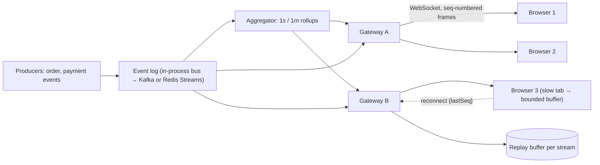

# Live Ops Dashboard

> [!abstract] Why this project exists
> Real-time features look easy in a demo and fail in production in the same five ways: events arrive out of order, a reconnecting client misses or duplicates events, a slow browser tab backs up the server, fan-out to thousands of viewers melts one process, and nobody can say what "live" means in milliseconds. This project builds a dashboard that streams operational events to many browsers and then injects each of those failures on purpose, so the Real-Time Systems chain in the [[Knowledge Graph]] is something you have debugged, not read.

**Map:** [[Projects MOC]] → [[Engineering Dashboard]]

## Problem being solved

Operators want a live view of what a system is doing — orders per second, payment outcomes, queue depth, error rate — updated within a second, across many open browser tabs, surviving laptop sleep and flaky Wi-Fi. The data originates in backend events; the dashboard must fan it out, keep each client's view consistent, and never fall over because one client is slow.

## Intended users

- An on-call engineer watching a release, who needs the view to be correct after their laptop wakes up.
- Product and operations staff with the page open all day on a wall screen.
- Kunal, as the engineer answering "how would you build live updates?" with reconnection, ordering and backpressure already handled.

## Product requirements

- Events appear on the dashboard within 1 s of being produced (p99), for 200 concurrent viewers on a laptop deployment.
- Every client sees events for a stream in order and exactly once in its view (duplicates suppressed, gaps detected).
- A client that disconnects for up to 10 minutes resumes from where it left off; longer gaps trigger a snapshot reload.
- A slow client never slows other clients or the producer: per-connection buffers are bounded and the policy on overflow is explicit (drop-oldest for metrics, disconnect-and-resync for state).
- Aggregated views (1-second and 1-minute rollups) are computed server-side once, not per client.
- The server scales horizontally: any gateway instance can serve any client.

## Minimum viable version

A NestJS gateway (`@WebSocketGateway`) that subscribes to an in-process event bus, assigns each stream a monotonically increasing sequence number, and pushes JSON frames to connected browsers. A React page keeps a small reducer per stream, renders a rolling chart and a table, and on reconnect sends `{ lastSeq }` so the server replays from an in-memory ring buffer. A synthetic producer emits order and payment events at a configurable rate with occasional bursts.

- Gateway with subscribe/unsubscribe per stream and sequence numbering.
- Ring buffer per stream (last 10,000 events) for replay on reconnect.
- React client with reconnect, replay request, gap detection and duplicate suppression.
- Synthetic producer with rate and burst controls; a 1-second server-side rollup.

## Architecture



> [!example]- Excalidraw version — the same diagram as an editable canvas
> ![[Live Ops Dashboard.excalidraw]]
> [[Live Ops Dashboard.excalidraw|Open in Excalidraw]] — needs the Excalidraw plugin (see [[Plugins to Install]]).


At the improved stage the in-process bus becomes Redis Streams or [[Kafka]] so two gateway instances see the same events, the replay buffer moves to Redis so a client can reconnect to any gateway, and the aggregator becomes a consumer group of its own.

## Tech stack

- **TypeScript + NestJS** (WebSocket gateway, `ws` adapter) — the work stack for frontends and a good fit for connection-heavy I/O.
- **React + a lightweight chart library** — the client reducer and gap detection are the interesting part, not the charts.
- **Redis Streams** (M3) for the shared log and replay buffer; Kafka as the comparison in M4 — see [[Redis Streams Docs]].
- **k6 with WebSocket support** to open hundreds of viewers and measure delivery latency.
- **Prometheus + Grafana** for server-side metrics about the dashboard itself.

## Data model

```text
Frame:        { stream, seq, ts, type, payload }           // seq strictly increasing per stream
Replay buf:   stream -> ring[10_000] of Frame              // M3: Redis Stream with MAXLEN
Client state: stream -> { lastSeq, pendingGapFrom?, view }
Rollup:       { stream, window: 1s|1m, start, count, sum, p50, p99 }
Subscription: connectionId -> Set<stream>, bufferedBytes, droppedFrames
```

## APIs

```text
WS  /live                       client → { op: "subscribe", stream, lastSeq? }
                                server → { op: "frame", ... } | { op: "gap", from, to } | { op: "snapshot", stream, state, seq }
HTTP GET /streams/{s}/snapshot  → full current state + seq (for gaps beyond the replay buffer)
HTTP GET /streams/{s}/rollups?window=1m&since=
```

## Relevant HLD concepts

- [[WebSockets]] — the transport, including heartbeats, close codes and what a proxy does to idle connections.
- [[Fan-Out]] — one event to N viewers; the cost is measured per gateway and is why rollups are computed once.
- [[Ordering Guarantees]] — per-stream sequence numbers are the ordering contract; cross-stream order is explicitly not promised.
- [[Client State and Reconnection]] — `lastSeq` replay, gap detection and the snapshot fallback.
- [[Backpressure]] — bounded per-connection buffers and the drop or disconnect policy for slow consumers.
- [[Pub-Sub]] — subscribe per stream; the gateway is a pub-sub broker with a memory of recent events.
- [[Kafka]] / [[Consumer Groups]] — the shared log in M3/M4 and how the aggregator scales.
- [[Real-Time Systems]] — the chain this project exists to make concrete.
- [[At-Most-Once Delivery]] — the metrics stream deliberately drops under overload; the state stream must not.
- [[Time-Series Databases]] and [[Metrics]] — rollups are a tiny TSDB; the retention and resolution choices are the same.

## Milestones

> [!info] The loop
> 1. Build a working minimal version → 2. Measure its behaviour → 3. Identify bottlenecks and failure modes → 4. Improve the architecture based on evidence → 5. Document the trade-offs (an entry in `04 Projects/Decisions`).

- [ ] M1 — Minimal working version. Exit: 20 browsers see the same ordered stream; a reconnect after 60 s replays with no gap and no duplicate.
- [ ] M2 — Measured. Exit: delivery latency p50/p99 at 50, 200 and 500 viewers and 100, 1,000 and 5,000 events/s; the viewer count at which one gateway saturates.
- [ ] M3 — Multi-gateway. Exit: two gateways behind a load balancer, Redis Streams as the log, reconnect to a different gateway resumes correctly.
- [ ] M4 — Improved. Exit: one evidence-driven change (binary frames, rollup-only streams for metrics, or Kafka) with before/after data.
- [ ] M5 — Documented. Exit: ADRs for delivery guarantees per stream type, the slow-client policy and the replay-buffer size.

## Current tasks

- [ ] NestJS gateway with subscribe/unsubscribe, per-stream sequence numbers and heartbeat.
- [ ] Ring-buffer replay and the `{ lastSeq }` reconnect protocol.
- [ ] React client: reducer per stream, gap detection, duplicate suppression, snapshot fallback.
- [ ] Synthetic producer with rate, burst and out-of-order injection flags.
- [ ] k6 WebSocket scenario measuring end-to-end delivery latency.

## Technical challenges

- [ ] What per-connection buffer size and overflow policy keeps p99 delivery under 1 s for healthy clients while one client reads at 1 KB/s?
- [ ] After a laptop sleep of 15 minutes, is replay or snapshot cheaper, and at what gap size does the answer flip?
- [ ] How should the client show a detected gap it cannot fill — stale banner, partial reload, or silent resync?
- [ ] Does `JSON.stringify` per frame per client dominate CPU at 500 viewers, and does one serialisation per frame fix it?

## Testing strategy

- **Unit** — sequence numbering, ring buffer, client reducer (order, gaps, duplicates) with scripted frame sequences.
- **Integration** — gateway with a real `ws` client: subscribe, disconnect, reconnect, replay.
- **Load** — k6 opens N viewers; assert delivery latency and zero gaps at the target viewer count.
- **Failure injection** — Toxiproxy throttles one client; kill a gateway mid-stream; pause the producer and burst it.

## Deployment plan

Docker Compose with two gateways behind nginx (sticky sessions off, to prove reconnect-anywhere), Redis, the producer and k6. Optional Kubernetes deployment to see what rolling restarts do to thousands of open sockets — the drain behaviour is a lesson in itself.

## Monitoring and observability

- Delivery latency (produced → rendered) p50/p99, measured with client-reported timestamps.
- Open connections, subscriptions per stream, frames sent and dropped per connection.
- Replay requests by gap size and how many fell back to snapshot.
- Gateway CPU per 1,000 frames fanned out — the number that decides when to add a gateway.

## GitHub repository

*(not created yet — suggested name: kunal/live-ops)*

## Live demo

*(none yet)* — the dashboard itself, with a "break things" panel: throttle me, disconnect me, burst the producer.

## Performance considerations

Fan-out cost is per client per frame; serialise once and write the same buffer to every socket. Rollups should be computed once in the aggregator, never per client. Consider binary frames (MessagePack) only after measuring JSON's share of CPU.

## Lessons learned

*(Fill as you go.)*

## Future enhancements

- Server-sent events as a comparison transport for the metrics stream — [[HTTP and HTTPS]].
- Kafka-backed log with consumer groups per gateway — [[Consumer Groups]].
- Presence (who is watching) reusing the [[Presence and Chat Service]] — [[Real-Time Systems]].
- Alert banners driven by the rollups — [[Alerting]].

## Related

### Design problems
- [[Design a Metrics and Monitoring System]]
- [[Design a Chat System]]
- [[Design a Ride-Sharing Service]]
- [[Design a Collaborative Document Editor]]

### Also exercised
*Concept notes that point at this project but are not discussed above — the long tail of what building it will touch.*
- [[CDNs]] · [[CQRS]] · [[Error Budgets]] · [[Event-Driven Architecture]] · [[Eventual Consistency]] · [[Inverted Indexes]] · [[Logging]] · [[Monitoring]] · [[Monitoring User-Facing Performance]] · [[Production Incident Analysis]] · [[SLI SLO and SLA]] · [[TCP and UDP]] · [[Topic Partitions]]

### Decisions
- *(record ADRs in 04 Projects/Decisions using the Architecture Decision Template)*
