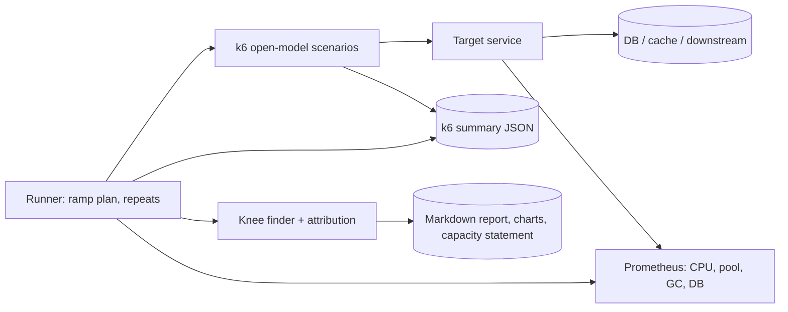

# Load Test and Latency Lab

> [!abstract] Why this project exists
> Interview estimates ("one server handles about 1,000 requests per second") are folklore until you have measured your own service, found the request rate where latency stops being flat, and traced that knee to a cause. This lab is the measuring instrument for every other project: one harness, one method, one report format — and the habit of asking "at what load does this break, and why?" before adding any architecture.

**Map:** [[Projects MOC]] → [[Engineering Dashboard]]

## Problem being solved

Services are usually sized by guesswork. The lab gives a repeatable way to find a service's capacity: drive it with an open-model load (arrival rate independent of response time, which is how real traffic behaves), record latency percentiles at each rate, identify the knee where p99 leaves the plateau, attribute it to a resource (CPU, pool, database, downstream, GC), and write the result up as a capacity statement with headroom. Then change one thing — an index, a pool size, a replica — and measure again.

## Intended users

- Every project in this vault at its M2 "measured" milestone.
- Kunal, writing capacity sections in problem notes with figures from this lab rather than from a book.
- Teammates who need a number for "how many pods do we need for the launch?"

## Product requirements

- Scenarios as code: closed-model (fixed VUs) and open-model (constant and ramping arrival rate) for HTTP, WebSocket and gRPC targets.
- Each run records p50/p90/p99 latency, error rate and throughput per stage, plus server-side resource metrics in the same time window.
- A `knee` finder: ramp the arrival rate until p99 exceeds the SLO or errors appear, report the last good rate and the first bad one.
- Reports are Markdown with charts and a capacity statement: "sustains X rps at p99 < Y ms with Z% CPU; knee at K rps caused by C".
- Runs are reproducible (warm-up, fixed duration, three repeats, median reported) and comparable (`compare a b`).
- Works against the [[Chaos Lab]] target first, then any project with a `/health/ready`.

## Minimum viable version

A k6 project with a scenario library (`constant-arrival-rate`, `ramping-arrival-rate`), a tiny Node script that runs a ramp, reads k6's JSON summary and Prometheus metrics for the window, finds the knee and renders a report. The first target is the Chaos Lab's orders API with no toxics; the first write-up is its capacity on your laptop and the attribution of the knee.

- k6 scenario library and thresholds encoding the SLO.
- Runner: warm-up, ramp, repeats, metrics capture, knee detection, Markdown report.
- Baseline report for the Chaos Lab target.
- `compare` for two reports.

## Architecture



Later: Gatling as a second generator to compare results and remove tool bias, a distributed k6 run (several generators) once one laptop cannot saturate a target, and a write-up series applying the method to each project.

## Tech stack

- **k6** (JavaScript scenarios) — open-model arrival rates are the key feature.
- **Node or TypeScript runner** — orchestration, JSON parsing, chart rendering (vega-lite to PNG).
- **Prometheus + Grafana** — server-side metrics; reports embed the window.
- **Gatling (M4)** — the comparison generator, and a chance to use the JVM stack.
- **Docker Compose** — generator and target on the same laptop at first, separate machines later.

## Data model

```text
Plan:    { target, scenario: open|closed, stages: [{ rate, duration }], slo: { p99Ms, errorRate }, repeats: 3, warmupSec: 60 }
Sample:  { stage, rate, p50, p90, p99, errorRate, throughput, cpu, poolActive, gcPauseMs, dbQps }
Report:  { plan, samples[], knee: { lastGoodRate, firstBadRate, suspectedCause }, capacityStatement, charts[] }
```

## APIs

```text
./bench run plans/orders-ramp.yaml [--repeats 3]
./bench knee plans/orders-ramp.yaml      # ramps until the SLO breaks
./bench compare reports/a.md reports/b.md
./bench write-up reports/a.md            # scaffolds the capacity-planning section for a note
```

## Relevant HLD concepts

- [[Latency]] and [[Throughput]] — the two axes of every chart; why they are not independent.
- [[Bottleneck Analysis]] — the attribution step: which resource saturated first, and how you know.
- [[Capacity Planning]] — the capacity statement with headroom is the deliverable.
- [[Back-of-the-Envelope Estimation]] — compare your estimate to the measurement; the gap is the lesson.
- [[Scalability]] and [[Horizontal vs Vertical Scaling]] — rerun with two replicas or a bigger container and see which helps.
- [[SLI SLO and SLA]] — the SLO is an input to the knee finder, not an afterthought.
- [[Performance vs Cost Trade-offs]] — cost per 1,000 requests at each configuration.
- [[Read Replicas]] and [[Database Scaling]] — the database experiments: replica for reads, pool size, index.
- [[Query Execution and Optimization]] — the most common knee cause is one query; EXPLAIN is part of attribution.
- [[Monitoring User-Facing Performance]] — percentiles, not averages; open-model load, not closed.

## Milestones

> [!info] The loop
> 1. Build a working minimal version → 2. Measure its behaviour → 3. Identify bottlenecks and failure modes → 4. Improve the architecture based on evidence → 5. Document the trade-offs (an entry in `04 Projects/Decisions`).

- [ ] M1 — Minimal working version. Exit: a ramp against the Chaos Lab target produces a report with a knee and a suspected cause; results repeat within 10% across three runs.
- [ ] M2 — Method. Exit: the knee's cause confirmed by changing one thing (pool size, index, CPU limit) and re-measuring; write-up template finalised.
- [ ] M3 — Applied. Exit: capacity reports for three projects ([[Rate Limiter Library]], [[Webhook Relay]], [[Double-Entry Ledger Service]]) and their problem notes' capacity sections updated with measured numbers.
- [ ] M4 — Improved. Exit: one evidence-driven change to the method (Gatling comparison, distributed generators, or coordinated-omission correction) with before/after data.
- [ ] M5 — Documented. Exit: a "numbers I measured" note (rps per core, DB qps per connection, cost per 1k requests) linked from [[Estimation Cheat Sheet]].

## Current tasks

- [ ] k6 scenario library with open-model stages and SLO thresholds.
- [ ] Runner with warm-up, repeats, Prometheus window capture and the knee finder.
- [ ] Report renderer with charts and the capacity statement.
- [ ] Baseline report for the Chaos Lab target.
- [ ] `compare` command.

## Technical challenges

- [ ] How much does a closed-model test (fixed VUs) understate latency compared to an open-model test at the same throughput — the coordinated-omission effect, measured?
- [ ] Can the knee be attributed automatically from metrics (first resource to pass 80%), or does it always need a human and EXPLAIN?
- [ ] What warm-up and duration make JVM results repeatable within 10%?
- [ ] When the generator and target share a laptop, how do you know the generator is not the bottleneck?

## Testing strategy

- **Unit** — knee detection and summary parsing with recorded fixtures.
- **Smoke** — a 30-second ramp against the target in CI-like fashion to keep the harness working.
- **Method** — the repeat-and-compare discipline is the test: a report that does not repeat is not a result.

## Deployment plan

Laptop first; then the generator on one machine and the target on another (or a small cloud instance) to remove shared-CPU bias. Reports live in the vault's `Attachments/` as images with the Markdown in the project folder.

## Monitoring and observability

- Generator-side: achieved versus requested arrival rate (dropped iterations mean the generator is saturated).
- Target-side: CPU, memory, pool usage, GC pauses, DB queries per second and slowest query.
- The combined timeline is the report.

## GitHub repository

*(not created yet — suggested name: kunal/latency-lab)*

## Live demo

*(none yet)* — a ramp chart with the knee marked and the one-line capacity statement.

## Performance considerations

The harness itself must not be the bottleneck: watch dropped iterations, run generators with enough CPU, and keep scenario scripts allocation-light.

## Lessons learned

*(Fill as you go.)*

## Future enhancements

- Continuous benchmark in CI with regression alerts — [[Deployment and Rollback Strategies]].
- Cost model per configuration from cloud prices — [[Performance vs Cost Trade-offs]].
- Replaying recorded production traffic shapes — [[Capacity Planning]].
- A shared results table across projects in a Base view — [[Metrics]].

## Related

### Design problems
- [[Design a URL Shortener]]
- [[Design a Ticket Booking System]]
- [[Design a Distributed Cache]]
- [[Design a Metrics and Monitoring System]]
- [[Design an Inventory Management System]]

### Also exercised
*Concept notes that point at this project but are not discussed above — the long tail of what building it will touch.*
- [[Backpressure]] · [[Block Storage]] · [[CDNs]] · [[Connection Pooling]] · [[Error Budgets]] · [[Functional vs Non-Functional Requirements]] · [[Graceful Degradation]] · [[Keep-Alive Connections]] · [[Load Balancers]] · [[Monitoring]] · [[Retry Storms]] · [[Time-Series Databases]] · [[Topic Partitions]] · [[Tracing]]

### Decisions
- *(record ADRs in 04 Projects/Decisions using the Architecture Decision Template)*
