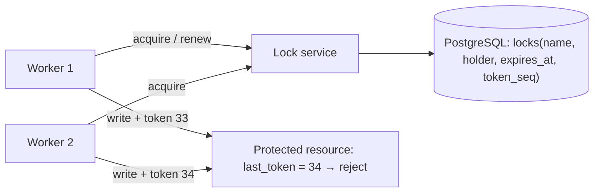

# Lock Service with Fencing Tokens

> [!abstract] Why this project exists
> "Use a distributed lock" is the most common wrong answer in design interviews, because a lease can expire while its holder is paused, and two holders then write at once. The fix — a monotonic fencing token checked by the resource — is simple, rarely implemented, and impossible to forget once you have watched the test fail without it. This project builds the smallest lock service that gets it right, and the test that shows what "right" means.

**Map:** [[Projects MOC]] → [[Engineering Dashboard]]

## Problem being solved

Many workers need to ensure that only one of them performs a job at a time (a scheduler tick, a partition rebalance, a migration), and the resource they protect — a database row, a file, a downstream API — must reject writes from a holder whose lease has silently expired. A lock service hands out leases with increasing tokens; the protected resource stores the highest token it has seen and refuses anything lower. The result is mutual exclusion that survives GC pauses, clock drift and network delays.

## Intended users

- The [[Durable Job Scheduler]] project, which needs exactly-one-leader ticks.
- Any service that currently relies on a Redis `SET NX PX` lock without a token (most of them).
- Kunal, to answer "what happens if the lock holder pauses for 30 seconds?" with a demonstrated mechanism rather than a hope.

## Product requirements

- `acquire(lockName, ttl)` returns a lease with a strictly increasing `fencingToken` per lock, or a wait/deny.
- `renew` extends a lease only if it is still held; `release` is idempotent.
- Leases expire server-side; a client that pauses past its TTL cannot renew and its token becomes stale.
- A protected resource adapter (PostgreSQL row, S3-style object, HTTP downstream) rejects writes carrying a token lower than the last accepted one.
- A client library (Java and TypeScript) that wraps the lease lifecycle, including a watchdog renewal thread and a callback when the lease is lost.
- The service survives a single server failure in M3 (replicated state) without issuing two overlapping leases.

## Minimum viable version

One Spring Boot server with a PostgreSQL table of locks. `acquire` is a single `UPDATE ... WHERE expires_at < now() OR holder IS NULL RETURNING token` that also increments a per-lock sequence, so the token is monotonic and the acquisition is atomic. Clients talk gRPC. A demo "protected counter" service stores `last_token` and rejects lower tokens. The headline test pauses a holder (simulated GC pause via a sleep inside a critical section), lets its lease expire, has a second client acquire, and asserts that the first client's late write is rejected.

- Lock table, atomic acquire/renew/release SQL.
- gRPC API and the Java client with watchdog renewal.
- Protected counter demo with token check.
- The "paused holder" test, run twice: once with token checking off (it fails), once on (it passes).

## Architecture



> [!example]- Excalidraw version — the same diagram as an editable canvas
> ![[Lock Service with Fencing Tokens.excalidraw]]
> [[Lock Service with Fencing Tokens.excalidraw|Open in Excalidraw]] — needs the Excalidraw plugin (see [[Plugins to Install]]).


At the improved stage the lock state moves to a replicated store (three-node etcd, or Raft via [[etcd Raft Library]]) so the service itself has no single point of failure, and the measurements compare lease latency and failover time against the PostgreSQL version.

## Tech stack

- **Java 21 + Spring Boot + gRPC** — the service and the primary client.
- **PostgreSQL** — the MVP's source of truth; one `UPDATE ... RETURNING` is the whole acquisition.
- **TypeScript client** — a second client to validate the protocol and the watchdog pattern in Node's event loop.
- **etcd (M3)** — replicated state with leases and compare-and-swap, to contrast with the single-database design.
- **Docker Compose + Toxiproxy** — to pause, delay and partition clients from the service.

## Data model

```sql
locks(name PRIMARY KEY, holder_id, expires_at, token_seq BIGINT NOT NULL DEFAULT 0)
-- acquire:
UPDATE locks SET holder_id = $1, expires_at = now() + $2, token_seq = token_seq + 1
WHERE name = $3 AND (holder_id IS NULL OR expires_at < now())
RETURNING token_seq;
protected_resource(id, last_token BIGINT, value)
```

## APIs

```protobuf
service LockService {
  rpc Acquire(AcquireRequest) returns (Lease);     // name, ttlMs, waitMs → leaseId, fencingToken, expiresAt
  rpc Renew(RenewRequest) returns (Lease);         // leaseId → extended lease or LEASE_LOST
  rpc Release(ReleaseRequest) returns (Ack);
}
```

```java
try (Lease lease = locks.acquire("rebalance", Duration.ofSeconds(10))) {
    resource.write(value, lease.fencingToken());   // resource rejects stale tokens
}
```

## Relevant HLD concepts

- [[Distributed Locks]] — leases, fencing tokens and why Redlock-style locks without tokens are unsafe.
- [[Leader Election]] — a lock with a long lease is a leader election; the scheduler uses it that way.
- [[Consensus]] — M3 replaces the single database with a consensus-backed store and measures what it costs.
- [[Split-Brain]] — two holders at once is split-brain in miniature; the token is the fence.
- [[Fault Tolerance]] — the service must fail safe (no lease) rather than fail open (two leases).
- [[Optimistic and Pessimistic Locking]] — the token check at the resource is optimistic concurrency control.
- [[Redis]] — the comparison implementation (`SET NX PX`) and its failure modes.
- [[CAP Theorem]] — during a partition the service chooses to deny rather than risk two holders.
- [[gRPC]] — deadlines on `acquire` are what make `waitMs` honest.

## Milestones

> [!info] The loop
> 1. Build a working minimal version → 2. Measure its behaviour → 3. Identify bottlenecks and failure modes → 4. Improve the architecture based on evidence → 5. Document the trade-offs (an entry in `04 Projects/Decisions`).

- [ ] M1 — Minimal working version. Exit: the paused-holder test fails without token checks and passes with them; 1,000 concurrent acquirers never overlap.
- [ ] M2 — Measured. Exit: acquire and renew latency p50/p99 at 100, 1k and 5k ops/s; lease-loss detection time versus TTL and renewal interval.
- [ ] M3 — Replicated. Exit: lock state on three-node etcd; service survives one node failure; failover time measured.
- [ ] M4 — Improved. Exit: one evidence-driven change (renewal interval policy, token persistence at the resource, or batching) with before/after data.
- [ ] M5 — Documented. Exit: ADRs for TTL defaults, what the client does on lease loss, and single-DB versus consensus.

## Current tasks

- [ ] Lock table and the atomic acquire/renew/release statements with tests.
- [ ] gRPC server and the Java client with a watchdog thread that renews at TTL/3.
- [ ] Protected counter service with `last_token` enforcement.
- [ ] The paused-holder test with a toggle for token checking.
- [ ] Compose stack with Toxiproxy to delay client-service traffic.

## Technical challenges

- [ ] What renewal interval keeps false lease loss under 0.1% with 200 ms of injected network jitter, and how does that bound the minimum safe TTL?
- [ ] If the resource is a downstream HTTP API you do not control, where can the token be enforced — and is the answer "nowhere" sometimes?
- [ ] How does `waitMs` queueing behave with 500 waiters: fair, starved, or thundering?
- [ ] Is the etcd version actually safer than PostgreSQL with synchronous replication, or just more complicated? Measure failover.

## Testing strategy

- **Unit** — token monotonicity, lease expiry arithmetic with a fake clock.
- **Integration** — Testcontainers PostgreSQL: concurrent acquirers, renew after expiry fails, release is idempotent.
- **Failure injection** — pause the holder (sleep), partition it (Toxiproxy), kill the service mid-acquire; assert no overlap and no lost tokens.
- **Contract** — the TypeScript client passes the same scenario suite as the Java client.

## Deployment plan

Docker Compose: lock service, PostgreSQL, two workers, the protected resource and Toxiproxy. M3 adds a three-node etcd. A single-pod Kubernetes deployment is enough to see what liveness probes do to a lock holder.

## Monitoring and observability

- Acquire latency and wait time; acquisitions by outcome (granted, timed out, denied).
- Active leases and leases lost (renew failed) — alert on any lease loss outside an experiment.
- Rejected writes at the protected resource by token gap (the signal that fencing did its job).
- Service failover time in M3.

## GitHub repository

*(not created yet — suggested name: kunal/fencelock)*

## Live demo

*(none yet)* — two terminals: worker 1 paused with `kill -STOP`, worker 2 acquires, worker 1 resumed and its write rejected with the token gap printed.

## Performance considerations

The database row per lock is a hot row under contention; measure before worrying. The usual levers are longer TTL with cheaper renewals, client-side backoff on `acquire`, and moving wait queues out of the database.

## Lessons learned

*(Fill as you go.)*

## Future enhancements

- Read/write locks and lock hierarchies — [[Distributed Locks]].
- Leader election API built on long leases, consumed by [[Durable Job Scheduler]] — [[Leader Election]].
- Token-aware adapters for S3-style conditional writes — [[Object Storage]].
- Redlock comparison write-up with the failure cases reproduced — [[Redis]].

## Related

### Design problems
- [[Design a Distributed Job Scheduler]]

### Decisions
- *(record ADRs in 04 Projects/Decisions using the Architecture Decision Template)*
